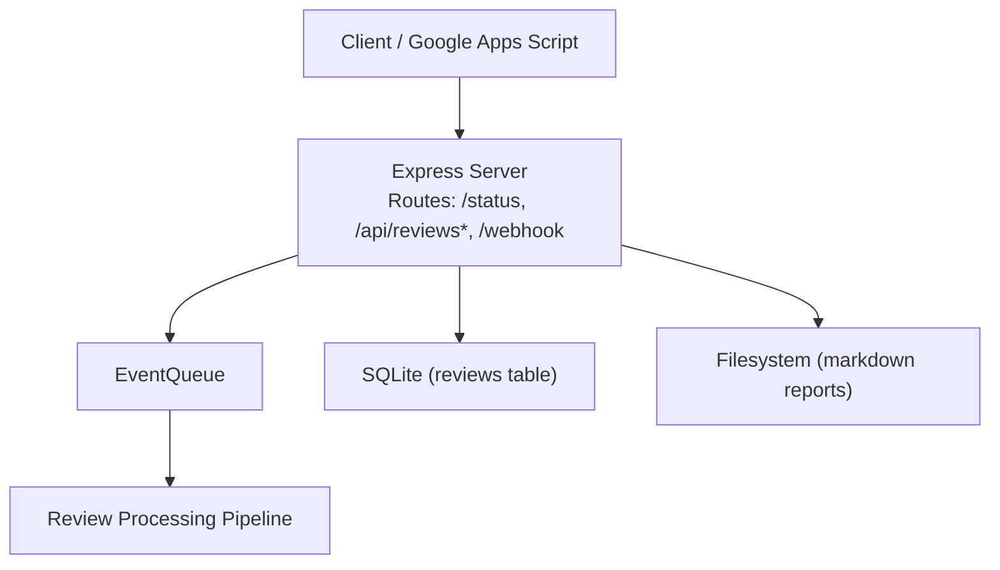
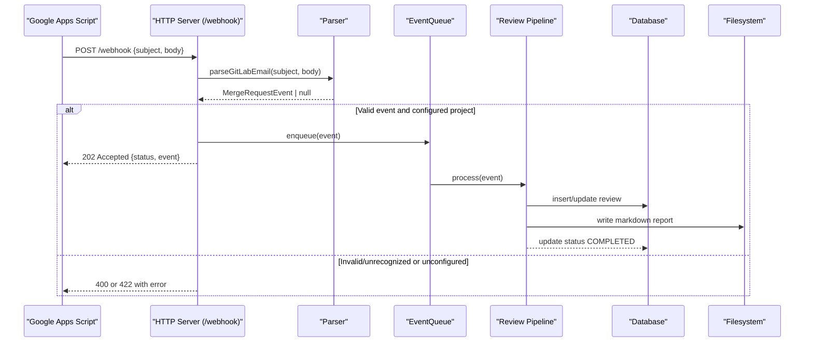
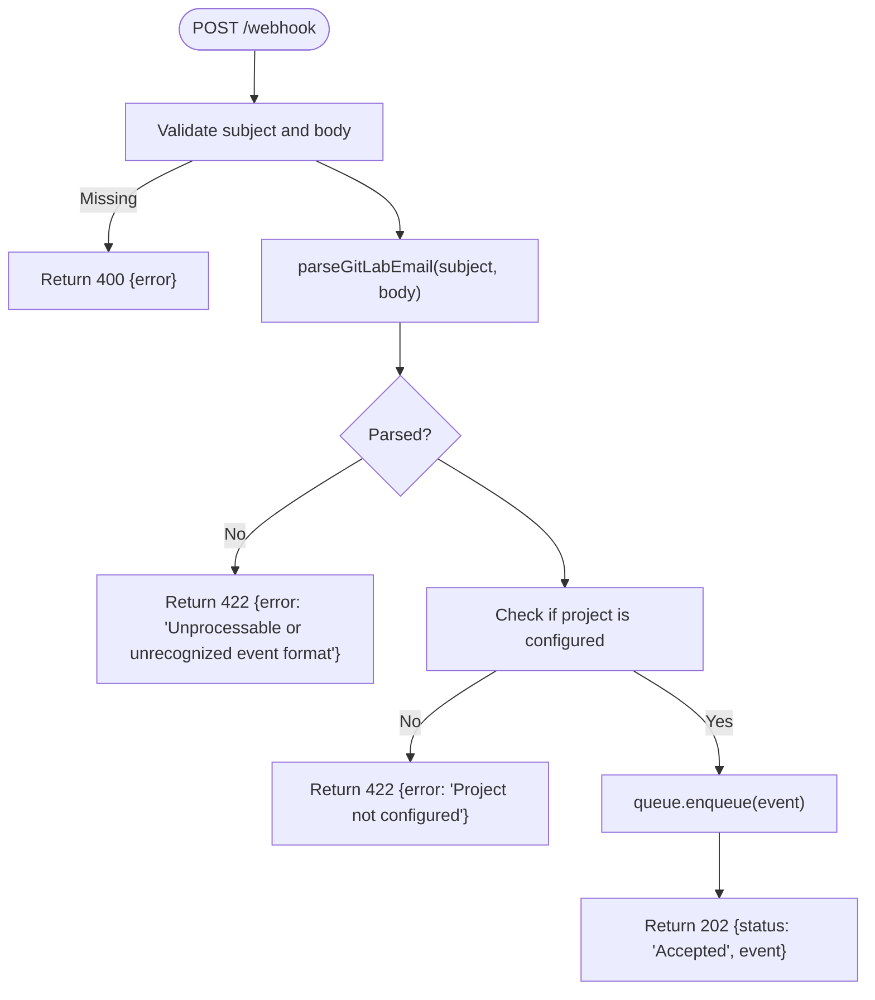
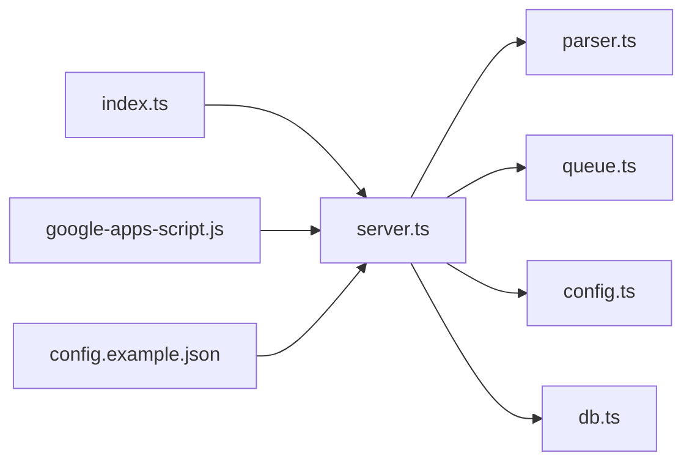

# API Reference

<cite>
**Referenced Files in This Document**   
- [server.ts](file://src/server.ts)
- [index.ts](file://src/index.ts)
- [parser.ts](file://src/parser.ts)
- [db.ts](file://src/db.ts)
- [google-apps-script.js](file://scripts/google-apps-script.js)
- [Google_Apps_Script_Setup.md](file://docs/Google_Apps_Script_Setup.md)
- [test-webhook.sh](file://scripts/test-webhook.sh)
- [config.example.json](file://config/config.example.json)
</cite>

## Table of Contents
1. [Introduction](#introduction)
2. [Project Structure](#project-structure)
3. [Core Components](#core-components)
4. [Architecture Overview](#architecture-overview)
5. [Detailed Component Analysis](#detailed-component-analysis)
6. [Dependency Analysis](#dependency-analysis)
7. [Performance Considerations](#performance-considerations)
8. [Troubleshooting Guide](#troubleshooting-guide)
9. [Conclusion](#conclusion)

## Introduction
This document provides comprehensive API documentation for the AI Reviewer Agent service, including:
- Webhook endpoint for processing GitLab merge request notifications forwarded from Google Apps Script
- REST endpoints for health checks and review retrieval
- Request/response schemas, error codes, and practical usage examples
- Notes on authentication and rate limiting

The service is built with Express and exposes a webhook to receive email-derived events and REST endpoints to query stored reviews.

## Project Structure
High-level components relevant to the API surface:
- HTTP server and route handlers
- Event queue for asynchronous processing
- Parser for GitLab email payloads
- Database layer for storing and retrieving reviews
- Configuration for repositories and integrations

**Diagram sources**
- [server.ts:10-114](file://src/server.ts#L10-L114)
- [index.ts:47-184](file://src/index.ts#L47-L184)
- [db.ts:23-40](file://src/db.ts#L23-L40)

**Section sources**
- [server.ts:10-114](file://src/server.ts#L10-L114)
- [index.ts:20-191](file://src/index.ts#L20-L191)

## Core Components
- HTTP Server: Express-based server exposing health, review listing, review detail, retry, and webhook routes.
- Event Queue: Asynchronous processor that consumes parsed merge request events and runs the review pipeline.
- Parser: Converts GitLab notification emails into structured MergeRequestEvent objects.
- Database: SQLite-backed storage for review records and report paths.
- Configuration: JSON configuration defining repositories and external integrations.

Key responsibilities:
- Validate incoming webhook payloads and parse them into internal events
- Enqueue events for background processing
- Provide read-only access to review metadata and markdown content
- Support retrying failed or pending reviews

**Section sources**
- [server.ts:10-114](file://src/server.ts#L10-L114)
- [parser.ts:1-92](file://src/parser.ts#L1-L92)
- [db.ts:1-96](file://src/db.ts#L1-L96)
- [index.ts:47-184](file://src/index.ts#L47-L184)

## Architecture Overview
End-to-end flow for a webhook-triggered review:

**Diagram sources**
- [server.ts:83-109](file://src/server.ts#L83-L109)
- [parser.ts:17-91](file://src/parser.ts#L17-L91)
- [index.ts:47-184](file://src/index.ts#L47-L184)
- [db.ts:68-82](file://src/db.ts#L68-L82)

## Detailed Component Analysis

### Webhook Endpoint: POST /webhook
Purpose:
- Accept GitLab merge request notifications forwarded by Google Apps Script
- Parse the payload into an internal event and enqueue it for processing

Authentication:
- No explicit authentication middleware is applied to this route. Ensure network-level protection (e.g., firewall, reverse proxy auth, IP allowlist).

Request:
- Method: POST
- Content-Type: application/json
- Body schema:
  - messageId: string (optional; used by sender)
  - subject: string (required)
  - body: string (required)

Response:
- 202 Accepted: Event accepted for processing
  - Body: { status: "Accepted", event: MergeRequestEvent }
- 400 Bad Request: Missing required fields
  - Body: { error: "Missing subject or body" }
- 422 Unprocessable Entity:
  - Unrecognized event format: { error: "Unprocessable or unrecognized event format" }
  - Project not configured: { error: "Project not configured" }

Notes:
- The server parses the email body to extract MR URL, project name, MR ID, title, and action type.
- Only projects present in the configuration are processed.

Usage example:
- See test script for a sample curl invocation.

**Section sources**
- [server.ts:83-109](file://src/server.ts#L83-L109)
- [parser.ts:17-91](file://src/parser.ts#L17-L91)
- [test-webhook.sh:1-33](file://scripts/test-webhook.sh#L1-L33)

#### Webhook Payload Format (from Google Apps Script)
Sender constructs:
- messageId: Gmail message id
- subject: Email subject line
- body: Plain text or HTML body

Forwarding behavior:
- On 202 Accepted: marks email as read
- On 400 or 422: marks email as read to avoid loops
- On other errors: retries later

Configuration:
- WEBHOOK_URL points to your server’s /webhook endpoint
- GMAIL_LABEL filters GitLab MR emails

Setup steps:
- Create Gmail filter to label GitLab MR emails
- Deploy Google Apps Script and set time-driven trigger to run every minute

**Section sources**
- [google-apps-script.js:1-78](file://scripts/google-apps-script.js#L1-L78)
- [Google_Apps_Script_Setup.md:1-39](file://docs/Google_Apps_Script_Setup.md#L1-L39)

### Health Check: GET /status
Purpose:
- Basic health check and uptime reporting

Authentication:
- None

Response:
- 200 OK
- Body: { status: "ok", uptime: number }

Example:
- curl http://localhost:8000/status

**Section sources**
- [server.ts:16-18](file://src/server.ts#L16-L18)

### List Reviews: GET /api/reviews
Purpose:
- Retrieve all stored reviews (metadata only)

Authentication:
- None

Response:
- 200 OK
- Body: Array of ReviewRecord entries

Error:
- 500 Internal Server Error
- Body: { error: "Internal server error" }

Notes:
- Each record includes id, project_name, mr_id, commit_sha, status, created_at, completed_at, and optional report_path.

**Section sources**
- [server.ts:24-33](file://src/server.ts#L24-L33)
- [db.ts:84-88](file://src/db.ts#L84-L88)
- [db.ts:50-59](file://src/db.ts#L50-L59)

### Get Review Details: GET /api/reviews/:id
Purpose:
- Retrieve a specific review’s metadata and its generated markdown report

Authentication:
- None

Path parameters:
- id: integer (review id)

Response:
- 200 OK
- Body: ReviewRecord extended with markdown field containing the full markdown report content

Errors:
- 400 Bad Request: Invalid ID
  - Body: { error: "Invalid ID" }
- 404 Not Found:
  - Review not found: { error: "Review not found" }
  - Markdown report not found on disk: { error: "Markdown report not found on disk" }
- 500 Internal Server Error
  - Body: { error: "Internal server error" }

Notes:
- The endpoint reads the markdown file from disk using the stored report_path.

**Section sources**
- [server.ts:36-54](file://src/server.ts#L36-L54)
- [db.ts:90-95](file://src/db.ts#L90-L95)

### Retry Review: POST /api/reviews/:id/retry
Purpose:
- Re-enqueue a specific review for processing (useful after failures)

Authentication:
- None

Path parameters:
- id: integer (review id)

Response:
- 200 OK
- Body: { status: "Retrying" }

Errors:
- 400 Bad Request: Invalid ID
  - Body: { error: "Invalid ID" }
- 404 Not Found: Review not found
  - Body: { error: "Review not found" }
- 500 Internal Server Error
  - Body: { error: "Internal server error" }

Notes:
- Internally constructs a MergeRequestEvent with forceRetry flag and enqueues it.

**Section sources**
- [server.ts:56-81](file://src/server.ts#L56-L81)

### Data Models

#### MergeRequestEvent
Fields:
- projectUrl: string
- projectName: string
- mrId: number
- mrTitle: string
- mrUrl: string
- action: enum ("opened" | "updated" | "commented" | "approved" | "merged" | "unknown")
- forceRetry?: boolean

Parsing rules:
- Extracts MR URL and project path from the email body
- Derives project name from the last segment of the project path
- Infers action based on keywords in the email body
- Falls back to "updated" when uncertain

**Section sources**
- [parser.ts:1-92](file://src/parser.ts#L1-L92)

#### ReviewRecord
Fields:
- id: number
- project_name: string
- mr_id: number
- commit_sha: string
- status: string ("PENDING" | "COMPLETED" | "FAILED")
- report_path?: string
- created_at: string
- completed_at?: string

Schema:
- Table reviews with unique index on (project_name, mr_id, commit_sha)

**Section sources**
- [db.ts:23-40](file://src/db.ts#L23-L40)
- [db.ts:50-59](file://src/db.ts#L50-L59)

### Webhook Processing Flow

**Diagram sources**
- [server.ts:83-109](file://src/server.ts#L83-L109)
- [parser.ts:17-91](file://src/parser.ts#L17-L91)

## Dependency Analysis
Component relationships:
- server.ts depends on parser.ts, queue.ts, config.ts, db.ts, and filesystem utilities
- index.ts orchestrates bootstrap, queue initialization, and review pipeline execution
- google-apps-script.js forwards emails to /webhook
- config.example.json defines repository mappings required by the webhook validation

**Diagram sources**
- [server.ts:1-9](file://src/server.ts#L1-L9)
- [index.ts:1-18](file://src/index.ts#L1-L18)
- [google-apps-script.js:1-13](file://scripts/google-apps-script.js#L1-L13)
- [config.example.json:1-28](file://config/config.example.json#L1-L28)

**Section sources**
- [server.ts:1-9](file://src/server.ts#L1-L9)
- [index.ts:1-18](file://src/index.ts#L1-L18)
- [google-apps-script.js:1-13](file://scripts/google-apps-script.js#L1-L13)
- [config.example.json:1-28](file://config/config.example.json#L1-L28)

## Performance Considerations
- Webhook responses are immediate (202 Accepted) while processing occurs asynchronously via the event queue.
- Avoid heavy synchronous operations in route handlers.
- Rate limiting:
  - No built-in rate limiting is implemented at the HTTP layer.
  - If exposed publicly, consider adding a reverse proxy rate limiter (e.g., Nginx, Cloudflare) or an Express rate-limiting middleware.
- Concurrency:
  - The event queue should be tuned according to system resources and downstream service limits (GitLab API, LLM providers).

[No sources needed since this section provides general guidance]

## Troubleshooting Guide
Common issues and resolutions:
- Webhook returns 400:
  - Cause: Missing subject or body in the request payload.
  - Resolution: Ensure the sender includes both fields.
- Webhook returns 422:
  - Cause: Unrecognized event format or project not configured.
  - Resolution: Verify email body contains a valid GitLab MR URL and that the project name exists in configuration.
- Review not found:
  - Cause: Invalid id or deleted record.
  - Resolution: Use GET /api/reviews to locate valid ids.
- Markdown report not found:
  - Cause: Report generation failed or file was removed.
  - Resolution: Retry the review via POST /api/reviews/:id/retry and check logs.

Operational tips:
- Monitor server logs for parsing and processing errors.
- Validate configuration of repositories before sending webhooks.
- For Google Apps Script integration, ensure the Gmail label matches and the time-driven trigger is active.

**Section sources**
- [server.ts:24-54](file://src/server.ts#L24-L54)
- [server.ts:83-109](file://src/server.ts#L83-L109)
- [google-apps-script.js:49-77](file://scripts/google-apps-script.js#L49-L77)

## Conclusion
The API exposes a simple webhook for ingesting GitLab MR notifications and REST endpoints for health checks and review retrieval. Authentication is not enforced at the API layer; secure deployment practices are recommended. Webhook processing is asynchronous, returning immediate acceptance and performing work in the background. Use the provided scripts and setup guides to integrate Google Apps Script forwarding and validate payloads.

[No sources needed since this section summarizes without analyzing specific files]