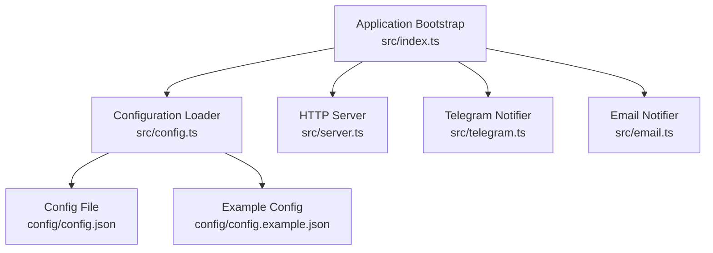
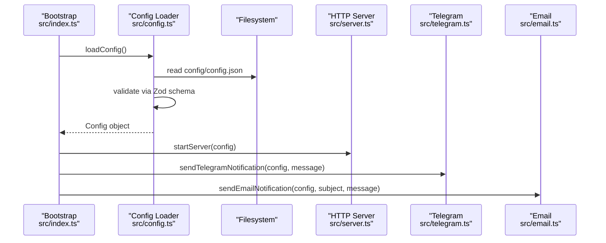
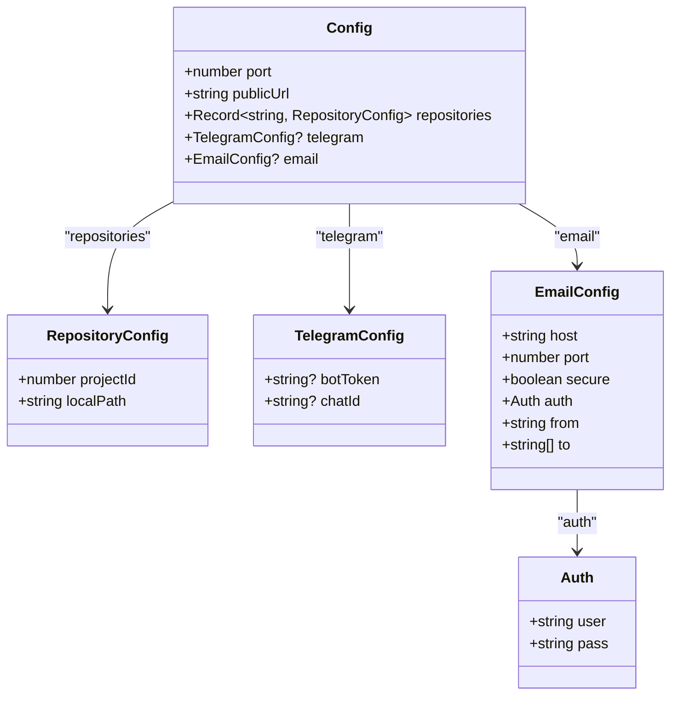
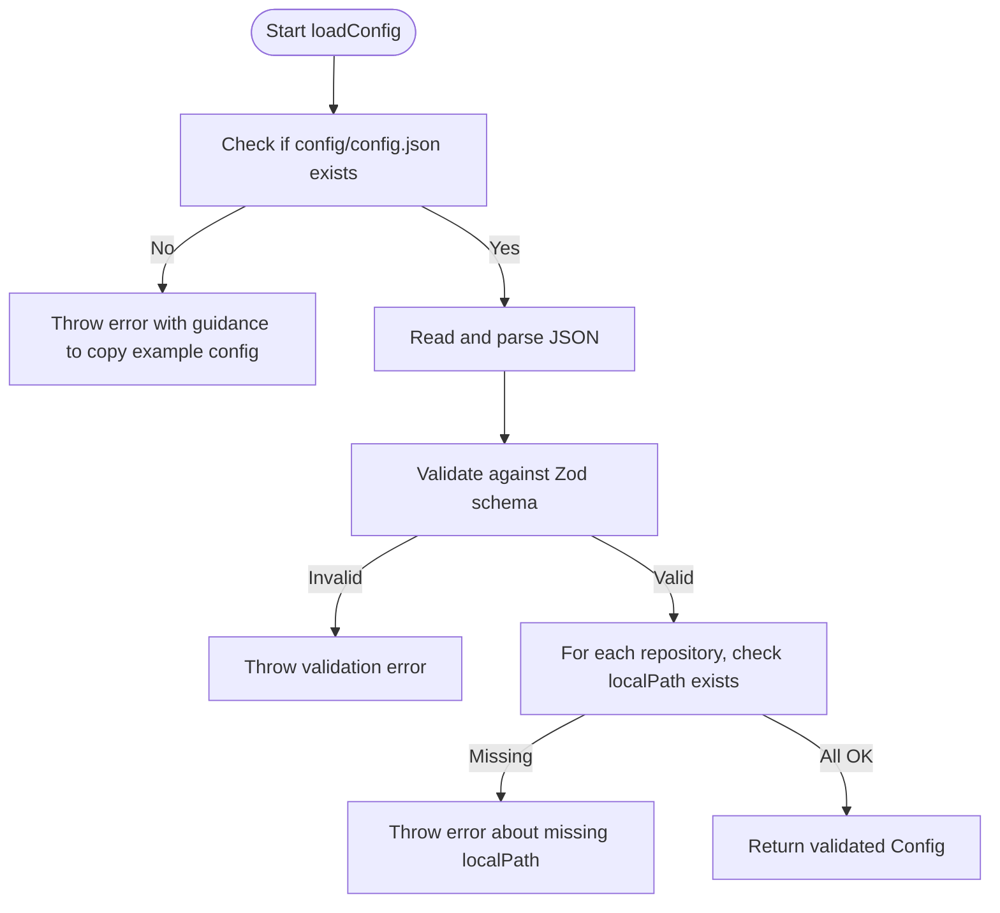
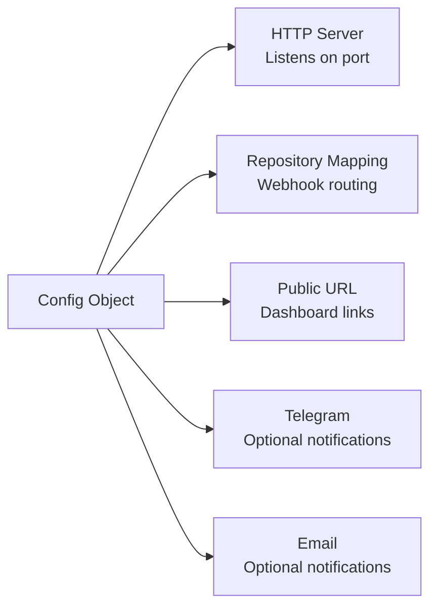
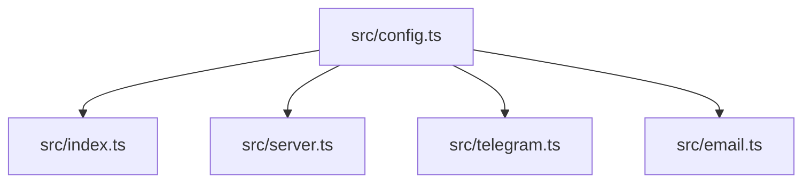

# Configuration Management

<cite>
**Referenced Files in This Document**
- [config.ts](file://src/config.ts)
- [config.example.json](file://config/config.example.json)
- [index.ts](file://src/index.ts)
- [server.ts](file://src/server.ts)
- [email.ts](file://src/email.ts)
- [telegram.ts](file://src/telegram.ts)
</cite>

## Table of Contents
1. [Introduction](#introduction)
2. [Project Structure](#project-structure)
3. [Core Components](#core-components)
4. [Architecture Overview](#architecture-overview)
5. [Detailed Component Analysis](#detailed-component-analysis)
6. [Dependency Analysis](#dependency-analysis)
7. [Performance Considerations](#performance-considerations)
8. [Troubleshooting Guide](#troubleshooting-guide)
9. [Conclusion](#conclusion)
10. [Appendices](#appendices)

## Introduction
This document explains the configuration management system used by the application. It covers the Zod-validated configuration schema, supported configuration options (port, public URL, repository mappings, Telegram bot settings, and email SMTP settings), environment variable support, configuration file structure, validation rules, default values, practical scenarios, best practices for sensitive information, and how configuration affects runtime behavior.

## Project Structure
The configuration system is centered around a single source of truth: a JSON configuration file loaded at startup and validated against a strict schema. The example configuration demonstrates the expected shape and optional sections.

**Diagram sources**
- [index.ts:20-31](file://src/index.ts#L20-L31)
- [config.ts:41-79](file://src/config.ts#L41-L79)
- [server.ts:10-114](file://src/server.ts#L10-L114)
- [email.ts:9-48](file://src/email.ts#L9-L48)
- [telegram.ts:8-43](file://src/telegram.ts#L8-L43)

**Section sources**
- [config.ts:1-80](file://src/config.ts#L1-L80)
- [config.example.json:1-28](file://config/config.example.json#L1-L28)
- [index.ts:20-31](file://src/index.ts#L20-L31)

## Core Components
- Configuration Schema: Defines required and optional fields with types and constraints using Zod.
- Configuration Loader: Reads the JSON file, validates it against the schema, and performs additional runtime checks (e.g., local paths existence).
- Runtime Consumers: HTTP server, Telegram notifier, and Email notifier consume the validated configuration to control behavior.

Key responsibilities:
- Enforce correct data types and presence of required fields.
- Provide sensible defaults where applicable.
- Fail fast on invalid or missing configuration.
- Validate external resources referenced by configuration (local repository paths).

**Section sources**
- [config.ts:6-38](file://src/config.ts#L6-L38)
- [config.ts:41-79](file://src/config.ts#L41-L79)

## Architecture Overview
At startup, the application loads and validates configuration before initializing other subsystems. The validated configuration controls:
- HTTP server port and public URL used for dashboard links.
- Repository mapping between GitLab project names and local filesystem paths.
- Optional integrations: Telegram notifications and Email notifications.

**Diagram sources**
- [index.ts:20-31](file://src/index.ts#L20-L31)
- [config.ts:41-79](file://src/config.ts#L41-L79)
- [server.ts:10-114](file://src/server.ts#L10-L114)
- [email.ts:9-48](file://src/email.ts#L9-L48)
- [telegram.ts:8-43](file://src/telegram.ts#L8-L43)

## Detailed Component Analysis

### Configuration Schema
The schema defines the following top-level configuration properties:
- port: Number, default 8000. Used by the HTTP server.
- publicUrl: String, default http://localhost:8000. Used to build dashboard URLs in desktop notifications.
- repositories: Record mapping project name strings to repository configurations. Each repository requires:
  - projectId: Number.
  - localPath: Non-empty string representing an existing directory on disk.
- telegram: Optional object with:
  - botToken: Optional string or empty string.
  - chatId: Optional string or empty string.
- email: Optional object with SMTP settings:
  - host: Non-empty string.
  - port: Positive integer.
  - secure: Boolean, default false.
  - auth.user: Non-empty string.
  - auth.pass: Non-empty string.
  - from: Valid email address.
  - to: Array of valid email addresses, minimum one.

Validation rules:
- All fields are strictly typed.
- Required fields enforce non-empty values.
- Email fields use email format validation.
- Port must be a positive integer.
- Local paths are checked at runtime to ensure they exist.

**Diagram sources**
- [config.ts:6-38](file://src/config.ts#L6-L38)

**Section sources**
- [config.ts:6-38](file://src/config.ts#L6-L38)

### Configuration Loader
Responsibilities:
- Locate the configuration file at a fixed path relative to the module.
- Read and parse JSON.
- Validate against the schema.
- Verify that all configured repository local paths exist on disk.
- Log errors and throw descriptive messages on failure.

Behavior highlights:
- If the configuration file is missing, a clear error instructs users to copy the example file and configure repositories.
- Invalid JSON results in a parsed error message.
- Schema validation failures produce detailed error logs and abort startup.
- Missing local repository directories cause startup failure with actionable diagnostics.

**Diagram sources**
- [config.ts:39-79](file://src/config.ts#L39-L79)

**Section sources**
- [config.ts:39-79](file://src/config.ts#L39-L79)

### Environment Variables
There is no explicit environment variable loading logic in the configuration loader. The application reads configuration exclusively from the JSON file. Therefore:
- Secrets should not be passed via environment variables into this loader.
- Use process.env only in modules that explicitly read them; the configuration layer itself does not reference environment variables.

Note: If you need environment-driven configuration in the future, extend the loader to merge environment variables after reading the JSON file and before schema validation.

**Section sources**
- [config.ts:39-79](file://src/config.ts#L39-L79)

### Configuration File Structure
Use the provided example as a template:
- repositories: Map project names to objects containing projectId and localPath.
- telegram: Optional section with botToken and chatId.
- email: Optional section with SMTP host, port, secure flag, authentication credentials, sender, and recipients.

Practical examples:
- Minimal configuration: Only define repositories and leave telegram and email omitted.
- Full configuration: Include telegram and email sections with real credentials and recipients.
- Multiple repositories: Add multiple entries under repositories, each with unique project names and local paths.

**Section sources**
- [config.example.json:1-28](file://config/config.example.json#L1-L28)

### Validation Rules and Defaults
- port: Defaults to 8000 if omitted.
- publicUrl: Defaults to http://localhost:8000 if omitted.
- repositories: Must be present and map to valid repository configs.
- telegram.botToken and telegram.chatId: Optional; both must be provided together to enable notifications.
- email.*: Optional; when present, all fields must satisfy their type and constraint rules.

Runtime checks:
- All repository localPath values must point to existing directories.

**Section sources**
- [config.ts:23-38](file://src/config.ts#L23-L38)
- [config.ts:68-75](file://src/config.ts#L68-L75)

### Relationship Between Configuration and Runtime Behavior
- HTTP Server:
  - Listens on config.port.
  - Serves static UI and API endpoints.
  - Uses config.repositories to accept webhooks only for configured projects.
- Desktop Notifications:
  - Builds dashboard URLs using config.publicUrl.
- Telegram Notifications:
  - Skipped if telegram is not configured or missing botToken/chatId.
  - Sends Markdown-formatted messages to Telegram’s API.
- Email Notifications:
  - Skipped if email is not configured or has no recipients.
  - Uses nodemailer with SMTP settings from config.email.

**Diagram sources**
- [server.ts:10-114](file://src/server.ts#L10-L114)
- [index.ts:125-159](file://src/index.ts#L125-L159)
- [email.ts:9-48](file://src/email.ts#L9-L48)
- [telegram.ts:8-43](file://src/telegram.ts#L8-L43)

**Section sources**
- [server.ts:10-114](file://src/server.ts#L10-L114)
- [index.ts:125-159](file://src/index.ts#L125-L159)
- [email.ts:9-48](file://src/email.ts#L9-L48)
- [telegram.ts:8-43](file://src/telegram.ts#L8-L43)

## Dependency Analysis
The configuration module is consumed by:
- Application bootstrap: Loads configuration and initializes services.
- HTTP server: Uses port and repository mapping.
- Notification modules: Use optional telegram and email sections.

**Diagram sources**
- [config.ts:1-80](file://src/config.ts#L1-L80)
- [index.ts:1-196](file://src/index.ts#L1-L196)
- [server.ts:1-115](file://src/server.ts#L1-L115)
- [email.ts:1-49](file://src/email.ts#L1-L49)
- [telegram.ts:1-44](file://src/telegram.ts#L1-L44)

**Section sources**
- [config.ts:1-80](file://src/config.ts#L1-L80)
- [index.ts:1-196](file://src/index.ts#L1-L196)
- [server.ts:1-115](file://src/server.ts#L1-L115)
- [email.ts:1-49](file://src/email.ts#L1-L49)
- [telegram.ts:1-44](file://src/telegram.ts#L1-L44)

## Performance Considerations
- Configuration loading occurs once at startup; performance impact is negligible.
- Avoid large configuration files; keep repository mappings concise.
- Ensure local repository paths are accessible to minimize I/O delays during validation.

[No sources needed since this section provides general guidance]

## Troubleshooting Guide
Common issues and resolutions:
- Missing configuration file:
  - Symptom: Startup fails with an error indicating the configuration file is missing.
  - Resolution: Copy config/config.example.json to config/config.json and fill in required fields.
- Invalid JSON:
  - Symptom: Startup fails due to JSON parsing errors.
  - Resolution: Validate JSON syntax and ensure proper formatting.
- Schema validation failure:
  - Symptom: Startup fails with validation errors describing invalid fields.
  - Resolution: Correct field types and ensure required fields are present.
- Missing local repository path:
  - Symptom: Startup fails because a configured localPath does not exist.
  - Resolution: Create the directory or update the configuration to point to an existing path.
- Telegram notifications not sent:
  - Symptom: No Telegram messages received.
  - Resolution: Ensure telegram.botToken and telegram.chatId are set correctly.
- Email notifications not sent:
  - Symptom: No emails received.
  - Resolution: Verify SMTP settings, credentials, and recipient list.

Operational notes:
- Notification failures do not mark reviews as failed; they are logged and ignored to avoid disrupting the pipeline.

**Section sources**
- [config.ts:41-79](file://src/config.ts#L41-L79)
- [email.ts:43-47](file://src/email.ts#L43-L47)
- [telegram.ts:31-42](file://src/telegram.ts#L31-L42)

## Conclusion
The configuration management system enforces a strict, validated configuration model that drives core runtime behaviors such as HTTP server binding, webhook routing, and optional notifications. By adhering to the schema and ensuring local repository paths exist, the application starts reliably and behaves predictably. For security, treat configuration files as sensitive artifacts and restrict access accordingly.

[No sources needed since this section summarizes without analyzing specific files]

## Appendices

### Practical Configuration Scenarios
- Minimal setup:
  - Define repositories with projectId and localPath.
  - Omit telegram and email to disable notifications.
- Enable Telegram notifications:
  - Add telegram with botToken and chatId.
- Enable Email notifications:
  - Add email with SMTP host, port, secure flag, auth credentials, from, and to recipients.
- Multi-repository setup:
  - Add multiple repository entries under repositories, each with unique project names and local paths.

**Section sources**
- [config.example.json:1-28](file://config/config.example.json#L1-L28)

### Best Practices for Managing Sensitive Information
- Store secrets (SMTP password, Telegram bot token) in a protected configuration file.
- Restrict file permissions to the application user only.
- Avoid committing secrets to version control; use .gitignore and CI secret managers.
- Rotate credentials regularly and audit access logs.

[No sources needed since this section provides general guidance]