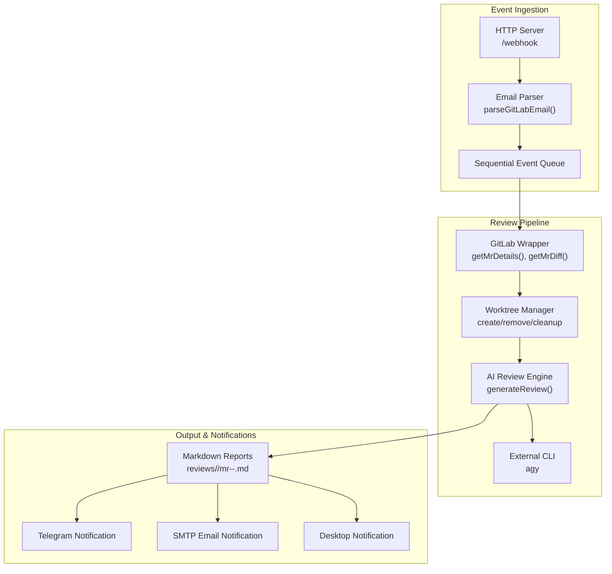
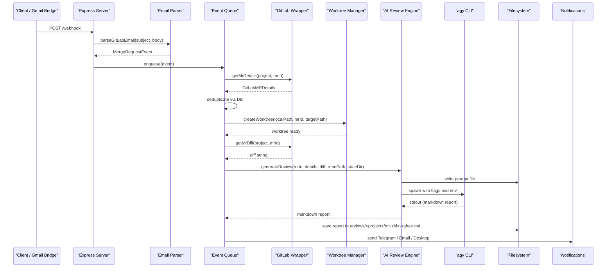
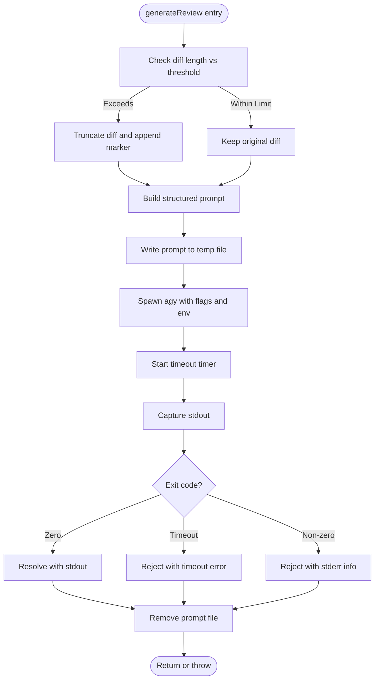
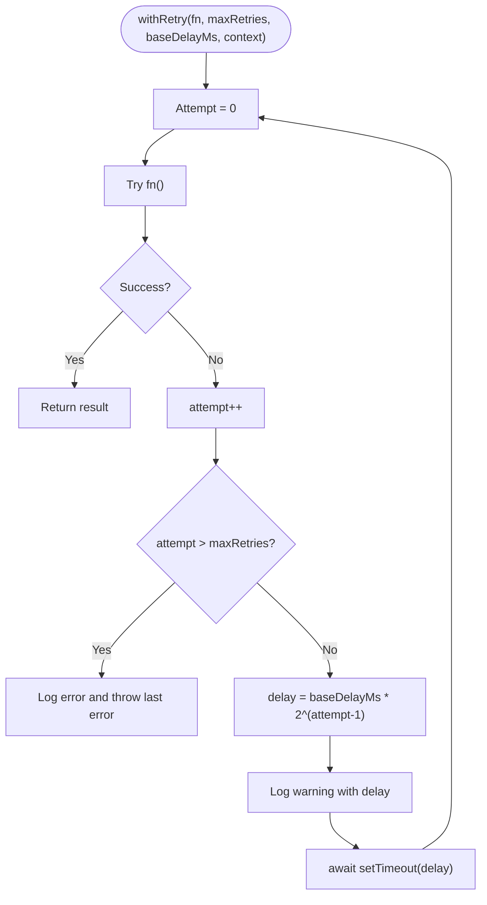
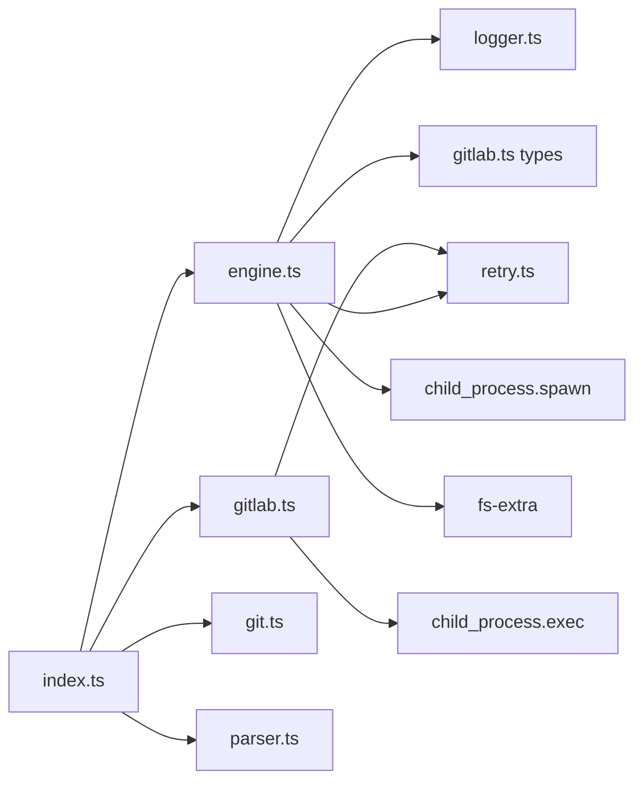

# AI Review Engine

<cite>
**Referenced Files in This Document**
- [README.md](file://README.md)
- [package.json](file://package.json)
- [config.example.json](file://config/config.example.json)
- [src/index.ts](file://src/index.ts)
- [src/engine.ts](file://src/engine.ts)
- [src/retry.ts](file://src/retry.ts)
- [src/parser.ts](file://src/parser.ts)
- [src/gitlab.ts](file://src/gitlab.ts)
- [src/git.ts](file://src/git.ts)
</cite>

## Table of Contents
1. [Introduction](#introduction)
2. [Project Structure](#project-structure)
3. [Core Components](#core-components)
4. [Architecture Overview](#architecture-overview)
5. [Detailed Component Analysis](#detailed-component-analysis)
6. [Dependency Analysis](#dependency-analysis)
7. [Performance Considerations](#performance-considerations)
8. [Troubleshooting Guide](#troubleshooting-guide)
9. [Conclusion](#conclusion)

## Introduction
This document explains the AI review engine that orchestrates the external agy CLI tool to perform automated code reviews for GitLab Merge Requests. It covers how the engine fits into the end-to-end workflow, from receiving an email-triggered event and fetching MR metadata and diffs, through prompt generation and invocation of agy, to saving reports and sending notifications. It also documents timeout handling, retry mechanisms, diff size limiting, output capture, configuration patterns, error handling, performance optimization techniques, resource management, and debugging approaches.

The system is designed to be read-only with respect to GitLab: it never posts comments or approvals back to GitLab. Instead, it produces private Markdown reports and exposes them via a web dashboard.

**Section sources**
- [README.md:1-45](file://README.md#L1-L45)

## Project Structure
At a high level, the application is an Express-based server that receives webhook payloads, parses GitLab notification emails, queues events sequentially, fetches GitLab data using glab, creates isolated Git worktrees, invokes the agy CLI for AI-powered reviews, persists reports, and sends notifications.

**Diagram sources**
- [src/index.ts:20-196](file://src/index.ts#L20-L196)
- [src/parser.ts:17-91](file://src/parser.ts#L17-L91)
- [src/gitlab.ts:51-95](file://src/gitlab.ts#L51-L95)
- [src/git.ts:9-49](file://src/git.ts#L9-L49)
- [src/engine.ts:8-212](file://src/engine.ts#L8-L212)

**Section sources**
- [README.md:160-201](file://README.md#L160-L201)
- [package.json:8-10](file://package.json#L8-L10)

## Core Components
- AI Review Engine: Builds a structured prompt with MR metadata and diff, truncates oversized diffs, spawns agy with appropriate flags and environment, enforces timeouts, captures stdout, and retries on failure.
- Retry Module: Provides exponential backoff retry logic used by both GitLab wrapper and AI engine calls.
- GitLab Wrapper: Uses glab to fetch MR details and diffs with retries and safe buffer sizing.
- Worktree Manager: Creates isolated Git worktrees per review and cleans them up reliably.
- Email Parser: Extracts MR metadata from GitLab notification emails.
- Orchestration (index): Bootstraps services, runs the pipeline, persists reports, and triggers notifications.

Key responsibilities and interactions are detailed below.

**Section sources**
- [src/engine.ts:8-212](file://src/engine.ts#L8-L212)
- [src/retry.ts:12-35](file://src/retry.ts#L12-L35)
- [src/gitlab.ts:51-95](file://src/gitlab.ts#L51-L95)
- [src/git.ts:9-49](file://src/git.ts#L9-L49)
- [src/parser.ts:17-91](file://src/parser.ts#L17-L91)
- [src/index.ts:47-184](file://src/index.ts#L47-L184)

## Architecture Overview
The AI review engine is the central component responsible for invoking agy and managing its lifecycle during a review. The orchestration layer coordinates all other modules around this core.

**Diagram sources**
- [src/index.ts:47-184](file://src/index.ts#L47-L184)
- [src/parser.ts:17-91](file://src/parser.ts#L17-L91)
- [src/gitlab.ts:51-95](file://src/gitlab.ts#L51-L95)
- [src/git.ts:9-49](file://src/git.ts#L9-L49)
- [src/engine.ts:8-212](file://src/engine.ts#L8-L212)

## Detailed Component Analysis

### AI Review Engine (engine.ts)
Responsibilities:
- Prompt construction: Combines repository path, MR metadata, and diff into a structured prompt instructing agy to classify the MR type and produce a standardized Markdown report.
- Diff size limiting: Truncates diffs exceeding a threshold to avoid overly large prompts.
- Process invocation: Spawns agy with model selection, permission bypass, directory access, extended internal timeout, and prompt content passed directly.
- Timeout enforcement: Kills the process if it exceeds a maximum runtime.
- Output capture: Collects stdout containing the generated Markdown report.
- Retry integration: Wraps the invocation with exponential backoff.
- Resource cleanup: Removes temporary prompt files after execution.

Key behaviors:
- Diff truncation strategy: If the diff exceeds the configured character limit, it is truncated and a marker is appended to indicate truncation.
- agy flags and environment:
  - Model selection flag set to a specific model variant.
  - Permission bypass flag to allow non-interactive tool use.
  - Directory access flag granting the agent read access to the repository.
  - Internal timeout flag increased to accommodate long-running agentic workflows.
  - TERM and IO_NONINTERACTIVE environment variables to ensure non-interactive behavior and proper TUI detection.
- Timeout handling: A timer kills the child process after a fixed duration; the promise rejects with a timeout error.
- Error handling: Non-zero exit codes and stderr are captured and logged; errors are wrapped and rethrown.
- Retry mechanism: The entire agy invocation is retried with exponential backoff using the shared retry utility.

**Diagram sources**
- [src/engine.ts:17-27](file://src/engine.ts#L17-L27)
- [src/engine.ts:29-78](file://src/engine.ts#L29-L78)
- [src/engine.ts:80-88](file://src/engine.ts#L80-L88)
- [src/engine.ts:91-193](file://src/engine.ts#L91-L193)
- [src/engine.ts:203-211](file://src/engine.ts#L203-L211)

Configuration examples and invocation patterns:
- Configuration fields relevant to the engine include repository mappings and optional notification settings. See example configuration for structure.
- Invocation pattern: The orchestration layer calls generateReview with MR ID, details, diff, repository path, and state directory.

Error handling examples:
- Timeout errors are explicitly rejected when the process exceeds the configured time.
- Non-zero exit codes result in rejection with stderr context.
- The outer try/catch wraps failures and logs additional debug information before throwing a user-facing error.

**Section sources**
- [src/engine.ts:8-212](file://src/engine.ts#L8-L212)
- [config.example.json:1-28](file://config/config.example.json#L1-L28)
- [src/index.ts:104-112](file://src/index.ts#L104-L112)

### Retry Module (retry.ts)
Purpose:
- Provides a generic exponential backoff retry function for asynchronous operations.
- Logs attempts and delays, and rethrows the last error after exhausting retries.

Behavior:
- Executes the provided function repeatedly until success or maxRetries exceeded.
- Calculates delay as baseDelayMs multiplied by 2^(attempt-1).
- Logs warnings for each failed attempt and final failure.

Usage across the system:
- GitLab wrapper uses it for glab commands (details and diff).
- AI engine uses it for agy invocation.

**Diagram sources**
- [src/retry.ts:12-35](file://src/retry.ts#L12-L35)

**Section sources**
- [src/retry.ts:1-36](file://src/retry.ts#L1-L36)

### GitLab Wrapper (gitlab.ts)
Responsibilities:
- Verifies glab authentication at startup.
- Fetches MR details and diffs using glab with retry logic.
- Parses JSON output for MR details.
- Configures a large buffer for diff retrieval to handle substantial changes.

Key points:
- Authentication check inspects glab status output and throws a clear error if no active token is found.
- getMrDetails returns a typed object with title, description, branches, author, state, and SHA.
- getMrDiff sets a 10MB buffer to prevent truncation of large diffs.

**Section sources**
- [src/gitlab.ts:21-49](file://src/gitlab.ts#L21-L49)
- [src/gitlab.ts:51-71](file://src/gitlab.ts#L51-L71)
- [src/gitlab.ts:73-95](file://src/gitlab.ts#L73-L95)

### Worktree Manager (git.ts)
Responsibilities:
- Create isolated Git worktrees for each review.
- Remove worktrees safely, with fallback deletion if git removal fails.
- Clean up orphaned worktrees on startup by pruning and removing stale directories.

Key points:
- Uses git fetch and worktree add --detach to isolate reviews without affecting the working branch.
- removeWorktree tries git worktree remove first, then falls back to filesystem deletion.
- cleanupOrphanedWorktrees prunes git’s internal state and removes leftover directories under the state/worktrees folder.

**Section sources**
- [src/git.ts:9-27](file://src/git.ts#L9-L27)
- [src/git.ts:29-49](file://src/git.ts#L29-L49)
- [src/git.ts:51-99](file://src/git.ts#L51-L99)

### Email Parser (parser.ts)
Responsibilities:
- Parse GitLab notification emails to extract MR metadata.
- Handle percent-encoded URLs commonly introduced by email security wrappers.
- Determine MR action based on email content keywords.

Key points:
- Returns null if the payload cannot be parsed as a relevant MR event.
- Extracts project URL, project name, MR ID, MR title, MR URL, and action.

**Section sources**
- [src/parser.ts:1-9](file://src/parser.ts#L1-L9)
- [src/parser.ts:17-91](file://src/parser.ts#L17-L91)

### Orchestration (index.ts)
Responsibilities:
- Bootstrap the application: load config, initialize database, verify glab auth, clean up orphaned worktrees.
- Initialize the sequential event queue with the review pipeline processor.
- For each event: fetch MR details, deduplicate, create worktree, fetch diff, invoke engine, save report, update DB, send notifications.
- Ensure worktree cleanup in finally block.

Key points:
- Deduplication prevents re-reviews for the same commit unless forced.
- Report persistence path follows a predictable naming convention.
- Notifications include Telegram, SMTP email, and desktop notifications.

**Section sources**
- [src/index.ts:20-45](file://src/index.ts#L20-L45)
- [src/index.ts:47-184](file://src/index.ts#L47-L184)

## Dependency Analysis
The AI review engine depends on several modules and external tools:

**Diagram sources**
- [src/engine.ts:1-6](file://src/engine.ts#L1-L6)
- [src/index.ts:1-18](file://src/index.ts#L1-L18)
- [src/gitlab.ts:1-4](file://src/gitlab.ts#L1-L4)
- [src/git.ts:1-5](file://src/git.ts#L1-L5)

Coupling and cohesion:
- engine.ts has focused responsibility for agy invocation and prompt management; it delegates retries to retry.ts and logging to logger.ts.
- gitlab.ts encapsulates glab interactions and uses retry.ts for resilience.
- index.ts orchestrates cross-cutting concerns and maintains low coupling between modules via well-defined interfaces.

Potential circular dependencies:
- None observed among the analyzed modules; dependencies flow from orchestration down to utilities.

External dependencies:
- agy CLI: invoked by engine.ts.
- glab CLI: invoked by gitlab.ts.
- Node.js built-ins: child_process, fs-extra.

**Section sources**
- [src/engine.ts:1-6](file://src/engine.ts#L1-L6)
- [src/gitlab.ts:1-4](file://src/gitlab.ts#L1-L4)
- [src/index.ts:1-18](file://src/index.ts#L1-L18)

## Performance Considerations
- Diff size limiting: Truncating large diffs reduces prompt size and processing time, preventing excessive memory usage and API costs.
- Process isolation: Using child_process.spawn avoids blocking the main thread and allows independent resource management for agy.
- Timeouts: Enforcing a hard timeout prevents runaway processes from consuming resources indefinitely.
- Sequential queue: Processing one event at a time avoids concurrent contention for disk I/O and external CLI calls.
- Buffer sizing: Increasing the buffer for glab diff retrieval prevents truncation of large diffs.
- Prompt file strategy: Writing prompts to files can help avoid command-line length limits and aids debugging.

Optimization recommendations:
- Tune diff truncation thresholds based on typical MR sizes and model input constraints.
- Adjust agy internal timeout and overall process timeout according to workload characteristics.
- Monitor memory usage and consider streaming stdout if outputs grow significantly.
- Cache frequently accessed repository metadata where appropriate to reduce repeated glab calls.

[No sources needed since this section provides general guidance]

## Troubleshooting Guide
Common issues and resolutions:
- agy CLI not installed or not in PATH:
  - Ensure agy is installed and accessible in the environment where the server runs.
  - Verify the model flag and permissions flags are correct for your installation.
- agy times out:
  - Increase the process timeout or internal agy timeout if reviews involve extensive tool-use steps.
  - Check network connectivity and model provider availability.
- glab authentication errors:
  - Run glab auth login and confirm at least one host is authenticated.
  - Inspect glab status output for missing tokens.
- Large diff truncation:
  - If important context is lost due to truncation, consider splitting reviews or adjusting truncation thresholds.
- Worktree cleanup failures:
  - Manually remove stale directories under state/worktrees and run git worktree prune in affected repositories.
- Notification delivery failures:
  - Validate Telegram bot token and chat ID, SMTP credentials, and desktop notification module availability.

Debugging tips:
- Enable verbose logging via LOG_LEVEL to capture detailed traces.
- Inspect temporary prompt files written under state/prompts for prompt composition issues.
- Review stderr captured by the engine when agy exits with non-zero codes.
- Use the test webhook script to simulate email payloads and validate parsing and pipeline behavior.

**Section sources**
- [src/engine.ts:139-187](file://src/engine.ts#L139-L187)
- [src/gitlab.ts:21-49](file://src/gitlab.ts#L21-L49)
- [src/git.ts:29-49](file://src/git.ts#L29-L49)
- [README.md:289-295](file://README.md#L289-L295)

## Conclusion
The AI review engine integrates tightly with the agy CLI to automate structured code reviews for GitLab Merge Requests. It manages the complete workflow from prompt generation and diff handling to process invocation, timeout enforcement, retry logic, and output capture. Combined with robust GitLab integration, isolated worktrees, and resilient retry mechanisms, the system delivers reliable, scalable, and observable AI-assisted reviews while maintaining a read-only posture toward GitLab. Proper configuration, monitoring, and troubleshooting practices ensure stable operation in diverse environments.

[No sources needed since this section summarizes without analyzing specific files]