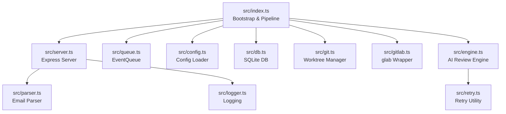
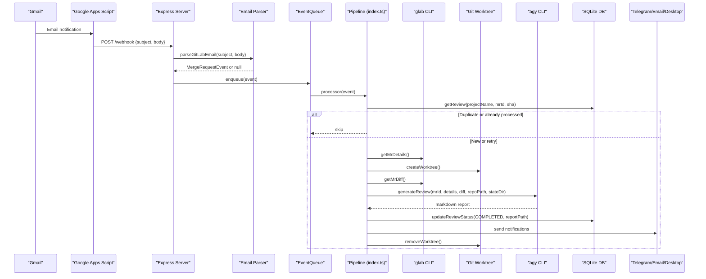
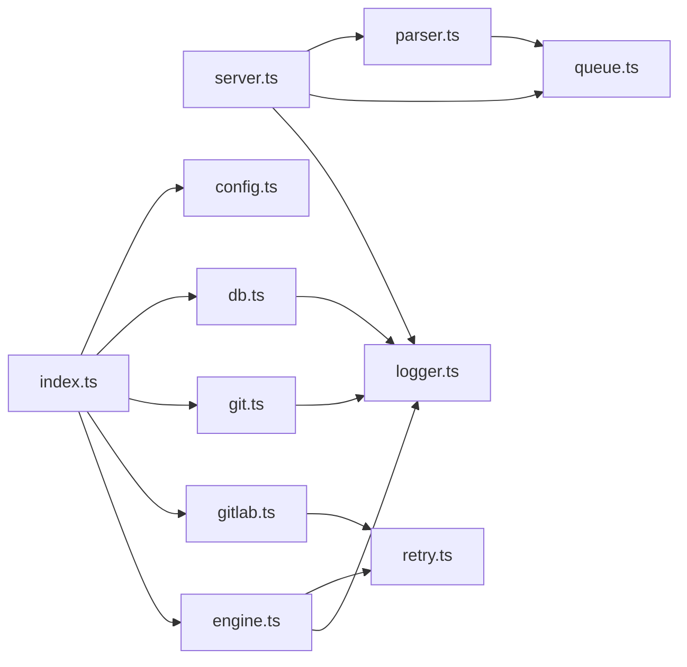

# Core Components

<cite>
**Referenced Files in This Document**
- [index.ts](file://src/index.ts)
- [server.ts](file://src/server.ts)
- [parser.ts](file://src/parser.ts)
- [queue.ts](file://src/queue.ts)
- [engine.ts](file://src/engine.ts)
- [git.ts](file://src/git.ts)
- [gitlab.ts](file://src/gitlab.ts)
- [db.ts](file://src/db.ts)
- [config.ts](file://src/config.ts)
- [retry.ts](file://src/retry.ts)
- [logger.ts](file://src/logger.ts)
- [config.example.json](file://config/config.example.json)
- [README.md](file://README.md)
</cite>

## Table of Contents
1. [Introduction](#introduction)
2. [Project Structure](#project-structure)
3. [Core Components](#core-components)
4. [Architecture Overview](#architecture-overview)
5. [Detailed Component Analysis](#detailed-component-analysis)
6. [Dependency Analysis](#dependency-analysis)
7. [Performance Considerations](#performance-considerations)
8. [Troubleshooting Guide](#troubleshooting-guide)
9. [Conclusion](#conclusion)

## Introduction
Argos is a self-hosted AI code review assistant that processes GitLab Merge Request notifications delivered via email, generates structured Markdown review reports using an agentic CLI, and exposes a web dashboard for browsing results. It avoids requiring GitLab webhook permissions by relying on email forwarding and uses the glab CLI to read MR metadata and diffs. Reviews run in isolated Git worktrees so your working tree is never modified.

This document focuses on the core components:
- Webhook parser for GitLab email notifications
- Sequential event queue for MR events
- AI review engine orchestrating the agy CLI
- Git worktree management for isolated environments
- GitLab API integration via glab CLI
- SQLite database operations for persistence and deduplication

## Project Structure
The application is organized into modular TypeScript files under src/, with configuration, static UI, scripts, and state directories. The bootstrap process initializes configuration, database, authentication, orphan cleanup, the event queue, and the HTTP server.

**Diagram sources**
- [index.ts:20-191](file://src/index.ts#L20-L191)
- [server.ts:10-114](file://src/server.ts#L10-L114)
- [queue.ts:6-46](file://src/queue.ts#L6-L46)
- [config.ts:41-79](file://src/config.ts#L41-L79)
- [db.ts:9-47](file://src/db.ts#L9-L47)
- [git.ts:9-49](file://src/git.ts#L9-L49)
- [gitlab.ts:21-95](file://src/gitlab.ts#L21-L95)
- [engine.ts:8-212](file://src/engine.ts#L8-L212)
- [retry.ts:12-35](file://src/retry.ts#L12-L35)
- [logger.ts:1-14](file://src/logger.ts#L1-L14)

**Section sources**
- [index.ts:20-191](file://src/index.ts#L20-L191)
- [README.md:160-201](file://README.md#L160-L201)

## Core Components
This section summarizes responsibilities and interactions among the core modules.

- Webhook parser (parser.ts): Parses GitLab notification emails into a MergeRequestEvent object, handling percent-encoded URLs and inferring action types.
- Event queue (queue.ts): In-memory FIFO queue ensuring sequential processing of MR events to avoid concurrency issues.
- AI review engine (engine.ts): Builds a prompt from MR details and diff, invokes the agy CLI with appropriate flags, handles timeouts and retries, and returns the generated Markdown report.
- Git worktree manager (git.ts): Creates isolated worktrees per MR, removes them after processing, and cleans up orphaned worktrees at startup.
- GitLab integration (gitlab.ts): Wraps glab CLI commands to fetch MR details and diffs with retry logic; verifies authentication at startup.
- Database (db.ts): Initializes SQLite schema, persists review records, and provides query/update functions used for deduplication and reporting.
- Configuration (config.ts): Loads and validates JSON configuration including repositories, Telegram, and email settings.
- Bootstrap (index.ts): Orchestrates initialization and the end-to-end pipeline for each MR event.
- HTTP server (server.ts): Serves the web dashboard, REST endpoints, and the webhook endpoint that enqueues parsed events.

**Section sources**
- [parser.ts:1-92](file://src/parser.ts#L1-L92)
- [queue.ts:1-47](file://src/queue.ts#L1-L47)
- [engine.ts:1-213](file://src/engine.ts#L1-L213)
- [git.ts:1-100](file://src/git.ts#L1-L100)
- [gitlab.ts:1-96](file://src/gitlab.ts#L1-L96)
- [db.ts:1-96](file://src/db.ts#L1-L96)
- [config.ts:1-80](file://src/config.ts#L1-L80)
- [index.ts:20-191](file://src/index.ts#L20-L191)
- [server.ts:10-114](file://src/server.ts#L10-L114)

## Architecture Overview
End-to-end flow from email to review report:

**Diagram sources**
- [server.ts:83-108](file://src/server.ts#L83-L108)
- [parser.ts:17-91](file://src/parser.ts#L17-L91)
- [queue.ts:15-45](file://src/queue.ts#L15-L45)
- [index.ts:47-183](file://src/index.ts#L47-L183)
- [gitlab.ts:51-95](file://src/gitlab.ts#L51-L95)
- [git.ts:9-49](file://src/git.ts#L9-L49)
- [engine.ts:8-212](file://src/engine.ts#L8-L212)
- [db.ts:61-82](file://src/db.ts#L61-L82)

## Detailed Component Analysis

### Webhook Parser (GitLab Email → MergeRequestEvent)
Responsibilities:
- Decode percent-encoded URL fragments (e.g., FireEye-wrapped links).
- Extract MR URL, project path, MR ID, project name, title, and action type.
- Return null if the payload cannot be recognized as a relevant MR event.

Key behaviors:
- URL extraction via regex matching merge request URLs.
- Title parsing with multiple fallbacks to handle common subject formats.
- Action inference based on keywords in the email body.

Return value:
- MergeRequestEvent object with fields: projectUrl, projectName, mrId, mrTitle, mrUrl, action, and optional forceRetry.

Error handling:
- Returns null when no MR URL is found or when parsing fails.

Common pitfalls:
- Percent-encoded URLs must be decoded before regex matching.
- Subject formats vary; robust fallbacks are required.

**Section sources**
- [parser.ts:17-91](file://src/parser.ts#L17-L91)

### Sequential Event Queue
Responsibilities:
- Maintain an in-memory FIFO queue of MergeRequestEvent items.
- Ensure single-threaded sequential processing to prevent concurrent reviews from interfering.

Key behaviors:
- enqueue pushes an event and schedules asynchronous processing.
- processNext checks processing flag and queue length, then delegates to the provided processor function.
- Uses setImmediate to avoid blocking the event loop.

Concurrency model:
- One event at a time; next item is scheduled after completion or error.

Error handling:
- Logs errors per event without crashing the queue.

**Section sources**
- [queue.ts:6-46](file://src/queue.ts#L6-L46)

### AI Review Engine (agy CLI Orchestration)
Responsibilities:
- Build a structured prompt containing repository context instructions, MR metadata, and the diff.
- Invoke the agy CLI with flags for non-interactive operation and extended timeout.
- Handle stdout capture, stderr inheritance, timeouts, and retries.
- Clean up temporary prompt files.

Key parameters:
- mrId: numeric identifier of the merge request.
- details: GitLabMRDetails object with title, description, branches, author, state, and SHA.
- diff: string containing the unified diff.
- repoPath: absolute path to the local Git repository.
- stateDir: directory for prompts and other transient artifacts.

Return value:
- Promise resolving to the generated Markdown report string.

Timeout and retry:
- Timeout of 20 minutes for agy execution; kills the child process on timeout.
- Retry wrapper around the CLI invocation with exponential backoff.

Diagnostics:
- Writes prompt to a file for debugging and logs stdout/stderr where applicable.

Edge cases:
- Truncates excessively large diffs (>100K characters) to reduce prompt size.
- Ensures non-interactive mode via environment variables and terminal detection.

**Section sources**
- [engine.ts:8-212](file://src/engine.ts#L8-L212)
- [retry.ts:12-35](file://src/retry.ts#L12-L35)

### Git Worktree Management
Responsibilities:
- Create isolated worktrees per MR using detached HEADs.
- Remove worktrees after processing.
- Clean up orphaned worktrees at startup.

Key behaviors:
- Fetches MR head via refs/merge-requests/<id>/head.
- Creates worktree with git worktree add --detach.
- Removes worktree with git worktree remove --force; falls back to filesystem deletion if needed.
- Prunes git internal state and deletes leftover directories during cleanup.

Error handling:
- Throws descriptive errors on failure to create/remove worktrees.
- Gracefully handles missing directories and prunes administrative pointers.

**Section sources**
- [git.ts:9-49](file://src/git.ts#L9-L49)
- [git.ts:51-99](file://src/git.ts#L51-L99)

### GitLab Integration via glab CLI
Responsibilities:
- Verify glab authentication at startup.
- Fetch MR details and diffs using glab commands.
- Wrap calls with retry logic for resilience.

Key functions:
- verifyGlabAuth: Runs glab auth status and ensures at least one host is authenticated.
- getMrDetails: Executes glab mr view -F json and parses JSON output.
- getMrDiff: Executes glab mr diff with a larger buffer for big diffs.

Return values:
- verifyGlabAuth: void (throws on failure).
- getMrDetails: GitLabMRDetails object.
- getMrDiff: string containing the diff.

Error handling:
- Throws descriptive errors when glab is not installed or not authenticated.
- Retries failed calls with exponential backoff.

**Section sources**
- [gitlab.ts:21-49](file://src/gitlab.ts#L21-L49)
- [gitlab.ts:51-95](file://src/gitlab.ts#L51-L95)
- [retry.ts:12-35](file://src/retry.ts#L12-L35)

### SQLite Database Operations
Responsibilities:
- Initialize the database and schema.
- Persist review records and track status transitions.
- Provide queries for the web dashboard and deduplication.

Schema:
- reviews table with columns: id, project_name, mr_id, commit_sha, status, report_path, created_at, completed_at.
- Unique index on (project_name, mr_id, commit_sha) to enforce deduplication.

Key functions:
- initDb: Opens database, creates schema, and returns the database instance.
- getReview: Retrieves a review by project, MR, and commit SHA.
- insertReview: Inserts a new review with PENDING status and returns the ID.
- updateReviewStatus: Updates status and optionally sets report_path and completed_at.
- getAllReviews: Lists all reviews ordered by newest first.
- getReviewById: Retrieves a specific review by ID.

Return values:
- initDb: Database instance.
- getReview: ReviewRecord or undefined.
- insertReview: number (last inserted ID).
- updateReviewStatus: void.
- getAllReviews: array of ReviewRecord.
- getReviewById: ReviewRecord or undefined.

Error handling:
- Throws on initialization failures.
- All queries use parameterized statements to prevent injection.

**Section sources**
- [db.ts:9-47](file://src/db.ts#L9-L47)
- [db.ts:61-95](file://src/db.ts#L61-L95)

### Configuration Loading and Validation
Responsibilities:
- Load config.json from the expected location.
- Validate structure using Zod schemas.
- Ensure configured repository paths exist on disk.

Configuration options:
- port: HTTP server port (default 8000).
- publicUrl: Public base URL for deep links (default http://localhost:8000).
- repositories: Map of repository names to objects with projectId and localPath.
- telegram: Optional botToken and chatId.
- email: SMTP settings including host, port, secure, auth.user, auth.pass, from, and to list.

Validation:
- Rejects invalid JSON and schema mismatches.
- Verifies existence of local repository paths.

Error handling:
- Throws descriptive errors for missing file, invalid JSON, validation failures, and missing local paths.

**Section sources**
- [config.ts:6-37](file://src/config.ts#L6-L37)
- [config.ts:41-79](file://src/config.ts#L41-L79)
- [config.example.json:1-28](file://config/config.example.json#L1-L28)

### Bootstrap and Pipeline Orchestration
Responsibilities:
- Load configuration and initialize the database.
- Verify glab authentication and clean up orphaned worktrees.
- Construct the EventQueue with the review pipeline processor.
- Start the Express server.

Pipeline steps per event:
- Resolve repository configuration.
- Fetch MR details and perform deduplication via SQLite.
- Create an isolated worktree.
- Fetch MR diff.
- Generate AI review via engine.
- Save Markdown report and update DB status.
- Send notifications (Telegram, Email, Desktop).
- Always remove the worktree in finally block.

Error handling:
- Logs and updates DB status to FAILED when mid-pipeline errors occur.
- Cleans up resources even on failure.

**Section sources**
- [index.ts:20-191](file://src/index.ts#L20-L191)

### HTTP Server and Web Dashboard
Responsibilities:
- Serve static UI from public/.
- Expose REST endpoints for listing and retrieving reviews.
- Provide a retry endpoint to re-enqueue a failed or pending review.
- Accept webhook payloads and enqueue parsed events.

Endpoints:
- GET /status: Health check returning status and uptime.
- GET /api/reviews: List all reviews.
- GET /api/reviews/:id: Get a specific review with its markdown content.
- POST /api/reviews/:id/retry: Re-enqueue a review with forceRetry=true.
- POST /webhook: Accept email payloads, parse, validate project configuration, and enqueue.

Return codes:
- 200 for successful health and data retrieval.
- 202 for accepted webhook payloads.
- 400/404 for invalid inputs or missing resources.
- 422 for unrecognized or unconfigured projects.
- 500 for internal server errors.

**Section sources**
- [server.ts:10-114](file://src/server.ts#L10-L114)

## Dependency Analysis
High-level dependencies between core modules:

**Diagram sources**
- [server.ts:1-114](file://src/server.ts#L1-L114)
- [parser.ts:1-92](file://src/parser.ts#L1-L92)
- [queue.ts:1-47](file://src/queue.ts#L1-L47)
- [index.ts:1-191](file://src/index.ts#L1-L191)
- [config.ts:1-80](file://src/config.ts#L1-L80)
- [db.ts:1-96](file://src/db.ts#L1-L96)
- [git.ts:1-100](file://src/git.ts#L1-L100)
- [gitlab.ts:1-96](file://src/gitlab.ts#L1-L96)
- [engine.ts:1-213](file://src/engine.ts#L1-L213)
- [retry.ts:1-36](file://src/retry.ts#L1-L36)
- [logger.ts:1-14](file://src/logger.ts#L1-L14)

**Section sources**
- [server.ts:1-114](file://src/server.ts#L1-L114)
- [index.ts:1-191](file://src/index.ts#L1-L191)

## Performance Considerations
- Sequential processing: The queue ensures only one MR is reviewed at a time, preventing resource contention but limiting throughput.
- Diff truncation: Large diffs are truncated to 100K characters to keep prompts manageable.
- CLI timeouts: agy has a 20-minute timeout to prevent long-running processes from hanging.
- Buffer sizing: glab diff uses a 10MB buffer to accommodate large diffs.
- Cleanup: Orphaned worktrees are pruned at startup and removed after each review to free disk space.
- Logging: Pino logger with pretty printing helps diagnose performance bottlenecks.

[No sources needed since this section provides general guidance]

## Troubleshooting Guide
Common issues and resolutions:

- glab CLI not authenticated:
  - Symptom: Startup fails with authentication error.
  - Resolution: Run glab auth login and ensure at least one host is authenticated.

- Missing configuration file:
  - Symptom: Application throws error about missing config.json.
  - Resolution: Copy config/config.example.json to config/config.json and fill in required fields.

- Repository localPath does not exist:
  - Symptom: Validation error during config loading.
  - Resolution: Ensure the configured localPath exists and is accessible.

- Unrecognized webhook payload:
  - Symptom: POST /webhook returns 422.
  - Resolution: Verify the payload includes subject and body with a valid GitLab MR URL.

- Orphaned worktrees remain:
  - Symptom: Disk usage grows over time.
  - Resolution: Restart the service to trigger cleanup; manually delete stale directories under state/worktrees if necessary.

- agy CLI hangs or times out:
  - Symptom: Review generation fails due to timeout.
  - Resolution: Check system resources and consider increasing timeout; ensure IO_NONINTERACTIVE and TERM are set correctly.

- Notifications not sent:
  - Symptom: No Telegram/email/desktop notifications.
  - Resolution: Verify Telegram bot token/chatId and SMTP settings in config; ensure BurntToast module is installed for Windows desktop notifications.

**Section sources**
- [gitlab.ts:21-49](file://src/gitlab.ts#L21-L49)
- [config.ts:41-79](file://src/config.ts#L41-L79)
- [server.ts:83-108](file://src/server.ts#L83-L108)
- [git.ts:51-99](file://src/git.ts#L51-L99)
- [engine.ts:139-187](file://src/engine.ts#L139-L187)

## Conclusion
Argos integrates several well-defined components to deliver automated AI-powered code reviews triggered by GitLab email notifications. The parser extracts MR metadata, the queue serializes processing, the engine orchestrates the agy CLI, the worktree manager isolates environments, the glab wrapper retrieves MR data, and SQLite persists state. Together, they provide a resilient, observable, and user-friendly review workflow with clear configuration, robust error handling, and practical troubleshooting guidance.

[No sources needed since this section summarizes without analyzing specific files]