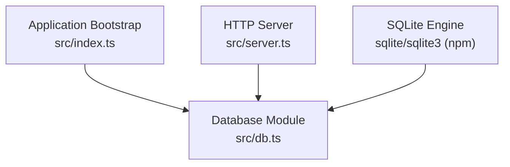
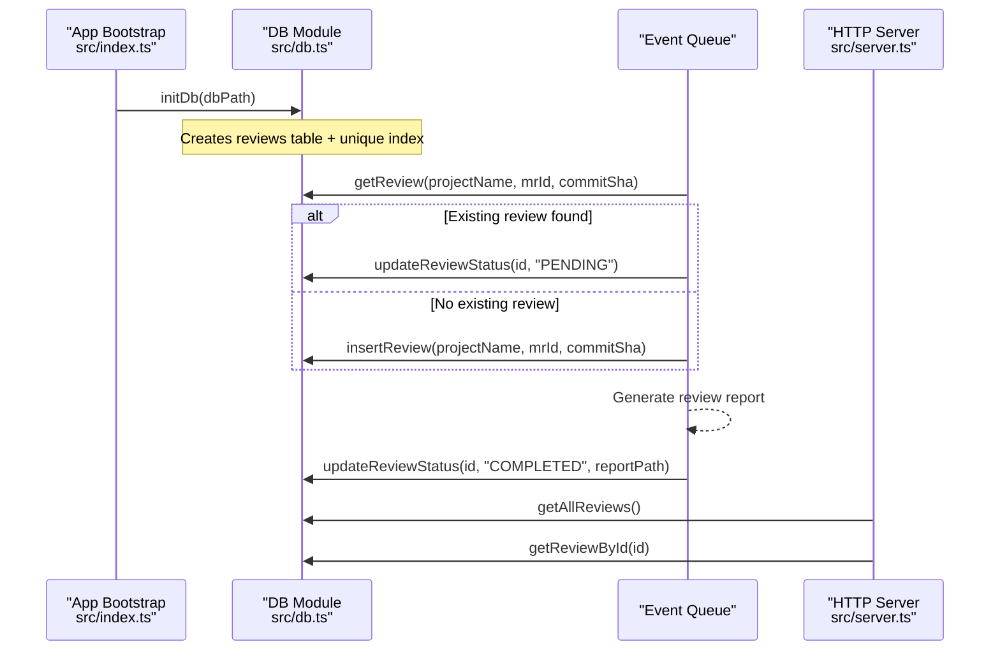
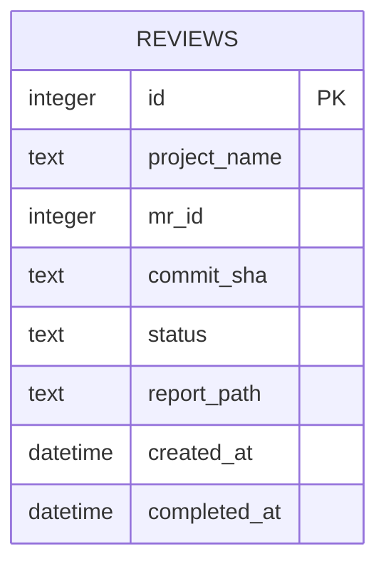
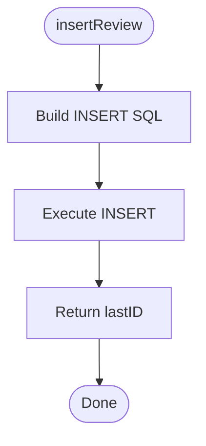
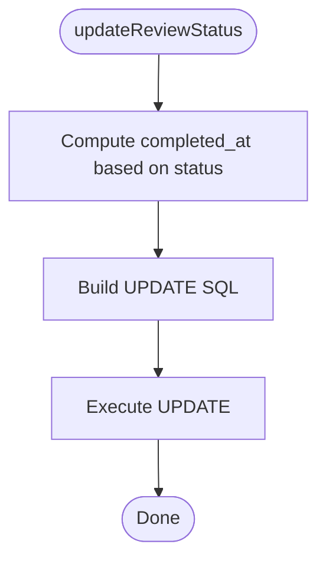
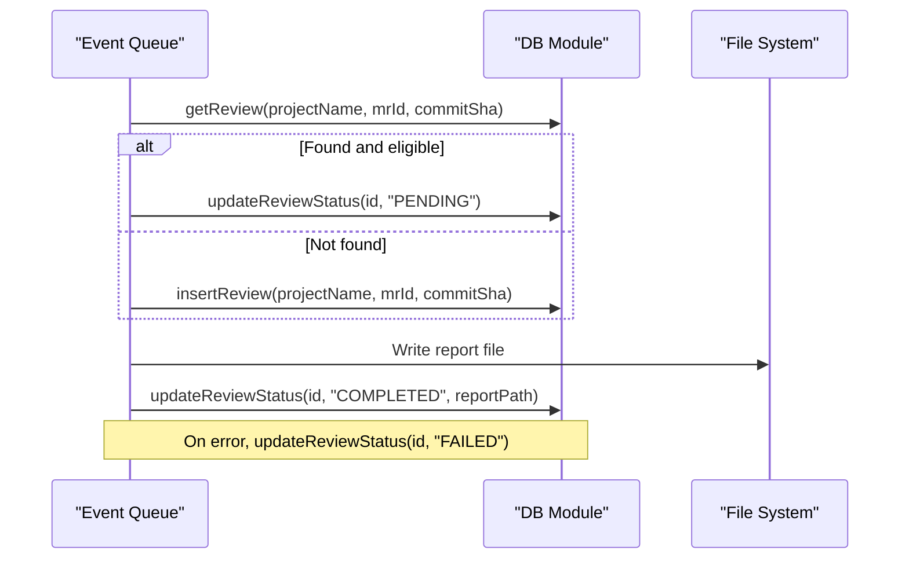
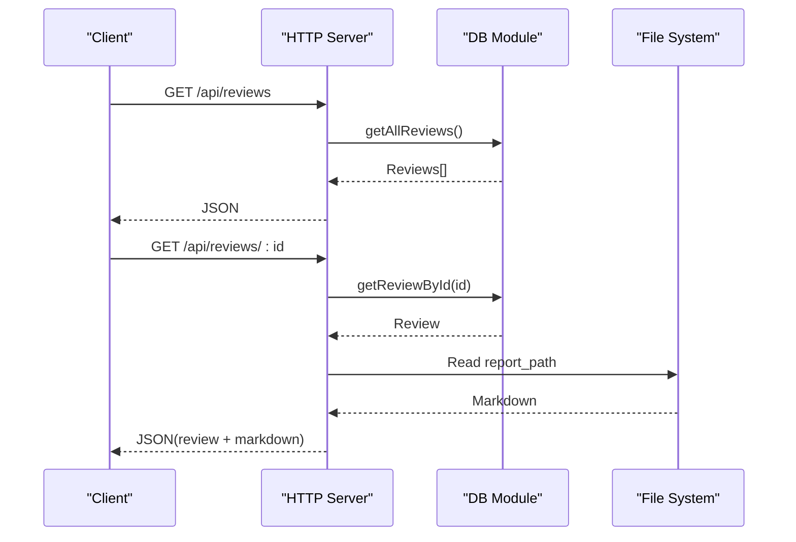
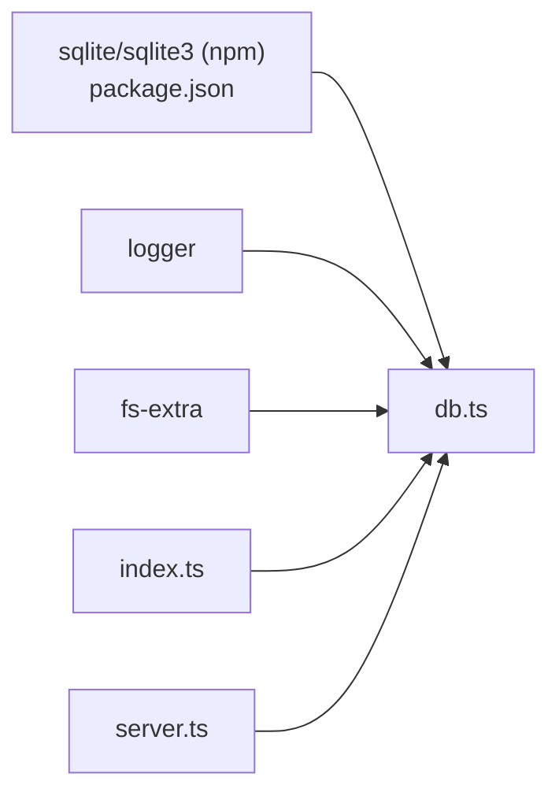

# Database Layer

<cite>
**Referenced Files in This Document**
- [db.ts](file://src/db.ts)
- [index.ts](file://src/index.ts)
- [server.ts](file://src/server.ts)
- [package.json](file://package.json)
</cite>

## Table of Contents
1. [Introduction](#introduction)
2. [Project Structure](#project-structure)
3. [Core Components](#core-components)
4. [Architecture Overview](#architecture-overview)
5. [Detailed Component Analysis](#detailed-component-analysis)
6. [Dependency Analysis](#dependency-analysis)
7. [Performance Considerations](#performance-considerations)
8. [Troubleshooting Guide](#troubleshooting-guide)
9. [Conclusion](#conclusion)

## Introduction
This document explains the SQLite database layer that persists review data for the AI reviewer agent. It covers schema design, table structure, relationships, CRUD operations, connection management, status tracking, and lifecycle management. It also includes guidance on queries, migration strategies, backup procedures, performance optimization, indexing, and troubleshooting common issues such as corruption or locking.

## Project Structure
The database layer is implemented in a single module that initializes the SQLite database, defines the schema, and exposes typed functions to create, read, update, and query review records. The application bootstrap initializes the database at startup, and the HTTP server reads from it to serve reviews via REST endpoints.

**Diagram sources**
- [index.ts:20-28](file://src/index.ts#L20-L28)
- [db.ts:9-48](file://src/db.ts#L9-L48)
- [server.ts:24-54](file://src/server.ts#L24-L54)
- [package.json:32-33](file://package.json#L32-L33)

**Section sources**
- [index.ts:20-28](file://src/index.ts#L20-L28)
- [db.ts:9-48](file://src/db.ts#L9-L48)
- [server.ts:24-54](file://src/server.ts#L24-L54)
- [package.json:32-33](file://package.json#L32-L33)

## Core Components
- Database initialization and schema creation
- Review record type definition
- CRUD operations for reviews
- Query helpers used by the event pipeline and API

Key responsibilities:
- Ensure the database file path exists and open a persistent connection
- Create the reviews table and an index if not present
- Provide strongly-typed functions for inserting, updating, and querying reviews
- Track review status and completion timestamps

**Section sources**
- [db.ts:9-48](file://src/db.ts#L9-L48)
- [db.ts:50-95](file://src/db.ts#L50-L95)

## Architecture Overview
The database layer integrates with two main consumers:
- Event processing pipeline: creates and updates review records during MR processing
- HTTP server: serves review listings and individual review content

**Diagram sources**
- [index.ts:73-96](file://src/index.ts#L73-L96)
- [index.ts:123-123](file://src/index.ts#L123-L123)
- [index.ts:169-175](file://src/index.ts#L169-L175)
- [server.ts:24-54](file://src/server.ts#L24-L54)
- [db.ts:61-95](file://src/db.ts#L61-L95)

## Detailed Component Analysis

### Schema Design and Data Model
- Table: reviews
  - id: INTEGER PRIMARY KEY AUTOINCREMENT
  - project_name: TEXT NOT NULL
  - mr_id: INTEGER NOT NULL
  - commit_sha: TEXT NOT NULL
  - status: TEXT NOT NULL
  - report_path: TEXT (nullable)
  - created_at: DATETIME DEFAULT CURRENT_TIMESTAMP
  - completed_at: DATETIME (nullable)
- Index: idx_reviews_mr_commit UNIQUE(project_name, mr_id, commit_sha)

Relationships:
- Each row represents one review attempt for a specific merge request at a specific commit.
- The unique index enforces deduplication per project, MR, and commit.

Data model diagram:

**Diagram sources**
- [db.ts:23-40](file://src/db.ts#L23-L40)

**Section sources**
- [db.ts:23-40](file://src/db.ts#L23-L40)

### Connection Management
- Uses sqlite/sqlite3 to open a persistent connection to a file-based SQLite database.
- Ensures the directory exists before opening the database.
- Logs initialization and errors.

Operational notes:
- The connection is held in module scope for reuse across requests and events.
- There is no explicit close/teardown logic in the current codebase; the process lifetime controls connection lifetime.

**Section sources**
- [db.ts:1-8](file://src/db.ts#L1-L8)
- [db.ts:9-18](file://src/db.ts#L9-L18)
- [db.ts:44-47](file://src/db.ts#L44-L47)

### CRUD Operations and Status Lifecycle

#### Insert
- Purpose: Create a new review record with initial status PENDING.
- Returns: Auto-incremented id.

Flow:

**Diagram sources**
- [db.ts:68-74](file://src/db.ts#L68-L74)

**Section sources**
- [db.ts:68-74](file://src/db.ts#L68-L74)

#### Read
- getReview(projectName, mrId, commitSha): Retrieves a review by composite key.
- getAllReviews(): Lists all reviews ordered by newest first.
- getReviewById(id): Retrieves a single review by primary key.

Queries:
- SELECT * FROM reviews WHERE project_name = ? AND mr_id = ? AND commit_sha = ?
- SELECT * FROM reviews ORDER BY id DESC
- SELECT * FROM reviews WHERE id = ?

**Section sources**
- [db.ts:61-66](file://src/db.ts#L61-L66)
- [db.ts:84-88](file://src/db.ts#L84-L88)
- [db.ts:90-95](file://src/db.ts#L90-L95)

#### Update
- updateReviewStatus(id, status, reportPath?): Updates status and optionally sets report_path and completed_at.
- Logic:
  - If status is COMPLETED or FAILED, set completed_at to current timestamp.
  - Use COALESCE to preserve existing completed_at when not explicitly setting it.

Flow:

**Diagram sources**
- [db.ts:76-82](file://src/db.ts#L76-L82)

**Section sources**
- [db.ts:76-82](file://src/db.ts#L76-L82)

### Usage in Application Flow

#### Event Processing Pipeline
- Deduplication check using getReview.
- If existing and already COMPLETED or PENDING, skip unless forced retry.
- Otherwise, update to PENDING or insert new.
- On success, update to COMPLETED with report_path.
- On failure, update to FAILED if still PENDING.

Sequence:

**Diagram sources**
- [index.ts:73-96](file://src/index.ts#L73-L96)
- [index.ts:123-123](file://src/index.ts#L123-L123)
- [index.ts:169-175](file://src/index.ts#L169-L175)

**Section sources**
- [index.ts:73-96](file://src/index.ts#L73-L96)
- [index.ts:123-123](file://src/index.ts#L123-L123)
- [index.ts:169-175](file://src/index.ts#L169-L175)

#### HTTP API Endpoints
- GET /api/reviews: Returns all reviews.
- GET /api/reviews/:id: Returns review metadata plus markdown content if available.
- POST /api/reviews/:id/retry: Re-enqueues a review for retry.

API flow:

**Diagram sources**
- [server.ts:24-54](file://src/server.ts#L24-L54)
- [db.ts:84-95](file://src/db.ts#L84-L95)

**Section sources**
- [server.ts:24-54](file://src/server.ts#L24-L54)

### Transaction Handling
- Current implementation executes each statement individually without explicit transactions.
- For higher write throughput and atomicity, consider wrapping related writes (e.g., status update + report path) in a transaction.

Recommendation:
- Use db.transaction or equivalent to group multiple statements into a single transaction where appropriate.

[No sources needed since this section provides general guidance]

### Migration Strategy
- Schema is created inline during initialization using CREATE TABLE IF NOT EXISTS and CREATE INDEX IF NOT EXISTS.
- This approach is simple but does not support versioning or rollback.

Recommended improvements:
- Introduce a migrations table to track applied versions.
- Apply incremental migrations on startup.
- Support rollback for development environments.

[No sources needed since this section provides general guidance]

### Backup Procedures
- Since SQLite stores data in a single file, back up the database file directly.
- Ensure consistent backups by stopping writes or using a snapshot mechanism.
- Automate periodic backups to a safe location.

Operational tips:
- Stop the service briefly or use WAL mode and consistent snapshots.
- Compress and rotate backups.

[No sources needed since this section provides general guidance]

## Dependency Analysis
The database module depends on:
- sqlite and sqlite3 npm packages
- fs-extra for directory creation
- logger for diagnostics

Consumers:
- Application bootstrap initializes the database.
- Event pipeline performs reads/writes during MR processing.
- HTTP server reads reviews for API responses.

**Diagram sources**
- [package.json:32-33](file://package.json#L32-L33)
- [db.ts:1-5](file://src/db.ts#L1-L5)
- [index.ts:3-3](file://src/index.ts#L3-L3)
- [server.ts:6-6](file://src/server.ts#L6-L6)

**Section sources**
- [package.json:32-33](file://package.json#L32-L33)
- [db.ts:1-5](file://src/db.ts#L1-L5)
- [index.ts:3-3](file://src/index.ts#L3-L3)
- [server.ts:6-6](file://src/server.ts#L6-L6)

## Performance Considerations
Indexing:
- Unique index on (project_name, mr_id, commit_sha) ensures fast deduplication lookups and prevents duplicates.

Query patterns:
- Reads are typically by composite key or by id; both are efficient with the existing schema.
- Listing all reviews uses ORDER BY id DESC; ensure id is indexed (primary key).

Optimization opportunities:
- Enable SQLite WAL mode for better concurrent read/write performance.
- Tune PRAGMAs like journal_mode, synchronous, cache_size, temp_store, and mmap_size according to workload.
- Batch writes where possible using transactions.
- Avoid full-table scans by adding targeted indexes for frequent filters (e.g., status).

[No sources needed since this section provides general guidance]

## Troubleshooting Guide
Common issues and mitigations:
- Database corruption:
  - Run integrity checks and repair using SQLite tools.
  - Restore from backup if necessary.
- Locking problems:
  - Ensure only one writer at a time; avoid long-running transactions.
  - Consider WAL mode to improve concurrency.
- Missing report files:
  - API returns 404 if report_path is missing or unreadable.
  - Verify filesystem permissions and paths.
- Duplicate reviews:
  - Rely on the unique index; handle constraint violations gracefully.

Operational checks:
- Validate database file existence and permissions.
- Monitor logs for initialization and query errors.
- Periodically run integrity checks and analyze slow queries.

**Section sources**
- [server.ts:44-49](file://src/server.ts#L44-L49)
- [db.ts:44-47](file://src/db.ts#L44-L47)

## Conclusion
The SQLite database layer provides a straightforward and effective persistence mechanism for review data. It defines a clear schema, supports essential CRUD operations, and integrates cleanly with both the event pipeline and HTTP API. To scale further, consider introducing migrations, transactions, WAL mode, and additional indexes tailored to query patterns. Robust backup and monitoring will help maintain reliability and performance.