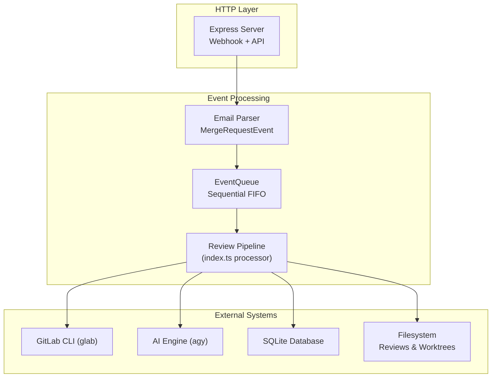
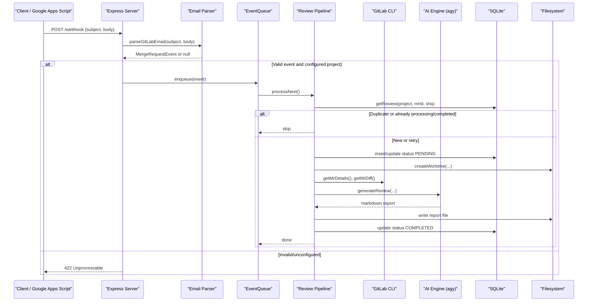
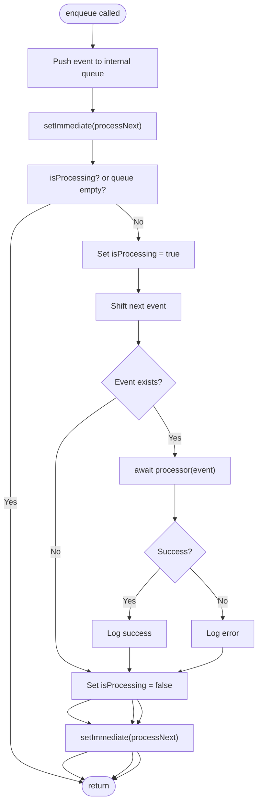
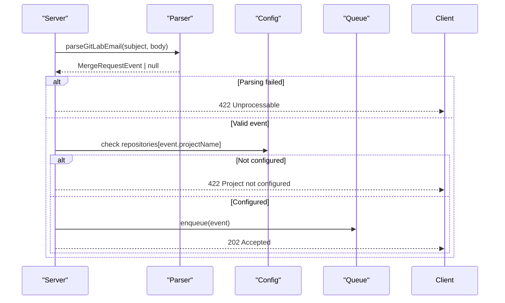
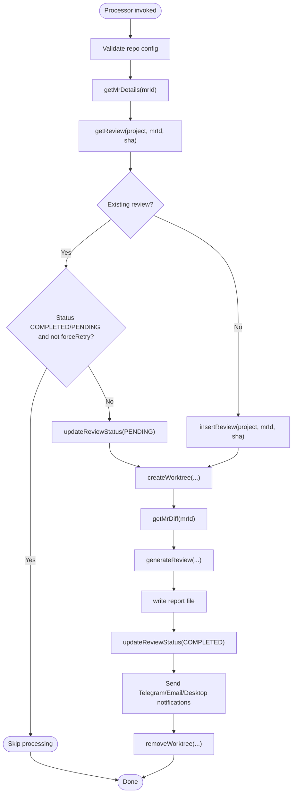
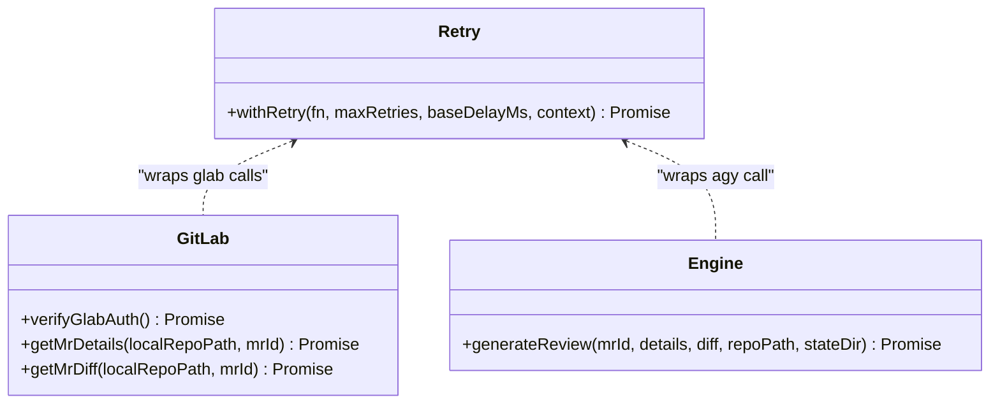
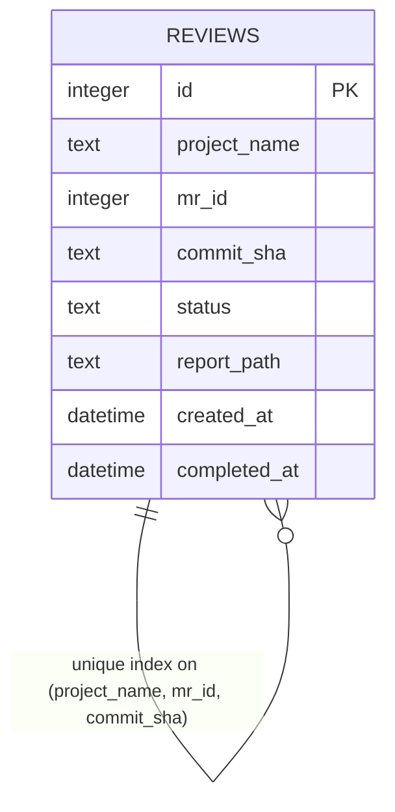
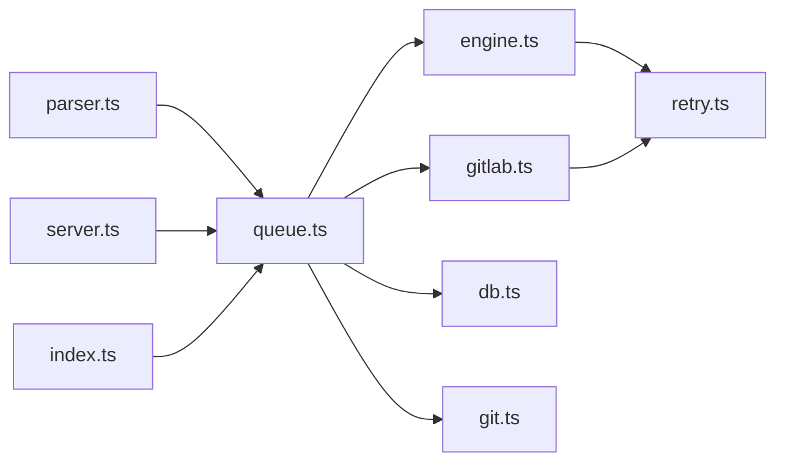

# Event Queue

<cite>
**Referenced Files in This Document**
- [queue.ts](file://src/queue.ts)
- [parser.ts](file://src/parser.ts)
- [engine.ts](file://src/engine.ts)
- [retry.ts](file://src/retry.ts)
- [server.ts](file://src/server.ts)
- [index.ts](file://src/index.ts)
- [config.ts](file://src/config.ts)
- [gitlab.ts](file://src/gitlab.ts)
- [db.ts](file://src/db.ts)
- [logger.ts](file://src/logger.ts)
- [git.ts](file://src/git.ts)
- [README.md](file://README.md)
</cite>

## Table of Contents
1. [Introduction](#introduction)
2. [Project Structure](#project-structure)
3. [Core Components](#core-components)
4. [Architecture Overview](#architecture-overview)
5. [Detailed Component Analysis](#detailed-component-analysis)
6. [Dependency Analysis](#dependency-analysis)
7. [Performance Considerations](#performance-considerations)
8. [Troubleshooting Guide](#troubleshooting-guide)
9. [Conclusion](#conclusion)
10. [Appendices](#appendices)

## Introduction
This document explains the sequential event queue system that processes Merge Request (MR) events for AI-powered code reviews. The queue ensures one MR is processed at a time to prevent concurrent processing conflicts, while integrating with the webhook parser, GitLab CLI, AI engine, and persistence layer. It covers lifecycle, concurrency control, error handling, retry logic, configuration, integration patterns, performance considerations, monitoring, and troubleshooting.

## Project Structure
The event queue is part of a larger application that:
- Receives MR notifications via an HTTP webhook endpoint
- Parses email payloads into structured MR events
- Enqueues events for sequential processing
- Executes a pipeline that fetches MR details and diffs, runs an AI review, persists results, and sends notifications

**Diagram sources**
- [server.ts:83-109](file://src/server.ts#L83-L109)
- [parser.ts:1-92](file://src/parser.ts#L1-L92)
- [queue.ts:6-46](file://src/queue.ts#L6-L46)
- [index.ts:47-184](file://src/index.ts#L47-L184)
- [gitlab.ts:51-95](file://src/gitlab.ts#L51-L95)
- [engine.ts:8-213](file://src/engine.ts#L8-L213)
- [db.ts:9-48](file://src/db.ts#L9-L48)

**Section sources**
- [README.md:5-44](file://README.md#L5-L44)
- [README.md:160-201](file://README.md#L160-L201)

## Core Components
- EventQueue: In-memory, single-threaded FIFO queue ensuring one MR is processed at a time.
- MergeRequestEvent: Structured representation of parsed MR events.
- Review Pipeline Processor: Asynchronous function passed to EventQueue orchestrating the full MR review workflow.
- Retry Utility: Generic exponential backoff wrapper used by external calls (GitLab CLI, AI engine).
- Persistence: SQLite database tracks review status and report paths.
- Configuration: Zod-validated configuration controls ports, repositories, and optional notification channels.

Key responsibilities:
- Concurrency control: Only one event is processed at any time.
- Error isolation: Failures do not block subsequent events.
- Retry strategy: Exponential backoff for transient failures.
- Deduplication: Avoid reprocessing identical MR commits.

**Section sources**
- [queue.ts:6-46](file://src/queue.ts#L6-L46)
- [parser.ts:1-92](file://src/parser.ts#L1-L92)
- [retry.ts:1-36](file://src/retry.ts#L1-L36)
- [db.ts:9-48](file://src/db.ts#L9-L48)
- [config.ts:23-36](file://src/config.ts#L23-L36)

## Architecture Overview
The event flow from webhook to completion:

**Diagram sources**
- [server.ts:83-109](file://src/server.ts#L83-L109)
- [parser.ts:17-91](file://src/parser.ts#L17-L91)
- [queue.ts:15-44](file://src/queue.ts#L15-L44)
- [index.ts:47-184](file://src/index.ts#L47-L184)
- [gitlab.ts:51-95](file://src/gitlab.ts#L51-L95)
- [engine.ts:8-213](file://src/engine.ts#L8-L213)
- [db.ts:61-82](file://src/db.ts#L61-L82)

## Detailed Component Analysis

### EventQueue: Sequential Processing and Lifecycle
The EventQueue enforces strict single-event processing to avoid concurrent access to shared resources (worktrees, filesystem, GitLab/AI engines).

Lifecycle:
- Initialization: Constructed with a processor function that implements the full review pipeline.
- Enqueue: Adds events to an internal array and schedules asynchronous processing using setImmediate.
- Process Next:
  - Guards against concurrent execution via an isProcessing flag.
  - Dequeues the next event and invokes the processor.
  - Logs success or error; always resets isProcessing and schedules the next item.

Concurrency control:
- Single active processor at any time prevents overlapping work.
- Uses setImmediate to avoid blocking the event loop during long-running tasks.

Error handling:
- Errors are logged but do not stop the queue; processing continues with the next event.
- No automatic retry within the queue itself; retries are handled by the processor’s use of withRetry for external calls.

**Diagram sources**
- [queue.ts:15-44](file://src/queue.ts#L15-L44)

**Section sources**
- [queue.ts:6-46](file://src/queue.ts#L6-L46)

### Webhook Parser Integration
The server parses incoming webhook payloads into MergeRequestEvent objects. If parsing fails or the project is unconfigured, it responds immediately without enqueuing.

Integration points:
- Validation: Ensures subject/body presence and recognized MR event format.
- Project gating: Rejects events for projects not present in configuration.
- Enqueueing: Calls queue.enqueue on valid events.

**Diagram sources**
- [server.ts:83-109](file://src/server.ts#L83-L109)
- [parser.ts:17-91](file://src/parser.ts#L17-L91)
- [config.ts:23-36](file://src/config.ts#L23-L36)

**Section sources**
- [server.ts:83-109](file://src/server.ts#L83-L109)
- [parser.ts:1-92](file://src/parser.ts#L1-L92)
- [config.ts:23-36](file://src/config.ts#L23-L36)

### Review Pipeline Processor
The processor function passed to EventQueue orchestrates the complete MR review workflow:
- Fetch MR details and diff via GitLab CLI
- Deduplicate based on project, MR ID, and commit SHA
- Create isolated Git worktree
- Generate AI review via agy CLI
- Save report and update database status
- Send notifications (Telegram, Email, Desktop)
- Clean up worktree

Deduplication:
- If a review exists for the same project/MR/commit and is COMPLETED or PENDING, it skips unless forceRetry is set.
- On retry, updates status to PENDING before reprocessing.

Error handling:
- Catches errors mid-pipeline and attempts to mark existing PENDING reviews as FAILED.
- Always cleans up worktrees in finally blocks.

**Diagram sources**
- [index.ts:47-184](file://src/index.ts#L47-L184)
- [gitlab.ts:51-95](file://src/gitlab.ts#L51-L95)
- [engine.ts:8-213](file://src/engine.ts#L8-L213)
- [db.ts:61-82](file://src/db.ts#L61-L82)
- [git.ts:9-49](file://src/git.ts#L9-L49)

**Section sources**
- [index.ts:47-184](file://src/index.ts#L47-L184)

### Retry Logic and External Integrations
Retry utility:
- Provides exponential backoff for async functions.
- Used by GitLab CLI wrappers and AI engine invocation.

GitLab CLI:
- Verifies authentication at startup.
- Wraps glab commands with retry parameters.

AI Engine:
- Spawns agy CLI with timeouts and environment flags.
- Retries generation up to a configured number of times.

**Diagram sources**
- [retry.ts:1-36](file://src/retry.ts#L1-L36)
- [gitlab.ts:21-95](file://src/gitlab.ts#L21-L95)
- [engine.ts:8-213](file://src/engine.ts#L8-L213)

**Section sources**
- [retry.ts:1-36](file://src/retry.ts#L1-L36)
- [gitlab.ts:21-95](file://src/gitlab.ts#L21-L95)
- [engine.ts:8-213](file://src/engine.ts#L8-L213)

### Data Models and Persistence
Database schema:
- Reviews table includes project_name, mr_id, commit_sha, status, report_path, timestamps.
- Unique index on (project_name, mr_id, commit_sha) enforces deduplication.

Operations:
- initDb initializes schema and migrations.
- getReview/insertReview/updateReviewStatus manage review lifecycle.
- getAllReviews/getReviewById support dashboard queries.

**Diagram sources**
- [db.ts:23-40](file://src/db.ts#L23-L40)

**Section sources**
- [db.ts:9-48](file://src/db.ts#L9-L48)
- [db.ts:61-82](file://src/db.ts#L61-L82)

### Configuration Options
Configuration schema validates:
- port and publicUrl for HTTP server and notification links.
- repositories mapping project names to local repository paths.
- Optional telegram and email settings for notifications.

Startup validation:
- Ensures configuration file exists and is valid JSON.
- Validates all configured repository local paths exist on disk.

**Section sources**
- [config.ts:23-36](file://src/config.ts#L23-L36)
- [config.ts:41-79](file://src/config.ts#L41-L79)

## Dependency Analysis
The queue depends on:
- Parser for event structure
- Server for enqueuing webhooks and manual retries
- Pipeline orchestrator for processing logic
- GitLab CLI and AI engine for external operations
- Database for state tracking
- Filesystem for reports and worktrees

**Diagram sources**
- [parser.ts:1-92](file://src/parser.ts#L1-L92)
- [server.ts:83-109](file://src/server.ts#L83-L109)
- [index.ts:47-184](file://src/index.ts#L47-L184)
- [queue.ts:6-46](file://src/queue.ts#L6-L46)
- [gitlab.ts:51-95](file://src/gitlab.ts#L51-L95)
- [engine.ts:8-213](file://src/engine.ts#L8-L213)
- [db.ts:61-82](file://src/db.ts#L61-L82)
- [git.ts:9-49](file://src/git.ts#L9-L49)
- [retry.ts:1-36](file://src/retry.ts#L1-L36)

**Section sources**
- [queue.ts:6-46](file://src/queue.ts#L6-L46)
- [index.ts:47-184](file://src/index.ts#L47-L184)

## Performance Considerations
- Sequential processing avoids resource contention but can become a bottleneck under high load.
- Large diffs are truncated to reduce memory usage and prompt size.
- External CLI invocations have timeouts to prevent indefinite hangs.
- Retry with exponential backoff reduces transient failure impact.
- Worktrees are cleaned up after each review to free disk space.

Recommendations:
- Monitor queue length and processing latency to detect bottlenecks.
- Tune retry parameters and timeouts based on workload characteristics.
- Consider scaling out by partitioning repositories across multiple instances if needed.

[No sources needed since this section provides general guidance]

## Troubleshooting Guide
Common issues and resolutions:
- Stuck events:
  - Cause: Long-running AI engine or GitLab CLI calls.
  - Action: Check logs for timeout messages; verify external CLI availability and permissions.
- Deadlocks:
  - Cause: Misuse of shared resources or improper cleanup.
  - Action: Ensure worktrees are removed in finally blocks; validate filesystem permissions.
- Failed reviews:
  - Cause: Network errors, model timeouts, or invalid prompts.
  - Action: Inspect retry logs; adjust retry counts/backoff; verify glab auth and agy installation.
- Unrecognized events:
  - Cause: Malformed webhook payload or unsupported project.
  - Action: Validate payload structure; ensure project is configured.

Monitoring approaches:
- Use HTTP health endpoint to verify service uptime.
- Track database statuses (PENDING, COMPLETED, FAILED) to identify stuck items.
- Review logs for retry warnings and error messages.

**Section sources**
- [server.ts:16-18](file://src/server.ts#L16-L18)
- [engine.ts:139-193](file://src/engine.ts#L139-L193)
- [gitlab.ts:21-49](file://src/gitlab.ts#L21-L49)
- [db.ts:76-82](file://src/db.ts#L76-L82)

## Conclusion
The EventQueue provides a robust, sequential processing mechanism that prevents concurrent MR review conflicts. Combined with retry logic, deduplication, and comprehensive error handling, it ensures reliable operation even under variable external conditions. Proper configuration, monitoring, and troubleshooting practices help maintain stability and performance.

[No sources needed since this section summarizes without analyzing specific files]

## Appendices

### Practical Examples of Queue Operations
- Enqueue via webhook:
  - POST /webhook with {subject, body}
  - Server parses and enqueues valid events
- Manual retry:
  - POST /api/reviews/:id/retry
  - Server constructs a MergeRequestEvent with forceRetry and enqueues it

**Section sources**
- [server.ts:56-81](file://src/server.ts#L56-L81)
- [server.ts:83-109](file://src/server.ts#L83-L109)

### Integration Patterns
- Webhook parser to queue:
  - Parse email payload into MergeRequestEvent
  - Validate project configuration
  - Enqueue for processing
- Queue to AI engine:
  - Processor invokes generateReview with MR details and diff
  - AI engine spawns agy CLI with timeouts and retries

**Section sources**
- [parser.ts:17-91](file://src/parser.ts#L17-L91)
- [engine.ts:8-213](file://src/engine.ts#L8-L213)