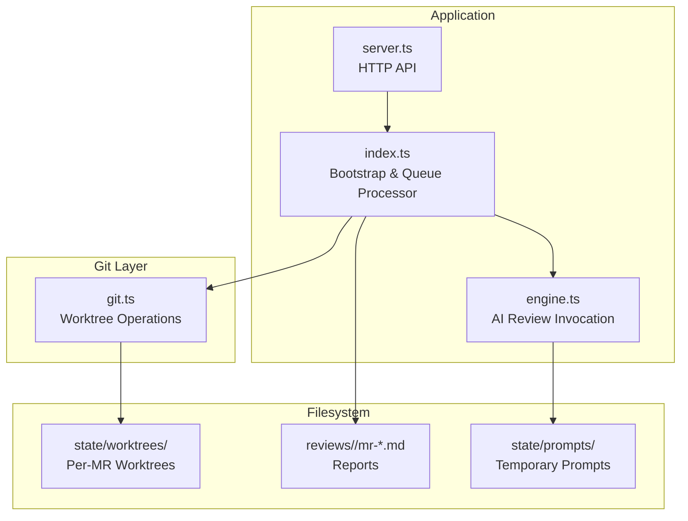
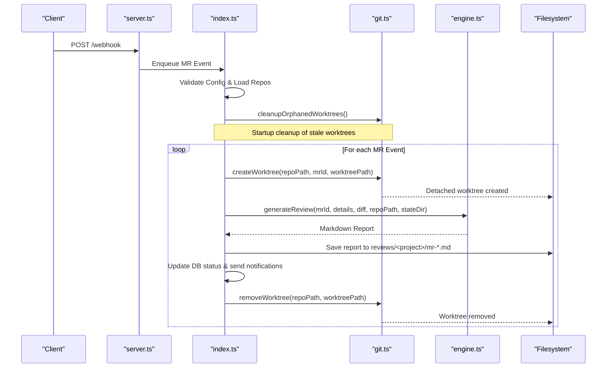
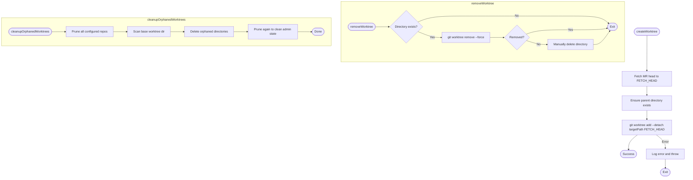
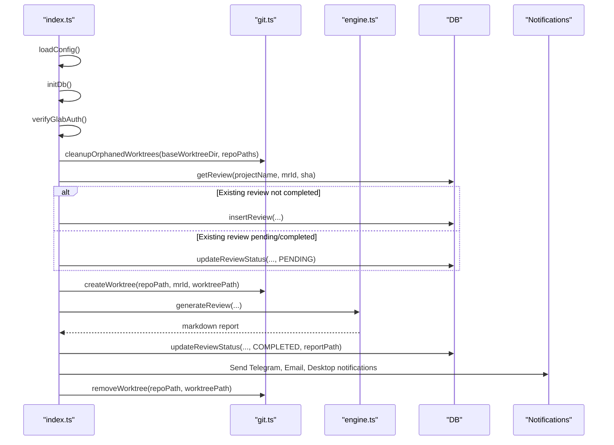
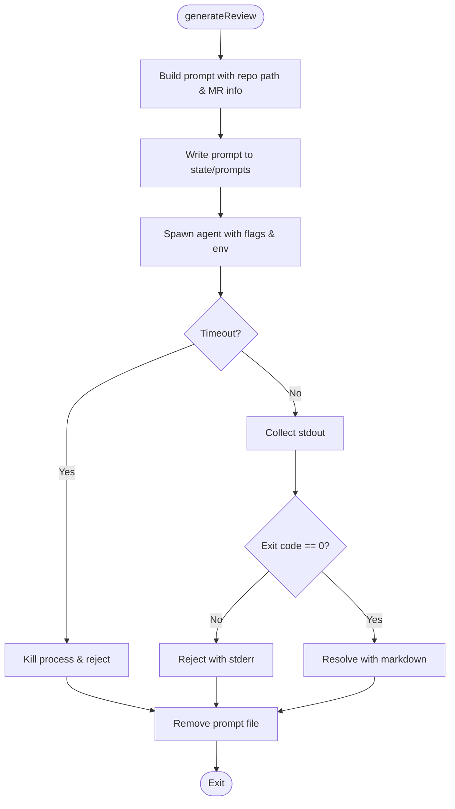
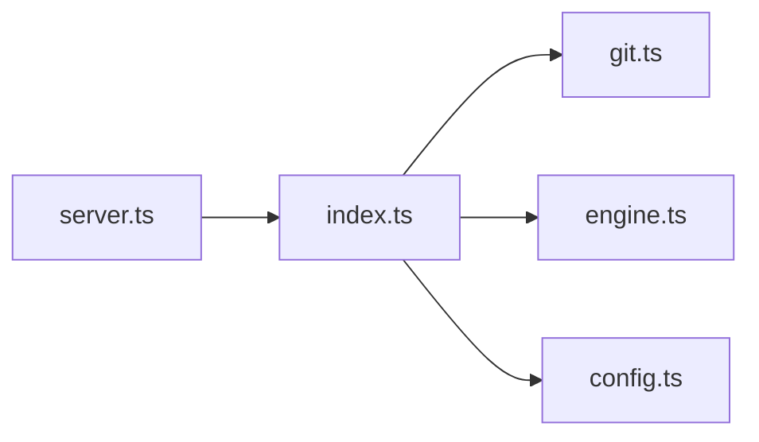

# Git Worktree Management

<cite>
**Referenced Files in This Document**
- [git.ts](file://src/git.ts)
- [index.ts](file://src/index.ts)
- [engine.ts](file://src/engine.ts)
- [server.ts](file://src/server.ts)
- [config.ts](file://src/config.ts)
</cite>

## Table of Contents
1. [Introduction](#introduction)
2. [Project Structure](#project-structure)
3. [Core Components](#core-components)
4. [Architecture Overview](#architecture-overview)
5. [Detailed Component Analysis](#detailed-component-analysis)
6. [Dependency Analysis](#dependency-analysis)
7. [Performance Considerations](#performance-considerations)
8. [Troubleshooting Guide](#troubleshooting-guide)
9. [Conclusion](#conclusion)

## Introduction
This document explains the Git worktree management system used to create isolated environments for code analysis. It covers how worktrees are created and removed, how orphaned worktrees are cleaned up, and how isolation is enforced during review processing. It also documents the Git operations performed, directory structure management, resource cleanup mechanisms, error handling strategies, integration with the review pipeline, and best practices for maintaining worktrees at scale.

## Project Structure
The worktree lifecycle is orchestrated by the application bootstrap and queue processor, while Git-specific operations are encapsulated in a dedicated module. The key directories involved include:
- state/worktrees: Base directory where per-MR worktrees are created under this path.
- reviews: Directory where generated Markdown reports are persisted.
- state/prompts: Temporary prompt files written by the AI engine (not part of worktrees).

**Diagram sources**
- [index.ts:20-196](file://src/index.ts#L20-L196)
- [git.ts:9-99](file://src/git.ts#L9-L99)
- [engine.ts:8-212](file://src/engine.ts#L8-L212)
- [server.ts:10-115](file://src/server.ts#L10-L115)

**Section sources**
- [index.ts:20-196](file://src/index.ts#L20-L196)
- [git.ts:9-99](file://src/git.ts#L9-L99)
- [engine.ts:8-212](file://src/engine.ts#L8-L212)
- [server.ts:10-115](file://src/server.ts#L10-L115)

## Core Components
- Git Worktree Module: Provides functions to create, remove, and clean up Git worktrees safely.
- Application Bootstrap and Queue Processor: Orchestrates MR processing, including worktree creation, review generation, report persistence, notifications, and cleanup.
- AI Review Engine: Invokes an external agent to generate a structured review using repository context and MR diff.
- Configuration Loader: Validates repository configuration and ensures local paths exist before processing.

Key responsibilities:
- Isolation: Each MR gets its own detached worktree to avoid polluting the main working tree.
- Cleanup: Robust removal of worktrees after processing, plus startup cleanup of orphans.
- Error Handling: Graceful fallbacks when Git commands fail and logging for diagnostics.

**Section sources**
- [git.ts:9-99](file://src/git.ts#L9-L99)
- [index.ts:20-196](file://src/index.ts#L20-L196)
- [engine.ts:8-212](file://src/engine.ts#L8-L212)
- [config.ts:41-79](file://src/config.ts#L41-L79)

## Architecture Overview
The review pipeline integrates Git worktrees as isolated sandboxes for each merge request. The flow is:
1. Bootstrap validates configuration and cleans up any orphaned worktrees from prior runs.
2. A webhook event enqueues a Merge Request event.
3. The queue processor creates a detached worktree for the MR’s head commit.
4. The AI engine generates a review using repository context and the MR diff.
5. The report is saved and status updated; notifications are sent.
6. The worktree is always removed in a finally block to ensure cleanup.

**Diagram sources**
- [server.ts:83-109](file://src/server.ts#L83-L109)
- [index.ts:20-196](file://src/index.ts#L20-L196)
- [git.ts:9-99](file://src/git.ts#L9-L99)
- [engine.ts:8-212](file://src/engine.ts#L8-L212)

## Detailed Component Analysis

### Git Worktree Module
Responsibilities:
- Create a detached worktree for a specific MR head commit.
- Remove a worktree, with fallback to manual deletion if Git fails.
- Prune Git administrative state and delete orphaned directories under the base worktree folder.

Implementation highlights:
- Fetches the MR head via Git fetch into FETCH_HEAD, then adds a detached worktree pointing to FETCH_HEAD.
- Uses force flags to remove worktrees even with untracked content or detached HEAD.
- Performs git worktree prune on configured repositories to clean internal pointers.
- Scans the base worktree directory and deletes any remaining directories that are no longer tracked by Git.

**Diagram sources**
- [git.ts:9-99](file://src/git.ts#L9-L99)

**Section sources**
- [git.ts:9-99](file://src/git.ts#L9-L99)

### Application Bootstrap and Queue Processor
Responsibilities:
- Load and validate configuration, ensuring repository local paths exist.
- Verify GitLab CLI authentication.
- Clean up orphaned worktrees at startup.
- Process MR events: create worktree, fetch diff, generate review, save report, update status, notify, and always remove the worktree.

Key behaviors:
- Worktree path includes project name, MR ID, and timestamp to ensure uniqueness.
- Deduplication prevents reprocessing identical MR commits unless forced retry.
- Failure handling updates review status to FAILED if needed.
- Cleanup occurs in a finally block to guarantee removal even on errors.

**Diagram sources**
- [index.ts:20-196](file://src/index.ts#L20-L196)
- [git.ts:9-99](file://src/git.ts#L9-L99)
- [engine.ts:8-212](file://src/engine.ts#L8-L212)

**Section sources**
- [index.ts:20-196](file://src/index.ts#L20-L196)

### AI Review Engine
Responsibilities:
- Build a prompt with repository knowledge base instructions and MR metadata.
- Write prompt to a temporary file to bypass command-line length limits.
- Invoke the external agent with appropriate flags and environment variables.
- Handle timeouts, process exit codes, and retries.
- Clean up temporary prompt files.

Integration with worktrees:
- The engine receives the repository path and reads context directly from the repository.
- While it does not directly manage worktrees, it operates within the isolated environment created by the pipeline.

**Diagram sources**
- [engine.ts:8-212](file://src/engine.ts#L8-L212)

**Section sources**
- [engine.ts:8-212](file://src/engine.ts#L8-L212)

### Configuration Loader
Responsibilities:
- Load and validate JSON configuration.
- Ensure all configured repository local paths exist on disk.
- Provide typed configuration for the rest of the application.

Relevance to worktrees:
- Ensures that the local repository paths passed to Git operations are valid before creating worktrees.

**Section sources**
- [config.ts:41-79](file://src/config.ts#L41-L79)

## Dependency Analysis
- index.ts depends on git.ts for worktree lifecycle and on engine.ts for review generation.
- server.ts exposes HTTP endpoints and enqueues events processed by index.ts.
- config.ts provides validated repository configurations consumed by index.ts and git.ts.

**Diagram sources**
- [server.ts:10-115](file://src/server.ts#L10-L115)
- [index.ts:1-196](file://src/index.ts#L1-L196)
- [git.ts:1-100](file://src/git.ts#L1-L100)
- [engine.ts:1-213](file://src/engine.ts#L1-L213)
- [config.ts:1-80](file://src/config.ts#L1-L80)

**Section sources**
- [server.ts:10-115](file://src/server.ts#L10-L115)
- [index.ts:1-196](file://src/index.ts#L1-L196)
- [git.ts:1-100](file://src/git.ts#L1-L100)
- [engine.ts:1-213](file://src/engine.ts#L1-L213)
- [config.ts:1-80](file://src/config.ts#L1-L80)

## Performance Considerations
- Detached worktrees minimize filesystem churn and avoid conflicts with the main branch.
- Using FETCH_HEAD avoids creating additional branches and keeps the repository tidy.
- Pruning Git administrative state reduces overhead from stale worktree references.
- Large diffs are truncated by the AI engine to prevent excessive memory usage and long processing times.
- Timeouts protect against long-running agents and free resources promptly.

[No sources needed since this section provides general guidance]

## Troubleshooting Guide
Common issues and resolutions:
- Git fetch failures for MR head:
  - Ensure the remote origin is reachable and credentials are valid.
  - Verify the MR exists and the user has read access.
- Worktree creation errors:
  - Confirm the target parent directory exists and is writable.
  - Check for permission issues or insufficient disk space.
- Worktree removal failures:
  - If git worktree remove fails, the module falls back to manually deleting the directory.
  - Run git worktree prune afterward to clean internal state.
- Orphaned worktrees:
  - Use the startup cleanup routine to remove directories that are no longer tracked by Git.
  - Manually inspect state/worktrees for leftover directories and run pruning on configured repos.
- Agent invocation issues:
  - Check timeout settings and environment variables required by the agent.
  - Inspect stderr output for detailed error messages.

Operational tips:
- Always monitor logs for warnings about failed prunes or manual deletions.
- Periodically run cleanup routines to reclaim disk space and keep Git state healthy.
- Validate repository local paths in configuration to prevent runtime errors.

**Section sources**
- [git.ts:9-99](file://src/git.ts#L9-L99)
- [index.ts:20-196](file://src/index.ts#L20-L196)
- [engine.ts:8-212](file://src/engine.ts#L8-L212)

## Conclusion
The Git worktree management system provides robust isolation for analyzing code changes by creating detached worktrees per merge request, ensuring safe and conflict-free review processing. The pipeline guarantees cleanup through explicit removal and startup-based orphan pruning. Error handling includes fallbacks and comprehensive logging. For large repositories, performance is improved by detaching worktrees, pruning Git state, and limiting diff sizes. Following the outlined best practices will help maintain a healthy and efficient review workflow.

[No sources needed since this section summarizes without analyzing specific files]