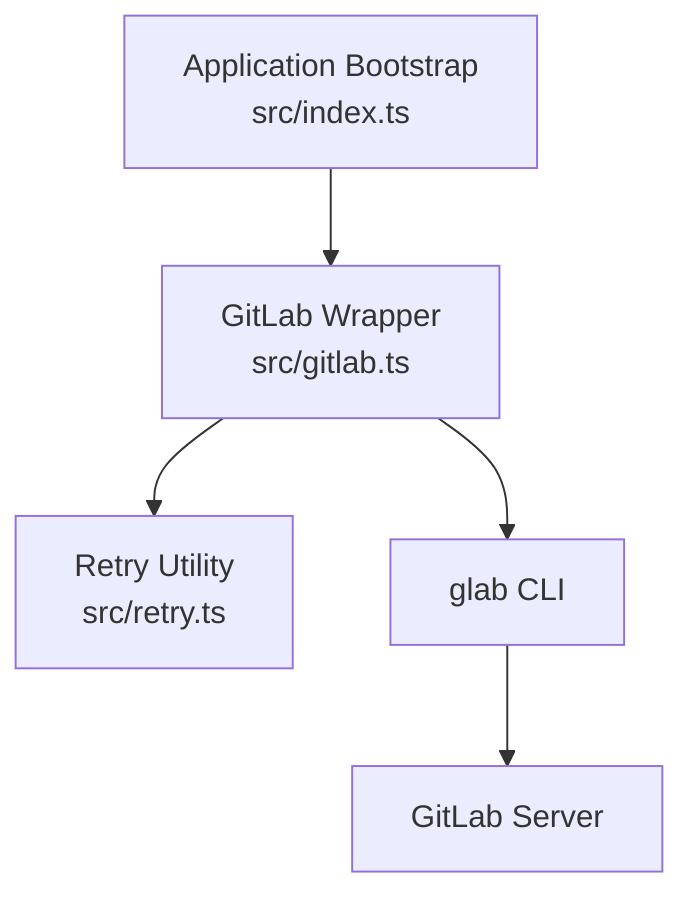
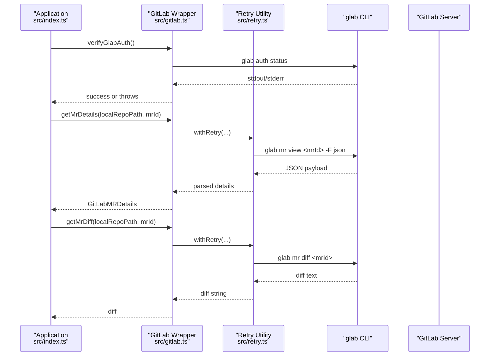
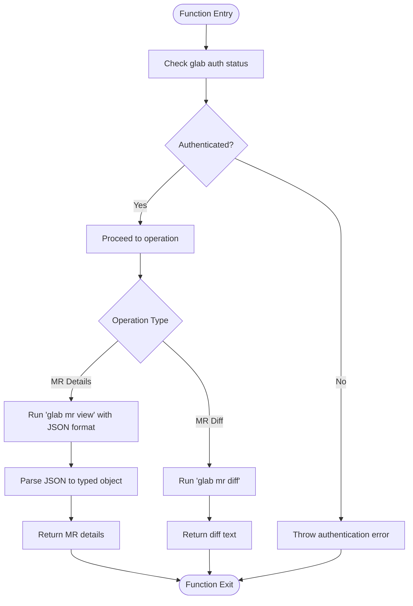
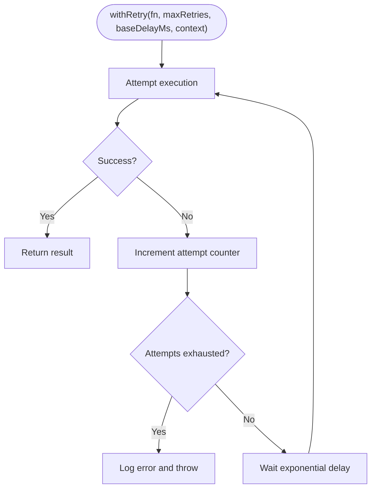
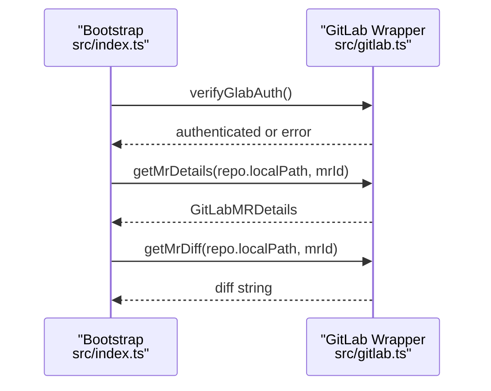
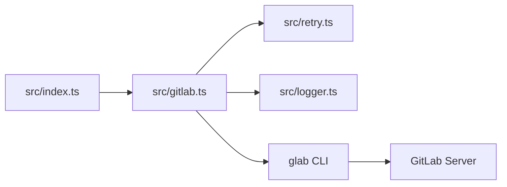

# GitLab Integration

<cite>
**Referenced Files in This Document**
- [gitlab.ts](file://src/gitlab.ts)
- [retry.ts](file://src/retry.ts)
- [index.ts](file://src/index.ts)
- [config.example.json](file://config/config.example.json)
- [README.md](file://README.md)
</cite>

## Table of Contents
1. [Introduction](#introduction)
2. [Project Structure](#project-structure)
3. [Core Components](#core-components)
4. [Architecture Overview](#architecture-overview)
5. [Detailed Component Analysis](#detailed-component-analysis)
6. [Dependency Analysis](#dependency-analysis)
7. [Performance Considerations](#performance-considerations)
8. [Troubleshooting Guide](#troubleshooting-guide)
9. [Conclusion](#conclusion)

## Introduction
This document explains the GitLab integration layer that communicates with GitLab via the glab CLI. It covers how merge request details are retrieved, how diffs are extracted, and how authentication is handled. It also documents the API calls made to GitLab (through glab), response parsing, error handling strategies, configuration for different GitLab instances, rate limiting considerations, and troubleshooting connectivity issues.

The integration is designed to be read-only: it never writes to GitLab. Authentication is delegated to the pre-configured glab CLI, which manages tokens and host connections.

## Project Structure
The GitLab integration lives primarily in a single module that wraps glab commands and integrates with the application’s retry utility. The main pipeline orchestrates MR detail retrieval, diff extraction, and review generation.

**Diagram sources**
- [index.ts:20-31](file://src/index.ts#L20-L31)
- [gitlab.ts:21-49](file://src/gitlab.ts#L21-L49)
- [retry.ts:12-35](file://src/retry.ts#L12-L35)

**Section sources**
- [README.md:160-201](file://README.md#L160-L201)
- [index.ts:20-31](file://src/index.ts#L20-L31)

## Core Components
- GitLab wrapper module: Provides functions to verify glab authentication, fetch MR details, and fetch MR diffs.
- Retry utility: Implements exponential backoff for transient failures.
- Application bootstrap: Verifies glab authentication at startup and orchestrates MR detail and diff retrieval during review processing.

Key responsibilities:
- Authentication verification via glab CLI status.
- Executing glab commands within the context of a local repository path.
- Parsing JSON output from glab into typed structures.
- Handling errors and propagating meaningful messages.

**Section sources**
- [gitlab.ts:8-19](file://src/gitlab.ts#L8-L19)
- [gitlab.ts:21-49](file://src/gitlab.ts#L21-L49)
- [gitlab.ts:51-71](file://src/gitlab.ts#L51-L71)
- [gitlab.ts:73-95](file://src/gitlab.ts#L73-L95)
- [retry.ts:12-35](file://src/retry.ts#L12-L35)
- [index.ts:20-31](file://src/index.ts#L20-L31)
- [index.ts:66-102](file://src/index.ts#L66-L102)

## Architecture Overview
The integration uses glab as a bridge to GitLab. The application invokes glab commands through Node.js child processes, relying on glab’s existing authentication and connection settings.

**Diagram sources**
- [index.ts:20-31](file://src/index.ts#L20-L31)
- [index.ts:66-102](file://src/index.ts#L66-L102)
- [gitlab.ts:21-49](file://src/gitlab.ts#L21-L49)
- [gitlab.ts:51-71](file://src/gitlab.ts#L51-L71)
- [gitlab.ts:73-95](file://src/gitlab.ts#L73-L95)
- [retry.ts:12-35](file://src/retry.ts#L12-L35)

## Detailed Component Analysis

### GitLab Wrapper Module
Responsibilities:
- Verify glab authentication by running `glab auth status`.
- Fetch MR details using `glab mr view <id> -F json` and parse JSON into a typed structure.
- Fetch MR diff using `glab mr diff <id>` with a larger buffer for large diffs.
- Wrap all external calls with retry logic.

Authentication flow:
- Executes `glab auth status`.
- Checks output for indicators of an active token or logged-in host.
- Throws a descriptive error if no active token is found.

MR details retrieval:
- Executes `glab mr view <id> -F json` inside the target repository directory.
- Parses JSON output into `GitLabMRDetails`.
- Retries up to three times with exponential backoff.

Diff extraction:
- Executes `glab mr diff <id>` inside the target repository directory.
- Uses a larger maxBuffer to accommodate large diffs.
- Returns raw diff text.

Error handling:
- Logs detailed errors for each operation.
- Wraps failures with clear messages indicating whether authentication or data retrieval failed.

**Diagram sources**
- [gitlab.ts:21-49](file://src/gitlab.ts#L21-L49)
- [gitlab.ts:51-71](file://src/gitlab.ts#L51-L71)
- [gitlab.ts:73-95](file://src/gitlab.ts#L73-L95)

**Section sources**
- [gitlab.ts:8-19](file://src/gitlab.ts#L8-L19)
- [gitlab.ts:21-49](file://src/gitlab.ts#L21-L49)
- [gitlab.ts:51-71](file://src/gitlab.ts#L51-L71)
- [gitlab.ts:73-95](file://src/gitlab.ts#L73-L95)

### Retry Utility
Responsibilities:
- Execute a function with exponential backoff retries.
- Log warnings and errors per attempt.
- Propagate the final error after exhausting retries.

Behavior:
- Attempts the function repeatedly up to a configured maximum.
- Doubles the delay between attempts starting from a base delay.
- Logs contextual information about failures and delays.

**Diagram sources**
- [retry.ts:12-35](file://src/retry.ts#L12-L35)

**Section sources**
- [retry.ts:12-35](file://src/retry.ts#L12-L35)

### Application Bootstrap Integration
Responsibilities:
- Verify glab authentication at startup.
- Orchestrate MR detail retrieval and diff extraction during review processing.
- Handle deduplication and worktree isolation around Git operations.

Integration points:
- Calls `verifyGlabAuth()` early in bootstrap.
- During event processing, calls `getMrDetails()` then `getMrDiff()`.
- Passes repository local path to ensure glab runs in the correct working directory.

**Diagram sources**
- [index.ts:20-31](file://src/index.ts#L20-L31)
- [index.ts:66-102](file://src/index.ts#L66-L102)
- [gitlab.ts:21-49](file://src/gitlab.ts#L21-L49)
- [gitlab.ts:51-71](file://src/gitlab.ts#L51-L71)
- [gitlab.ts:73-95](file://src/gitlab.ts#L73-L95)

**Section sources**
- [index.ts:20-31](file://src/index.ts#L20-L31)
- [index.ts:66-102](file://src/index.ts#L66-L102)

## Dependency Analysis
The GitLab integration depends on:
- Child process execution to run glab commands.
- The retry utility for resilience against transient failures.
- Logger for structured diagnostics.
- Application bootstrap for orchestration and configuration.

**Diagram sources**
- [index.ts:1-18](file://src/index.ts#L1-L18)
- [gitlab.ts:1-4](file://src/gitlab.ts#L1-L4)
- [retry.ts:1-1](file://src/retry.ts#L1-L1)

**Section sources**
- [index.ts:1-18](file://src/index.ts#L1-L18)
- [gitlab.ts:1-4](file://src/gitlab.ts#L1-L4)
- [retry.ts:1-1](file://src/retry.ts#L1-L1)

## Performance Considerations
- Large diffs: The diff command uses an increased buffer size to handle large changes without truncation.
- Retry strategy: Exponential backoff reduces pressure on GitLab during transient outages and helps avoid hammering the server.
- Sequential processing: The application processes events sequentially, reducing concurrent load on GitLab and filesystem resources.
- Worktree isolation: Reviews run in isolated worktrees, preventing interference with developer checkouts and improving reliability.

[No sources needed since this section provides general guidance]

## Troubleshooting Guide

### Authentication Issues
Symptoms:
- Startup fails with authentication-related errors.
- glab reports missing or invalid tokens.

Actions:
- Ensure glab is installed and available in PATH.
- Run `glab auth login` to authenticate against your GitLab instance.
- Verify that at least one host is authenticated; the wrapper checks for indicators like “Logged in to” or “Token found”.

Relevant implementation:
- Authentication verification logs and error propagation.

**Section sources**
- [gitlab.ts:21-49](file://src/gitlab.ts#L21-L49)
- [README.md:106-110](file://README.md#L106-L110)

### Connectivity Issues with GitLab Servers
Symptoms:
- Timeouts or network errors when fetching MR details or diffs.
- Intermittent failures during review processing.

Actions:
- Confirm network access to the GitLab server from the environment where the agent runs.
- Validate proxy and DNS settings if applicable.
- Increase retry counts or base delay in the retry utility if necessary.
- Check glab configuration for the correct GitLab host URL.

Relevant implementation:
- Retry utility with exponential backoff.
- Error logging for failed operations.

**Section sources**
- [retry.ts:12-35](file://src/retry.ts#L12-L35)
- [gitlab.ts:51-71](file://src/gitlab.ts#L51-L71)
- [gitlab.ts:73-95](file://src/gitlab.ts#L73-L95)

### Rate Limiting Considerations
- The integration does not implement explicit rate limiting; it relies on glab and GitLab’s built-in throttling.
- Use sequential processing (already implemented) to reduce bursty requests.
- If you encounter frequent rate limit errors, consider:
  - Reducing concurrency (the queue already processes one event at a time).
  - Increasing retry base delay to space out attempts.
  - Monitoring GitLab’s rate limit headers via glab or server-side logs.

[No sources needed since this section provides general guidance]

### Configuration for Different GitLab Instances
- glab manages multiple hosts and tokens; ensure the correct host is configured for your GitLab instance.
- The application passes the local repository path to glab so commands run in the correct working directory.
- Repository configuration includes project identifiers and local paths.

Configuration example fields:
- repositories: map of project names to GitLab project ID and local clone path.

**Section sources**
- [config.example.json:1-10](file://config/config.example.json#L1-L10)
- [gitlab.ts:51-71](file://src/gitlab.ts#L51-L71)
- [gitlab.ts:73-95](file://src/gitlab.ts#L73-L95)

### Examples

#### MR Detail Retrieval
- The application calls `getMrDetails(localRepoPath, mrId)` during review processing.
- The wrapper executes `glab mr view <mrId> -F json`, parses JSON, and returns typed details.

Usage reference:
- Pipeline step that retrieves MR details before creating a worktree.

**Section sources**
- [index.ts:66-71](file://src/index.ts#L66-L71)
- [gitlab.ts:51-71](file://src/gitlab.ts#L51-L71)

#### Diff Extraction
- The application calls `getMrDiff(localRepoPath, mrId)` after creating a worktree.
- The wrapper executes `glab mr diff <mrId>` with a larger buffer and returns the diff text.

Usage reference:
- Pipeline step that fetches the diff for AI review generation.

**Section sources**
- [index.ts:98-102](file://src/index.ts#L98-L102)
- [gitlab.ts:73-95](file://src/gitlab.ts#L73-L95)

## Conclusion
The GitLab integration leverages the glab CLI to securely and reliably retrieve merge request details and diffs. Authentication is delegated to glab, while the application focuses on orchestration, retry logic, and robust error handling. The design emphasizes safety (read-only), isolation (worktrees), and resilience (retries and sequential processing). For multi-host environments, configure glab appropriately and ensure the correct repository path is passed to glab commands.

[No sources needed since this section summarizes without analyzing specific files]