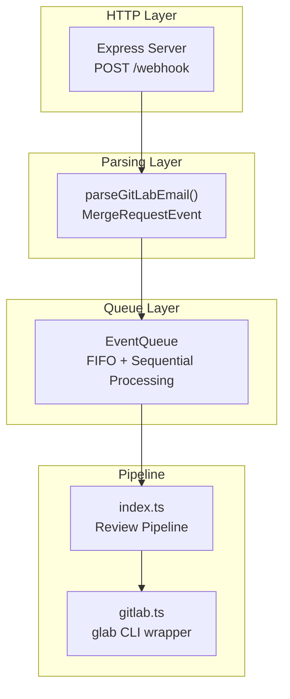
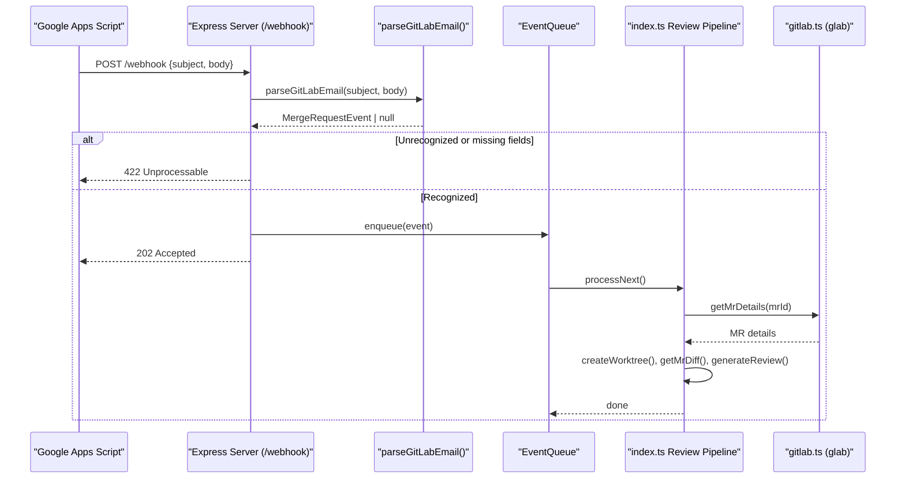
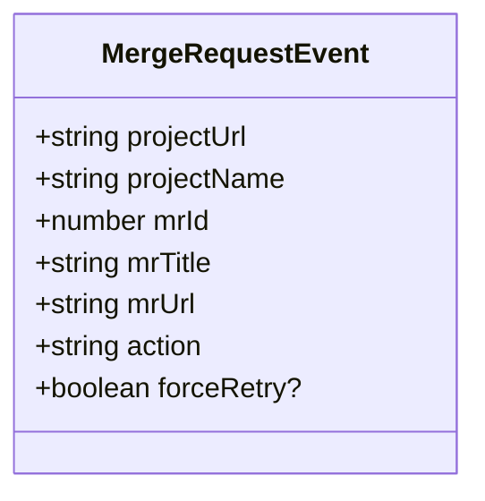
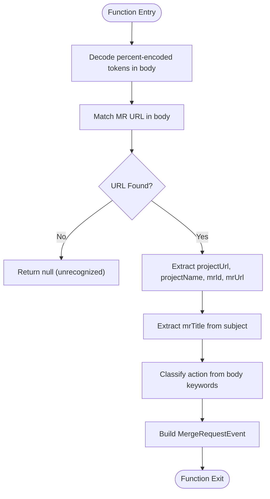
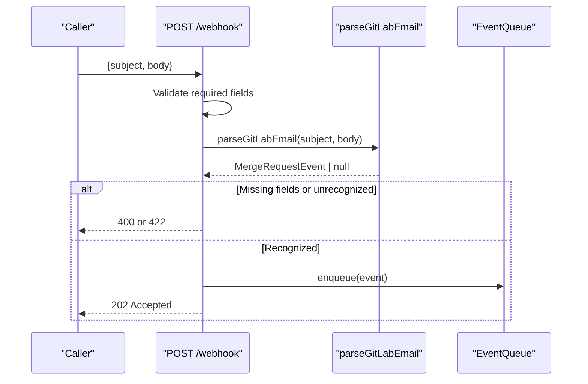
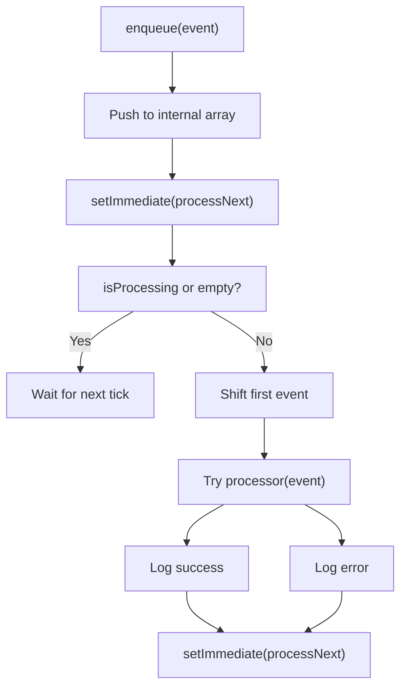
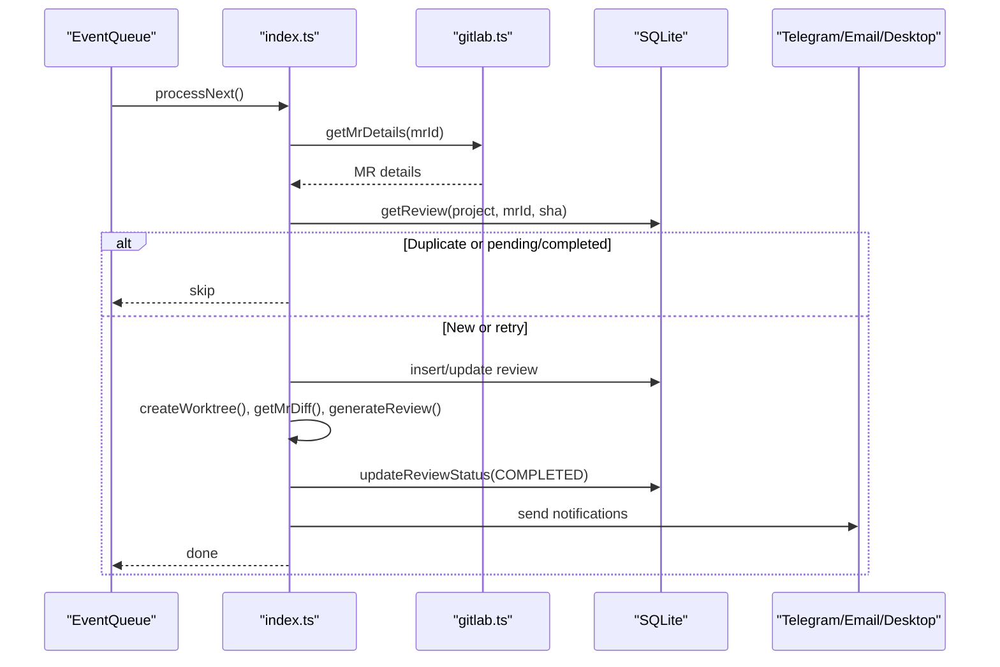
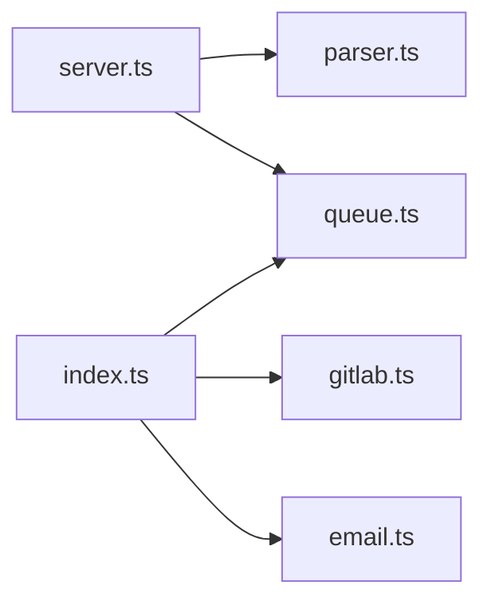

# Webhook Parser

<cite>
**Referenced Files in This Document**
- [parser.ts](file://src/parser.ts)
- [server.ts](file://src/server.ts)
- [queue.ts](file://src/queue.ts)
- [index.ts](file://src/index.ts)
- [gitlab.ts](file://src/gitlab.ts)
- [email.ts](file://src/email.ts)
- [README.md](file://README.md)
</cite>

## Table of Contents
1. [Introduction](#introduction)
2. [Project Structure](#project-structure)
3. [Core Components](#core-components)
4. [Architecture Overview](#architecture-overview)
5. [Detailed Component Analysis](#detailed-component-analysis)
6. [Dependency Analysis](#dependency-analysis)
7. [Performance Considerations](#performance-considerations)
8. [Troubleshooting Guide](#troubleshooting-guide)
9. [Conclusion](#conclusion)

## Introduction
This document explains the GitLab webhook parser component that processes GitLab email notifications to extract merge request details. It covers how URLs are parsed, titles are extracted from subject lines, and actions are classified. It also documents the MergeRequestEvent interface, the parseGitLabEmail function implementation, error handling for malformed emails, and integration with the HTTP server and queue system. Finally, it provides troubleshooting guidance for various GitLab notification formats.

## Project Structure
The webhook parsing logic is implemented in a small set of focused modules:
- Email payload parsing and event modeling live in the parser module.
- The HTTP server receives webhooks and enqueues events.
- A sequential queue ensures one review runs at a time.
- The main bootstrap wires the queue processor to fetch MR details and run the AI review pipeline.

**Diagram sources**
- [server.ts:83-109](file://src/server.ts#L83-L109)
- [parser.ts:1-92](file://src/parser.ts#L1-L92)
- [queue.ts:1-47](file://src/queue.ts#L1-L47)
- [index.ts:47-184](file://src/index.ts#L47-L184)
- [gitlab.ts:51-95](file://src/gitlab.ts#L51-L95)

**Section sources**
- [README.md:141-158](file://README.md#L141-L158)
- [README.md:176-190](file://README.md#L176-L190)

## Core Components
- MergeRequestEvent: Typed model representing a parsed GitLab MR event.
- parseGitLabEmail(subject, body): Parses an email’s subject and body into a MergeRequestEvent or returns null if unrecognized.
- EventQueue: In-memory FIFO queue that processes events sequentially.
- Express server POST /webhook: Validates input, parses the email, validates project configuration, and enqueues the event.
- index.ts pipeline: Orchestrates fetching MR details, creating worktrees, generating reviews, saving reports, and sending notifications.

Key responsibilities:
- URL extraction and validation from email bodies.
- Title extraction from subject lines with fallbacks.
- Action classification based on email content keywords.
- Safe handling of percent-encoded URLs (e.g., FireEye-wrapped links).
- Graceful error handling and logging.

**Section sources**
- [parser.ts:1-92](file://src/parser.ts#L1-L92)
- [server.ts:83-109](file://src/server.ts#L83-L109)
- [queue.ts:1-47](file://src/queue.ts#L1-L47)
- [index.ts:47-184](file://src/index.ts#L47-L184)

## Architecture Overview
The webhook flow starts when Google Apps Script forwards GitLab email notifications to the agent’s HTTP endpoint. The server parses the payload, extracts MR metadata, validates the project, and enqueues the event. The queue processes events one by one, invoking the pipeline that fetches MR details via glab, creates an isolated worktree, generates an AI review, saves the report, and sends notifications.

**Diagram sources**
- [server.ts:83-109](file://src/server.ts#L83-L109)
- [parser.ts:17-91](file://src/parser.ts#L17-L91)
- [queue.ts:15-45](file://src/queue.ts#L15-L45)
- [index.ts:47-184](file://src/index.ts#L47-L184)
- [gitlab.ts:51-95](file://src/gitlab.ts#L51-L95)

## Detailed Component Analysis

### MergeRequestEvent Interface
The MergeRequestEvent interface defines the shape of parsed events:
- projectUrl: Base repository URL derived from the MR URL.
- projectName: Repository name extracted from the full path segment.
- mrId: Numeric merge request ID extracted from the URL.
- mrTitle: Human-readable title extracted from the subject line.
- mrUrl: Full MR URL found in the email body.
- action: Classification of the event type among opened, updated, commented, approved, merged, or unknown.
- forceRetry?: Optional flag used during manual retries to bypass deduplication.

**Diagram sources**
- [parser.ts:1-9](file://src/parser.ts#L1-L9)

**Section sources**
- [parser.ts:1-9](file://src/parser.ts#L1-L9)

### parseGitLabEmail Implementation
The parser performs the following steps:
- Percent-decode the email body to handle security wrappers like FireEye that encode URLs.
- Extract the MR URL using a regex pattern targeting GitLab merge request paths.
- Derive projectUrl and projectName from the MR URL.
- Extract mrId from the URL path.
- Extract mrTitle from the subject line using multiple patterns:
  - Primary pattern matches “| MR Title (!N)” format.
  - Fallback pattern matches “| ... |” without the MR number.
  - Final fallback strips known prefixes and suffixes from the subject.
- Classify action by scanning the lowercased body for specific phrases:
  - opened: “created a merge request” or “opened merge request”
  - updated: “pushed new commits”
  - approved: “was approved”
  - merged: “was merged”
  - commented: contains “comment” or “note”
  - default: “updated” if none match

Error handling:
- If no MR URL is found, the function returns null, signaling an unrecognized event.
- Percent-decoding errors are caught and ignored per token, preserving original text.

Complexity:
- Regex matching and string operations are linear in the size of the subject/body.
- No external I/O; parsing is fast and suitable for high-throughput webhook processing.

**Diagram sources**
- [parser.ts:17-91](file://src/parser.ts#L17-L91)

**Section sources**
- [parser.ts:17-91](file://src/parser.ts#L17-L91)

### HTTP Server Integration
The Express server handles incoming webhook payloads:
- Validates presence of subject and body.
- Calls parseGitLabEmail to obtain a MergeRequestEvent.
- Returns 422 if parsing fails or the project is not configured.
- Enqueues the event and responds with 202 Accepted immediately.

**Diagram sources**
- [server.ts:83-109](file://src/server.ts#L83-L109)
- [parser.ts:17-91](file://src/parser.ts#L17-L91)
- [queue.ts:15-45](file://src/queue.ts#L15-L45)

**Section sources**
- [server.ts:83-109](file://src/server.ts#L83-L109)

### Queue System
The EventQueue implements a simple in-memory FIFO queue with sequential processing:
- enqueue pushes events and triggers asynchronous processing.
- processNext ensures only one event is processed at a time.
- Errors during processing are logged but do not crash the queue.

**Diagram sources**
- [queue.ts:15-45](file://src/queue.ts#L15-L45)

**Section sources**
- [queue.ts:1-47](file://src/queue.ts#L1-L47)

### Pipeline Orchestration
The main bootstrap wires the queue processor to the review pipeline:
- Fetch MR details via glab CLI.
- Deduplicate based on project, MR ID, and commit SHA.
- Create an isolated Git worktree.
- Fetch MR diff.
- Generate AI review report.
- Save report and update database status.
- Send notifications (Telegram, Email, Desktop).

**Diagram sources**
- [index.ts:47-184](file://src/index.ts#L47-L184)
- [gitlab.ts:51-95](file://src/gitlab.ts#L51-L95)

**Section sources**
- [index.ts:47-184](file://src/index.ts#L47-L184)

## Dependency Analysis
- server.ts depends on parser.ts for event parsing and queue.ts for event dispatching.
- index.ts orchestrates the pipeline and depends on gitlab.ts for MR details/diff retrieval.
- email.ts provides optional SMTP notifications and is invoked by the pipeline upon completion.
- All components are loosely coupled through typed interfaces and clear boundaries.

**Diagram sources**
- [server.ts:1-115](file://src/server.ts#L1-L115)
- [parser.ts:1-92](file://src/parser.ts#L1-L92)
- [queue.ts:1-47](file://src/queue.ts#L1-L47)
- [index.ts:1-196](file://src/index.ts#L1-L196)
- [gitlab.ts:1-96](file://src/gitlab.ts#L1-L96)
- [email.ts:1-49](file://src/email.ts#L1-L49)

**Section sources**
- [server.ts:1-115](file://src/server.ts#L1-L115)
- [parser.ts:1-92](file://src/parser.ts#L1-L92)
- [queue.ts:1-47](file://src/queue.ts#L1-L47)
- [index.ts:1-196](file://src/index.ts#L1-L196)
- [gitlab.ts:1-96](file://src/gitlab.ts#L1-L96)
- [email.ts:1-49](file://src/email.ts#L1-L49)

## Performance Considerations
- Parsing is CPU-bound but lightweight; avoid heavy transformations in parseGitLabEmail.
- Queue ensures sequential processing to prevent concurrent resource contention (worktrees, glab calls).
- glab CLI calls include retry logic to mitigate transient failures.
- Large diffs are buffered with limits to prevent memory spikes.
- Notifications are non-blocking and fail gracefully without affecting the core pipeline.

[No sources needed since this section provides general guidance]

## Troubleshooting Guide
Common parsing issues and resolutions:
- No MR URL found in body:
  - Cause: Email does not contain a GitLab MR URL or the URL format differs.
  - Resolution: Ensure GitLab email templates include MR links; verify regex compatibility with your GitLab instance URL structure.
- Title extraction fails:
  - Cause: Subject line deviates from expected “Project | MR Title (!N)” format.
  - Resolution: Adjust subject formatting or extend titleRegex/fallback patterns accordingly.
- Action misclassification:
  - Cause: Body lacks expected keywords (“created a merge request”, “pushed new commits”, etc.).
  - Resolution: Update keyword checks to match your GitLab version’s email phrasing.
- Percent-encoded URLs:
  - Cause: Security gateways wrap URLs with encoded characters.
  - Resolution: The parser decodes tokens safely; ensure decodeURIComponent is available and not blocked by environment policies.
- Project not configured:
  - Cause: eventName.projectName does not match any configured repository.
  - Resolution: Add the project to config.repositories with correct localPath and projectId.
- glab authentication failures:
  - Cause: glab CLI not authenticated or not installed.
  - Resolution: Run glab auth login and ensure PATH includes glab.

Integration-related issues:
- Webhook returns 422:
  - Indicates unrecognized event format or unconfigured project.
  - Inspect logs for parsing warnings and validate payload structure.
- Queue stalls:
  - Check logs for processor errors; ensure the pipeline completes and cleans up worktrees.
- Notification failures:
  - Email/Telegram/desktop notifications failing should not block the pipeline; check respective configurations and credentials.

**Section sources**
- [parser.ts:17-91](file://src/parser.ts#L17-L91)
- [server.ts:83-109](file://src/server.ts#L83-L109)
- [gitlab.ts:21-49](file://src/gitlab.ts#L21-L49)
- [email.ts:9-48](file://src/email.ts#L9-L48)

## Conclusion
The GitLab webhook parser cleanly transforms email notifications into structured MergeRequestEvent objects, enabling reliable downstream processing. With robust URL parsing, flexible title extraction, and keyword-based action classification, it accommodates common GitLab email formats while handling edge cases like percent-encoded URLs. Integrated with a sequential queue and a comprehensive review pipeline, the system ensures stable, scalable processing of MR events and consistent delivery of AI-generated review reports.

[No sources needed since this section summarizes without analyzing specific files]