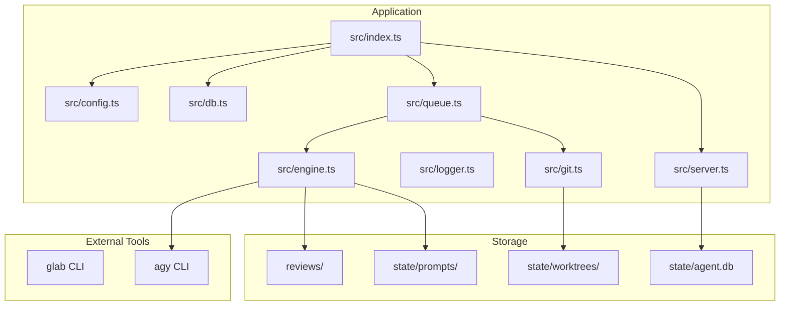
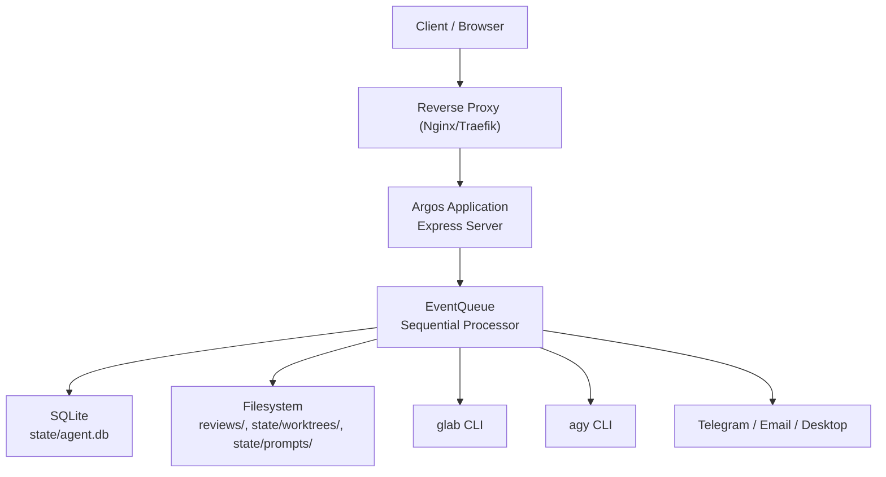
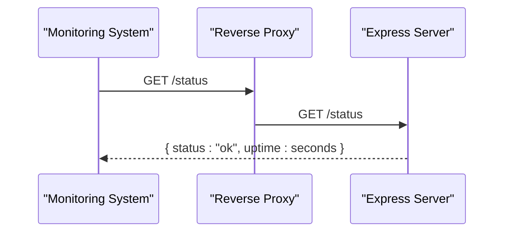
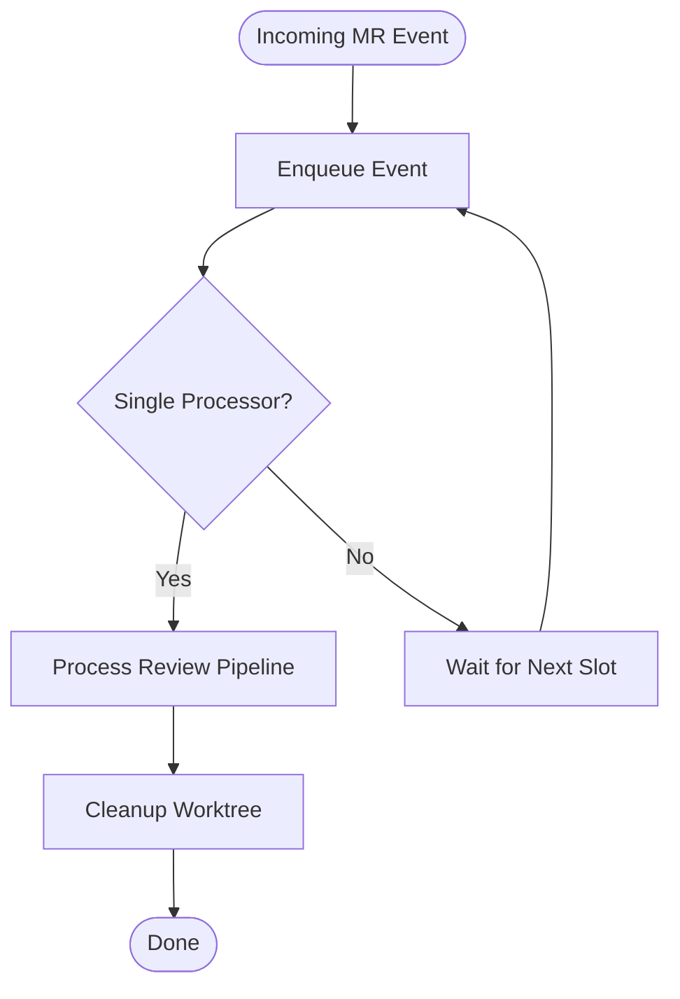
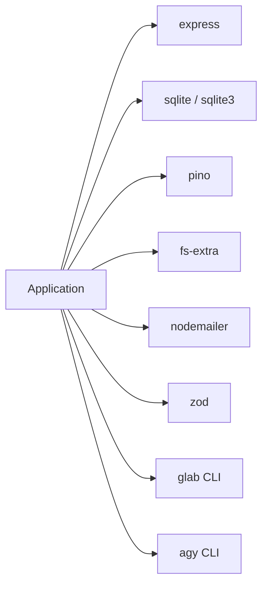

# Deployment Guide

<cite>
**Referenced Files in This Document**
- [README.md](file://README.md)
- [package.json](file://package.json)
- [src/index.ts](file://src/index.ts)
- [src/server.ts](file://src/server.ts)
- [src/config.ts](file://src/config.ts)
- [src/logger.ts](file://src/logger.ts)
- [src/db.ts](file://src/db.ts)
- [src/git.ts](file://src/git.ts)
- [src/engine.ts](file://src/engine.ts)
- [src/queue.ts](file://src/queue.ts)
- [config/config.example.json](file://config/config.example.json)
</cite>

## Table of Contents
1. [Introduction](#introduction)
2. [Project Structure](#project-structure)
3. [Core Components](#core-components)
4. [Architecture Overview](#architecture-overview)
5. [Detailed Component Analysis](#detailed-component-analysis)
6. [Dependency Analysis](#dependency-analysis)
7. [Performance Considerations](#performance-considerations)
8. [Troubleshooting Guide](#troubleshooting-guide)
9. [Conclusion](#conclusion)
10. [Appendices](#appendices)

## Introduction
This deployment guide provides production-ready instructions for running the AI code review agent. It covers process management with PM2 or systemd, environment configuration, logging with Pino, monitoring endpoints, scaling considerations for multiple repositories and concurrent requests, backup and disaster recovery for SQLite and review reports, performance optimization, security hardening, and maintenance tasks such as orphaned worktree cleanup and log rotation.

The application is an Express HTTP server that receives GitLab merge request notifications via email forwarded through Google Apps Script, processes them sequentially, generates AI-powered review reports, persists metadata to SQLite, and serves a web dashboard.

## Project Structure
At runtime, the application uses:
- A JSON configuration file under `config/config.json`
- An SQLite database at `state/agent.db`
- Generated Markdown review reports under `reviews/<project-name>/`
- Temporary state under `state/worktrees/` and `state/prompts/`
- Static web assets under `public/`

**Diagram sources**
- [src/index.ts:20-191](file://src/index.ts#L20-L191)
- [src/server.ts:10-113](file://src/server.ts#L10-L113)
- [src/config.ts:39-78](file://src/config.ts#L39-L78)
- [src/logger.ts:1-14](file://src/logger.ts#L1-L14)
- [src/db.ts:9-48](file://src/db.ts#L9-L48)
- [src/git.ts:9-99](file://src/git.ts#L9-L99)
- [src/engine.ts:8-212](file://src/engine.ts#L8-L212)

**Section sources**
- [README.md:160-200](file://README.md#L160-L200)
- [src/index.ts:20-191](file://src/index.ts#L20-L191)

## Core Components
- Bootstrap and pipeline orchestration: loads configuration, initializes SQLite, verifies external tool authentication, cleans up orphaned worktrees, starts the event queue, and launches the HTTP server.
- HTTP server: serves static UI, exposes health and API endpoints, and accepts webhook payloads from Google Apps Script.
- Configuration loader: validates JSON configuration using Zod and ensures repository local paths exist.
- Logging: Pino logger configured with pretty printing and level controlled by environment variable.
- Database: SQLite schema for reviews table with deduplication index.
- Git worktree manager: creates isolated worktrees per MR, removes them after processing, and prunes orphaned worktrees on startup.
- AI engine: invokes agy CLI with timeouts, retries, and prompt truncation for large diffs.
- Event queue: in-memory FIFO queue that processes one MR event at a time.

**Section sources**
- [src/index.ts:20-191](file://src/index.ts#L20-L191)
- [src/server.ts:10-113](file://src/server.ts#L10-L113)
- [src/config.ts:39-78](file://src/config.ts#L39-L78)
- [src/logger.ts:1-14](file://src/logger.ts#L1-L14)
- [src/db.ts:9-48](file://src/db.ts#L9-L48)
- [src/git.ts:9-99](file://src/git.ts#L9-L99)
- [src/engine.ts:8-212](file://src/engine.ts#L8-L212)
- [src/queue.ts:6-46](file://src/queue.ts#L6-L46)

## Architecture Overview
The production architecture consists of:
- A reverse proxy (recommended) exposing `/webhook`, `/status`, and the dashboard.
- The Node.js application listening on a private port.
- External tools `glab` and `agy` invoked by the application.
- Persistent storage for SQLite and Markdown reports.
- Optional notification channels (Telegram, Email, Desktop).

**Diagram sources**
- [src/server.ts:10-113](file://src/server.ts#L10-L113)
- [src/index.ts:20-191](file://src/index.ts#L20-L191)
- [src/queue.ts:6-46](file://src/queue.ts#L6-L46)
- [src/db.ts:9-48](file://src/db.ts#L9-L48)
- [src/git.ts:9-99](file://src/git.ts#L9-L99)
- [src/engine.ts:8-212](file://src/engine.ts#L8-L212)

## Detailed Component Analysis

### Process Management with PM2
Recommended for development and small production deployments.

- Install dependencies and build artifacts if applicable.
- Start the app with PM2 using the npm start script.
- Configure PM2 ecosystem file to set environment variables, restart policies, and logs directory.
- Use PM2 logs and status commands for operational visibility.

Key points:
- Set `LOG_LEVEL` in PM2 environment.
- Pin Node.js version compatible with the project.
- Ensure `glab` and `agy` are available in PATH for the PM2 user.

**Section sources**
- [package.json:8-10](file://package.json#L8-L10)
- [src/logger.ts:1-14](file://src/logger.ts#L1-L14)

### Process Management with systemd
Recommended for Linux servers.

- Create a service unit file for the application.
- Run the service under a dedicated non-root user.
- Set working directory to the application root.
- Configure environment variables including `LOG_LEVEL`.
- Enable automatic restart on failure and boot.
- Manage logs via journald or redirect to files.

Operational tips:
- Use `ExecStart` to run the npm start script.
- Add `Restart=always` and `RestartSec` for resilience.
- Restrict filesystem access to only required directories.

**Section sources**
- [package.json:8-10](file://package.json#L8-L10)
- [src/logger.ts:1-14](file://src/logger.ts#L1-L14)

### Environment Configuration for Production
Production configuration should be stored securely and validated at startup.

- Copy the example configuration to `config/config.json`.
- Define all repositories with their GitLab project IDs and local clone paths.
- Optionally configure Telegram and SMTP email settings.
- Validate that all repository local paths exist; startup will fail otherwise.
- Keep secrets out of version control; use environment-specific configuration management.

Configuration fields include:
- Port and public URL for deep links.
- Repository map with project identifiers and local paths.
- Optional Telegram bot token and chat ID.
- Optional SMTP email host, port, secure flag, auth credentials, sender, and recipients.

**Section sources**
- [config/config.example.json:1-28](file://config/config.example.json#L1-L28)
- [src/config.ts:23-34](file://src/config.ts#L23-L34)
- [src/config.ts:39-78](file://src/config.ts#L39-L78)

### Logging Setup with Pino
Logging is controlled by the `LOG_LEVEL` environment variable.

- Supported levels: debug, info, warn, error, fatal.
- Default level is info when not set.
- Pretty transport is used for human-readable console output.
- For production, consider switching to structured JSON transport and rotating logs externally.

Recommendations:
- Set `LOG_LEVEL=info` in production.
- Use a log aggregator (e.g., journald, Fluent Bit, Vector) to collect stdout.
- Avoid enabling debug in production due to volume and performance impact.

**Section sources**
- [src/logger.ts:1-14](file://src/logger.ts#L1-L14)
- [README.md:297-302](file://README.md#L297-L302)

### Monitoring Considerations
Use built-in endpoints for health checks and basic observability.

- Health endpoint returns status and uptime.
- Web dashboard lists reviews and allows retrying failed ones.
- Integrate with your monitoring stack to scrape `/status`.
- Track external tool availability (`glab`, `agy`) and disk usage for reviews and worktrees.

**Diagram sources**
- [src/server.ts:16-18](file://src/server.ts#L16-L18)

**Section sources**
- [src/server.ts:16-18](file://src/server.ts#L16-L18)
- [README.md:141-150](file://README.md#L141-L150)

### Scaling Considerations
Current design processes events sequentially to avoid resource contention.

- Sequential queue prevents concurrent reviews from interfering with each other.
- Multiple repositories are supported via configuration.
- Concurrency is limited to one review at a time per process instance.

Scaling strategies:
- Horizontal scaling: run multiple application instances behind a load balancer.
- Each instance maintains its own SQLite database and review reports; ensure shared storage or sharding strategy if needed.
- External tools (`glab`, `agy`) must be installed and authenticated on every instance.
- Consider increasing timeouts and memory limits for larger repositories.

**Diagram sources**
- [src/queue.ts:6-46](file://src/queue.ts#L6-L46)
- [src/index.ts:47-184](file://src/index.ts#L47-L184)

**Section sources**
- [src/queue.ts:6-46](file://src/queue.ts#L6-L46)
- [README.md:258-260](file://README.md#L258-L260)

### Backup Strategies
Backups should cover both persistent data and generated content.

- SQLite database: back up `state/agent.db` regularly.
- Review reports: back up `reviews/` directory recursively.
- Configuration: back up `config/config.json` securely.
- External tool caches: consider backing up `glab` authentication cache if necessary.

Backup recommendations:
- Use consistent snapshots for SQLite to avoid corruption.
- Schedule incremental backups for large review report directories.
- Encrypt backups at rest and restrict access permissions.

**Section sources**
- [src/db.ts:22-40](file://src/db.ts#L22-L40)
- [README.md:191-197](file://README.md#L191-L197)

### Disaster Recovery Procedures
Recovery steps:
- Restore `state/agent.db` and `reviews/` from latest backups.
- Verify repository local paths and GitLab authentication.
- Restart the application; it will initialize schema and clean orphaned worktrees.
- Validate health endpoint and test a sample webhook.

Recovery checklist:
- Confirm file permissions for application user.
- Ensure `glab` and `agy` are accessible.
- Reconfigure any missing repositories.
- Monitor logs for initialization errors.

**Section sources**
- [src/index.ts:27-44](file://src/index.ts#L27-L44)
- [src/db.ts:9-48](file://src/db.ts#L9-L48)

### Performance Optimization Tips
- Truncate large diffs to reduce AI processing time.
- Tune timeout values for AI generation based on workload.
- Use SSDs for SQLite and review report storage.
- Limit log verbosity in production to reduce I/O overhead.
- Pre-warm external tool caches where possible.

Implementation details:
- Diff truncation threshold is applied before invoking the AI engine.
- AI engine includes a process-level timeout to prevent long-running jobs.
- Retry logic wraps AI generation calls.

**Section sources**
- [src/engine.ts:17-27](file://src/engine.ts#L17-L27)
- [src/engine.ts:91-193](file://src/engine.ts#L91-L193)

### Security Hardening Recommendations
- Run the application under a dedicated non-root user.
- Restrict filesystem access to only required directories.
- Store secrets (SMTP password, Telegram token) securely and avoid committing them.
- Use HTTPS termination at the reverse proxy.
- Restrict webhook access to trusted networks or add authentication.
- Regularly update dependencies and external tools.

Operational controls:
- Harden OS and container images.
- Enable audit logging for critical operations.
- Rotate tokens and credentials periodically.

**Section sources**
- [src/config.ts:23-34](file://src/config.ts#L23-L34)
- [src/server.ts:83-109](file://src/server.ts#L83-L109)

### Maintenance Tasks
- Orphaned worktree cleanup runs on startup and can be triggered manually during maintenance.
- Log rotation should be handled by the system’s log manager.
- Periodically verify repository local paths and GitLab authentication.
- Clean up old prompts and temporary files if needed.

Cleanup behavior:
- On startup, the application prunes worktrees and removes orphaned directories.
- After each review, the worktree is removed regardless of success or failure.

**Section sources**
- [src/index.ts:33-44](file://src/index.ts#L33-L44)
- [src/git.ts:51-99](file://src/git.ts#L51-L99)
- [src/index.ts:180-183](file://src/index.ts#L180-L183)

## Dependency Analysis
The application depends on:
- Express for HTTP serving.
- SQLite for persistence.
- Pino for logging.
- fs-extra for filesystem operations.
- nodemailer for optional email notifications.
- zod for configuration validation.
- External CLI tools glab and agy.

**Diagram sources**
- [package.json:27-35](file://package.json#L27-L35)
- [src/server.ts:1-8](file://src/server.ts#L1-L8)
- [src/logger.ts:1-1](file://src/logger.ts#L1-L1)
- [src/db.ts:1-4](file://src/db.ts#L1-L4)
- [src/config.ts:1-4](file://src/config.ts#L1-L4)
- [src/engine.ts:1-6](file://src/engine.ts#L1-L6)

**Section sources**
- [package.json:27-35](file://package.json#L27-L35)

## Performance Considerations
- Sequential processing reduces contention but limits throughput.
- Large diffs are truncated to improve AI response times.
- AI generation has a process-level timeout to bound execution time.
- Disk I/O for SQLite and Markdown reports should be optimized with fast storage.
- Logging verbosity impacts performance; keep production logs at info or warn.

[No sources needed since this section provides general guidance]

## Troubleshooting Guide
Common issues and resolutions:
- Missing configuration file: copy example config and fill required fields.
- Invalid configuration JSON: validate structure and types.
- Repository path does not exist: ensure local clones are present.
- SQLite initialization failures: check file permissions and disk space.
- glab authentication missing: authenticate before starting the service.
- agy CLI errors: check model name, timeouts, and terminal environment variables.
- Webhook parsing failures: verify payload contains subject and body.
- Unconfigured project webhook: add the project to configuration.

Operational checks:
- Health endpoint should return ok.
- Review list API should return records.
- Retry endpoint should enqueue a reprocessing job.

**Section sources**
- [src/config.ts:41-78](file://src/config.ts#L41-L78)
- [src/db.ts:9-48](file://src/db.ts#L9-L48)
- [src/server.ts:24-54](file://src/server.ts#L24-L54)
- [src/server.ts:56-81](file://src/server.ts#L56-L81)
- [src/server.ts:83-109](file://src/server.ts#L83-L109)

## Conclusion
For production, deploy the application with a robust process manager (PM2 or systemd), secure configuration, appropriate logging levels, and monitoring via the health endpoint. Back up SQLite and review reports regularly, implement disaster recovery procedures, and perform routine maintenance to clean orphaned worktrees. Scale horizontally if needed, while respecting the sequential processing model. Harden security by restricting access and managing secrets safely.

[No sources needed since this section summarizes without analyzing specific files]

## Appendices

### API Endpoints Reference
- GET `/`: Web Dashboard
- GET `/status`: Health check
- GET `/api/reviews`: List all reviews
- GET `/api/reviews/:id`: Get review content
- POST `/api/reviews/:id/retry`: Retry a review
- POST `/webhook`: Receive email payloads

**Section sources**
- [README.md:141-150](file://README.md#L141-L150)
- [src/server.ts:16-109](file://src/server.ts#L16-L109)

### Environment Variables
- `LOG_LEVEL`: Pino log level (debug, info, warn, error, fatal)

**Section sources**
- [README.md:297-302](file://README.md#L297-L302)
- [src/logger.ts:1-14](file://src/logger.ts#L1-L14)