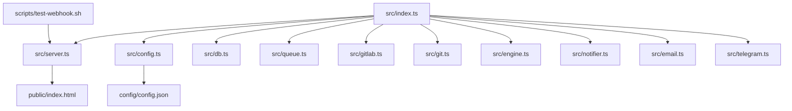
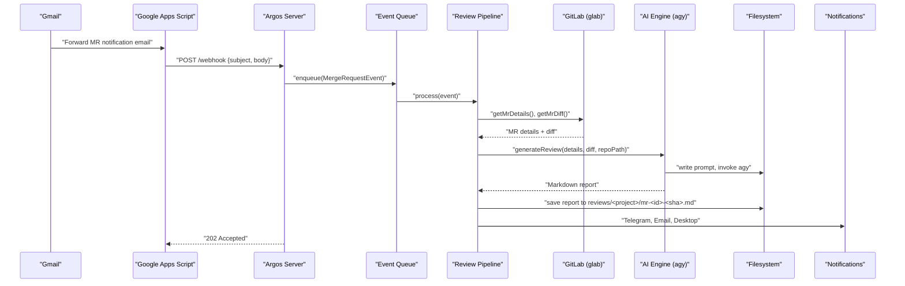
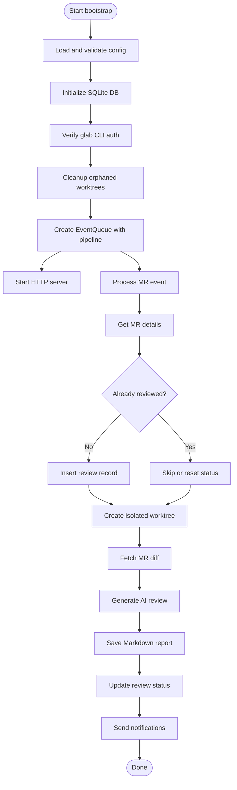
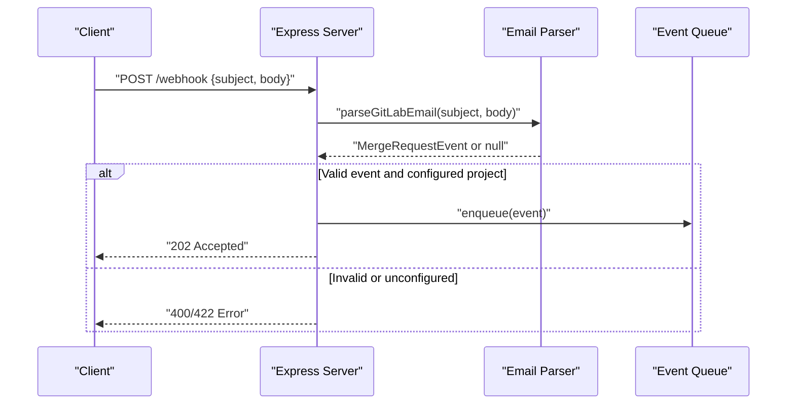
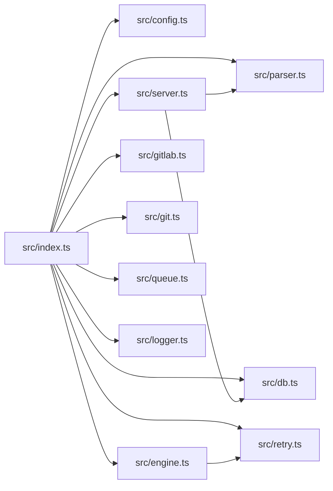

# Development Guide

<cite>
**Referenced Files in This Document**
- [README.md](file://README.md)
- [package.json](file://package.json)
- [tsconfig.json](file://tsconfig.json)
- [src/index.ts](file://src/index.ts)
- [src/server.ts](file://src/server.ts)
- [src/config.ts](file://src/config.ts)
- [src/parser.ts](file://src/parser.ts)
- [src/engine.ts](file://src/engine.ts)
- [scripts/test-webhook.sh](file://scripts/test-webhook.sh)
- [config/config.example.json](file://config/config.example.json)
</cite>

## Table of Contents
1. [Introduction](#introduction)
2. [Project Structure](#project-structure)
3. [Local Development Setup](#local-development-setup)
4. [TypeScript Compilation and Build](#typescript-compilation-and-build)
5. [Core Components](#core-components)
6. [Architecture Overview](#architecture-overview)
7. [Detailed Component Analysis](#detailed-component-analysis)
8. [Dependency Analysis](#dependency-analysis)
9. [Testing Strategies](#testing-strategies)
10. [Debugging Techniques](#debugging-techniques)
11. [Extending Functionality](#extending-functionality)
12. [Coding Standards and Contribution Guidelines](#coding-standards-and-contribution-guidelines)
13. [Performance Considerations](#performance-considerations)
14. [Troubleshooting Guide](#troubleshooting-guide)
15. [Conclusion](#conclusion)

## Introduction
This guide explains how to contribute to the Argos project: a self-hosted AI code review assistant that processes GitLab Merge Request notifications, runs an agentic AI review, and produces structured Markdown reports with optional notifications. It covers local setup, TypeScript compilation, testing with the provided webhook script, debugging techniques, code organization, coding standards, contribution workflows, and guidance for extending functionality such as adding notification channels or modifying the AI review engine.

## Project Structure
Argos is a Node.js/TypeScript application organized by feature modules under `src/`, with configuration, scripts, and static assets in dedicated directories. The main entry point bootstraps configuration, database, CLI authentication, worktree cleanup, event queue processing, and the HTTP server.

**Diagram sources**
- [src/index.ts:20-191](file://src/index.ts#L20-L191)
- [src/server.ts:10-113](file://src/server.ts#L10-L113)
- [src/config.ts:39-79](file://src/config.ts#L39-L79)
- [scripts/test-webhook.sh:5-14](file://scripts/test-webhook.sh#L5-L14)

**Section sources**
- [README.md:160-201](file://README.md#L160-L201)
- [src/index.ts:20-191](file://src/index.ts#L20-L191)

## Local Development Setup
Follow these steps to set up a local development environment:

- Install dependencies using your package manager (the repository includes both npm and pnpm lockfiles).
- Copy the example configuration file to `config/config.json` and edit it to match your environment.
- Ensure external tools are installed and authenticated:
  - Node.js ≥ 18
  - Git
  - glab CLI (authenticated via `glab auth login`)
  - agy CLI (for AI reviews)
  - Optional: BurntToast PowerShell module for Windows desktop notifications
- Start the agent and open the web dashboard at the configured port.

Key references:
- Prerequisites and quick start instructions are documented in the project README.
- Configuration schema and defaults are defined in the config loader.
- Example configuration structure is provided in `config/config.example.json`.

**Section sources**
- [README.md:46-130](file://README.md#L46-L130)
- [config/config.example.json:1-28](file://config/config.example.json#L1-L28)
- [src/config.ts:23-36](file://src/config.ts#L23-L36)

## TypeScript Compilation and Build
The project uses TypeScript with strict mode enabled. The compiler target is ES2022, CommonJS modules, and output goes to `dist/`. Source files live under `src/`.

Important settings:
- Target: ES2022
- Module: CommonJS
- Strict mode: enabled
- Root directory: `src`
- Output directory: `dist`
- Types: Node types included

Development run:
- Use `npm start` to run the application directly via `ts-node` against `src/index.ts`.

Build command:
- Run the TypeScript compiler to emit JavaScript into `dist/`:
  - `npx tsc`

Notes:
- The package.json does not define a build script; use the TypeScript compiler directly.
- The runtime entrypoint remains `src/index.ts` during development.

**Section sources**
- [tsconfig.json:1-15](file://tsconfig.json#L1-L15)
- [package.json:8-11](file://package.json#L8-L11)

## Core Components
Argos is composed of several core modules:

- Bootstrap and pipeline orchestration (`src/index.ts`)
- HTTP server and API endpoints (`src/server.ts`)
- Configuration loading and validation (`src/config.ts`)
- Email parser (`src/parser.ts`)
- SQLite persistence (`src/db.ts`)
- Git worktree management (`src/git.ts`)
- GitLab CLI wrapper (`src/gitlab.ts`)
- AI review engine (`src/engine.ts`)
- Notification channels: Telegram, Email, Desktop (`src/telegram.ts`, `src/email.ts`, `src/notifier.ts`)
- Retry utility (`src/retry.ts`)
- Logging (`src/logger.ts`)
- Event queue (`src/queue.ts`)

Responsibilities:
- `index.ts` orchestrates startup, validates configuration, initializes DB, verifies CLI auth, cleans orphaned worktrees, creates the event queue, and starts the server.
- `server.ts` serves the dashboard, exposes REST APIs, and handles incoming webhooks.
- `engine.ts` constructs prompts and invokes the agy CLI with retries and timeouts.
- `parser.ts` extracts MR metadata from email payloads.
- `config.ts` validates configuration using Zod and ensures repository paths exist.

**Section sources**
- [src/index.ts:20-191](file://src/index.ts#L20-L191)
- [src/server.ts:10-113](file://src/server.ts#L10-L113)
- [src/config.ts:39-79](file://src/config.ts#L39-L79)
- [src/parser.ts:1-92](file://src/parser.ts#L1-L92)
- [src/engine.ts:8-213](file://src/engine.ts#L8-L213)

## Architecture Overview
The system receives GitLab MR notifications via email forwarded through Google Apps Script to Argos’s HTTP server. The server parses the payload, enqueues events, and processes them sequentially. Each event triggers Git operations, diff retrieval, AI review generation, report saving, and notifications.

**Diagram sources**
- [src/server.ts:83-108](file://src/server.ts#L83-L108)
- [src/index.ts:47-183](file://src/index.ts#L47-L183)
- [src/engine.ts:8-213](file://src/engine.ts#L8-L213)

## Detailed Component Analysis

### Bootstrap and Pipeline Orchestration (`src/index.ts`)
Responsibilities:
- Load and validate configuration
- Initialize SQLite database
- Verify glab CLI authentication
- Clean orphaned worktrees
- Create sequential event queue with review pipeline processor
- Start HTTP server

Pipeline steps per event:
- Fetch MR details and deduplicate via SQLite
- Create isolated Git worktree
- Fetch MR diff
- Generate AI review via agy CLI
- Save Markdown report
- Update review status
- Send notifications (Telegram, Email, Desktop)

Error handling:
- On failure, attempts to mark pending reviews as failed
- Always removes the temporary worktree in finally block

**Diagram sources**
- [src/index.ts:20-191](file://src/index.ts#L20-L191)

**Section sources**
- [src/index.ts:20-191](file://src/index.ts#L20-L191)

### HTTP Server and Web Dashboard (`src/server.ts`)
Endpoints:
- GET `/status`: Health check returning status and uptime
- GET `/api/reviews`: List all reviews (JSON)
- GET `/api/reviews/:id`: Get specific review content (JSON with markdown)
- POST `/api/reviews/:id/retry`: Re-enqueue a review with forceRetry flag
- POST `/webhook`: Accepts email payloads, parses into MergeRequestEvent, enqueues for processing

Static serving:
- Serves the web dashboard from `public/`

Validation:
- Validates required fields in webhook payload
- Rejects unconfigured projects

**Diagram sources**
- [src/server.ts:16-113](file://src/server.ts#L16-L113)
- [src/parser.ts:17-91](file://src/parser.ts#L17-L91)

**Section sources**
- [src/server.ts:10-113](file://src/server.ts#L10-L113)

### Configuration Loader (`src/config.ts`)
Features:
- Zod schemas for repositories, email, and top-level config
- Loads `config/config.json` at runtime
- Validates JSON and schema constraints
- Ensures all repository local paths exist on disk

Errors:
- Throws descriptive errors when config file is missing, invalid JSON, or schema validation fails
- Logs detailed messages for troubleshooting

**Section sources**
- [src/config.ts:1-80](file://src/config.ts#L1-L80)

### Email Parser (`src/parser.ts`)
Responsibilities:
- Extracts MR URL, project name, MR ID, title, and action from email subject/body
- Handles percent-encoded URLs (e.g., FireEye-wrapped links)
- Classifies actions: opened, updated, approved, merged, commented, unknown

Edge cases:
- Returns null if no valid MR URL is found
- Defaults to updated action when uncertain

**Section sources**
- [src/parser.ts:1-92](file://src/parser.ts#L1-L92)

### AI Review Engine (`src/engine.ts`)
Responsibilities:
- Constructs a structured prompt including MR metadata and diff
- Writes prompt to a temporary file to avoid command-line length limits
- Invokes agy CLI with flags for non-interactive mode, model selection, and extended timeout
- Implements retry logic with exponential backoff
- Truncates large diffs (>100K chars)
- Cleans up prompt files after execution

Timeouts and retries:
- Timeout kills the process if agy takes too long
- Retries up to 2 times with backoff

**Section sources**
- [src/engine.ts:8-213](file://src/engine.ts#L8-L213)

## Dependency Analysis
High-level dependency relationships:

**Diagram sources**
- [src/index.ts:1-18](file://src/index.ts#L1-L18)
- [src/server.ts:1-8](file://src/server.ts#L1-L8)
- [src/engine.ts:1-6](file://src/engine.ts#L1-L6)

**Section sources**
- [src/index.ts:1-18](file://src/index.ts#L1-L18)
- [src/server.ts:1-8](file://src/server.ts#L1-L8)
- [src/engine.ts:1-6](file://src/engine.ts#L1-L6)

## Testing Strategies
Use the provided test webhook script to send sample payloads to the running server:

- Start the server locally
- Execute the test script to simulate a GitLab MR notification
- Validate responses and logs to confirm parsing, queuing, and processing

Example usage:
- `bash scripts/test-webhook.sh`

Expected behavior:
- The server accepts the payload and enqueues the event
- The pipeline processes the event and generates a review
- Logs indicate success or failure

**Section sources**
- [scripts/test-webhook.sh:1-33](file://scripts/test-webhook.sh#L1-L33)
- [README.md:289-295](file://README.md#L289-L295)

## Debugging Techniques
- Set log level via environment variable `LOG_LEVEL` (supports debug, info, warn, error, fatal)
- Inspect server logs for parsing, queuing, and pipeline steps
- Check generated prompt files under `state/prompts/` for AI review context
- Validate configuration and repository paths using config loader errors
- Use health endpoint `/status` to verify server availability

Tips:
- Enable debug logging to see detailed pipeline progress
- Confirm glab CLI authentication before starting
- Ensure agy CLI is installed and accessible in PATH

**Section sources**
- [README.md:297-302](file://README.md#L297-L302)
- [src/config.ts:41-79](file://src/config.ts#L41-L79)
- [src/engine.ts:80-90](file://src/engine.ts#L80-L90)

## Extending Functionality

### Adding a New Notification Channel
Steps:
1. Implement a new notifier module (e.g., `src/slack.ts`) with a function to send notifications.
2. Integrate it into the pipeline in `src/index.ts` after saving the report.
3. Add configuration options in `src/config.ts` Zod schema and update `config/config.example.json`.
4. Test the new channel using the webhook script and verify logs.

Considerations:
- Handle authentication securely via configuration
- Provide graceful fallbacks if the service is unavailable
- Log errors without breaking the pipeline

**Section sources**
- [src/index.ts:125-159](file://src/index.ts#L125-L159)
- [src/config.ts:23-36](file://src/config.ts#L23-L36)
- [config/config.example.json:12-26](file://config/config.example.json#L12-L26)

### Modifying the AI Review Engine
To change the AI review behavior:
- Edit the prompt construction in `src/engine.ts` to adjust sections, severity format, or classification rules
- Adjust CLI flags for agy (model, timeouts, permissions)
- Modify retry and timeout parameters as needed
- Validate changes using the webhook script and inspect generated reports

Safety:
- Keep prompt files under `state/prompts/` for debugging
- Ensure truncation thresholds align with model token limits
- Monitor logs for CLI errors and timeouts

**Section sources**
- [src/engine.ts:29-78](file://src/engine.ts#L29-L78)
- [src/engine.ts:91-193](file://src/engine.ts#L91-L193)

## Coding Standards and Contribution Guidelines
Standards:
- TypeScript strict mode is enabled; adhere to type safety
- Use Zod for runtime configuration validation
- Prefer clear, modular functions with single responsibilities
- Log meaningful messages for observability
- Avoid mutating shared state; prefer immutable data flows where possible

Contribution workflow:
- Fork the repository and create a feature branch
- Make focused changes aligned with one feature or fix
- Test locally using the webhook script
- Commit with clear, descriptive messages following conventional commits
- Open a pull request with a summary of changes and rationale

Quality assurance:
- Ensure configuration validation passes
- Verify all endpoints respond correctly
- Check logs for errors or warnings
- Validate generated reports and notifications

**Section sources**
- [tsconfig.json:1-15](file://tsconfig.json#L1-L15)
- [src/config.ts:58-79](file://src/config.ts#L58-L79)
- [README.md:289-312](file://README.md#L289-L312)

## Performance Considerations
- Sequential event processing prevents resource contention but may introduce latency under high load
- Large diffs are truncated to reduce AI processing time
- Worktrees are cleaned up automatically to free disk space
- Retry logic mitigates transient failures for CLI calls
- Consider scaling horizontally by running multiple instances behind a reverse proxy if needed

[No sources needed since this section provides general guidance]

## Troubleshooting Guide
Common issues and resolutions:
- Missing configuration file: copy `config/config.example.json` to `config/config.json` and fill in required fields
- Repository path not found: ensure local paths in config exist and are accessible
- glab CLI authentication failed: run `glab auth login`
- agy CLI not found or exits with errors: verify installation and PATH; check logs for stderr output
- Webhook returns 422: ensure payload contains subject and body and project is configured
- Notifications not sent: verify Telegram bot token/chatId or SMTP credentials in config

Logs to inspect:
- Startup logs for configuration and DB initialization
- Pipeline logs for MR processing steps
- Engine logs for agy invocation and timeouts
- Server logs for endpoint errors

**Section sources**
- [src/config.ts:41-79](file://src/config.ts#L41-L79)
- [src/server.ts:83-108](file://src/server.ts#L83-L108)
- [src/engine.ts:139-193](file://src/engine.ts#L139-L193)

## Conclusion
This guide provides a comprehensive overview of contributing to Argos, covering setup, TypeScript compilation, testing, debugging, architecture, component analysis, dependency mapping, extension points, coding standards, and troubleshooting. By following these practices, contributors can confidently extend functionality, maintain quality, and integrate new features while ensuring reliable operation.

[No sources needed since this section summarizes without analyzing specific files]