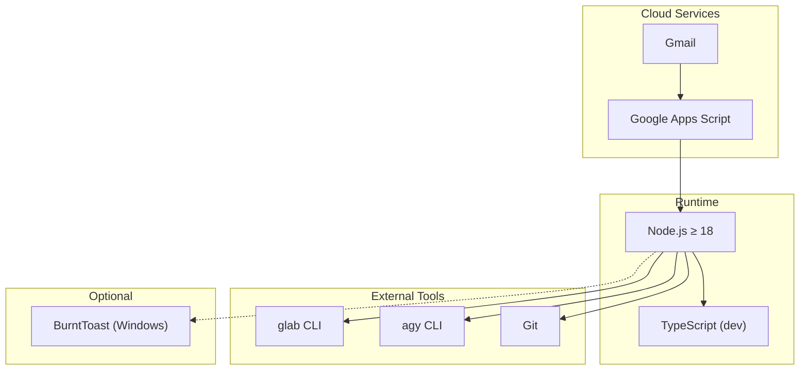
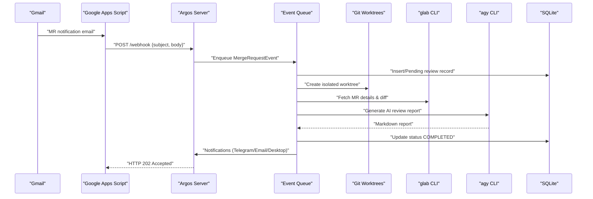
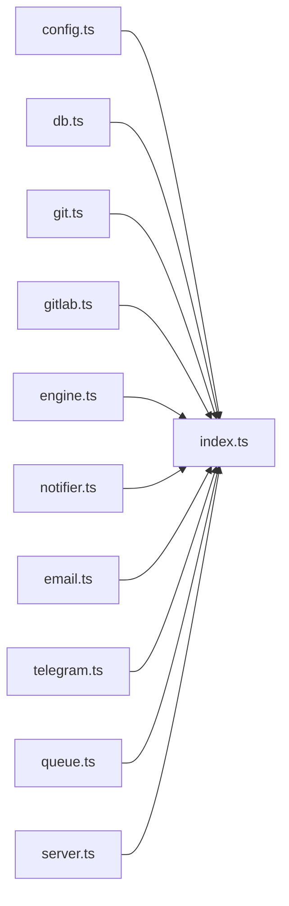

# Getting Started

<cite>
**Referenced Files in This Document**
- [README.md](file://README.md)
- [package.json](file://package.json)
- [config.example.json](file://config/config.example.json)
- [Google_Apps_Script_Setup.md](file://docs/Google_Apps_Script_Setup.md)
- [google-apps-script.js](file://scripts/google-apps-script.js)
- [config.ts](file://src/config.ts)
- [index.ts](file://src/index.ts)
- [gitlab.ts](file://src/gitlab.ts)
</cite>

## Table of Contents
1. [Introduction](#introduction)
2. [Project Structure](#project-structure)
3. [Core Components](#core-components)
4. [Architecture Overview](#architecture-overview)
5. [Detailed Component Analysis](#detailed-component-analysis)
6. [Dependency Analysis](#dependency-analysis)
7. [Performance Considerations](#performance-considerations)
8. [Troubleshooting Guide](#troubleshooting-guide)
9. [Conclusion](#conclusion)

## Introduction
This guide helps you set up the Argos AI Reviewer Agent, a self-hosted tool that automatically generates structured code review reports for GitLab Merge Requests using email-triggered events and an AI agent. It covers prerequisites, installation, configuration, authentication, Google Apps Script integration, optional Windows notifications, and verification steps to ensure everything is working correctly.

## Project Structure
Argos is a TypeScript application with an Express server, SQLite persistence, and external CLI integrations (glab and agy). The repository includes:
- Configuration examples and validation schemas
- A webhook receiver and web dashboard
- Email parsing, queue processing, and notification modules
- Git worktree management and GitLab CLI wrappers
- Documentation for Google Apps Script setup

**Diagram sources**
- [README.md:46-56](file://README.md#L46-L56)
- [package.json:8-10](file://package.json#L8-L10)

**Section sources**
- [README.md:160-201](file://README.md#L160-L201)
- [package.json:1-37](file://package.json#L1-L37)

## Core Components
- Runtime and build: Node.js runtime and TypeScript compiler are required; the app runs via ts-node.
- External CLIs: glab CLI for GitLab operations and agy CLI for AI reviews.
- Data persistence: SQLite database stores review records and status.
- Web interface: Express serves a static dashboard and API endpoints.
- Event pipeline: Parses emails, queues events, creates isolated worktrees, fetches diffs, invokes AI, saves reports, and sends notifications.

Key responsibilities:
- Configuration loading and validation
- Database initialization and queries
- Git worktree lifecycle management
- GitLab metadata and diff retrieval
- AI review generation via agy
- Notifications (Telegram, SMTP email, desktop)

**Section sources**
- [README.md:203-260](file://README.md#L203-L260)
- [index.ts:20-191](file://src/index.ts#L20-L191)
- [config.ts:1-80](file://src/config.ts#L1-L80)

## Architecture Overview
The system integrates Gmail notifications into a local HTTP server through Google Apps Script. The server processes MR events sequentially, performs Git operations, calls the AI agent, and persists results.

**Diagram sources**
- [README.md:5-28](file://README.md#L5-L28)
- [index.ts:47-183](file://src/index.ts#L47-L183)
- [gitlab.ts:21-95](file://src/gitlab.ts#L21-L95)

## Detailed Component Analysis

### Prerequisites and Installation
- Install Node.js version 18 or newer.
- Ensure TypeScript is available (used by dev scripts).
- Install glab CLI and authenticate it.
- Install agy CLI for AI reviews.
- Ensure Git is installed.
- Set up Gmail + Google Apps Script to forward MR notifications to your local server.
- Optional: Install BurntToast on Windows for desktop notifications.

Steps:
1. Clone the repository and install dependencies.
2. Copy the example configuration file and edit it.
3. Authenticate glab CLI.
4. Configure Google Apps Script to forward emails to the agent’s webhook endpoint.
5. Optionally install BurntToast.
6. Start the agent.

Verification:
- Confirm the server starts and listens on the configured port.
- Open the web dashboard at the configured URL.
- Send a test webhook payload to validate the pipeline.

**Section sources**
- [README.md:46-130](file://README.md#L46-L130)
- [package.json:8-10](file://package.json#L8-L10)

### Configuration File Setup
The application loads and validates configuration from config/config.json using Zod schemas. Required fields include:
- Port and public URL for the web dashboard
- repositories mapping project names to GitLab project IDs and local paths
- Optional telegram and email notification settings

Validation ensures:
- All required fields are present and valid
- Local repository paths exist on disk
- JSON structure matches expected schema

Example configuration keys:
- port: HTTP server port
- publicUrl: Public base URL for deep links
- repositories.<name>.projectId: GitLab project ID
- repositories.<name>.localPath: Absolute path to local clone
- telegram.botToken and telegram.chatId: Optional Telegram Bot credentials
- email.*: SMTP settings for sending notifications

To get started:
- Copy config/config.example.json to config/config.json
- Fill in your GitLab project IDs and local repository paths
- Add optional notification settings if needed

**Section sources**
- [config.example.json:1-28](file://config/config.example.json#L1-L28)
- [config.ts:6-34](file://src/config.ts#L6-L34)
- [config.ts:41-79](file://src/config.ts#L41-L79)

### glab CLI Authentication
Before starting the agent, authenticate glab CLI so it can fetch MR details and diffs. The application verifies authentication on startup and will fail fast if no active token is found.

Setup:
- Run glab auth login and follow prompts to authenticate with your GitLab instance.
- Ensure glab is accessible in PATH.

Startup behavior:
- On bootstrap, the application checks for an active GitLab token.
- If not authenticated, it throws an error instructing you to run glab auth login.

**Section sources**
- [README.md:106-110](file://README.md#L106-L110)
- [gitlab.ts:21-48](file://src/gitlab.ts#L21-L48)
- [index.ts:30-31](file://src/index.ts#L30-L31)

### Google Apps Script Email Bridge
Use Google Apps Script to forward GitLab MR notifications from Gmail to the agent’s webhook endpoint.

Steps:
1. Create a Gmail filter to label incoming GitLab MR notifications (e.g., label name GitLab/MRs).
2. Deploy the provided Google Apps Script project and paste the script contents.
3. Update WEBHOOK_URL to point to your local server (use ngrok or similar to expose port 8000).
4. Update GMAIL_LABEL to match your Gmail filter label.
5. Create a time-driven trigger to run processNewEmails every minute.
6. Grant permissions when prompted.
7. Test by marking an old MR notification as unread and applying the label; wait for the trigger to run.

Payload format:
- subject: Email subject line
- body: Plain text or HTML body content

Expected response:
- HTTP 202 Accepted indicates successful ingestion.

**Section sources**
- [Google_Apps_Script_Setup.md:1-39](file://docs/Google_Apps_Script_Setup.md#L1-L39)
- [google-apps-script.js:1-78](file://scripts/google-apps-script.js#L1-L78)

### Starting the Agent
Run the application using the provided npm script. The server will:
- Load and validate configuration
- Initialize SQLite database
- Verify glab CLI authentication
- Clean up orphaned worktrees
- Start the event queue and HTTP server

Access the web dashboard at the configured port and public URL.

**Section sources**
- [README.md:124-130](file://README.md#L124-L130)
- [index.ts:20-191](file://src/index.ts#L20-L191)

### Optional: BurntToast for Windows Notifications
Install the BurntToast PowerShell module to enable clickable Windows toast notifications from WSL. This allows opening the specific review in your browser directly from the notification.

Installation:
- In PowerShell (Windows or WSL), install the module.

Usage:
- The notifier module executes PowerShell commands to send notifications with a logo and deep link to the dashboard.

**Section sources**
- [README.md:116-122](file://README.md#L116-L122)
- [README.md:234-236](file://README.md#L234-L236)

## Dependency Analysis
Argos depends on:
- Node.js runtime and TypeScript for development
- glab CLI for GitLab operations
- agy CLI for AI review generation
- Git for worktree management
- Gmail and Google Apps Script for event ingestion
- Optional BurntToast for desktop notifications

Internal modules:
- Configuration loader and validator
- Database manager
- Git worktree manager
- GitLab CLI wrapper
- AI review engine
- Notification handlers (Telegram, SMTP, Desktop)
- HTTP server and webhook handler
- Event queue

**Diagram sources**
- [index.ts:1-18](file://src/index.ts#L1-L18)

**Section sources**
- [README.md:203-260](file://README.md#L203-L260)

## Performance Considerations
- Sequential processing: The in-memory queue processes one MR at a time to avoid resource contention.
- Retry with backoff: glab CLI and agy CLI calls are retried with exponential backoff to handle transient failures.
- Large diff handling: Diffs exceeding a threshold are truncated to keep prompt sizes manageable.
- Orphan cleanup: Startup and post-review cleanup removes stale worktrees to prevent disk bloat.

[No sources needed since this section provides general guidance]

## Troubleshooting Guide
Common issues and resolutions:
- Missing configuration file:
  - Ensure config/config.json exists and is valid JSON.
  - Validate that all local repository paths exist on disk.
- glab CLI not authenticated:
  - Run glab auth login and verify authentication.
  - Ensure glab is installed and in PATH.
- Google Apps Script not forwarding emails:
  - Confirm the Gmail filter label matches the script’s GMAIL_LABEL.
  - Verify WEBHOOK_URL points to a reachable endpoint (use ngrok if needed).
  - Check that the time-driven trigger is enabled and running every minute.
- Server not responding:
  - Confirm the server started successfully and is listening on the configured port.
  - Use the health check endpoint to verify service status.
- Test webhook:
  - Use the included test script to send a sample payload to /webhook.

Verification checklist:
- Dependencies installed (Node.js, TypeScript, glab, agy, Git)
- Configuration file copied and edited
- glab CLI authenticated
- Google Apps Script deployed and triggered
- Server started and dashboard accessible
- Test webhook returns accepted status

**Section sources**
- [README.md:289-302](file://README.md#L289-L302)
- [config.ts:41-79](file://src/config.ts#L41-L79)
- [gitlab.ts:21-48](file://src/gitlab.ts#L21-L48)
- [Google_Apps_Script_Setup.md:34-39](file://docs/Google_Apps_Script_Setup.md#L34-L39)

## Conclusion
You now have a complete setup guide for the Argos AI Reviewer Agent. With Node.js, TypeScript, glab, agy, Git, Gmail, and Google Apps Script configured, the agent will automatically generate AI-powered review reports for GitLab merge requests. Use the web dashboard to browse reports and optionally enable desktop notifications for a streamlined workflow.

[No sources needed since this section summarizes without analyzing specific files]