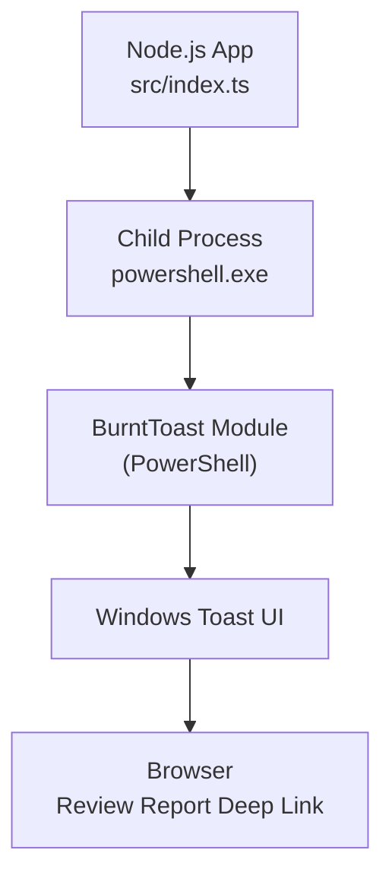
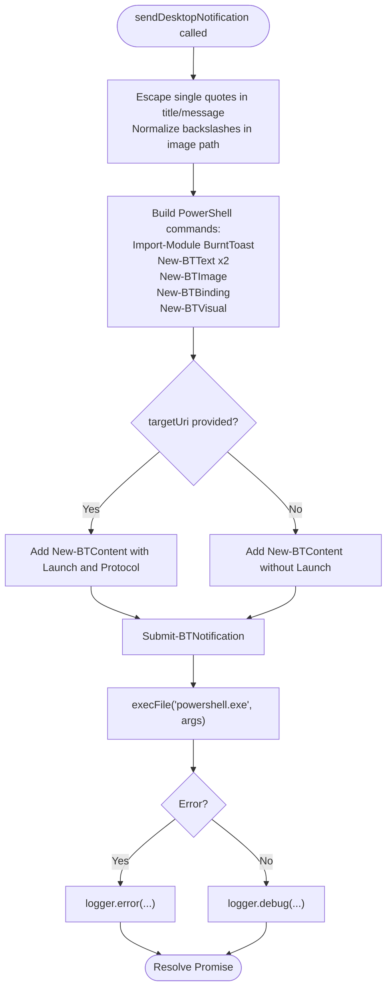
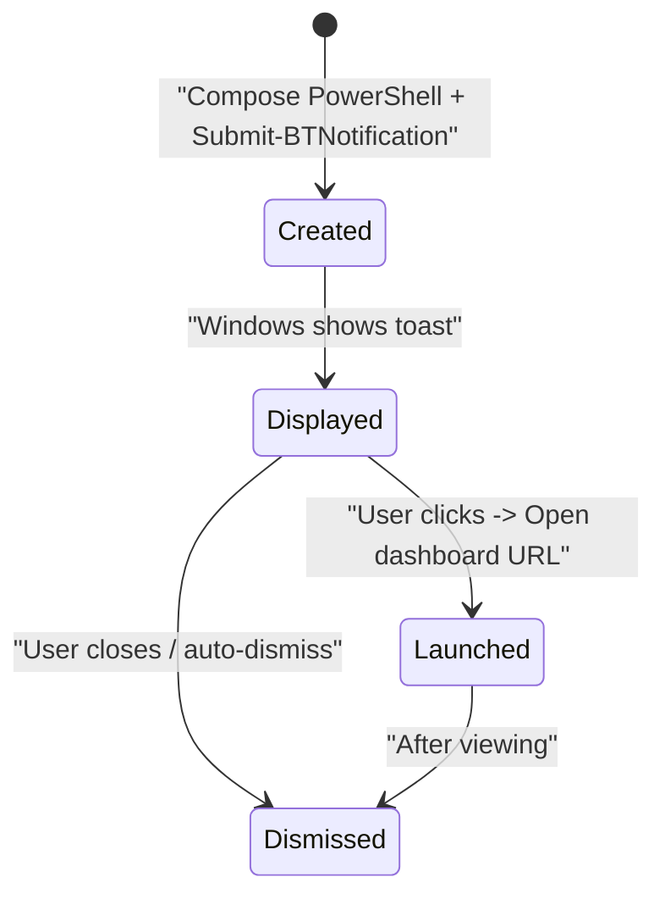
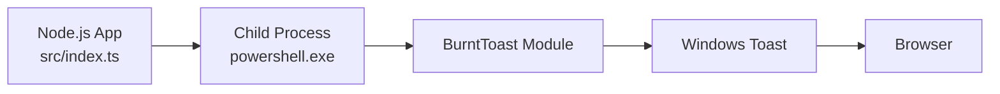

# Desktop Notifications

<cite>
**Referenced Files in This Document**
- [notifier.ts](file://src/notifier.ts)
- [index.ts](file://src/index.ts)
- [README.md](file://README.md)
- [package.json](file://package.json)
</cite>

## Table of Contents
1. [Introduction](#introduction)
2. [Project Structure](#project-structure)
3. [Core Components](#core-components)
4. [Architecture Overview](#architecture-overview)
5. [Detailed Component Analysis](#detailed-component-analysis)
6. [Dependency Analysis](#dependency-analysis)
7. [Performance Considerations](#performance-considerations)
8. [Troubleshooting Guide](#troubleshooting-guide)
9. [Conclusion](#conclusion)
10. [Appendices](#appendices)

## Introduction
This document explains the Windows desktop notification system implemented with the BurntToast PowerShell module, invoked from Node.js running inside WSL (Windows Subsystem for Linux). It covers how notifications are created and displayed, how deep links open review reports in the browser, how user interactions are handled, and how to set up and troubleshoot the integration.

The system is designed to run on Windows via WSL, where Node.js calls PowerShell to send toast notifications using BurntToast. The notifications include a title, body, optional logo image, and a clickable action that opens the Web Dashboard at a specific review report URL.

## Project Structure
The notification feature is implemented as a small Node.js module that executes PowerShell commands through the standard library’s child process API. The main application orchestrates when to send notifications after an AI review completes.



**Diagram sources**
- [index.ts:151-159](file://src/index.ts#L151-L159)
- [notifier.ts:11-59](file://src/notifier.ts#L11-L59)

**Section sources**
- [README.md:41-42](file://README.md#L41-L42)
- [README.md:186-186](file://README.md#L186-L186)
- [README.md:234-236](file://README.md#L234-L236)
- [README.md:312-312](file://README.md#L312-L312)

## Core Components
- Notification sender module: encapsulates PowerShell command construction and execution.
- Application pipeline: triggers notifications after successful review completion.
- Configuration: environment variables and app configuration control behavior such as default logo path and dashboard base URL.

Key responsibilities:
- Construct safe PowerShell commands for BurntToast.
- Execute PowerShell via `execFile` to avoid shell escaping issues.
- Log success or failure without blocking the main pipeline.
- Provide deep linking to the review report in the Web Dashboard.

**Section sources**
- [notifier.ts:1-61](file://src/notifier.ts#L1-L61)
- [index.ts:151-159](file://src/index.ts#L151-L159)

## Architecture Overview
The notification flow integrates into the review pipeline. After generating and saving the review report, the application constructs a dashboard URL and sends a toast notification. When the user clicks the notification, the configured protocol handler launches the browser to the specified review ID.

```mermaid
sequenceDiagram
participant Pipeline as "Review Pipeline<br/>src/index.ts"
participant Notifier as "Notifier<br/>src/notifier.ts"
participant PS as "PowerShell<br/>powershell.exe"
participant BT as "BurntToast<br/>(PS Module)"
participant OS as "Windows Toast"
participant Browser as "Browser"
Pipeline->>Pipeline : Generate & save review report
Pipeline->>Notifier : sendDesktopNotification(title, message, dashboardUrl)
Notifier->>PS : execFile("powershell.exe", args)
PS->>BT : Import-Module BurntToast; Build content; Submit-BTNotification
BT-->>OS : Show toast with title, body, image, launch URI
OS-->>Browser : On click -> Open dashboard URL with review ID
```

**Diagram sources**
- [index.ts:151-159](file://src/index.ts#L151-L159)
- [notifier.ts:24-47](file://src/notifier.ts#L24-L47)

## Detailed Component Analysis

### Notification Sender Module
The notifier module builds and executes PowerShell commands to create and submit a toast notification. It supports:
- Title and body text.
- Optional custom logo image path (Windows absolute path).
- Optional deep link to a target URI (protocol-based activation).
- Safe string escaping for PowerShell arguments.

Behavior highlights:
- Uses `execFile` to call `powershell.exe` directly, bypassing shell escaping complexity.
- Always resolves the promise to avoid blocking the pipeline, even if PowerShell fails.
- Logs errors and debug messages via the shared logger.



**Diagram sources**
- [notifier.ts:11-59](file://src/notifier.ts#L11-L59)

**Section sources**
- [notifier.ts:1-61](file://src/notifier.ts#L1-L61)

### Integration Point in Review Pipeline
The main application invokes the notification sender after completing the review workflow. It constructs:
- A concise title including project name and MR number.
- A short body encouraging the user to view the report.
- A dashboard URL with the review ID for deep linking.

```mermaid
sequenceDiagram
participant Pipeline as "Review Pipeline<br/>src/index.ts"
participant Notifier as "Notifier<br/>src/notifier.ts"
Pipeline->>Pipeline : Update DB status to COMPLETED
Pipeline->>Pipeline : Compose desktopTitle, desktopMessage, dashboardUrl
Pipeline->>Notifier : await sendDesktopNotification(...)
Note over Pipeline,Notifier : Non-blocking; errors logged but do not fail pipeline
```

**Diagram sources**
- [index.ts:151-159](file://src/index.ts#L151-L159)

**Section sources**
- [index.ts:151-159](file://src/index.ts#L151-L159)

### Toast Customization Details
- Title formatting: Includes project name and MR identifier for quick context.
- Body content: Short summary with a call-to-action to view the report.
- Deep linking: Uses a dashboard URL with a query parameter for the review ID.
- Action buttons: Implemented via BurntToast’s content model; the primary interaction is clicking the toast to launch the target URI.
- Image override: Supports a custom logo image path passed as an absolute Windows path.

Notes:
- The implementation uses protocol-based activation for launching the target URI.
- The default logo path can be supplied via an environment variable; if omitted, no image override is applied.

**Section sources**
- [notifier.ts:4-31](file://src/notifier.ts#L4-L31)
- [notifier.ts:34-40](file://src/notifier.ts#L34-L40)
- [index.ts:152-158](file://src/index.ts#L152-L158)

### Notification Lifecycle
- Creation: The notifier composes PowerShell commands to build a BurntToast content object and submits it.
- Display timing: Occurs immediately after the review pipeline completes successfully.
- User interaction handling: Clicking the toast triggers the configured protocol handler to open the dashboard URL.
- Automatic dismissal: Managed by Windows; the application does not explicitly dismiss notifications.



[No sources needed since this diagram shows conceptual lifecycle, not actual code structure]

## Dependency Analysis
The notification feature depends on:
- Node.js runtime and its child process capabilities.
- PowerShell availability on Windows (invoked from WSL).
- BurntToast PowerShell module installed in the PowerShell environment.
- A valid Windows absolute path for the logo image (optional).
- A public URL configured for the Web Dashboard to construct deep links.



**Diagram sources**
- [index.ts:151-159](file://src/index.ts#L151-L159)
- [notifier.ts:44-47](file://src/notifier.ts#L44-L47)

**Section sources**
- [README.md:41-42](file://README.md#L41-L42)
- [README.md:116-122](file://README.md#L116-L122)
- [README.md:234-236](file://README.md#L234-L236)

## Performance Considerations
- Non-blocking execution: The notifier always resolves its promise, ensuring the review pipeline continues regardless of PowerShell outcome.
- Minimal overhead: PowerShell invocation is lightweight; however, repeated rapid notifications may cause transient UI load on Windows.
- Logging: Errors are logged without interrupting the pipeline; consider enabling debug logs to diagnose issues.

[No sources needed since this section provides general guidance]

## Troubleshooting Guide

Common issues and resolutions:
- PowerShell not found or blocked:
  - Ensure PowerShell is available on Windows and accessible from WSL.
  - Execution policy may block script/module loading; use a per-process bypass flag when invoking PowerShell.
- BurntToast module missing:
  - Install the BurntToast module in PowerShell before running the application.
- Permission issues:
  - Running from WSL requires appropriate permissions to invoke Windows processes.
  - Ensure the Node.js process has rights to execute external commands.
- Missing dependencies:
  - Verify Node.js version meets requirements and dependencies are installed.
- Logo image path invalid:
  - Provide an absolute Windows path for the image; ensure the file exists and is readable by the Windows session.
- Deep link not opening:
  - Confirm the dashboard URL is correct and reachable from the browser.
  - Ensure the protocol handler is registered if required by your setup.

Setup checklist:
- Install BurntToast module in PowerShell:
  - Run the installation command in PowerShell (on Windows or WSL).
- Configure environment variables:
  - Optionally set the default logo path via environment variable.
- Validate PowerShell execution policy:
  - Use a per-process bypass when invoking PowerShell from Node.js.

References:
- README includes setup instructions for installing BurntToast and describes the WSL-native notification approach.

**Section sources**
- [README.md:116-122](file://README.md#L116-L122)
- [README.md:234-236](file://README.md#L234-L236)
- [README.md:312-312](file://README.md#L312-L312)
- [notifier.ts:44-57](file://src/notifier.ts#L44-L57)

## Conclusion
The Windows desktop notification system leverages BurntToast via PowerShell executed from Node.js in WSL. It provides a simple, non-blocking mechanism to notify users about completed reviews, with deep links to the Web Dashboard for immediate access to detailed reports. Proper setup of PowerShell, BurntToast, and environment variables ensures reliable operation. Error handling is designed to keep the main pipeline resilient while logging actionable diagnostics.

[No sources needed since this section summarizes without analyzing specific files]

## Appendices

### Environment Variables and Configuration
- Default logo path:
  - Controlled by an environment variable; if unset, no image override is applied.
- Dashboard URL:
  - Constructed from the application’s public URL plus the review ID query parameter.

**Section sources**
- [notifier.ts:4-4](file://src/notifier.ts#L4-L4)
- [index.ts:154-158](file://src/index.ts#L154-L158)

### Setup Instructions Summary
- Install BurntToast module in PowerShell.
- Ensure PowerShell is accessible from WSL.
- Optionally configure the default logo path via environment variable.
- Start the application and verify notifications appear on Windows.

**Section sources**
- [README.md:116-122](file://README.md#L116-L122)

### Cross-Platform Compatibility and Fallbacks
- Current design targets Windows via WSL; notifications rely on PowerShell and BurntToast.
- For non-Windows environments, the notifier still attempts to execute PowerShell; failures will be logged but will not block the pipeline.
- Consider adding a platform check to skip notification sending on non-Windows systems or provide alternative notification channels.

**Section sources**
- [notifier.ts:44-57](file://src/notifier.ts#L44-L57)
- [README.md:312-312](file://README.md#L312-L312)