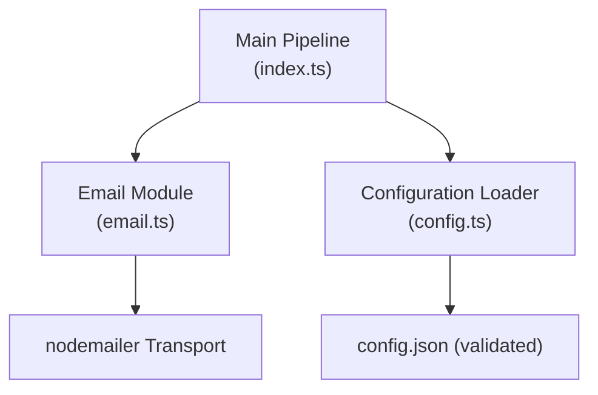
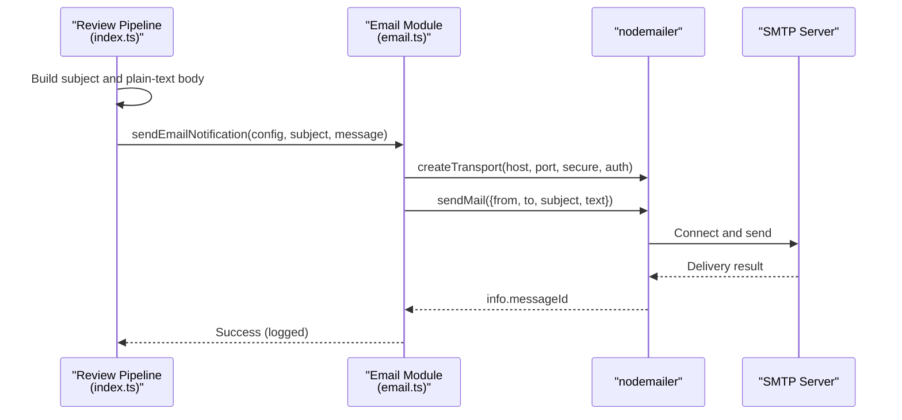
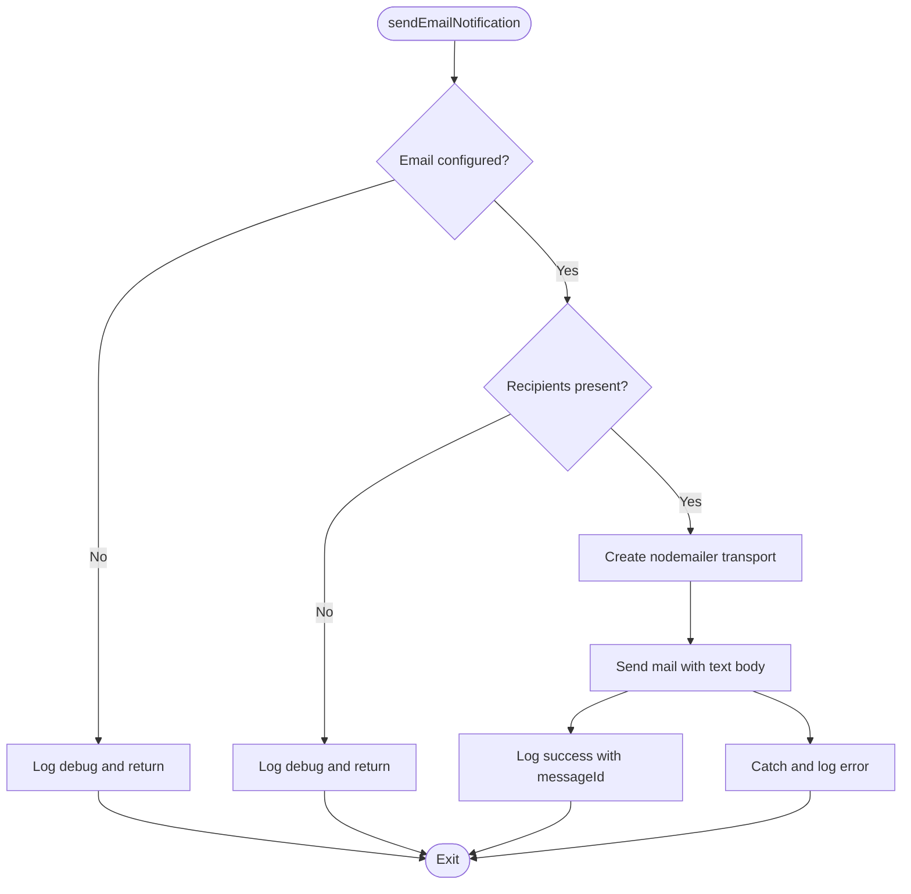
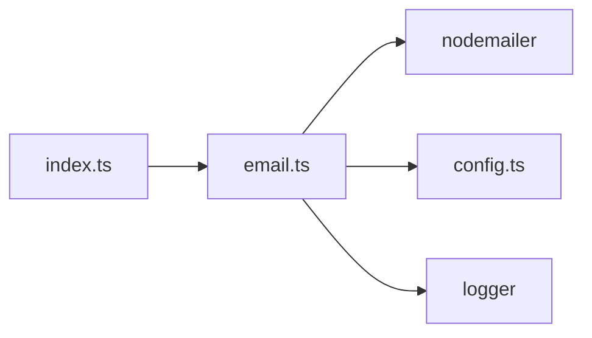

# Email Notifications

<cite>
**Referenced Files in This Document**
- [email.ts](file://src/email.ts)
- [config.ts](file://src/config.ts)
- [index.ts](file://src/index.ts)
- [retry.ts](file://src/retry.ts)
- [config.example.json](file://config/config.example.json)
- [README.md](file://README.md)
</cite>

## Table of Contents
1. [Introduction](#introduction)
2. [Project Structure](#project-structure)
3. [Core Components](#core-components)
4. [Architecture Overview](#architecture-overview)
5. [Detailed Component Analysis](#detailed-component-analysis)
6. [Dependency Analysis](#dependency-analysis)
7. [Performance Considerations](#performance-considerations)
8. [Troubleshooting Guide](#troubleshooting-guide)
9. [Conclusion](#conclusion)

## Introduction
This document explains the SMTP email notification system used by the application to deliver AI review completion notifications. It covers SMTP configuration, authentication, recipient management, message formatting, error handling, and performance considerations. It also provides guidance for extending the system with HTML templates, OAuth, and bulk sending patterns.

## Project Structure
The email notification feature is implemented as a small module that integrates into the main pipeline:
- Configuration is validated at startup using schema validation.
- The main pipeline composes an email subject and plain-text body after generating a review report.
- The email module sends notifications via nodemailer using the configured SMTP transport.
- Failures are logged but do not break the review pipeline.

**Diagram sources**
- [index.ts:136-149](file://src/index.ts#L136-L149)
- [email.ts:9-48](file://src/email.ts#L9-L48)
- [config.ts:11-34](file://src/config.ts#L11-L34)

**Section sources**
- [index.ts:136-149](file://src/index.ts#L136-L149)
- [email.ts:9-48](file://src/email.ts#L9-L48)
- [config.ts:11-34](file://src/config.ts#L11-L34)

## Core Components
- SMTP transport: Uses nodemailer with host, port, secure flag, and username/password authentication.
- Configuration schema: Validates email settings including host, port, secure, auth.user, auth.pass, from, and to array.
- Integration point: The main pipeline constructs a plain-text email after saving the review report and calls the email module.

Key responsibilities:
- Validate configuration before sending.
- Skip sending if email is not configured or recipients list is empty.
- Send emails and log success/failure without throwing exceptions.

**Section sources**
- [email.ts:9-48](file://src/email.ts#L9-L48)
- [config.ts:11-34](file://src/config.ts#L11-L34)
- [index.ts:136-149](file://src/index.ts#L136-L149)

## Architecture Overview
The email notification flow is triggered after a successful AI review. The pipeline builds a simple text-based notification and delegates delivery to the email module.

**Diagram sources**
- [index.ts:136-149](file://src/index.ts#L136-L149)
- [email.ts:22-42](file://src/email.ts#L22-L42)

## Detailed Component Analysis

### SMTP Configuration and Schema
- Host and port: Required fields; port must be a positive integer.
- Secure: Boolean flag indicating whether to use TLS on connect.
- Authentication: Username and password required when email is enabled.
- From and To: From must be a valid email address; To must be a non-empty array of email addresses.

Validation occurs during configuration load. If invalid, the application throws an error early.

**Section sources**
- [config.ts:11-34](file://src/config.ts#L11-L34)
- [config.example.json:16-26](file://config/config.example.json#L16-L26)

### Email Sending Logic
- Skips sending if email config is missing or recipients list is empty.
- Creates a nodemailer transport with host, port, secure, and basic auth.
- Sends a plain-text email with from, to, subject, and text.
- Logs success with messageId and logs errors without throwing.

**Diagram sources**
- [email.ts:9-48](file://src/email.ts#L9-L48)

**Section sources**
- [email.ts:9-48](file://src/email.ts#L9-L48)

### Recipient Management
- Recipients are defined as an array of email addresses in configuration.
- The email module joins them into a comma-separated string for nodemailer.
- No distribution lists or dynamic resolution logic is implemented in the current codebase.

Recommendation: For distribution lists, maintain separate arrays per repository or environment and merge them at runtime based on repository configuration.

**Section sources**
- [email.ts:15-40](file://src/email.ts#L15-L40)
- [config.ts:11-21](file://src/config.ts#L11-L21)

### Message Formatting and Templates
- Current implementation uses a plain-text body constructed in the main pipeline.
- There is no HTML template engine or styling in the email module.

To support professional HTML emails:
- Add an HTML field to the email payload alongside text.
- Introduce a template function that renders structured HTML with consistent styling.
- Ensure both text and HTML bodies are provided for compatibility.

Note: This section describes recommended enhancements; the current code does not implement HTML templates.

[No sources needed since this section proposes enhancements not present in the code]

### Security Considerations
- Credentials are stored in the configuration file under email.auth.user and email.auth.pass.
- The configuration file is loaded from disk and should be protected via filesystem permissions and secrets management.
- Transmission security depends on the SMTP server’s TLS configuration (secure flag).
- Avoid logging sensitive values such as passwords or tokens.

Best practices:
- Restrict access to config.json.
- Use environment variables or a secrets manager for credentials where possible.
- Prefer STARTTLS (port 587, secure=false) or implicit TLS (port 465, secure=true) according to provider requirements.

**Section sources**
- [config.ts:41-78](file://src/config.ts#L41-L78)
- [email.ts:25-33](file://src/email.ts#L25-L33)

### Retry Mechanisms
- The email module does not implement retries; failures are logged and ignored to avoid disrupting the review pipeline.
- The project includes a generic retry utility with exponential backoff that can be reused to wrap email sending if desired.

Recommended approach:
- Wrap sendEmailNotification with the retry utility for transient network or SMTP errors.
- Configure maxRetries and baseDelayMs appropriate for your SMTP provider.

**Section sources**
- [email.ts:43-47](file://src/email.ts#L43-L47)
- [retry.ts:12-35](file://src/retry.ts#L12-L35)

## Dependency Analysis
The email module depends on:
- nodemailer for SMTP transport and sending.
- Config object for SMTP settings and recipients.
- Logger for diagnostics.

The main pipeline depends on the email module to notify after completing a review.

**Diagram sources**
- [index.ts:14-15](file://src/index.ts#L14-L15)
- [email.ts:1-3](file://src/email.ts#L1-L3)
- [config.ts:1-4](file://src/config.ts#L1-L4)

**Section sources**
- [index.ts:14-15](file://src/index.ts#L14-L15)
- [email.ts:1-3](file://src/email.ts#L1-L3)

## Performance Considerations
- Sequential sending: The current implementation sends one email per review event. For bulk scenarios, consider batching recipients or parallelizing transports carefully to respect SMTP rate limits.
- Connection reuse: Reuse nodemailer transports where feasible to reduce connection overhead.
- Backpressure: Keep the event queue sequential to avoid overwhelming the SMTP server.
- Logging: Avoid verbose logging of large payloads or repeated messages in high-throughput environments.

[No sources needed since this section provides general guidance]

## Troubleshooting Guide
Common issues and resolutions:
- Email skipped due to missing configuration: Ensure email block exists in config.json and passes schema validation.
- Email skipped due to empty recipients: Verify the to array contains at least one valid email address.
- Connection failures: Check host, port, and secure flag match your SMTP provider’s requirements.
- Authentication failures: Confirm username and password are correct and allowed for SMTP access.
- Delivery problems: Inspect SMTP server logs and ensure outbound connectivity and DNS resolution are working.

Operational notes:
- Errors are logged but do not fail the review pipeline.
- Successful sends include a messageId in logs for traceability.

**Section sources**
- [email.ts:10-20](file://src/email.ts#L10-L20)
- [email.ts:43-47](file://src/email.ts#L43-L47)

## Conclusion
The SMTP email notification system is intentionally simple and resilient: it validates configuration, sends plain-text notifications, and logs outcomes without disrupting the core review workflow. To evolve toward production-grade usage, consider adding HTML templating, OAuth support, robust retry logic, and enhanced recipient management while maintaining strong security practices around credential storage and transmission.

[No sources needed since this section summarizes without analyzing specific files]