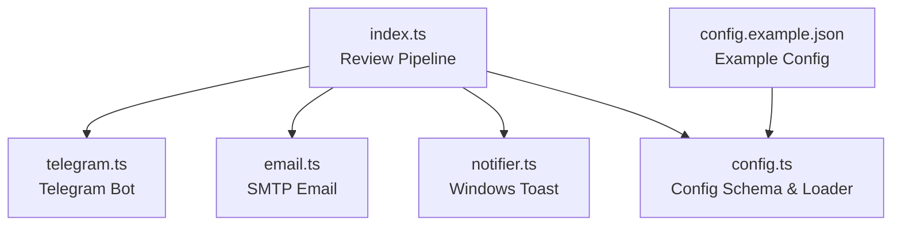
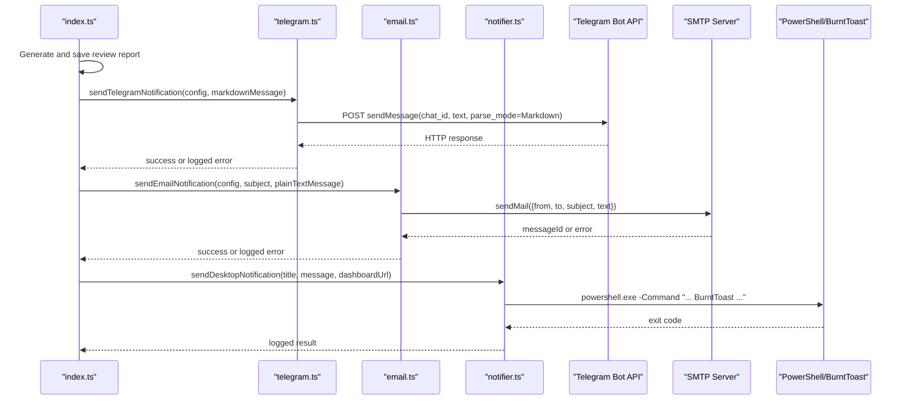
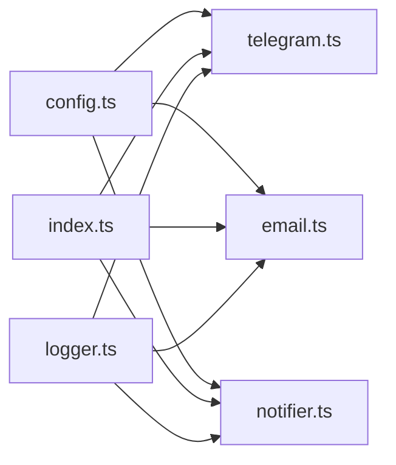

# Notification System

<cite>
**Referenced Files in This Document**
- [index.ts](file://src/index.ts)
- [telegram.ts](file://src/telegram.ts)
- [email.ts](file://src/email.ts)
- [notifier.ts](file://src/notifier.ts)
- [config.ts](file://src/config.ts)
- [config.example.json](file://config/config.example.json)
- [README.md](file://README.md)
</cite>

## Table of Contents
1. [Introduction](#introduction)
2. [Project Structure](#project-structure)
3. [Core Components](#core-components)
4. [Architecture Overview](#architecture-overview)
5. [Detailed Component Analysis](#detailed-component-analysis)
6. [Dependency Analysis](#dependency-analysis)
7. [Performance Considerations](#performance-considerations)
8. [Troubleshooting Guide](#troubleshooting-guide)
9. [Conclusion](#conclusion)

## Introduction
This document explains the multi-channel notification system used by the project to deliver review completion updates across three channels:
- Telegram Bot messages
- SMTP email notifications
- Windows desktop notifications via BurntToast (from WSL)

It covers configuration, message formatting, error handling, and best practices for reliable delivery. It also includes guidance on deep linking into the Web Dashboard from Windows toast notifications.

## Project Structure
The notification logic is implemented as small, focused modules that are invoked after a review report is generated and persisted. The main pipeline orchestrates these calls so that failures in any single channel do not fail the overall review process.

**Diagram sources**
- [index.ts:104-159](file://src/index.ts#L104-L159)
- [telegram.ts:8-43](file://src/telegram.ts#L8-L43)
- [email.ts:9-48](file://src/email.ts#L9-L48)
- [notifier.ts:11-60](file://src/notifier.ts#L11-L60)
- [config.ts:23-34](file://src/config.ts#L23-L34)
- [config.example.json:12-26](file://config/config.example.json#L12-L26)

**Section sources**
- [index.ts:104-159](file://src/index.ts#L104-L159)
- [config.ts:23-34](file://src/config.ts#L23-L34)
- [config.example.json:12-26](file://config/config.example.json#L12-L26)

## Core Components
- Telegram notifier: Sends Markdown-formatted messages using the Telegram Bot API. Skips gracefully if bot token or chat ID are missing.
- Email notifier: Uses nodemailer with host, port, secure flag, auth credentials, sender, and recipients. Skips if no recipients are configured.
- Desktop notifier: Executes PowerShell commands via execFile to render a BurntToast notification with optional clickable link and custom image path.
- Configuration loader: Validates config structure and required fields for repositories, email, and optional Telegram settings.

Key responsibilities:
- All notification senders catch errors and log them without throwing, ensuring the review pipeline continues even if a channel fails.
- The main pipeline composes channel-specific messages and invokes each notifier after saving the report.

**Section sources**
- [telegram.ts:8-43](file://src/telegram.ts#L8-L43)
- [email.ts:9-48](file://src/email.ts#L9-L48)
- [notifier.ts:11-60](file://src/notifier.ts#L11-L60)
- [config.ts:23-34](file://src/config.ts#L23-L34)
- [index.ts:125-159](file://src/index.ts#L125-L159)

## Architecture Overview
The notification system is triggered at the end of the review pipeline. Each channel receives its own tailored message and configuration.

**Diagram sources**
- [index.ts:125-159](file://src/index.ts#L125-L159)
- [telegram.ts:14-37](file://src/telegram.ts#L14-L37)
- [email.ts:22-42](file://src/email.ts#L22-L42)
- [notifier.ts:24-58](file://src/notifier.ts#L24-L58)

## Detailed Component Analysis

### Telegram Bot Integration
- Token and Chat ID:
  - Both botToken and chatId must be present in the telegram section of the configuration; otherwise, the notifier skips sending and logs a debug message.
- Message Formatting:
  - Messages are sent with parse_mode set to Markdown.
  - The pipeline constructs a Markdown message including project name, MR link, title, type, and report path.
- Error Handling:
  - Network or API errors are caught and logged; they do not throw exceptions.
  - Non-OK responses are logged with status and body.

Configuration requirements:
- telegram.botToken: string
- telegram.chatId: string

Example configuration keys:
- See example file for placeholder values.

Best practices:
- Keep botToken and chatId out of source control.
- Use a dedicated bot and private group/channel for alerts.
- Validate Markdown content to avoid Telegram parsing errors.

Common issues:
- Missing botToken or chatId results in skipped notifications.
- Invalid Markdown can cause Telegram API errors.
- Rate limiting or network errors will be logged but not fail the pipeline.

**Section sources**
- [telegram.ts:8-43](file://src/telegram.ts#L8-L43)
- [index.ts:125-134](file://src/index.ts#L125-L134)
- [config.ts:27-32](file://src/config.ts#L27-L32)
- [config.example.json:12-15](file://config/config.example.json#L12-L15)

### SMTP Email Notification System
- Host Configuration:
  - host, port, secure, auth.user, auth.pass, from, and to are required when email is enabled.
- Authentication:
  - Auth uses user/pass; secure indicates TLS usage depending on the server.
- Message Templates:
  - The pipeline builds a plain-text email with project, MR details, URL, title, and report path.
- Delivery Handling:
  - Uses nodemailer’s transporter.sendMail.
  - Success logs include the messageId.
  - Errors are caught and logged without throwing.

Configuration requirements:
- email.host: string
- email.port: number
- email.secure: boolean
- email.auth.user: string
- email.auth.pass: string
- email.from: email address
- email.to: array of email addresses

Example configuration keys:
- See example file for placeholder values.

Best practices:
- Use app passwords where supported.
- Prefer secure=true for ports like 465; use secure=false with STARTTLS on port 587 as appropriate.
- Ensure all recipients are valid to reduce bounce rates.

Common issues:
- No recipients configured leads to skipped delivery.
- Incorrect host/port/secure/auth causes connection or authentication errors.
- Sender domain may require SPF/DKIM setup for better deliverability.

**Section sources**
- [email.ts:9-48](file://src/email.ts#L9-L48)
- [index.ts:136-149](file://src/index.ts#L136-L149)
- [config.ts:11-21](file://src/config.ts#L11-L21)
- [config.example.json:16-26](file://config/config.example.json#L16-L26)

### Windows Desktop Notifications (BurntToast via WSL)
- WSL Integration:
  - The notifier executes PowerShell through Node’s execFile to call BurntToast from within WSL.
- Toast Customization:
  - Supports title, message, optional image path, and optional launch URI.
  - Image path defaults to an environment variable if provided; it is escaped for PowerShell.
- Deep Linking:
  - When a targetUri is provided, the toast becomes clickable and opens the specified URI via protocol activation.
  - The pipeline sets the URI to the Web Dashboard with a query parameter referencing the review id.

Configuration and environment:
- NOTIF_LOGO_PATH (optional): absolute Windows path to a logo image used in the toast.
- publicUrl (in config): base URL for the dashboard; combined with ?id=<reviewId> for deep links.

Best practices:
- Install BurntToast module in PowerShell before running the agent.
- Ensure the absolute Windows path for images is accessible from WSL.
- Verify that the OS handles the protocol activation for the target URI.

Common issues:
- BurntToast module not installed: PowerShell command fails.
- Invalid or inaccessible image path: toast may still show but without the logo.
- Protocol activation not handled by the OS: clicking the toast does nothing.

**Section sources**
- [notifier.ts:11-60](file://src/notifier.ts#L11-L60)
- [index.ts:151-159](file://src/index.ts#L151-L159)
- [README.md:41-42](file://README.md#L41-L42)
- [README.md:116-122](file://README.md#L116-L122)

### Configuration Model and Validation
- The configuration schema validates:
  - port and publicUrl
  - repositories map with projectId and localPath
  - optional telegram object with botToken and chatId
  - optional email object with host, port, secure, auth, from, to
- On startup, the loader reads config.json, parses JSON, validates against the schema, and checks repository paths exist.

Important notes:
- If config.json is missing or invalid, startup fails early with clear errors.
- Optional channels (Telegram, Email) are validated only if present.

**Section sources**
- [config.ts:23-34](file://src/config.ts#L23-L34)
- [config.ts:41-79](file://src/config.ts#L41-L79)
- [config.example.json:1-26](file://config/config.example.json#L1-26)

## Dependency Analysis
The notification components depend on shared configuration and logging utilities. The main pipeline composes them after generating and persisting the review report.

**Diagram sources**
- [config.ts:23-34](file://src/config.ts#L23-L34)
- [telegram.ts:1-2](file://src/telegram.ts#L1-L2)
- [email.ts:1-3](file://src/email.ts#L1-L3)
- [notifier.ts:1-2](file://src/notifier.ts#L1-L2)
- [index.ts:14-16](file://src/index.ts#L14-L16)

Coupling and cohesion:
- Each notifier is cohesive around a single delivery mechanism.
- Coupling to configuration is minimal and typed via the shared Config type.
- Logging is centralized via logger, keeping error reporting consistent.

External dependencies:
- Telegram Bot API over HTTPS
- nodemailer for SMTP
- PowerShell and BurntToast for Windows toasts

Potential circular dependencies:
- None observed among notification modules.

**Section sources**
- [telegram.ts:1-2](file://src/telegram.ts#L1-L2)
- [email.ts:1-3](file://src/email.ts#L1-L3)
- [notifier.ts:1-2](file://src/notifier.ts#L1-L2)
- [index.ts:14-16](file://src/index.ts#L14-L16)

## Performance Considerations
- Asynchronous and non-blocking:
  - All notification functions return promises and do not block the pipeline.
- Fail-fast vs. fail-safe:
  - Notification failures are logged but do not fail the review process.
- External service latency:
  - Telegram API and SMTP servers introduce network latency; consider monitoring timeouts if you extend the implementation.
- PowerShell invocation:
  - BurntToast execution spawns a child process; ensure the host machine is responsive to avoid delays.

[No sources needed since this section provides general guidance]

## Troubleshooting Guide

### Telegram
Symptoms:
- No Telegram messages received.
- Logs indicate “Telegram notification skipped”.

Checks:
- Confirm telegram.botToken and telegram.chatId are set in config.json.
- Verify the bot is added to the target chat/group and has permission to send messages.
- Inspect logs for Telegram API status codes and error bodies.

Resolution steps:
- Update config.json with correct botToken and chatId.
- Test the bot manually using the Telegram Bot API documentation.
- Ensure Markdown formatting is valid.

**Section sources**
- [telegram.ts:9-12](file://src/telegram.ts#L9-L12)
- [telegram.ts:31-42](file://src/telegram.ts#L31-L42)
- [config.example.json:12-15](file://config/config.example.json#L12-L15)

### SMTP Email
Symptoms:
- Emails not delivered.
- Logs show connection or authentication errors.

Checks:
- Validate host, port, secure, auth.user, auth.pass, from, and to.
- Ensure recipient list is not empty.
- Confirm SMTP server allows connections from your environment.

Resolution steps:
- Correct host/port/secure according to your provider’s guidelines.
- Use app passwords if required.
- Check DNS records (SPF/DKIM) for the sender domain.

**Section sources**
- [email.ts:10-20](file://src/email.ts#L10-L20)
- [email.ts:22-47](file://src/email.ts#L22-L47)
- [config.ts:11-21](file://src/config.ts#L11-L21)
- [config.example.json:16-26](file://config/config.example.json#L16-L26)

### Windows Desktop Notifications
Symptoms:
- No toast appears.
- Toast appears but clicking does nothing.
- Toast shows without logo.

Checks:
- Install BurntToast module in PowerShell.
- Ensure NOTIF_LOGO_PATH points to a valid absolute Windows path.
- Verify publicUrl is set correctly in config.json for deep links.
- Confirm the OS handles the protocol activation for the target URI.

Resolution steps:
- Run Install-Module BurntToast in PowerShell.
- Set NOTIF_LOGO_PATH to a valid image path.
- Open the dashboard URL directly to confirm accessibility.
- Configure default handler for the URI scheme if needed.

**Section sources**
- [notifier.ts:11-60](file://src/notifier.ts#L11-L60)
- [index.ts:151-159](file://src/index.ts#L151-L159)
- [README.md:116-122](file://README.md#L116-L122)

## Conclusion
The notification system provides resilient, multi-channel delivery of review completion updates. Telegram and email are configured via JSON, while Windows toasts integrate seamlessly from WSL using BurntToast. All channels are designed to fail safely, ensuring the core review workflow remains uninterrupted. For production reliability, validate configurations, monitor external service connectivity, and follow the troubleshooting guidance above.

[No sources needed since this section summarizes without analyzing specific files]