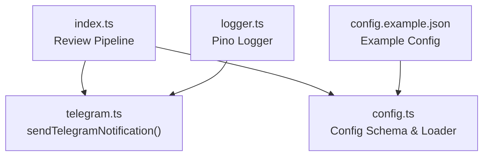
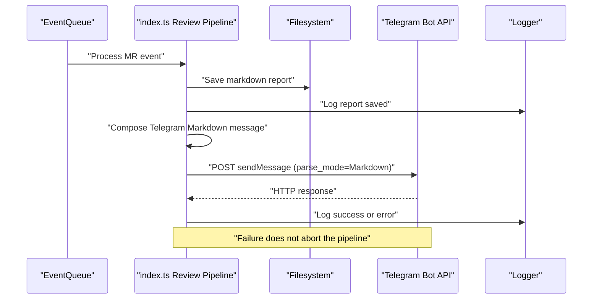
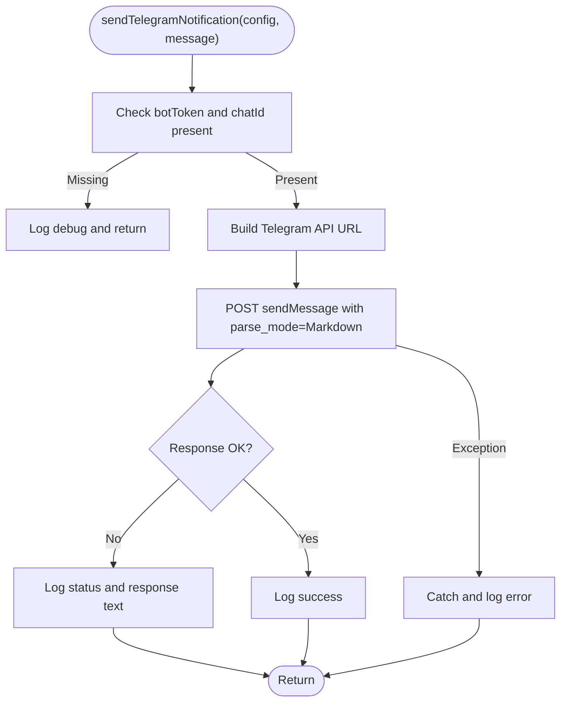
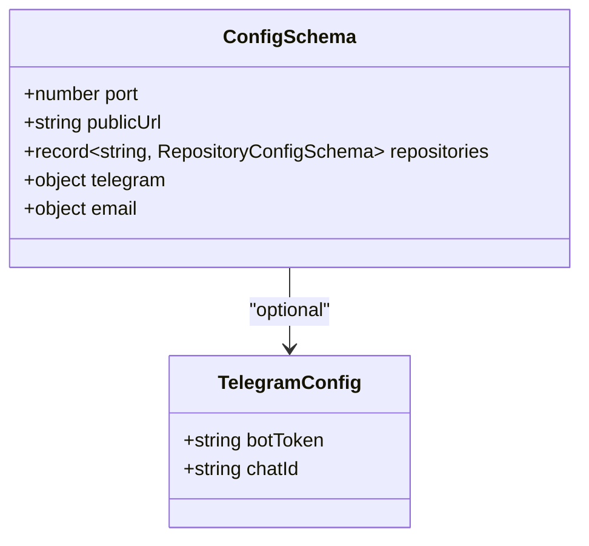
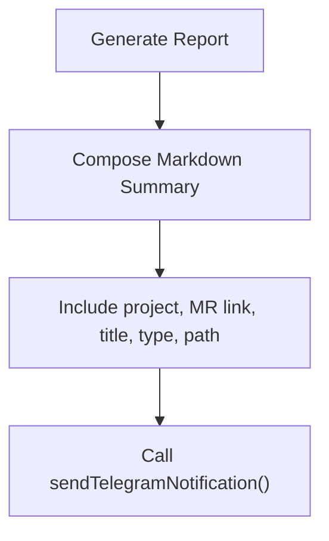
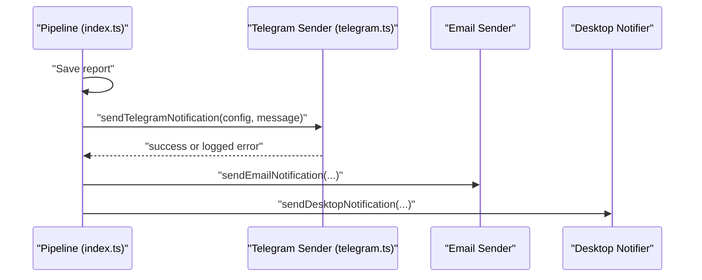
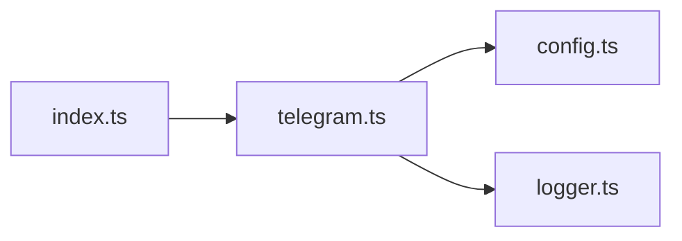

# Telegram Integration

<cite>
**Referenced Files in This Document**
- [telegram.ts](file://src/telegram.ts)
- [index.ts](file://src/index.ts)
- [config.ts](file://src/config.ts)
- [config.example.json](file://config/config.example.json)
- [logger.ts](file://src/logger.ts)
- [README.md](file://README.md)
</cite>

## Table of Contents
1. [Introduction](#introduction)
2. [Project Structure](#project-structure)
3. [Core Components](#core-components)
4. [Architecture Overview](#architecture-overview)
5. [Detailed Component Analysis](#detailed-component-analysis)
6. [Dependency Analysis](#dependency-analysis)
7. [Performance Considerations](#performance-considerations)
8. [Troubleshooting Guide](#troubleshooting-guide)
9. [Conclusion](#conclusion)

## Introduction
This document explains the Telegram notification channel used by the AI reviewer agent to deliver review completion notifications. It covers:
- Bot setup via BotFather and obtaining bot tokens
- Configuring chat IDs for review notifications
- Message formatting using Markdown for readable Telegram messages
- Error handling for network failures, invalid chat IDs, and API errors
- Configuration examples for multiple chats across repositories or teams
- Integration with the main notification pipeline and routing of reviews to Telegram channels

The implementation is intentionally lightweight and resilient: if sending a Telegram message fails, it does not fail the overall review process.

## Project Structure
Telegram integration is implemented as a small module that sends Markdown-formatted messages to the Telegram Bot API. The main pipeline constructs a concise summary and calls this module after generating and saving the review report.

**Diagram sources**
- [index.ts:104-134](file://src/index.ts#L104-L134)
- [telegram.ts:8-43](file://src/telegram.ts#L8-L43)
- [config.ts:23-36](file://src/config.ts#L23-L36)
- [config.example.json:12-15](file://config/config.example.json#L12-L15)
- [logger.ts:1-14](file://src/logger.ts#L1-L14)

**Section sources**
- [index.ts:104-134](file://src/index.ts#L104-L134)
- [telegram.ts:8-43](file://src/telegram.ts#L8-L43)
- [config.ts:23-36](file://src/config.ts#L23-L36)
- [config.example.json:12-15](file://config/config.example.json#L12-L15)
- [logger.ts:1-14](file://src/logger.ts#L1-L14)

## Core Components
- Telegram sender: Sends Markdown messages to Telegram using the configured bot token and chat ID.
- Configuration loader: Validates and loads configuration including optional Telegram settings.
- Example configuration: Demonstrates where to place bot token and chat ID.
- Logger: Provides structured logging for success and failure paths.

Key responsibilities:
- telegram.ts: HTTP POST to Telegram Bot API with parse_mode set to Markdown; graceful error handling without throwing.
- config.ts: Zod schema validates optional telegram.botToken and telegram.chatId fields.
- index.ts: Builds a Markdown summary and invokes sendTelegramNotification after saving the report.

**Section sources**
- [telegram.ts:8-43](file://src/telegram.ts#L8-L43)
- [config.ts:23-36](file://src/config.ts#L23-L36)
- [config.example.json:12-15](file://config/config.example.json#L12-L15)
- [index.ts:125-134](file://src/index.ts#L125-L134)

## Architecture Overview
The Telegram notification is part of the post-processing stage of the review pipeline. After the AI review engine generates and saves the report, the pipeline composes a Markdown summary and sends it to Telegram. If Telegram is not configured or the message fails to send, the pipeline continues without failing.

**Diagram sources**
- [index.ts:114-134](file://src/index.ts#L114-L134)
- [telegram.ts:14-42](file://src/telegram.ts#L14-L42)

## Detailed Component Analysis

### Telegram Sender Module
The Telegram sender encapsulates all logic required to deliver a Markdown message to a specific chat.

Responsibilities:
- Validate configuration presence (bot token and chat ID).
- Construct the Telegram Bot API URL.
- Send a JSON payload with chat_id, text, and parse_mode set to Markdown.
- Handle non-OK responses by logging details.
- Catch and log exceptions without throwing, ensuring the review pipeline remains unaffected.

Complexity:
- Time complexity: O(1) per call plus network latency.
- Space complexity: O(1) aside from request/response buffers.

Error handling:
- Missing configuration: logs debug message and returns early.
- Non-OK HTTP status: logs status and response body, returns without throwing.
- Network or runtime errors: catches and logs error message.

**Diagram sources**
- [telegram.ts:8-43](file://src/telegram.ts#L8-L43)

**Section sources**
- [telegram.ts:8-43](file://src/telegram.ts#L8-L43)

### Configuration Schema and Loading
The configuration schema defines an optional telegram object containing botToken and chatId. The loader reads config.json, validates against the schema, and ensures repository local paths exist.

Key points:
- telegram.botToken and telegram.chatId are optional strings.
- Validation errors produce clear error messages and stop startup.
- Example configuration demonstrates where to place values.

**Diagram sources**
- [config.ts:23-36](file://src/config.ts#L23-L36)

**Section sources**
- [config.ts:23-36](file://src/config.ts#L23-L36)
- [config.example.json:12-15](file://config/config.example.json#L12-L15)

### Message Formatting System
The pipeline composes a Markdown message that includes:
- A header indicating completion
- Project name
- Merge Request link and title
- Type label
- Path to the generated report

Telegram’s parse_mode is set to Markdown, enabling bold, links, and inline code formatting.

**Diagram sources**
- [index.ts:125-134](file://src/index.ts#L125-L134)
- [telegram.ts:18-28](file://src/telegram.ts#L18-L28)

**Section sources**
- [index.ts:125-134](file://src/index.ts#L125-L134)
- [telegram.ts:18-28](file://src/telegram.ts#L18-L28)

### Integration With Main Notification System
After saving the review report, the pipeline:
1. Composes a Telegram Markdown message.
2. Calls sendTelegramNotification with the global config.
3. Proceeds to send email and desktop notifications.

If Telegram is not configured, the function returns early without affecting subsequent steps.

**Diagram sources**
- [index.ts:123-159](file://src/index.ts#L123-L159)
- [telegram.ts:8-43](file://src/telegram.ts#L8-L43)

**Section sources**
- [index.ts:123-159](file://src/index.ts#L123-L159)
- [telegram.ts:8-43](file://src/telegram.ts#L8-L43)

## Dependency Analysis
- telegram.ts depends on:
  - config.ts for typed configuration access
  - logger.ts for structured logging
- index.ts imports and uses sendTelegramNotification within the review pipeline
- config.ts defines the shape of telegram configuration and validates it at startup

**Diagram sources**
- [index.ts:14](file://src/index.ts#L14)
- [telegram.ts:1-2](file://src/telegram.ts#L1-L2)
- [config.ts:1-4](file://src/config.ts#L1-L4)
- [logger.ts:1-14](file://src/logger.ts#L1-L14)

**Section sources**
- [index.ts:14](file://src/index.ts#L14)
- [telegram.ts:1-2](file://src/telegram.ts#L1-L2)
- [config.ts:1-4](file://src/config.ts#L1-L4)
- [logger.ts:1-14](file://src/logger.ts#L1-L14)

## Performance Considerations
- Telegram notifications are sent synchronously after saving the report. For high-throughput environments, consider making them asynchronous or queuing them separately to avoid blocking the pipeline.
- Network latency dominates execution time; retries are not implemented in the current sender.
- Logging overhead is minimal and controlled via LOG_LEVEL environment variable.

[No sources needed since this section provides general guidance]

## Troubleshooting Guide

Common issues and resolutions:

- Bot not configured or missing credentials
  - Symptom: Debug log indicates Telegram notification skipped.
  - Cause: botToken or chatId missing in configuration.
  - Resolution: Add telegram.botToken and telegram.chatId to config.json. See example configuration for structure.

- Invalid chat ID
  - Symptom: Telegram API responds with an error status and message.
  - Cause: chatId does not correspond to a valid chat or bot lacks permission.
  - Resolution: Verify chatId and ensure the bot has been added to the target group/channel or is allowed to message the user.

- Network failures or rate limiting
  - Symptom: Exception caught and logged; no retry is attempted.
  - Cause: Temporary network issues or Telegram API rate limits.
  - Resolution: Retry later; consider adding exponential backoff and retry logic around the Telegram API call.

- Markdown parsing errors
  - Symptom: Telegram rejects the message due to malformed Markdown.
  - Cause: Incorrect use of Markdown syntax in the composed message.
  - Resolution: Ensure proper escaping and valid Markdown; test message locally before deployment.

- Permissions issues
  - Symptom: Messages not delivered to groups/channels.
  - Cause: Bot not added to group/channel or insufficient permissions.
  - Resolution: Add the bot to the target group/channel and grant necessary permissions.

Configuration checklist:
- Set telegram.botToken to your bot token obtained from BotFather.
- Set telegram.chatId to the target chat ID (user, group, or channel).
- Ensure the bot is authorized to send messages to the target chat.

References:
- Example configuration shows where to place botToken and chatId.
- README documents optional Telegram configuration and environment variables.

**Section sources**
- [telegram.ts:9-12](file://src/telegram.ts#L9-L12)
- [telegram.ts:31-42](file://src/telegram.ts#L31-L42)
- [config.example.json:12-15](file://config/config.example.json#L12-L15)
- [README.md:88-104](file://README.md#L88-L104)

## Conclusion
The Telegram integration provides a simple, resilient notification channel for review completions. It uses Markdown formatting for readability and gracefully handles failures so they do not disrupt the core review workflow. To support multiple chats across repositories or teams, extend the configuration schema to map each repository to one or more chat IDs and iterate over them when composing and sending messages.

[No sources needed since this section summarizes without analyzing specific files]