# Project Overview

<cite>
**Referenced Files in This Document**
- [README.md](file://README.md)
- [package.json](file://package.json)
- [src/index.ts](file://src/index.ts)
- [src/server.ts](file://src/server.ts)
- [scripts/google-apps-script.js](file://scripts/google-apps-script.js)
- [src/parser.ts](file://src/parser.ts)
- [src/engine.ts](file://src/engine.ts)
- [src/git.ts](file://src/git.ts)
- [src/db.ts](file://src/db.ts)
- [src/notifier.ts](file://src/notifier.ts)
</cite>

## Table of Contents
1. [Introduction](#introduction)
2. [Project Structure](#project-structure)
3. [Core Components](#core-components)
4. [Architecture Overview](#architecture-overview)
5. [Detailed Component Analysis](#detailed-component-analysis)
6. [Dependency Analysis](#dependency-analysis)
7. [Performance Considerations](#performance-considerations)
8. [Troubleshooting Guide](#troubleshooting-guide)
9. [Conclusion](#conclusion)

## Introduction
Argos is a personal, self-hosted AI code review assistant that processes GitLab Merge Requests through email notifications without requiring webhook permissions or modifying the target repository. It receives GitLab MR notification emails forwarded by Gmail and Google Apps Script, parses them into structured events, performs an AI-powered review using the Antigravity CLI (`agy`), saves Markdown reports, and delivers multi-channel notifications. A built-in web dashboard lets you browse and read generated reviews.

Key goals:
- Work within existing permission boundaries (no GitLab webhooks required).
- Keep your active checkout untouched via isolated Git worktrees.
- Avoid duplicate reviews using SQLite deduplication.
- Provide a simple web UI for reviewing results.
- Notify you via Telegram, SMTP email, and Windows desktop notifications.

This document explains both what the system does at a high level and how it is implemented under the hood.

## Project Structure
The project is a TypeScript/Node application with an Express HTTP server, SQLite persistence, Git worktree management, GitLab CLI integration, and optional notification channels. The main entry point bootstraps configuration, database, cleanup, queueing, and the HTTP server.

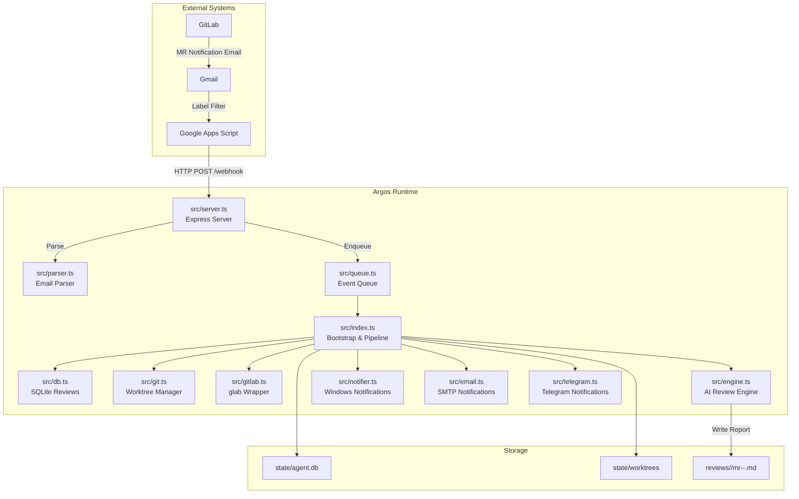

**Diagram sources**
- [README.md:5-30](file://README.md#L5-L30)
- [src/index.ts:20-195](file://src/index.ts#L20-L195)
- [src/server.ts:10-114](file://src/server.ts#L10-L114)
- [scripts/google-apps-script.js:15-77](file://scripts/google-apps-script.js#L15-L77)

**Section sources**
- [README.md:1-45](file://README.md#L1-L45)
- [package.json:1-37](file://package.json#L1-L37)

## Core Components
- Bootstrap and pipeline orchestration: loads config, initializes SQLite, verifies `glab` authentication, cleans orphaned worktrees, creates a sequential event queue, and starts the HTTP server.
- HTTP server: serves the static dashboard, exposes REST endpoints, and handles incoming webhook payloads from Google Apps Script.
- Email parser: extracts MergeRequestEvent fields from GitLab notification emails, handling percent-encoded URLs and multiple subject formats.
- Event queue: ensures one review runs at a time to avoid resource contention.
- Database: persists review records with unique constraints on project, MR ID, and commit SHA to enforce deduplication.
- Git worktree manager: creates isolated worktrees per MR, removes them after processing, and prunes orphaned worktrees on startup.
- GitLab wrapper: fetches MR details and diffs via `glab`.
- AI engine: constructs a prompt, invokes `agy`, truncates large diffs, retries failed calls, and writes Markdown reports.
- Notifiers: sends Windows toast notifications (via BurntToast), optional Telegram messages, and optional SMTP emails.

**Section sources**
- [src/index.ts:20-195](file://src/index.ts#L20-L195)
- [src/server.ts:10-114](file://src/server.ts#L10-L114)
- [src/parser.ts:1-92](file://src/parser.ts#L1-L92)
- [src/db.ts:9-96](file://src/db.ts#L9-L96)
- [src/git.ts:9-100](file://src/git.ts#L9-L100)
- [src/engine.ts:8-213](file://src/engine.ts#L8-L213)
- [src/notifier.ts:1-61](file://src/notifier.ts#L1-L61)

## Architecture Overview
The system integrates three layers:
- Trigger layer: Gmail filters forward GitLab MR emails to Google Apps Script, which posts JSON payloads to Argos.
- Processing layer: Argos parses the payload, enqueues the event, and sequentially processes it through Git operations, AI generation, and storage.
- Presentation and notification layer: A web dashboard displays reviews; notifications are sent via Telegram, email, and Windows desktop.

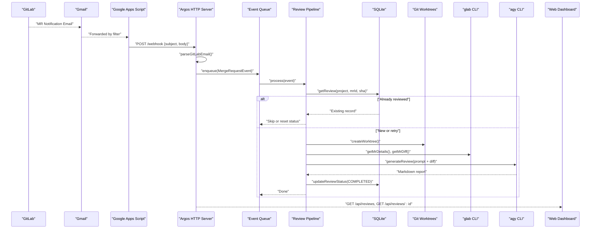

**Diagram sources**
- [scripts/google-apps-script.js:15-77](file://scripts/google-apps-script.js#L15-L77)
- [src/server.ts:83-109](file://src/server.ts#L83-L109)
- [src/parser.ts:17-91](file://src/parser.ts#L17-L91)
- [src/index.ts:47-183](file://src/index.ts#L47-L183)
- [src/db.ts:61-88](file://src/db.ts#L61-L88)
- [src/git.ts:9-49](file://src/git.ts#L9-L49)
- [src/engine.ts:8-213](file://src/engine.ts#L8-L213)

## Detailed Component Analysis

### Email-to-Webhook Bridge (Gmail + Google Apps Script)
- Gmail filters label GitLab MR emails.
- Google Apps Script polls labeled threads, reads unread messages, and posts their subject and body to Argos’s `/webhook`.
- On success (HTTP 202), the script marks the message as read; on client errors (400/422), it still marks as read to prevent loops; on server failures, it retries later.

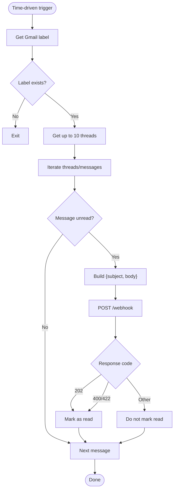

**Diagram sources**
- [scripts/google-apps-script.js:15-77](file://scripts/google-apps-script.js#L15-L77)

**Section sources**
- [scripts/google-apps-script.js:1-78](file://scripts/google-apps-script.js#L1-L78)

### Webhook Handler and Parsing
- The server accepts JSON payloads with `subject` and `body`.
- It validates presence of required fields, parses the payload into a `MergeRequestEvent`, checks if the project is configured, and enqueues the event.
- The parser decodes percent-encoded URLs, extracts MR URL, project name, MR ID, title, and action type.

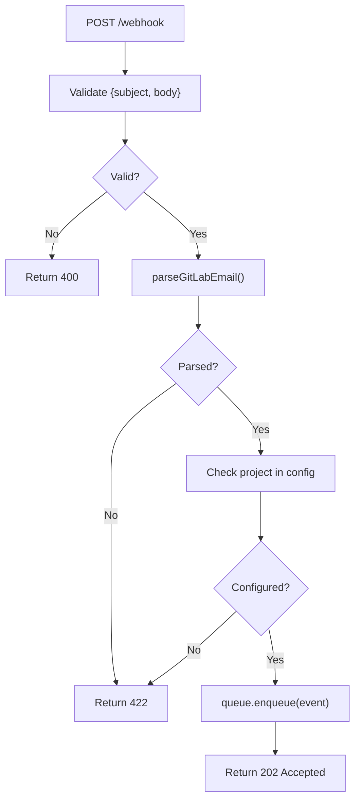

**Diagram sources**
- [src/server.ts:83-109](file://src/server.ts#L83-L109)
- [src/parser.ts:17-91](file://src/parser.ts#L17-L91)

**Section sources**
- [src/server.ts:83-109](file://src/server.ts#L83-L109)
- [src/parser.ts:1-92](file://src/parser.ts#L1-L92)

### Review Pipeline Orchestration
The pipeline executes these steps for each event:
1. Resolve repository configuration by project name.
2. Fetch MR details and compute commit SHA.
3. Deduplicate via SQLite; skip if already completed/pending unless forced retry.
4. Create an isolated Git worktree.
5. Fetch MR diff.
6. Generate AI review via `agy`.
7. Save Markdown report and update status to COMPLETED.
8. Send notifications (Telegram, Email, Desktop).
9. Always remove the worktree.

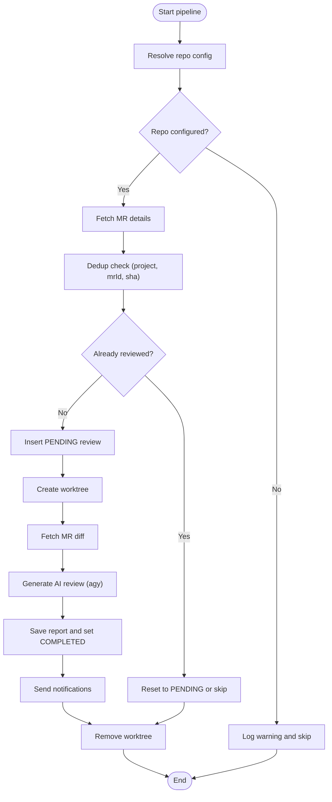

**Diagram sources**
- [src/index.ts:47-183](file://src/index.ts#L47-L183)
- [src/db.ts:61-88](file://src/db.ts#L61-L88)
- [src/git.ts:9-49](file://src/git.ts#L9-L49)
- [src/engine.ts:8-213](file://src/engine.ts#L8-L213)

**Section sources**
- [src/index.ts:20-195](file://src/index.ts#L20-L195)

### AI Review Engine
- Builds a prompt including MR metadata and the diff.
- Truncates excessively large diffs to control token usage.
- Invokes `agy` with flags to allow non-interactive tool use, grant filesystem access to the repository, and extend timeouts.
- Uses exponential backoff retry for CLI invocation.
- Cleans up temporary prompt files.

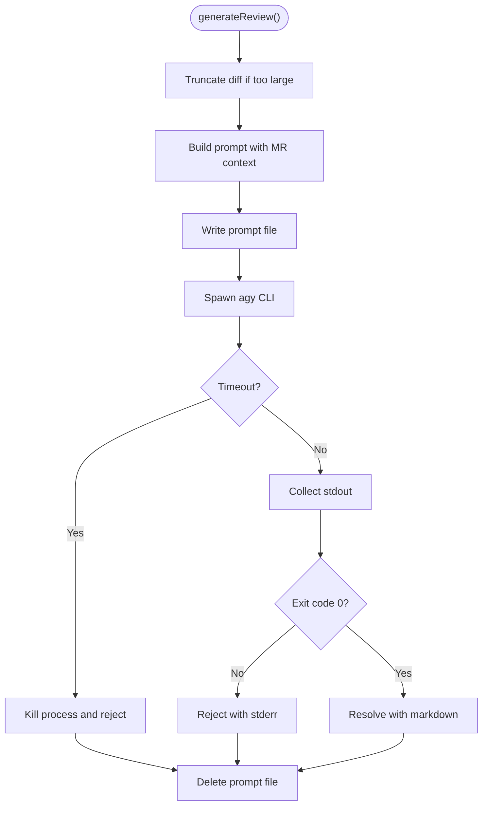

**Diagram sources**
- [src/engine.ts:8-213](file://src/engine.ts#L8-L213)

**Section sources**
- [src/engine.ts:8-213](file://src/engine.ts#L8-L213)

### Git Worktree Management
- Creates a detached worktree from the MR head reference.
- Removes worktrees after processing, with fallback deletion if Git fails.
- Prunes orphaned worktrees on startup across configured repositories.

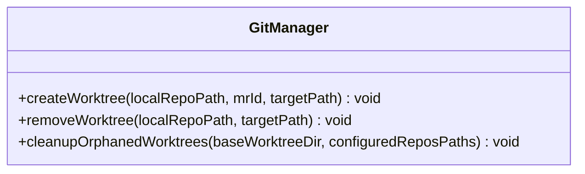

**Diagram sources**
- [src/git.ts:9-100](file://src/git.ts#L9-L100)

**Section sources**
- [src/git.ts:1-100](file://src/git.ts#L1-L100)

### Database and Deduplication
- Initializes SQLite schema with a `reviews` table and a unique index on `(project_name, mr_id, commit_sha)`.
- Provides functions to insert, query, update status, and list reviews.
- Deduplication prevents re-reviews unless explicitly retried.

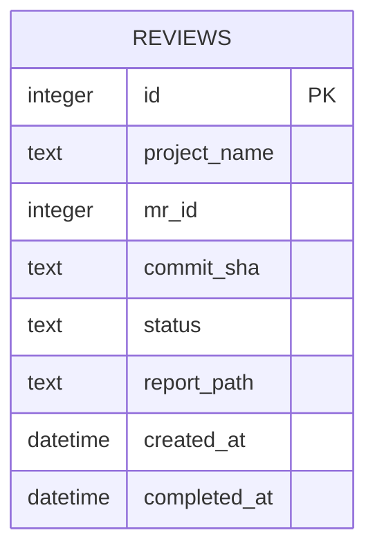

**Diagram sources**
- [src/db.ts:23-43](file://src/db.ts#L23-L43)

**Section sources**
- [src/db.ts:1-96](file://src/db.ts#L1-L96)

### Notifications
- Windows desktop notifications: uses PowerShell’s BurntToast module to show clickable toasts that open the dashboard deep link.
- Optional Telegram Bot and SMTP email notifications are triggered after successful review completion.

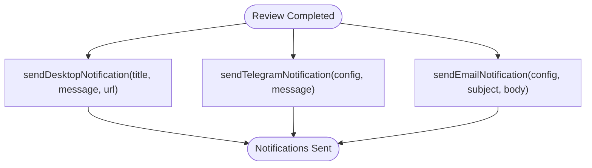

**Diagram sources**
- [src/notifier.ts:11-61](file://src/notifier.ts#L11-L61)
- [src/index.ts:125-159](file://src/index.ts#L125-L159)

**Section sources**
- [src/notifier.ts:1-61](file://src/notifier.ts#L1-L61)
- [src/index.ts:125-159](file://src/index.ts#L125-L159)

### Web Dashboard and API
- Static SPA served from `public/`.
- Endpoints:
  - `GET /status`: health check.
  - `GET /api/reviews`: list all reviews.
  - `GET /api/reviews/:id`: get review metadata and markdown content.
  - `POST /api/reviews/:id/retry`: enqueue a retry for a specific review.
  - `POST /webhook`: receive email payloads.

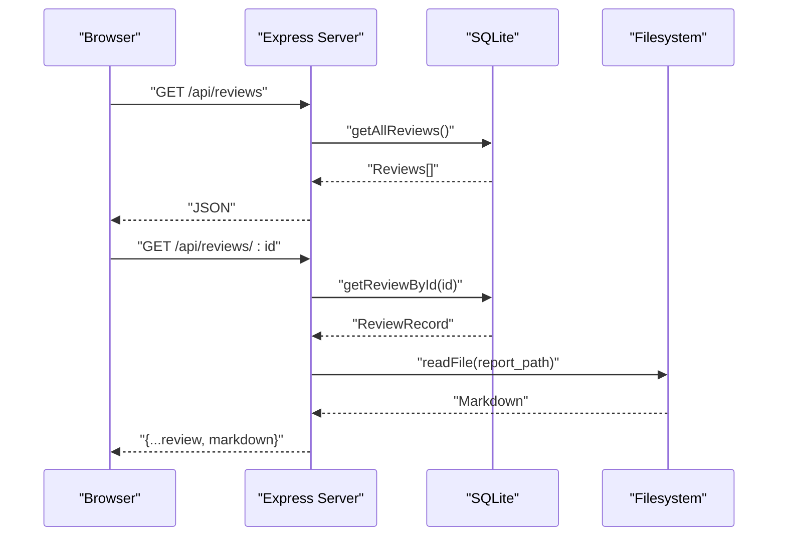

**Diagram sources**
- [src/server.ts:16-54](file://src/server.ts#L16-L54)
- [src/db.ts:84-95](file://src/db.ts#L84-L95)

**Section sources**
- [src/server.ts:10-114](file://src/server.ts#L10-L114)

## Dependency Analysis
High-level dependencies between modules:
- `index.ts` orchestrates configuration, database, Git, GitLab, AI engine, and notifications.
- `server.ts` depends on parser, queue, config, db, and filesystem utilities.
- `engine.ts` depends on logger, gitlab types, retry utility, and child process execution.
- `git.ts` depends on child process exec and filesystem utilities.
- `db.ts` depends on sqlite3/sqlite and filesystem utilities.
- `notifier.ts` depends on child process execFile for PowerShell.

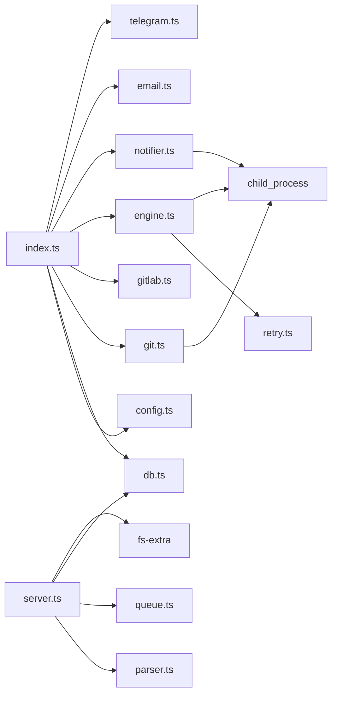

**Diagram sources**
- [src/index.ts:1-18](file://src/index.ts#L1-L18)
- [src/server.ts:1-8](file://src/server.ts#L1-L8)
- [src/engine.ts:1-6](file://src/engine.ts#L1-L6)
- [src/git.ts:1-5](file://src/git.ts#L1-L5)
- [src/notifier.ts:1-2](file://src/notifier.ts#L1-L2)

**Section sources**
- [src/index.ts:1-18](file://src/index.ts#L1-L18)
- [src/server.ts:1-8](file://src/server.ts#L1-L8)
- [src/engine.ts:1-6](file://src/engine.ts#L1-L6)
- [src/git.ts:1-5](file://src/git.ts#L1-L5)
- [src/notifier.ts:1-2](file://src/notifier.ts#L1-L2)

## Performance Considerations
- Sequential processing: The in-memory queue processes one MR at a time to avoid concurrent resource contention.
- Large diff handling: Diffs exceeding a threshold are truncated to reduce AI model input size.
- CLI timeouts: `agy` has an internal timeout extended for complex agentic workflows; the parent process also enforces an overall timeout.
- Retries: Exponential backoff is applied to critical CLI calls to improve resilience.
- Worktree isolation: Temporary worktrees ensure no interference with active branches and simplify cleanup.

[No sources needed since this section provides general guidance]

## Troubleshooting Guide
Common issues and resolutions:
- Google Apps Script cannot reach Argos:
  - Ensure `WEBHOOK_URL` points to a reachable address and the server is listening on the configured port.
  - Verify Gmail label matches the script configuration.
- Unrecognized email format:
  - Confirm the email contains a GitLab MR URL and expected subject pattern.
  - Check parser logs for parsing failures.
- Project not configured:
  - Add the project to the configuration with correct `projectId` and `localPath`.
- Duplicate reviews:
  - Use the retry endpoint to force reprocessing when necessary.
- Worktree cleanup failures:
  - Run manual pruning or restart the service to trigger orphan cleanup.
- AI generation failures:
  - Check `agy` installation and authentication; verify model availability and environment variables.
  - Inspect logs for CLI exit codes and stderr output.

**Section sources**
- [scripts/google-apps-script.js:49-77](file://scripts/google-apps-script.js#L49-L77)
- [src/server.ts:83-109](file://src/server.ts#L83-L109)
- [src/parser.ts:17-91](file://src/parser.ts#L17-L91)
- [src/index.ts:160-183](file://src/index.ts#L160-L183)
- [src/engine.ts:139-213](file://src/engine.ts#L139-L213)

## Conclusion
Argos provides a robust, self-hosted workflow for AI-powered code reviews driven by email notifications. By combining Gmail filtering, Google Apps Script forwarding, an Express server, SQLite-backed deduplication, Git worktree isolation, and an agentic AI review step, it delivers actionable Markdown reports and multi-channel notifications while keeping your development environment safe and unmodified. The web dashboard offers easy browsing and deep-linking to individual reviews, making it practical for personal or small-team use cases where webhook permissions are unavailable.

[No sources needed since this section summarizes without analyzing specific files]