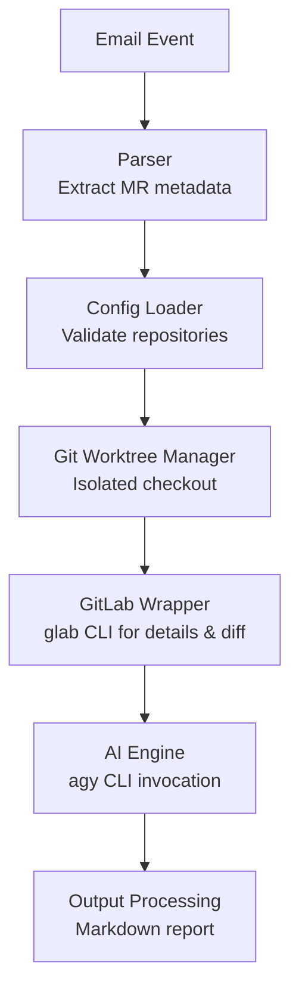
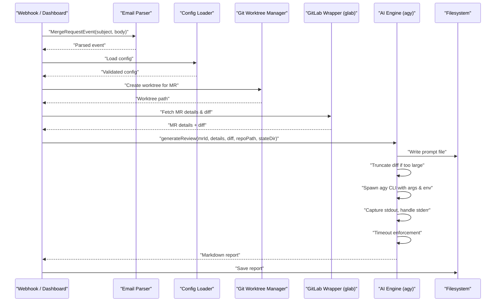
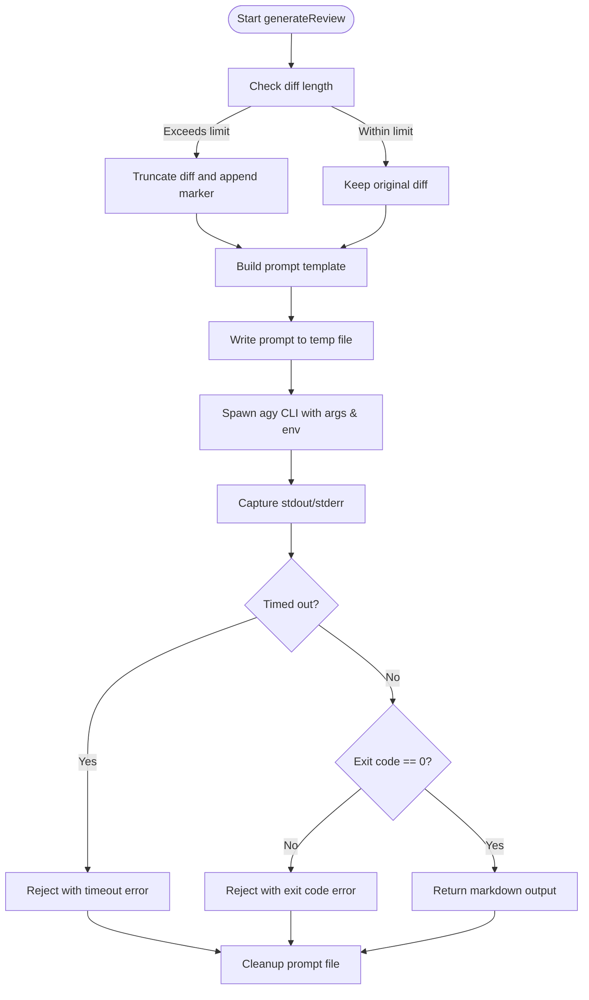
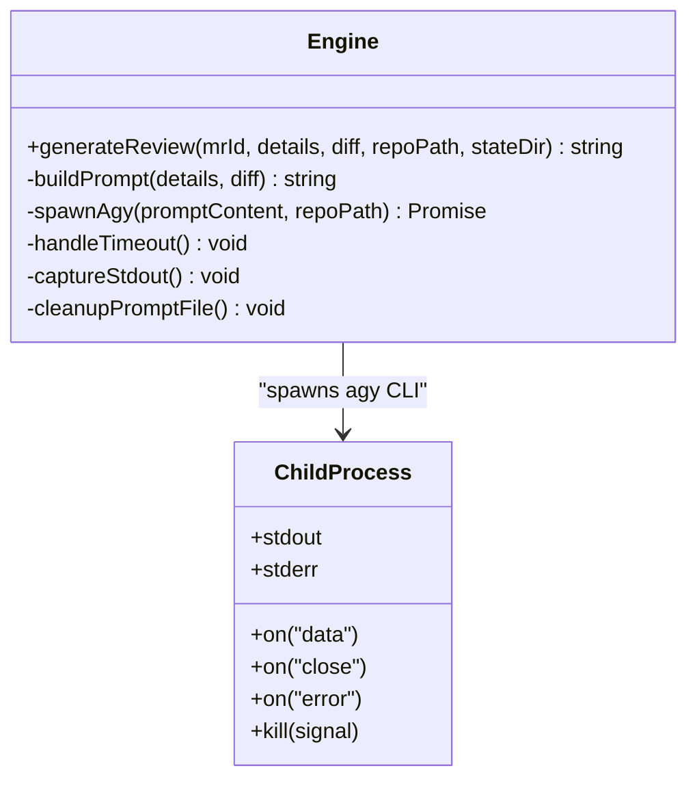
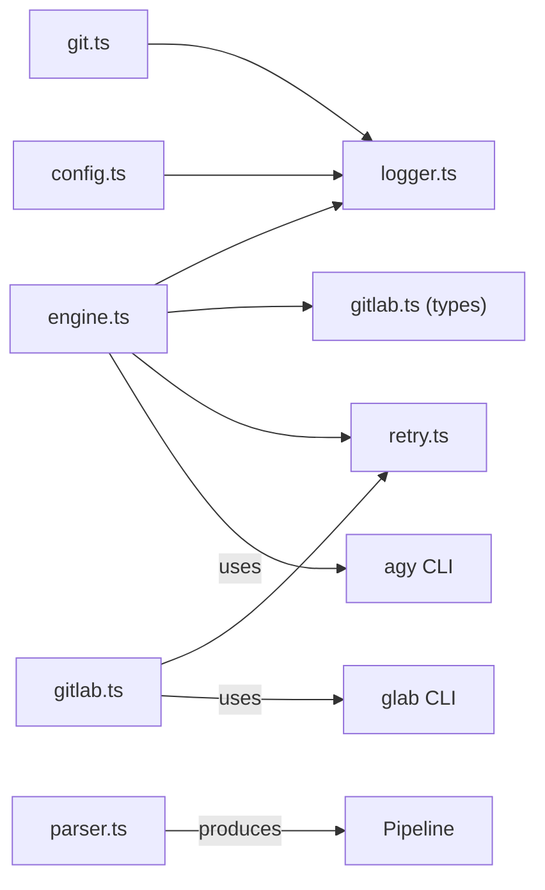

# AI Agent Orchestration

<cite>
**Referenced Files in This Document**
- [README.md](file://README.md)
- [engine.ts](file://src/engine.ts)
- [config.ts](file://src/config.ts)
- [parser.ts](file://src/parser.ts)
- [gitlab.ts](file://src/gitlab.ts)
- [git.ts](file://src/git.ts)
- [retry.ts](file://src/retry.ts)
- [config.example.json](file://config/config.example.json)
</cite>

## Table of Contents
1. [Introduction](#introduction)
2. [Project Structure](#project-structure)
3. [Core Components](#core-components)
4. [Architecture Overview](#architecture-overview)
5. [Detailed Component Analysis](#detailed-component-analysis)
6. [Dependency Analysis](#dependency-analysis)
7. [Performance Considerations](#performance-considerations)
8. [Troubleshooting Guide](#troubleshooting-guide)
9. [Conclusion](#conclusion)

## Introduction
This document explains the AI agent orchestration system that manages external AI CLI execution for code analysis. It focuses on the end-to-end workflow from prompt generation to result processing, including diff truncation strategies, prompt template management, and output parsing. It also documents integration with the 'agy' CLI tool, covering command-line arguments, environment variables, process management, timeout handling, stdout/stderr capture, and error propagation patterns. Finally, it provides examples of prompt templates, configuration options, and troubleshooting guidance for common AI service integration issues.

The system is designed to run reviews without modifying target repositories or requiring GitLab write permissions. It uses an email-driven trigger, isolated Git worktrees, glab CLI for GitLab data access, and agy CLI for AI-powered review generation.

**Section sources**
- [README.md:1-45](file://README.md#L1-L45)

## Project Structure
At a high level, the orchestration spans several modules:
- Configuration loading and validation
- Email event parsing
- Git worktree isolation
- GitLab metadata and diff retrieval via glab CLI
- AI review generation via agy CLI
- Retry utilities for resilient external calls
- Example configuration schema

**Diagram sources**
- [parser.ts:1-92](file://src/parser.ts#L1-L92)
- [config.ts:1-80](file://src/config.ts#L1-L80)
- [git.ts:1-100](file://src/git.ts#L1-L100)
- [gitlab.ts:1-96](file://src/gitlab.ts#L1-L96)
- [engine.ts:1-213](file://src/engine.ts#L1-L213)

**Section sources**
- [README.md:160-201](file://README.md#L160-L201)

## Core Components
- Parser: Converts GitLab notification payloads into structured MergeRequestEvent objects.
- Config Loader: Loads and validates application configuration using Zod schemas.
- Git Worktree Manager: Creates and removes isolated Git worktrees per MR.
- GitLab Wrapper: Executes glab CLI commands to fetch MR details and diffs with retry logic.
- AI Engine: Builds prompts, invokes agy CLI, handles timeouts, captures output, and propagates errors.
- Retry Utility: Provides exponential backoff for transient failures.

Key responsibilities and interactions are detailed in subsequent sections.

**Section sources**
- [parser.ts:1-92](file://src/parser.ts#L1-L92)
- [config.ts:1-80](file://src/config.ts#L1-L80)
- [git.ts:1-100](file://src/git.ts#L1-L100)
- [gitlab.ts:1-96](file://src/gitlab.ts#L1-L96)
- [engine.ts:1-213](file://src/engine.ts#L1-L213)
- [retry.ts:1-36](file://src/retry.ts#L1-L36)

## Architecture Overview
The orchestration pipeline integrates multiple external tools (glab, agy) and internal modules to produce a structured Markdown review. The AI engine constructs a prompt that includes MR metadata and the diff, then delegates execution to agy. The agent reads repository context directly via filesystem access granted by --add-dir, keeping prompts lean.

**Diagram sources**
- [parser.ts:17-91](file://src/parser.ts#L17-L91)
- [config.ts:41-79](file://src/config.ts#L41-L79)
- [git.ts:9-27](file://src/git.ts#L9-L27)
- [gitlab.ts:51-95](file://src/gitlab.ts#L51-L95)
- [engine.ts:8-213](file://src/engine.ts#L8-L213)

## Detailed Component Analysis

### Prompt Generation and Template Management
The AI engine builds a prompt that instructs the agent to:
- Classify the MR type (Feature, Bug Fix, Unit Test).
- Generate a structured Markdown report with required sections.
- Use a strict finding format for each issue.
- Read repository context via AGENTS.md and .agents or graphify-out directories.

Prompt template characteristics:
- Includes MR title, description, source/target branches.
- Embeds the diff within a fenced code block.
- Enforces output-only Markdown without conversational text.
- Uses a deterministic structure to aid downstream parsing.

Diff truncation strategy:
- If the diff exceeds a threshold (e.g., 100,000 characters), it is truncated at the boundary and a marker is appended indicating truncation.
- This prevents oversized prompts while preserving critical early changes.

Prompt file management:
- Prompts are written to a temporary directory under state/prompts to bypass command-line length limits.
- Each prompt file is named uniquely per MR and timestamp.
- Cleanup occurs after successful completion or failure.

**Diagram sources**
- [engine.ts:17-27](file://src/engine.ts#L17-L27)
- [engine.ts:29-78](file://src/engine.ts#L29-L78)
- [engine.ts:80-88](file://src/engine.ts#L80-L88)
- [engine.ts:114-137](file://src/engine.ts#L114-L137)
- [engine.ts:139-187](file://src/engine.ts#L139-L187)
- [engine.ts:203-211](file://src/engine.ts#L203-L211)

**Section sources**
- [engine.ts:17-27](file://src/engine.ts#L17-L27)
- [engine.ts:29-78](file://src/engine.ts#L29-L78)
- [engine.ts:80-88](file://src/engine.ts#L80-L88)
- [engine.ts:203-211](file://src/engine.ts#L203-L211)

### Integration with 'agy' CLI
Command-line arguments:
- Model selection: gemini-3.8-flash-high
- Permission handling: dangerously-skip-permissions to auto-approve tool-use requests in non-interactive mode
- Repository context: --add-dir <repo-path> grants file access to the target repository
- Internal timeout: --print-timeout set to extended duration for complex agentic workflows
- Prompt input: --print with prompt content passed directly

Environment variables:
- TERM=xterm-256color ensures TUI detection recognizes a valid terminal footprint
- IO_NONINTERACTIVE=true hints Go binaries to skip interactive prompts

Process management:
- The child process is spawned with stdio configured to pipe stdout and inherit stderr.
- A timer enforces an overall timeout; on timeout, SIGTERM is sent to the child process.
- On close, the process exit code is checked; non-zero exits propagate errors.

Error propagation:
- Timeouts reject with a descriptive error.
- Non-zero exit codes reject with captured stderr information.
- Errors during spawn are caught and rejected immediately.

Retry behavior:
- The entire agy invocation is wrapped with exponential backoff retries.

**Diagram sources**
- [engine.ts:8-213](file://src/engine.ts#L8-L213)

**Section sources**
- [engine.ts:91-137](file://src/engine.ts#L91-L137)
- [engine.ts:139-187](file://src/engine.ts#L139-L187)
- [engine.ts:194-202](file://src/engine.ts#L194-L202)

### Output Parsing
The AI engine returns raw Markdown output from agy. Downstream components are responsible for saving the report and rendering it in the dashboard. The prompt template enforces a consistent structure, which simplifies parsing and presentation.

Parsing considerations:
- Findings follow a strict format with severity, file path, issue summary, rationale, and suggested fix.
- Section ordering is enforced by the prompt instructions.
- If no significant issues are found, the agent returns a specific phrase.

Note: There is no explicit parser module for the AI output in this repository; the engine returns the Markdown string for further use.

**Section sources**
- [engine.ts:29-78](file://src/engine.ts#L29-L78)

### Git Worktree Isolation
The system creates isolated Git worktrees for each MR to ensure the developer’s active branch remains untouched. It fetches the MR head reference and checks out a detached HEAD in a temporary directory. Cleanup routines remove orphaned worktrees on startup and after reviews.

Key operations:
- Create worktree: fetch refs/merge-requests/<id>/head and add a detached worktree.
- Remove worktree: git worktree remove with fallback to manual deletion.
- Cleanup orphaned worktrees: prune git administrative pointers and delete leftover directories.

**Section sources**
- [git.ts:9-27](file://src/git.ts#L9-L27)
- [git.ts:29-49](file://src/git.ts#L29-L49)
- [git.ts:51-99](file://src/git.ts#L51-L99)

### GitLab Integration (glab CLI)
The GitLab wrapper executes glab commands to retrieve MR details and diffs:
- getMrDetails: runs glab mr view in JSON mode with retry logic.
- getMrDiff: runs glab mr diff with a larger buffer for big diffs and retry logic.
- verifyGlabAuth: checks authentication status and warns or throws if not authenticated.

Retries:
- Both detail and diff fetching use exponential backoff to handle transient network or auth issues.

**Section sources**
- [gitlab.ts:21-49](file://src/gitlab.ts#L21-L49)
- [gitlab.ts:51-71](file://src/gitlab.ts#L51-L71)
- [gitlab.ts:73-95](file://src/gitlab.ts#L73-L95)

### Retry Utility
The retry utility wraps asynchronous functions with exponential backoff:
- Parameters include max retries, base delay, and context for logging.
- Delays double on each attempt.
- Errors are logged and rethrown after exhausting retries.

**Section sources**
- [retry.ts:1-36](file://src/retry.ts#L1-L36)

### Configuration Options
Configuration is loaded from a JSON file and validated against Zod schemas:
- Port and public URL for the HTTP server.
- Repositories mapping project names to GitLab project IDs and local paths.
- Optional Telegram and SMTP email settings.
- Local path existence is verified at load time.

Example configuration keys:
- repositories.<name>.projectId
- repositories.<name>.localPath
- telegram.botToken
- telegram.chatId
- email.host, port, secure, auth.user, auth.pass, from, to[]

**Section sources**
- [config.ts:6-34](file://src/config.ts#L6-L34)
- [config.ts:39-79](file://src/config.ts#L39-L79)
- [config.example.json:1-28](file://config/config.example.json#L1-L28)

## Dependency Analysis
The orchestration depends on external CLI tools and internal modules:
- glab CLI: used for GitLab metadata and diff retrieval.
- agy CLI: used for AI review generation.
- Git: used for worktree management.
- Node.js runtime: provides child_process, fs-extra, and native fetch.

Internal dependencies:
- engine.ts depends on logger, gitlab types, and retry.
- gitlab.ts depends on logger and retry.
- git.ts depends on logger and fs-extra.
- parser.ts is standalone.
- config.ts depends on logger and fs-extra.

**Diagram sources**
- [engine.ts:1-7](file://src/engine.ts#L1-L7)
- [gitlab.ts:1-5](file://src/gitlab.ts#L1-L5)
- [git.ts:1-6](file://src/git.ts#L1-L6)
- [config.ts:1-5](file://src/config.ts#L1-L5)

**Section sources**
- [engine.ts:1-7](file://src/engine.ts#L1-L7)
- [gitlab.ts:1-5](file://src/gitlab.ts#L1-L5)
- [git.ts:1-6](file://src/git.ts#L1-L6)
- [config.ts:1-5](file://src/config.ts#L1-L5)

## Performance Considerations
- Diff truncation reduces prompt size and model processing time for large changes.
- Extended print-timeout accommodates complex agentic workflows involving file browsing and tests.
- Sequential queue processing avoids concurrent resource contention.
- Retries with exponential backoff mitigate transient failures without overwhelming external services.
- Using --add-dir allows the agent to read only necessary context, minimizing prompt bloat.

[No sources needed since this section provides general guidance]

## Troubleshooting Guide
Common AI service integration issues and resolutions:
- agy CLI hangs waiting for interactive approvals:
  - Ensure --dangerously-skip-permissions is set.
  - Set IO_NONINTERACTIVE=true and TERM=xterm-256color to avoid TUI prompts.
- agy CLI times out:
  - Increase --print-timeout and overall process timeout.
  - Review logs for long-running tool-use steps.
- agy CLI exits with non-zero code:
  - Inspect stderr captured during process close.
  - Validate repository path and permissions (--add-dir).
- glab CLI authentication errors:
  - Run glab auth login and verify token presence.
  - Confirm PATH includes glab executable.
- Large diff causes prompt overflow:
  - Rely on built-in truncation; consider splitting reviews or adjusting thresholds.
- Orphaned worktrees consume disk space:
  - Run cleanup routines to prune and remove stale worktrees.

Operational tips:
- Enable debug logging to capture stderr lines from agy when needed.
- Verify repository local paths exist before starting the server.
- Use the test webhook script to validate end-to-end flow.

**Section sources**
- [engine.ts:114-137](file://src/engine.ts#L114-L137)
- [engine.ts:139-187](file://src/engine.ts#L139-L187)
- [gitlab.ts:21-49](file://src/gitlab.ts#L21-L49)
- [git.ts:51-99](file://src/git.ts#L51-L99)

## Conclusion
The AI agent orchestration system provides a robust, self-hosted code review workflow that integrates GitLab data retrieval and AI-powered analysis through external CLIs. By isolating worktrees, managing prompts carefully, enforcing timeouts, and applying retries, it delivers reliable Markdown reports while keeping prompts lean and context-aware. Proper configuration and troubleshooting steps ensure smooth operation across diverse environments.

[No sources needed since this section summarizes without analyzing specific files]