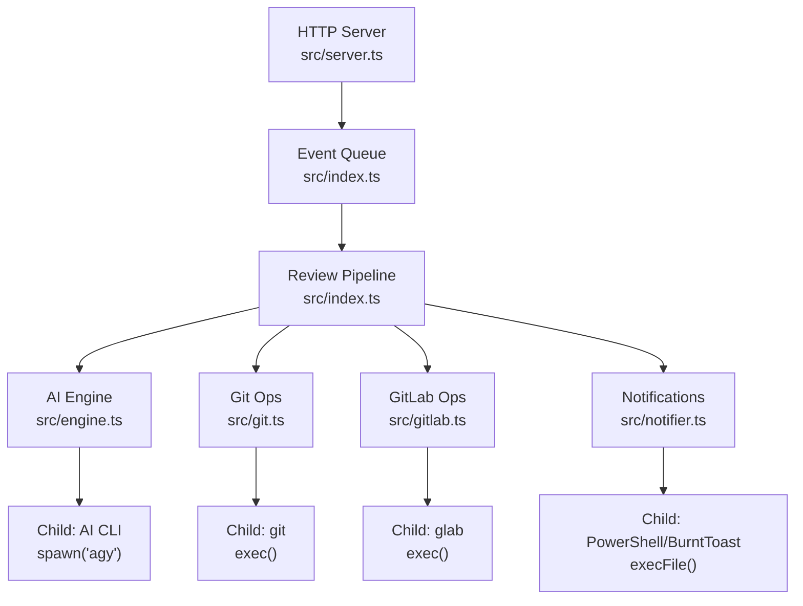
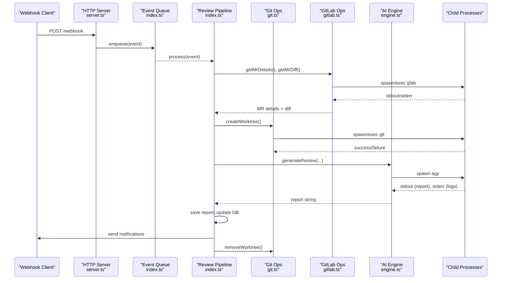
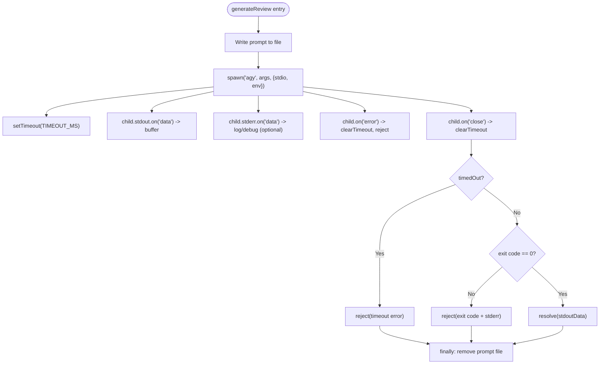
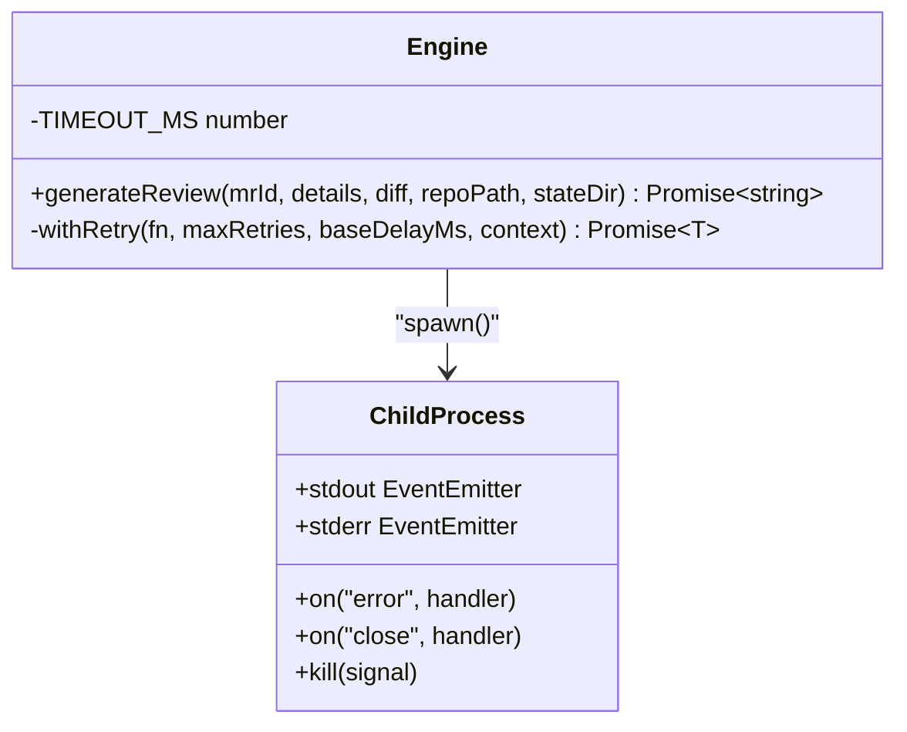
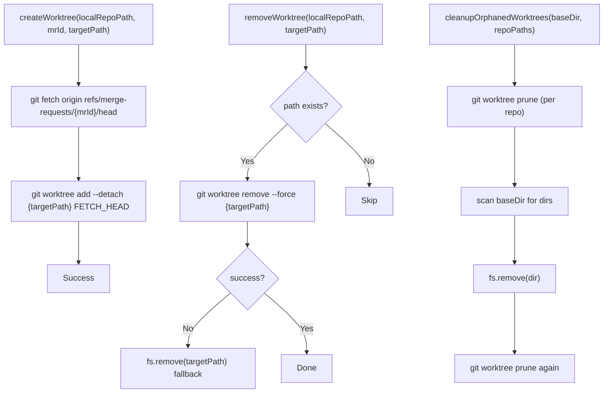
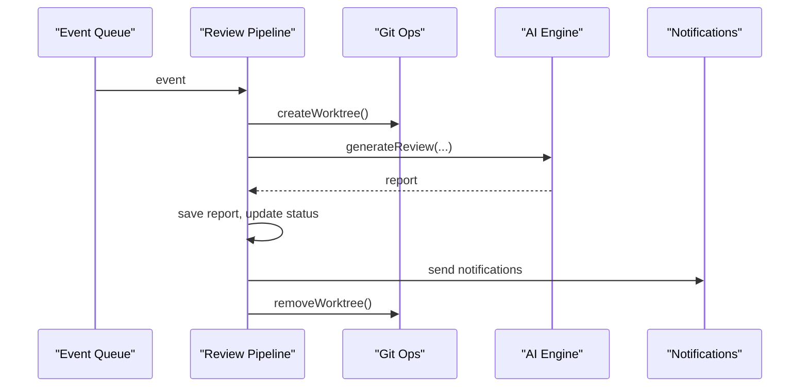
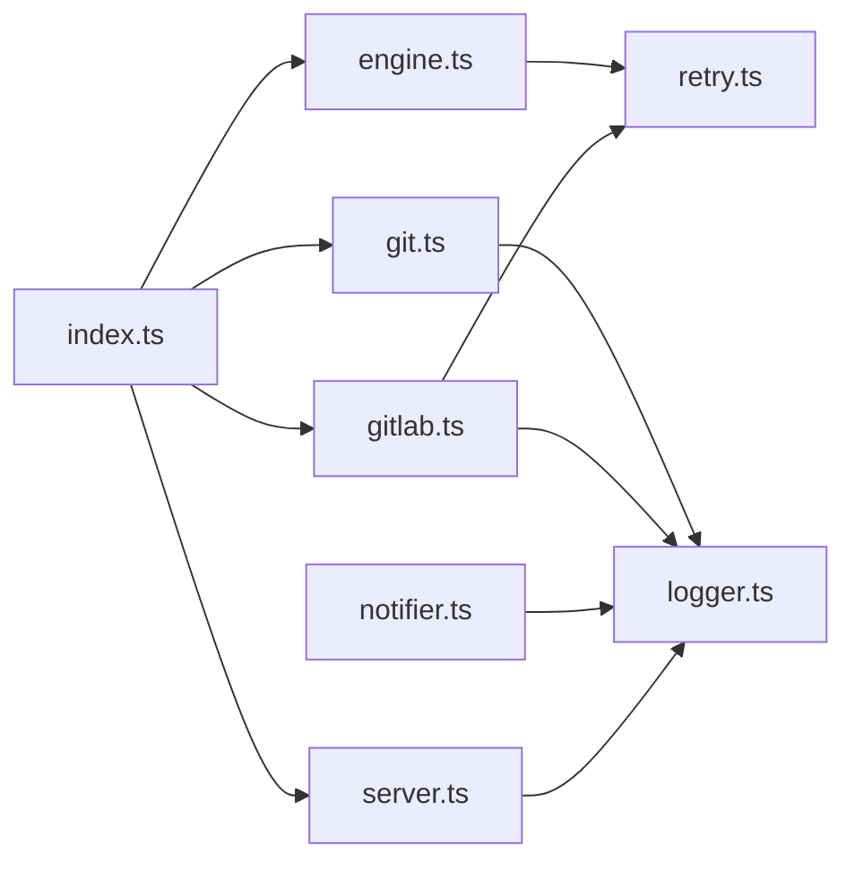

# Process Management & Timeout Handling

<cite>
**Referenced Files in This Document**   
- [src/index.ts](file://src/index.ts)
- [src/engine.ts](file://src/engine.ts)
- [src/server.ts](file://src/server.ts)
- [src/git.ts](file://src/git.ts)
- [src/gitlab.ts](file://src/gitlab.ts)
- [src/notifier.ts](file://src/notifier.ts)
- [src/retry.ts](file://src/retry.ts)
- [src/logger.ts](file://src/logger.ts)
</cite>

## Table of Contents
1. [Introduction](#introduction)
2. [Project Structure](#project-structure)
3. [Core Components](#core-components)
4. [Architecture Overview](#architecture-overview)
5. [Detailed Component Analysis](#detailed-component-analysis)
6. [Dependency Analysis](#dependency-analysis)
7. [Performance Considerations](#performance-considerations)
8. [Troubleshooting Guide](#troubleshooting-guide)
9. [Conclusion](#conclusion)

## Introduction
This document explains the child process management system used by the AI CLI execution pipeline. It covers how processes are spawned, monitored, timed out, and cleaned up; how stdout/stderr streams are handled; and how errors propagate through the system. It also documents timeout configurations, monitoring strategies, graceful shutdown considerations, and practical debugging and troubleshooting guidance.

The primary child process is an external AI CLI tool invoked to generate code review reports. Additional child processes include Git and GitLab CLI commands for repository operations and notifications.

## Project Structure
The application is a Node.js service that:
- Starts an HTTP server to receive webhooks and serve a dashboard.
- Enqueues merge request events for background processing.
- Spawns external CLI tools (AI reviewer, Git, GitLab CLI, desktop notification tool).
- Manages temporary worktrees and prompt files.
- Logs all activity with structured logging.

**Diagram sources**
- [src/server.ts:10-114](file://src/server.ts#L10-L114)
- [src/index.ts:47-183](file://src/index.ts#L47-L183)
- [src/engine.ts:8-212](file://src/engine.ts#L8-L212)
- [src/git.ts:9-49](file://src/git.ts#L9-L49)
- [src/gitlab.ts:21-95](file://src/gitlab.ts#L21-L95)
- [src/notifier.ts:11-60](file://src/notifier.ts#L11-L60)

**Section sources**
- [src/server.ts:10-114](file://src/server.ts#L10-L114)
- [src/index.ts:20-195](file://src/index.ts#L20-L195)

## Core Components
- Event-driven pipeline: The server accepts webhooks and enqueues merge request events. The queue triggers the review pipeline.
- Review pipeline: Orchestrates fetching MR details/diff, creating isolated worktrees, invoking the AI engine, saving reports, and sending notifications.
- AI engine: Spawns the AI CLI, manages timeouts, captures stdout, handles stderr, and retries on failure.
- Git operations: Uses Git CLI to create/remove worktrees and prune orphaned entries.
- GitLab operations: Uses GitLab CLI to verify authentication and fetch MR metadata and diffs.
- Notifications: Invokes platform-specific notification tools via child processes.
- Retry utility: Provides exponential backoff retry logic for flaky operations.
- Logging: Centralized structured logger configuration.

**Section sources**
- [src/index.ts:47-183](file://src/index.ts#L47-L183)
- [src/engine.ts:8-212](file://src/engine.ts#L8-L212)
- [src/git.ts:9-99](file://src/git.ts#L9-L99)
- [src/gitlab.ts:21-95](file://src/gitlab.ts#L21-L95)
- [src/notifier.ts:11-60](file://src/notifier.ts#L11-L60)
- [src/retry.ts:12-35](file://src/retry.ts#L12-L35)
- [src/logger.ts:1-14](file://src/logger.ts#L1-L14)

## Architecture Overview
The end-to-end flow from webhook to report generation involves multiple child processes and cleanup steps.

**Diagram sources**
- [src/server.ts:83-108](file://src/server.ts#L83-L108)
- [src/index.ts:47-183](file://src/index.ts#L47-L183)
- [src/gitlab.ts:51-95](file://src/gitlab.ts#L51-L95)
- [src/git.ts:9-49](file://src/git.ts#L9-L49)
- [src/engine.ts:8-212](file://src/engine.ts#L8-L212)

## Detailed Component Analysis

### AI Engine: Process Spawning, Streams, Timeouts, and Retries
The AI engine spawns the external AI CLI to generate a review report. It:
- Writes a large prompt to a file to avoid command-line length limits.
- Spawns the AI CLI with explicit arguments and environment variables to ensure non-interactive behavior and terminal detection.
- Captures stdout into memory and logs stderr lines when enabled.
- Implements a hard timeout using setTimeout and kills the child process on timeout.
- Handles child process error and close events, clearing timers and resolving or rejecting promises accordingly.
- Wraps the invocation in a retry mechanism with exponential backoff.

Key behaviors:
- Timeout: Hard limit set to 20 minutes. On timeout, SIGTERM is sent to the child process.
- Stream handling: stdout is buffered; stderr is optionally logged line-by-line.
- Error propagation: Errors from spawning, timeouts, and non-zero exit codes are converted to rejected promises and rethrown after wrapping.
- Retry: The entire spawn-and-wait operation is retried up to a configured number of times with exponential backoff.

**Diagram sources**
- [src/engine.ts:8-212](file://src/engine.ts#L8-L212)

**Section sources**
- [src/engine.ts:17-27](file://src/engine.ts#L17-L27)
- [src/engine.ts:80-89](file://src/engine.ts#L80-L89)
- [src/engine.ts:91-193](file://src/engine.ts#L91-L193)
- [src/engine.ts:139-145](file://src/engine.ts#L139-L145)
- [src/engine.ts:147-187](file://src/engine.ts#L147-L187)
- [src/engine.ts:194-211](file://src/engine.ts#L194-L211)
- [src/retry.ts:12-35](file://src/retry.ts#L12-L35)

### Git Operations: Worktree Lifecycle and Cleanup
Git operations manage isolated worktrees per merge request:
- Create: Fetches the MR head and creates a detached worktree at a unique path.
- Remove: Attempts a safe removal via Git; falls back to manual directory deletion if needed.
- Orphan cleanup: Prunes Git’s internal worktree references and removes stale directories under the state folder.

**Diagram sources**
- [src/git.ts:9-49](file://src/git.ts#L9-L49)
- [src/git.ts:51-99](file://src/git.ts#L51-L99)

**Section sources**
- [src/git.ts:9-49](file://src/git.ts#L9-L49)
- [src/git.ts:51-99](file://src/git.ts#L51-L99)

### GitLab Operations: Authentication and Data Retrieval
GitLab operations use the GitLab CLI:
- Authentication verification: Runs a status check and validates presence of a token.
- MR details: Retrieves JSON metadata for a merge request.
- MR diff: Retrieves the diff text with a larger buffer to accommodate large changes.

All CLI calls are wrapped with retry logic to handle transient failures.

**Section sources**
- [src/gitlab.ts:21-49](file://src/gitlab.ts#L21-L49)
- [src/gitlab.ts:51-70](file://src/gitlab.ts#L51-L70)
- [src/gitlab.ts:73-95](file://src/gitlab.ts#L73-L95)
- [src/retry.ts:12-35](file://src/retry.ts#L12-L35)

### Notifications: Platform-Specific Child Processes
Desktop notifications are sent via PowerShell and BurntToast on Windows. The implementation:
- Builds a PowerShell command string safely.
- Uses execFile to avoid shell escaping issues.
- Resolves the promise regardless of success or failure to avoid blocking the pipeline.

**Section sources**
- [src/notifier.ts:11-60](file://src/notifier.ts#L11-L60)

### Review Pipeline: Orchestration and Resource Cleanup
The pipeline coordinates:
- Fetching MR details and diff.
- Creating an isolated worktree.
- Invoking the AI engine to generate a report.
- Saving the report and updating database status.
- Sending notifications.
- Always removing the worktree in a finally block.

**Diagram sources**
- [src/index.ts:47-183](file://src/index.ts#L47-L183)

**Section sources**
- [src/index.ts:47-183](file://src/index.ts#L47-L183)

## Dependency Analysis
The following diagram shows how modules depend on each other and where child processes are invoked.

**Diagram sources**
- [src/index.ts:1-18](file://src/index.ts#L1-L18)
- [src/engine.ts:1-6](file://src/engine.ts#L1-L6)
- [src/git.ts:1-5](file://src/git.ts#L1-L5)
- [src/gitlab.ts:1-4](file://src/gitlab.ts#L1-L4)
- [src/notifier.ts:1-2](file://src/notifier.ts#L1-L2)
- [src/server.ts:1-6](file://src/server.ts#L1-L6)
- [src/retry.ts:1](file://src/retry.ts#L1)
- [src/logger.ts:1](file://src/logger.ts#L1)

**Section sources**
- [src/index.ts:1-18](file://src/index.ts#L1-L18)
- [src/engine.ts:1-6](file://src/engine.ts#L1-L6)
- [src/git.ts:1-5](file://src/git.ts#L1-L5)
- [src/gitlab.ts:1-4](file://src/gitlab.ts#L1-L4)
- [src/notifier.ts:1-2](file://src/notifier.ts#L1-L2)
- [src/server.ts:1-6](file://src/server.ts#L1-L6)
- [src/retry.ts:1](file://src/retry.ts#L1)
- [src/logger.ts:1](file://src/logger.ts#L1)

## Performance Considerations
- Prompt size: Large prompts are written to disk to avoid command-line length limits. The AI engine truncates excessively large diffs to reduce memory usage and processing time.
- Buffer sizes: Git diff retrieval uses a larger buffer to prevent truncation on large diffs.
- Concurrency: The event queue serializes processing per event; consider scaling horizontally if throughput becomes a bottleneck.
- Timeouts: The AI CLI has a hard timeout to prevent long-running processes from consuming resources indefinitely.
- Cleanup: Worktrees are removed in finally blocks to minimize disk usage and avoid orphaned directories.

[No sources needed since this section provides general guidance]

## Troubleshooting Guide

### Common Symptoms and Causes
- AI CLI hangs or runs too long:
  - Cause: Long-running agent workflows or interactive prompts.
  - Evidence: Timeout logs and SIGTERM kill.
  - Action: Increase timeout if necessary; ensure non-interactive flags and environment variables are set.
- Non-zero exit codes:
  - Cause: CLI errors or missing dependencies.
  - Evidence: Exit code logged along with stderr content.
  - Action: Inspect stderr logs; validate CLI installation and permissions.
- Git worktree creation/removal failures:
  - Cause: Permission issues, stale worktrees, or network problems during fetch.
  - Evidence: Error logs around fetch/worktree commands.
  - Action: Run manual git commands locally; clean orphaned worktrees; verify repository paths.
- GitLab CLI authentication issues:
  - Cause: Missing or invalid tokens.
  - Evidence: Fatal logs indicating no active token.
  - Action: Re-authenticate using the GitLab CLI.
- Notification failures:
  - Cause: Missing PowerShell modules or incorrect paths.
  - Evidence: Error logs from notifier module.
  - Action: Install required modules; verify image path and environment.

### Debugging Steps
- Enable verbose logging:
  - Adjust LOG_LEVEL to debug to capture detailed output from child processes and pipeline steps.
- Inspect generated prompts:
  - The AI engine writes prompts to a temporary file before invocation; inspect these files to validate input formatting.
- Monitor child processes:
  - Use OS-level tools (e.g., process monitors) to observe spawned processes and their resource consumption.
- Validate CLI environments:
  - Ensure CLI tools (agy, glab, git, PowerShell) are installed and accessible in PATH.
- Reproduce locally:
  - Run the same commands manually in the repository context to isolate environment differences.

**Section sources**
- [src/engine.ts:139-145](file://src/engine.ts#L139-L145)
- [src/engine.ts:171-187](file://src/engine.ts#L171-L187)
- [src/engine.ts:194-211](file://src/engine.ts#L194-L211)
- [src/git.ts:23-49](file://src/git.ts#L23-L49)
- [src/gitlab.ts:21-49](file://src/gitlab.ts#L21-L49)
- [src/notifier.ts:44-58](file://src/notifier.ts#L44-L58)
- [src/logger.ts:1-14](file://src/logger.ts#L1-L14)

## Conclusion
The child process management system integrates multiple external CLIs to perform AI-driven code reviews. It employs robust timeout handling, stream capture, retry logic, and comprehensive cleanup to ensure reliability. By understanding the lifecycle of spawned processes, the configuration of timeouts, and the logging patterns, operators can effectively monitor, debug, and troubleshoot process-related issues.

[No sources needed since this section summarizes without analyzing specific files]