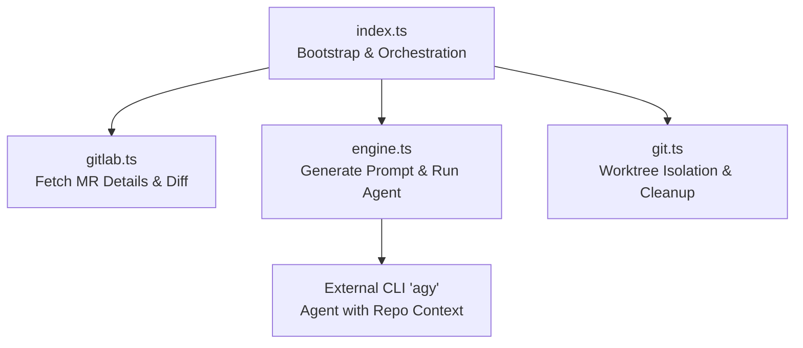
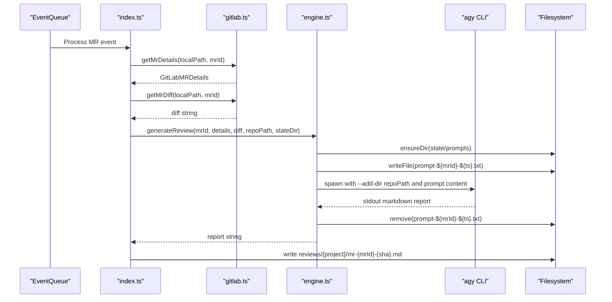
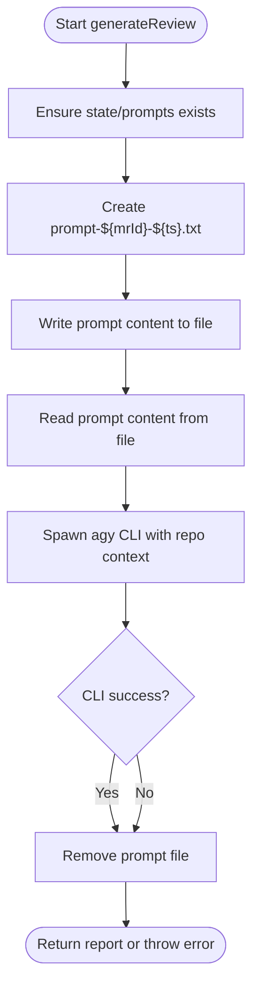
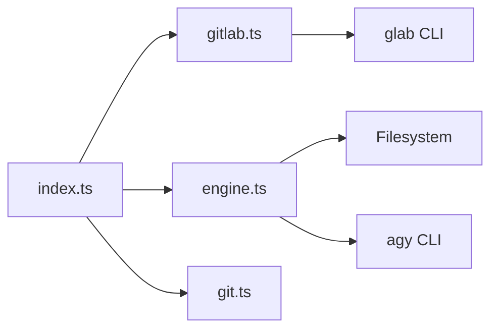

# Prompt Generation & Management

<cite>
**Referenced Files in This Document**
- [engine.ts](file://src/engine.ts)
- [gitlab.ts](file://src/gitlab.ts)
- [index.ts](file://src/index.ts)
- [git.ts](file://src/git.ts)
- [config.ts](file://src/config.ts)
- [config.example.json](file://config/config.example.json)
</cite>

## Table of Contents
1. [Introduction](#introduction)
2. [Project Structure](#project-structure)
3. [Core Components](#core-components)
4. [Architecture Overview](#architecture-overview)
5. [Detailed Component Analysis](#detailed-component-analysis)
6. [Dependency Analysis](#dependency-analysis)
7. [Performance Considerations](#performance-considerations)
8. [Troubleshooting Guide](#troubleshooting-guide)
9. [Conclusion](#conclusion)

## Introduction
This document explains the prompt generation and management system that constructs AI review prompts from merge request context and repository knowledge. It covers:
- How prompts are built using merge request metadata and diffs
- The template structure and dynamic variable substitution
- Repository context injection via an external agent CLI
- File-based prompt storage, temporary file lifecycle, and cleanup
- Size limitations and optimization strategies
- Customization options and best practices for prompt engineering

## Project Structure
The prompt generation pipeline is orchestrated by the application bootstrap and executed within a queue-driven workflow. Key files:
- Application bootstrap and orchestration: [index.ts](file://src/index.ts)
- GitLab integration (MR details and diff): [gitlab.ts](file://src/gitlab.ts)
- Prompt construction and execution: [engine.ts](file://src/engine.ts)
- Worktree isolation and cleanup: [git.ts](file://src/git.ts)
- Configuration loading and validation: [config.ts](file://src/config.ts), [config.example.json](file://config/config.example.json)

**Diagram sources**
- [index.ts:47-112](file://src/index.ts#L47-L112)
- [gitlab.ts:51-95](file://src/gitlab.ts#L51-L95)
- [engine.ts:8-212](file://src/engine.ts#L8-L212)
- [git.ts:9-49](file://src/git.ts#L9-L49)

**Section sources**
- [index.ts:20-112](file://src/index.ts#L20-L112)
- [gitlab.ts:51-95](file://src/gitlab.ts#L51-L95)
- [engine.ts:8-212](file://src/engine.ts#L8-L212)
- [git.ts:9-49](file://src/git.ts#L9-L49)

## Core Components
- Merge Request Context Provider: Retrieves MR title, description, branches, author, state, and SHA from GitLab via CLI.
- Diff Provider: Fetches the MR diff as text.
- Prompt Builder: Constructs a structured prompt including repository knowledge instructions, MR metadata, and the diff.
- Execution Engine: Writes the prompt to a temporary file, invokes the external agent CLI with repo context, captures output, and cleans up.
- Worktree Manager: Creates isolated worktrees per MR and ensures cleanup even on failures.

**Section sources**
- [gitlab.ts:8-19](file://src/gitlab.ts#L8-L19)
- [gitlab.ts:51-95](file://src/gitlab.ts#L51-L95)
- [engine.ts:8-212](file://src/engine.ts#L8-L212)
- [git.ts:9-49](file://src/git.ts#L9-L49)

## Architecture Overview
The end-to-end flow for generating an AI review prompt and executing it:

**Diagram sources**
- [index.ts:47-123](file://src/index.ts#L47-L123)
- [gitlab.ts:51-95](file://src/gitlab.ts#L51-L95)
- [engine.ts:80-211](file://src/engine.ts#L80-L211)

## Detailed Component Analysis

### Prompt Template Structure and Dynamic Substitution
The prompt builder composes a structured instruction set for the AI reviewer:
- Role definition and task scope
- Repository knowledge base instructions directing the agent to read specific files/directories within the target repository
- Merge request information fields injected dynamically:
  - Title
  - Description
  - Source branch
  - Target branch
- Task requirements:
  - Classification into one of three types: Feature, Bug Fix, Unit Test
  - Required Markdown sections for all classifications
  - Additional sections based on classification
  - Strict finding format with severity, file path, issue summary, rationale, and suggested fix
- Output constraints:
  - Only Markdown report
  - Fallback message when no issues found
- Diff inclusion:
  - The final diff is appended at the end of the prompt

Dynamic variables are substituted directly into the prompt template before writing to disk and invoking the agent.

**Section sources**
- [engine.ts:29-78](file://src/engine.ts#L29-L78)

### Repository Context Injection
Repository context is provided in two ways:
- Instructional guidance embedded in the prompt directs the agent to read specific repository artifacts such as documentation and architectural guides.
- The agent CLI is invoked with an additional directory argument pointing to the repository path, enabling the agent to access repository files during its analysis.

This dual approach ensures the agent has both explicit instructions and filesystem access to repository context.

**Section sources**
- [engine.ts:32-34](file://src/engine.ts#L32-L34)
- [engine.ts:114-126](file://src/engine.ts#L114-L126)

### File-Based Prompt Storage and Temporary File Management
- Directory creation: The system ensures the state/prompts directory exists before writing any prompt files.
- Filename pattern: Each prompt is written to a unique file named prompt-{mrId}-{timestamp}.txt under state/prompts.
- Write and read cycle: The prompt is written to disk and then read back to pass to the agent CLI.
- Purpose: Bypassing command-line length limits and enabling debugging visibility.

Cleanup procedure:
- After successful invocation or failure, the temporary prompt file is removed in a finally block.
- If removal fails, a warning is logged but processing continues.

**Diagram sources**
- [engine.ts:80-88](file://src/engine.ts#L80-L88)
- [engine.ts:114-187](file://src/engine.ts#L114-L187)
- [engine.ts:203-211](file://src/engine.ts#L203-L211)

**Section sources**
- [engine.ts:80-88](file://src/engine.ts#L80-L88)
- [engine.ts:203-211](file://src/engine.ts#L203-L211)

### External Agent Invocation and Environment
- CLI tool: The system spawns an external agent CLI named agy.
- Model selection: Configured model parameter is passed to the CLI.
- Permissions: A flag is used to skip interactive permission prompts.
- Repository context: The repository path is added via an add-directory flag so the agent can read repository files.
- Timeout: Internal CLI timeout is increased to accommodate long-running workflows.
- Terminal emulation: Environment variables force terminal detection and non-interactive behavior.

Error handling:
- Timeouts kill the process after a configured duration.
- Non-zero exit codes produce errors with captured stderr.
- Retry wrapper applies retries with exponential backoff for transient failures.

**Section sources**
- [engine.ts:91-193](file://src/engine.ts#L91-L193)

### Worktree Isolation and Cleanup
- Per-MR worktrees are created under state/worktrees to isolate repository state during review.
- Worktrees are detached from branches and cleaned up after processing, even if errors occur.
- On startup, orphaned worktrees are pruned and removed to recover from previous crashes.

**Section sources**
- [index.ts:33-44](file://src/index.ts#L33-L44)
- [index.ts:98-112](file://src/index.ts#L98-L112)
- [index.ts:180-183](file://src/index.ts#L180-L183)
- [git.ts:9-49](file://src/git.ts#L9-L49)
- [git.ts:51-99](file://src/git.ts#L51-L99)

### Example Generated Prompt Outline
While the exact content is not included here, the generated prompt follows this outline:
- Role and task definition
- Repository knowledge base instructions
- Merge request metadata (title, description, source/target branches)
- Classification and required sections
- Finding format specification
- Output constraints
- Git diff section

This structure ensures consistent, actionable outputs from the AI reviewer.

**Section sources**
- [engine.ts:29-78](file://src/engine.ts#L29-L78)

### Template Customization Options
Currently, the prompt template is defined inline within the engine. To customize:
- Modify the prompt construction logic in the engine to adjust sections, instructions, or formatting rules.
- Introduce configuration-driven parameters for:
  - Classification categories and their associated sections
  - Severity levels and finding format
  - Output constraints and fallback messages
- Add environment variables or config entries to toggle optional sections or change repository knowledge directives.

Best practices:
- Keep the prompt concise and focused on high-signal instructions.
- Use clear, deterministic output formats to simplify downstream parsing.
- Avoid overly verbose examples; prefer precise rules.

**Section sources**
- [engine.ts:29-78](file://src/engine.ts#L29-L78)

### Prompt Size Limitations and Optimization Strategies
- Diff truncation: If the diff exceeds a threshold, it is truncated with a marker indicating truncation.
- Rationale: Large diffs can exceed CLI argument limits and increase processing time/cost.
- Strategy:
  - Truncate diffs early to bound prompt size.
  - Prefer targeted diffs or staged changes where possible.
  - Monitor agent performance and adjust thresholds based on workload.

**Section sources**
- [engine.ts:17-27](file://src/engine.ts#L17-L27)

## Dependency Analysis
The prompt generation system depends on:
- GitLab CLI for fetching MR details and diffs
- External agent CLI for executing the review with repository context
- Filesystem for temporary prompt storage and review reports
- Configuration loader for validating repository paths and runtime settings

**Diagram sources**
- [index.ts:47-112](file://src/index.ts#L47-L112)
- [gitlab.ts:51-95](file://src/gitlab.ts#L51-L95)
- [engine.ts:80-211](file://src/engine.ts#L80-L211)
- [git.ts:9-49](file://src/git.ts#L9-L49)

**Section sources**
- [index.ts:47-112](file://src/index.ts#L47-L112)
- [gitlab.ts:51-95](file://src/gitlab.ts#L51-L95)
- [engine.ts:80-211](file://src/engine.ts#L80-L211)
- [git.ts:9-49](file://src/git.ts#L9-L49)

## Performance Considerations
- Diff size control: Truncating large diffs reduces prompt size and processing time.
- CLI timeouts: Increased internal timeouts accommodate complex agent workflows.
- Retry strategy: Retries mitigate transient failures without excessive overhead.
- Worktree isolation: Prevents cross-MR interference and improves reliability.
- Prompt file I/O: Writing prompts to disk avoids CLI argument limits and enables debugging.

[No sources needed since this section provides general guidance]

## Troubleshooting Guide
Common issues and resolutions:
- glab authentication failures:
  - Ensure glab CLI is installed and authenticated.
  - Check logs for authentication status and token presence.
- MR fetch failures:
  - Verify network connectivity and permissions.
  - Confirm MR ID and project path correctness.
- Agent CLI errors:
  - Inspect stderr output for detailed error messages.
  - Adjust timeouts or flags if the agent hangs or exits prematurely.
- Prompt file cleanup failures:
  - Manually remove stale prompt files in state/prompts if warnings persist.
- Worktree cleanup issues:
  - Run pruning and manual cleanup routines to recover from orphaned worktrees.

**Section sources**
- [gitlab.ts:21-49](file://src/gitlab.ts#L21-L49)
- [engine.ts:165-211](file://src/engine.ts#L165-L211)
- [git.ts:29-49](file://src/git.ts#L29-L49)
- [git.ts:51-99](file://src/git.ts#L51-L99)

## Conclusion
The prompt generation system integrates GitLab context, repository knowledge, and an external agent CLI to produce structured AI review reports. It emphasizes safety through worktree isolation, robustness via retries and timeouts, and clarity through a well-defined prompt template. Operators can tailor the template and configuration to align with team conventions while maintaining reliable performance and clean resource management.

[No sources needed since this section summarizes without analyzing specific files]