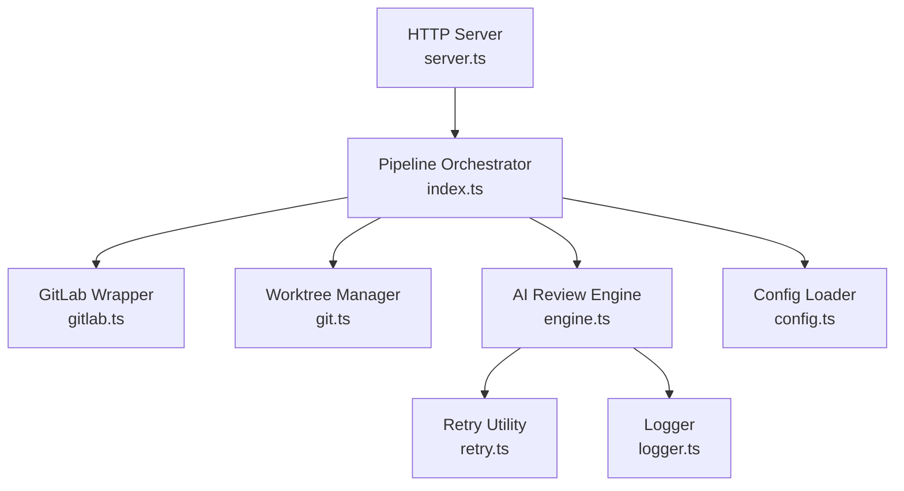
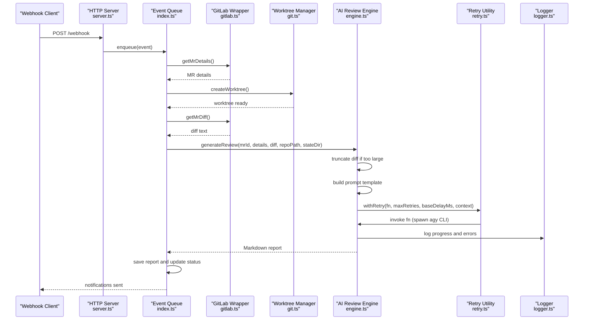
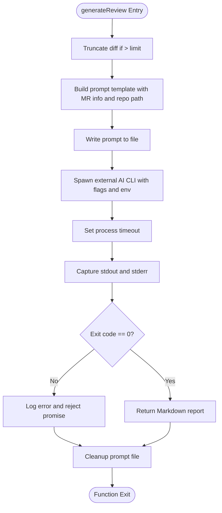
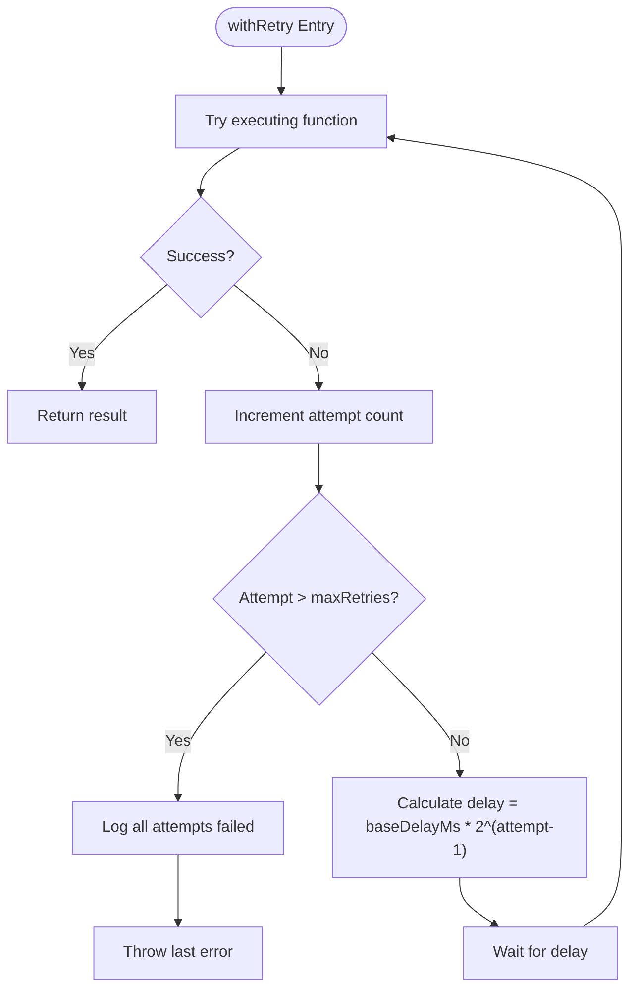
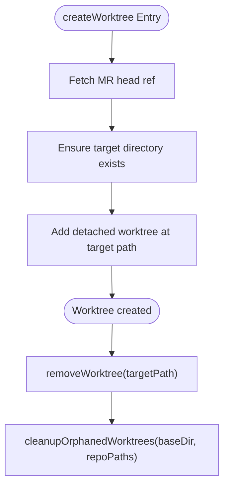
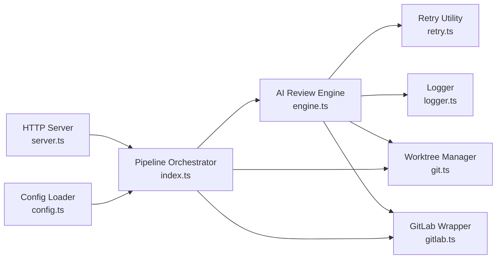

# AI Review Engine

<cite>
**Referenced Files in This Document**
- [engine.ts](file://src/engine.ts)
- [retry.ts](file://src/retry.ts)
- [git.ts](file://src/git.ts)
- [gitlab.ts](file://src/gitlab.ts)
- [index.ts](file://src/index.ts)
- [server.ts](file://src/server.ts)
- [config.ts](file://src/config.ts)
- [logger.ts](file://src/logger.ts)
- [README.md](file://README.md)
- [config.example.json](file://config/config.example.json)
</cite>

## Table of Contents
1. [Introduction](#introduction)
2. [Project Structure](#project-structure)
3. [Core Components](#core-components)
4. [Architecture Overview](#architecture-overview)
5. [Detailed Component Analysis](#detailed-component-analysis)
6. [Dependency Analysis](#dependency-analysis)
7. [Performance Considerations](#performance-considerations)
8. [Troubleshooting Guide](#troubleshooting-guide)
9. [Conclusion](#conclusion)

## Introduction
The AI review engine is the core orchestrator that manages the complete lifecycle of AI-powered code reviews for GitLab Merge Requests. It coordinates external CLI tools, isolates repository state using Git worktrees, extracts diffs, generates structured prompts, invokes an external AI agent, and processes results into Markdown reports. The engine also implements robust retry logic with exponential backoff, timeout management, and comprehensive logging to handle failures from external dependencies such as GitLab and AI services.

## Project Structure
The AI review engine integrates with several modules:
- Pipeline orchestration and event processing
- Git worktree isolation and cleanup
- GitLab metadata and diff retrieval
- External AI agent invocation via a CLI tool
- Retry and logging utilities
- Configuration validation and environment setup

**Diagram sources**
- [server.ts:10-115](file://src/server.ts#L10-L115)
- [index.ts:20-196](file://src/index.ts#L20-L196)
- [gitlab.ts:21-96](file://src/gitlab.ts#L21-L96)
- [git.ts:9-99](file://src/git.ts#L9-L99)
- [engine.ts:8-213](file://src/engine.ts#L8-L213)
- [retry.ts:12-36](file://src/retry.ts#L12-L36)
- [logger.ts:1-14](file://src/logger.ts#L1-L14)
- [config.ts:41-79](file://src/config.ts#L41-L79)

**Section sources**
- [README.md:160-201](file://README.md#L160-L201)
- [server.ts:10-115](file://src/server.ts#L10-L115)
- [index.ts:20-196](file://src/index.ts#L20-L196)

## Core Components
- AI Review Engine: constructs prompts, truncates large diffs, spawns the external AI CLI, enforces timeouts, captures output, and returns structured Markdown.
- Retry Utility: provides exponential backoff for transient failures.
- Git Worktree Manager: creates isolated worktrees per MR, removes them after processing, and cleans up orphaned worktrees on startup.
- GitLab Wrapper: fetches MR details and diffs via an external CLI with retries.
- Pipeline Orchestrator: coordinates the end-to-end flow from webhook ingestion to report generation and notifications.
- Logger: centralized logging with configurable levels and pretty printing.

**Section sources**
- [engine.ts:8-213](file://src/engine.ts#L8-L213)
- [retry.ts:12-36](file://src/retry.ts#L12-L36)
- [git.ts:9-99](file://src/git.ts#L9-L99)
- [gitlab.ts:21-96](file://src/gitlab.ts#L21-L96)
- [index.ts:47-184](file://src/index.ts#L47-L184)
- [logger.ts:1-14](file://src/logger.ts#L1-L14)

## Architecture Overview
The system follows a pipeline architecture where HTTP webhooks trigger sequential processing. Each MR event flows through GitLab data retrieval, worktree isolation, diff extraction, AI prompt generation, external CLI execution, result persistence, and notification dispatch.

**Diagram sources**
- [server.ts:83-109](file://src/server.ts#L83-L109)
- [index.ts:47-184](file://src/index.ts#L47-L184)
- [gitlab.ts:51-96](file://src/gitlab.ts#L51-L96)
- [git.ts:9-49](file://src/git.ts#L9-L49)
- [engine.ts:8-213](file://src/engine.ts#L8-L213)
- [retry.ts:12-36](file://src/retry.ts#L12-L36)
- [logger.ts:1-14](file://src/logger.ts#L1-L14)

## Detailed Component Analysis

### AI Review Engine
The engine orchestrates prompt construction, external CLI invocation, timeout enforcement, and result handling. It truncates excessively large diffs to control prompt size, writes prompts to files to bypass command-line length limits, and uses environment variables to ensure non-interactive operation.

Key responsibilities:
- Diff truncation to prevent oversized prompts
- Prompt template assembly including MR metadata and repository context instructions
- Spawning the external AI CLI with appropriate flags and environment settings
- Timeout management to kill long-running processes
- Capturing stdout/stderr and mapping exit codes to errors
- Cleanup of temporary prompt files

**Diagram sources**
- [engine.ts:17-27](file://src/engine.ts#L17-L27)
- [engine.ts:29-78](file://src/engine.ts#L29-L78)
- [engine.ts:80-88](file://src/engine.ts#L80-L88)
- [engine.ts:91-193](file://src/engine.ts#L91-L193)
- [engine.ts:194-211](file://src/engine.ts#L194-L211)

**Section sources**
- [engine.ts:8-213](file://src/engine.ts#L8-L213)

### Retry Mechanism with Exponential Backoff
The retry utility wraps asynchronous functions and retries failed attempts with exponential delays. It logs each attempt and final failure, ensuring consistent behavior across GitLab CLI calls and AI CLI invocations.

Behavior:
- Executes function until success or maximum retries exceeded
- Calculates delay as baseDelayMs multiplied by powers of two
- Logs warnings for each failed attempt and fatal errors upon exhaustion

**Diagram sources**
- [retry.ts:12-36](file://src/retry.ts#L12-L36)

**Section sources**
- [retry.ts:12-36](file://src/retry.ts#L12-L36)

### Git Worktree Management
The worktree manager ensures isolated environments for each MR review. It fetches merge request refs, creates detached worktrees, and provides cleanup routines for both successful and failed runs. It also prunes orphaned worktrees on startup to maintain filesystem hygiene.

Responsibilities:
- Fetching MR head refs
- Creating detached worktrees at deterministic paths
- Removing worktrees after processing
- Pruning administrative pointers and cleaning orphaned directories

**Diagram sources**
- [git.ts:9-27](file://src/git.ts#L9-L27)
- [git.ts:29-49](file://src/git.ts#L29-L49)
- [git.ts:51-99](file://src/git.ts#L51-L99)

**Section sources**
- [git.ts:9-99](file://src/git.ts#L9-L99)

### GitLab Integration
The GitLab wrapper retrieves MR details and diffs using an external CLI. It validates authentication status and applies retry logic to mitigate transient network or service issues.

Capabilities:
- Verifying CLI authentication
- Fetching structured MR metadata
- Extracting raw diff content with buffer limits
- Retrying failed operations with exponential backoff

**Section sources**
- [gitlab.ts:21-96](file://src/gitlab.ts#L21-L96)

### Pipeline Orchestration
The orchestrator coordinates the entire lifecycle: configuration loading, database initialization, GitLab auth verification, worktree cleanup, event queue setup, and review processing. It handles deduplication, status updates, report saving, and notifications.

Flow highlights:
- Deduplicate based on project, MR ID, and commit SHA
- Create isolated worktree before fetching diff
- Invoke AI engine with repository path and state directory
- Save Markdown report and update database status
- Send notifications via Telegram, Email, and Desktop

**Section sources**
- [index.ts:20-196](file://src/index.ts#L20-L196)

### Configuration and Environment
Configuration is validated using schema definitions to ensure required fields exist and local repository paths are present. Example configuration demonstrates multi-repository support and optional integrations like Telegram and email.

Key aspects:
- Zod-based schema validation for config structure
- Path existence checks for configured repositories
- Example configuration showing repository entries and optional services

**Section sources**
- [config.ts:6-38](file://src/config.ts#L6-L38)
- [config.ts:41-79](file://src/config.ts#L41-L79)
- [config.example.json:1-28](file://config/config.example.json#L1-L28)

### Logging and Monitoring
Logging is centralized with configurable levels and pretty-printed output. It supports environment-driven log levels and includes detailed messages for retries, CLI invocations, and errors.

Monitoring approaches:
- Structured logs for retries and backoff
- CLI stdout/stderr capture for debugging
- Health check endpoint for service status
- Web dashboard for reviewing generated reports

**Section sources**
- [logger.ts:1-14](file://src/logger.ts#L1-L14)
- [server.ts:16-18](file://src/server.ts#L16-L18)
- [engine.ts:147-187](file://src/engine.ts#L147-L187)

## Dependency Analysis
The AI review engine depends on external CLI tools and internal utilities:
- External dependencies: GitLab CLI for metadata/diff retrieval, AI CLI for model invocation
- Internal dependencies: retry utility for resilience, logger for observability, git module for isolation, config module for validation

**Diagram sources**
- [engine.ts:8-213](file://src/engine.ts#L8-L213)
- [retry.ts:12-36](file://src/retry.ts#L12-L36)
- [logger.ts:1-14](file://src/logger.ts#L1-L14)
- [git.ts:9-99](file://src/git.ts#L9-L99)
- [gitlab.ts:21-96](file://src/gitlab.ts#L21-L96)
- [index.ts:20-196](file://src/index.ts#L20-L196)
- [server.ts:10-115](file://src/server.ts#L10-L115)
- [config.ts:41-79](file://src/config.ts#L41-L79)

**Section sources**
- [engine.ts:8-213](file://src/engine.ts#L8-L213)
- [index.ts:20-196](file://src/index.ts#L20-L196)

## Performance Considerations
- Diff truncation reduces prompt size and prevents excessive memory usage during AI processing.
- Sequential event queue prevents concurrent reviews from competing for resources.
- External CLI timeouts avoid indefinite hangs and free system resources promptly.
- Buffer limits on diff retrieval protect against oversized outputs.
- Isolated worktrees minimize filesystem contention and reduce risk of side effects.

[No sources needed since this section provides general guidance]

## Troubleshooting Guide
Common issues and resolutions:
- AI CLI timeout: Increase timeout values or optimize prompt size; monitor logs for timeout events.
- External CLI failures: Verify authentication and PATH configuration; use retry logs to diagnose transient errors.
- Orphaned worktrees: Run cleanup routines on startup; manually remove stale directories if necessary.
- Configuration errors: Validate JSON structure and ensure local repository paths exist.
- Notification failures: Check Telegram bot token/chat ID and SMTP credentials.

Operational tips:
- Use health check endpoint to verify service availability.
- Inspect generated prompts and reports under state/prompts and reviews directories.
- Adjust LOG_LEVEL to debug for deeper insights into retries and CLI interactions.

**Section sources**
- [engine.ts:139-187](file://src/engine.ts#L139-L187)
- [git.ts:51-99](file://src/git.ts#L51-L99)
- [config.ts:41-79](file://src/config.ts#L41-L79)
- [server.ts:16-18](file://src/server.ts#L16-L18)

## Conclusion
The AI review engine provides a resilient, isolated, and observable pipeline for generating AI-powered code reviews. By combining Git worktrees, structured prompts, external CLI integration, and exponential backoff retries, it delivers reliable outcomes even under transient failures. The modular architecture enables clear separation of concerns, while comprehensive logging and monitoring facilitate operational visibility and troubleshooting.

[No sources needed since this section summarizes without analyzing specific files]