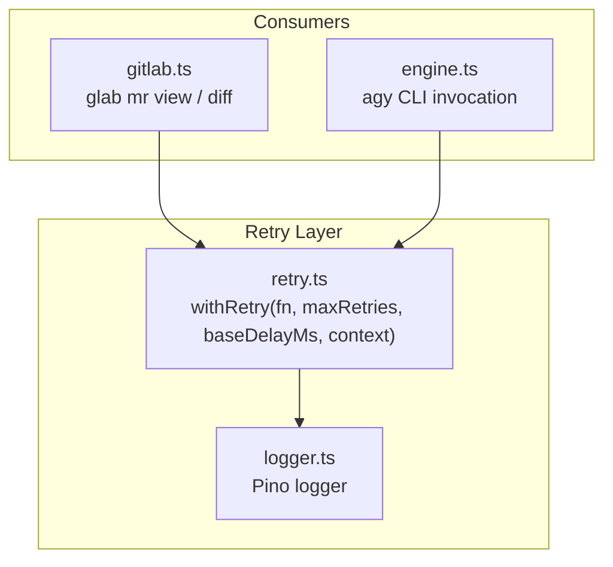
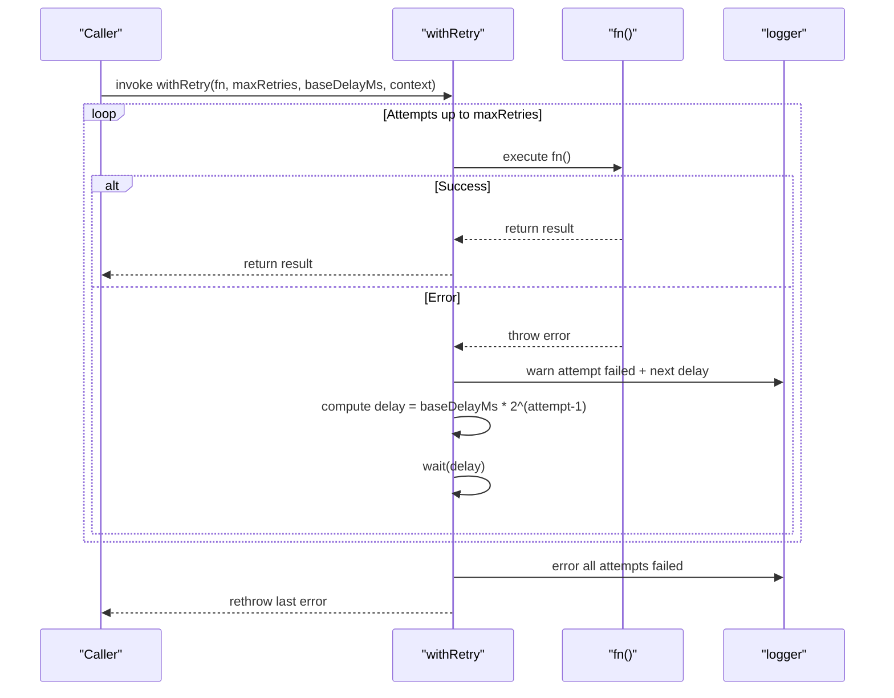
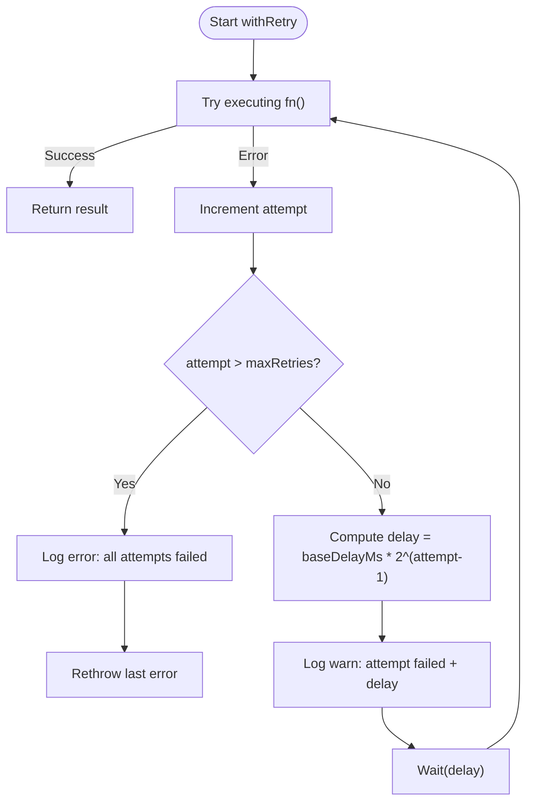
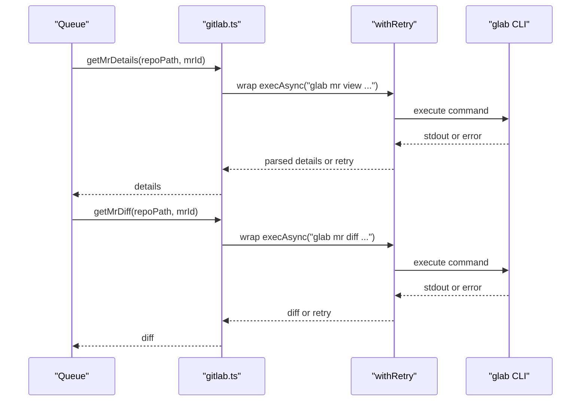
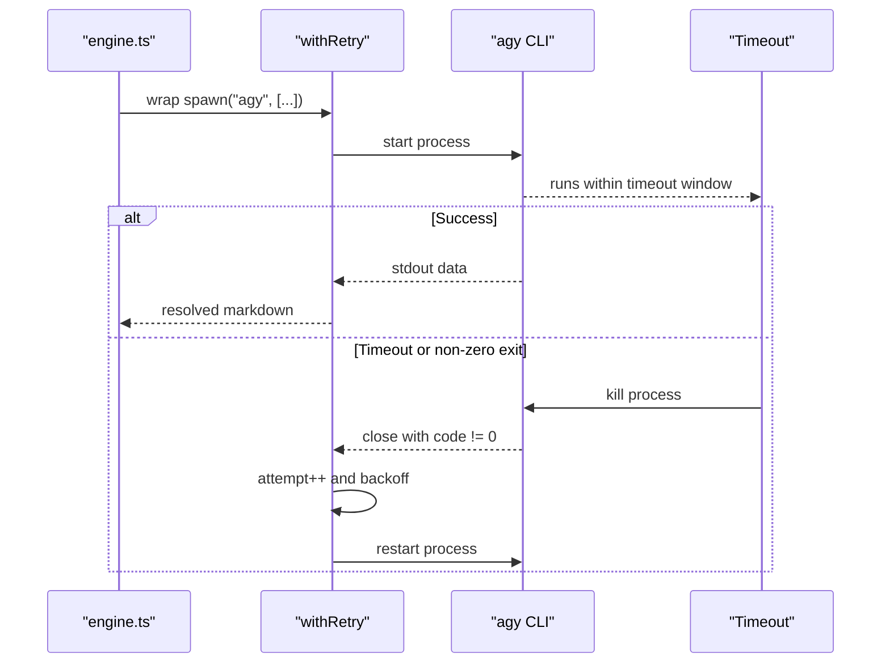
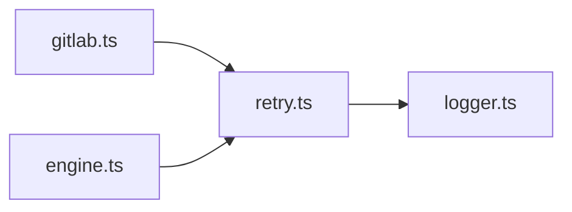

# Retry Mechanism

<cite>
**Referenced Files in This Document**
- [retry.ts](file://src/retry.ts)
- [engine.ts](file://src/engine.ts)
- [gitlab.ts](file://src/gitlab.ts)
- [logger.ts](file://src/logger.ts)
- [server.ts](file://src/server.ts)
- [index.ts](file://src/index.ts)
- [parser.ts](file://src/parser.ts)
- [README.md](file://README.md)
</cite>

## Table of Contents
1. [Introduction](#introduction)
2. [Project Structure](#project-structure)
3. [Core Components](#core-components)
4. [Architecture Overview](#architecture-overview)
5. [Detailed Component Analysis](#detailed-component-analysis)
6. [Dependency Analysis](#dependency-analysis)
7. [Performance Considerations](#performance-considerations)
8. [Troubleshooting Guide](#troubleshooting-guide)
9. [Conclusion](#conclusion)

## Introduction
This document explains the retry mechanism that provides resilient execution for AI agent invocations and external CLI calls in the project. It covers:
- The exponential backoff algorithm implemented by the retry wrapper
- How retries are configured for different operations
- Failure detection strategies used by the system
- Where and how the retry wrapper is applied
- Logging and monitoring of retry attempts
- Performance implications and debugging guidance

The retry mechanism is intentionally simple and focused on transient failures, without a circuit breaker implementation.

## Project Structure
The retry functionality lives in a dedicated module and is consumed by two primary subsystems:
- GitLab CLI integration for fetching MR details and diffs
- AI review engine invoking the agy CLI

**Diagram sources**
- [retry.ts:12-35](file://src/retry.ts#L12-L35)
- [gitlab.ts:51-95](file://src/gitlab.ts#L51-L95)
- [engine.ts:91-193](file://src/engine.ts#L91-L193)
- [logger.ts:1-14](file://src/logger.ts#L1-L14)

**Section sources**
- [README.md:189-190](file://README.md#L189-L190)
- [README.md:232-233](file://README.md#L232-L233)
- [README.md:254-256](file://README.md#L254-L256)

## Core Components
- Retry wrapper function with exponential backoff
- Logger integration for structured retry events
- Consumers applying retries to external CLI calls (GitLab and AI agent)

Key responsibilities:
- Retry wrapper: encapsulates attempt counting, delay calculation, logging, and error propagation
- Logger: emits warn/error logs for each retry and final failure
- Consumers: configure retry parameters per operation based on expected failure characteristics

**Section sources**
- [retry.ts:12-35](file://src/retry.ts#L12-L35)
- [logger.ts:1-14](file://src/logger.ts#L1-L14)

## Architecture Overview
The retry mechanism is a thin, composable layer around asynchronous functions. It does not inspect error types; any thrown error triggers a retry until the maximum number of attempts is exhausted.

**Diagram sources**
- [retry.ts:12-35](file://src/retry.ts#L12-L35)

## Detailed Component Analysis

### Retry Wrapper: Exponential Backoff Algorithm
The retry wrapper executes a promise-returning function repeatedly until it succeeds or exceeds the configured maximum retries. On each failure:
- It increments the attempt counter
- Computes an exponential delay using baseDelayMs multiplied by 2 raised to the power of (attempt - 1)
- Logs a warning with the current attempt number, context, error message, and computed delay
- Waits for the computed delay before retrying
- After exhausting all retries, logs an error and rethrows the last error

Important behaviors:
- No jitter is added to delays
- All errors trigger retries; there is no error classification
- The first call counts as attempt 1; subsequent retries increment attempt and apply backoff accordingly

**Diagram sources**
- [retry.ts:12-35](file://src/retry.ts#L12-L35)

**Section sources**
- [retry.ts:12-35](file://src/retry.ts#L12-L35)

### Retry Configuration Options
The retry wrapper accepts four parameters:
- fn: the asynchronous function to execute
- maxRetries: maximum number of retry attempts allowed after the initial call
- baseDelayMs: base delay in milliseconds; actual delay doubles on each retry
- context: descriptive string used in logs to identify the operation

Operational defaults observed in consumers:
- GitLab CLI calls: 3 total attempts, base delay 1000ms
- AI agent (agy) CLI call: 2 total attempts, base delay 2000ms

These values reflect different resilience needs:
- External network/CLI calls to GitLab use more attempts and shorter base delay
- AI agent invocation uses fewer attempts but longer base delay due to potentially long-running processes

**Section sources**
- [gitlab.ts:57-62](file://src/gitlab.ts#L57-L62)
- [gitlab.ts:79-86](file://src/gitlab.ts#L79-L86)
- [engine.ts:91-193](file://src/engine.ts#L91-L193)

### Failure Detection Strategies
Current strategy:
- Any thrown error from the wrapped function triggers a retry
- There is no explicit classification of transient vs. permanent errors
- Timeouts and non-zero exit codes are treated as failures and retried

Implications:
- Transient issues (network hiccups, temporary unavailability) are mitigated
- Permanent issues (misconfiguration, missing dependencies) will still be retried up to the configured limit before failing

Recommendation:
- Introduce error classification to distinguish transient vs. permanent failures
- Optionally add jitter to avoid thundering herd when multiple retries occur concurrently

**Section sources**
- [retry.ts:20-33](file://src/retry.ts#L20-L33)
- [engine.ts:139-187](file://src/engine.ts#L139-L187)

### Retry Wrapper Usage in GitLab Integration
The GitLab module wraps both MR detail retrieval and diff fetching with retry logic:
- getMrDetails: invokes glab mr view with JSON output
- getMrDiff: invokes glab mr diff with a larger buffer for large diffs

Both operations use 3 attempts and a 1000ms base delay.

**Diagram sources**
- [gitlab.ts:51-95](file://src/gitlab.ts#L51-L95)
- [retry.ts:12-35](file://src/retry.ts#L12-L35)

**Section sources**
- [gitlab.ts:51-95](file://src/gitlab.ts#L51-L95)

### Retry Wrapper Usage in AI Review Engine
The AI review engine invokes the agy CLI to generate a structured Markdown report. The CLI invocation is wrapped with retry logic:
- Timeout handling kills the process if it exceeds a configured duration
- Non-zero exit codes and timeout conditions reject the promise
- The entire invocation is retried up to 2 times with a 2000ms base delay

**Diagram sources**
- [engine.ts:91-193](file://src/engine.ts#L91-L193)
- [engine.ts:139-187](file://src/engine.ts#L139-L187)
- [retry.ts:12-35](file://src/retry.ts#L12-L35)

**Section sources**
- [engine.ts:91-193](file://src/engine.ts#L91-L193)

### Circuit Breaker Patterns
There is no circuit breaker implementation in the current codebase. The retry mechanism does not track failure rates or open/close states. If you need circuit-breaking behavior, consider adding:
- A failure rate tracker per operation
- Thresholds to open the circuit and short-circuit requests
- A half-open state to test recovery
- Metrics and alerts for circuit state transitions

[No sources needed since this section proposes conceptual enhancements]

### Custom Retry Logic Implementation
To implement custom retry logic:
- Extend the retry wrapper to accept an optional predicate function that classifies errors as transient or permanent
- Add jitter to delays to reduce contention
- Support configurable backoff caps and maximum total time
- Emit structured metrics (attempts, delays, success/failure) for observability

Example approach:
- Wrap existing callers with the enhanced retry wrapper
- Keep current configuration values unchanged during migration
- Gradually introduce jitter and caps while monitoring impact

[No sources needed since this section provides general guidance]

### Monitoring Retry Attempts
Logging is provided via Pino:
- Each failed attempt logs a warning with attempt number, context, error message, and computed delay
- Final exhaustion logs an error with the last error message

To enhance monitoring:
- Add structured fields such as operation name, attempt count, delay, and error type
- Export metrics (e.g., Prometheus) for retry counts and durations
- Correlate retry logs with request IDs or MR IDs for traceability

**Section sources**
- [retry.ts:26-32](file://src/retry.ts#L26-L32)
- [logger.ts:1-14](file://src/logger.ts#L1-L14)

## Dependency Analysis
The retry module depends only on the logger. Consumers depend on the retry module to wrap their asynchronous operations.

**Diagram sources**
- [retry.ts:1-2](file://src/retry.ts#L1-L2)
- [gitlab.ts:1-4](file://src/gitlab.ts#L1-L4)
- [engine.ts:1-6](file://src/engine.ts#L1-L6)
- [logger.ts:1-14](file://src/logger.ts#L1-L14)

**Section sources**
- [retry.ts:1-2](file://src/retry.ts#L1-L2)
- [gitlab.ts:1-4](file://src/gitlab.ts#L1-L4)
- [engine.ts:1-6](file://src/engine.ts#L1-L6)

## Performance Considerations
- Exponential backoff reduces load on failing services but can increase overall latency
- Without jitter, concurrent retries may synchronize and cause bursts
- Long-running AI agent invocations can block resources; ensure timeouts are appropriate
- Large buffers for diffs prevent memory pressure but should be tuned per environment
- Sequential processing in the queue avoids concurrency issues but can become a bottleneck under high load

Recommendations:
- Add jitter to backoff delays
- Cap maximum delay and total retry time
- Monitor retry frequency and latency distributions
- Tune buffer sizes and timeouts based on workload characteristics

[No sources needed since this section provides general guidance]

## Troubleshooting Guide
Common issues and diagnostics:
- Repeated retries with identical errors indicate permanent failures; check authentication, PATH, and dependency availability
- Timeouts in AI agent invocations suggest slow model responses or heavy tool-use steps; adjust timeout and model selection
- High retry volume indicates transient instability; monitor external service health and network conditions

Steps:
- Inspect logs for retry warnings and final errors
- Verify glab CLI authentication status
- Validate agy CLI installation and permissions
- Reduce concurrency or increase timeouts if necessary

**Section sources**
- [gitlab.ts:21-48](file://src/gitlab.ts#L21-L48)
- [engine.ts:139-187](file://src/engine.ts#L139-L187)
- [retry.ts:26-32](file://src/retry.ts#L26-L32)

## Conclusion
The retry mechanism provides a straightforward and effective way to handle transient failures in external CLI calls and AI agent invocations. While it lacks advanced features like error classification and circuit breaking, its simplicity makes it easy to understand and operate. For production environments, consider enhancing it with jitter, error classification, metrics, and circuit breaker patterns to improve resilience and observability.