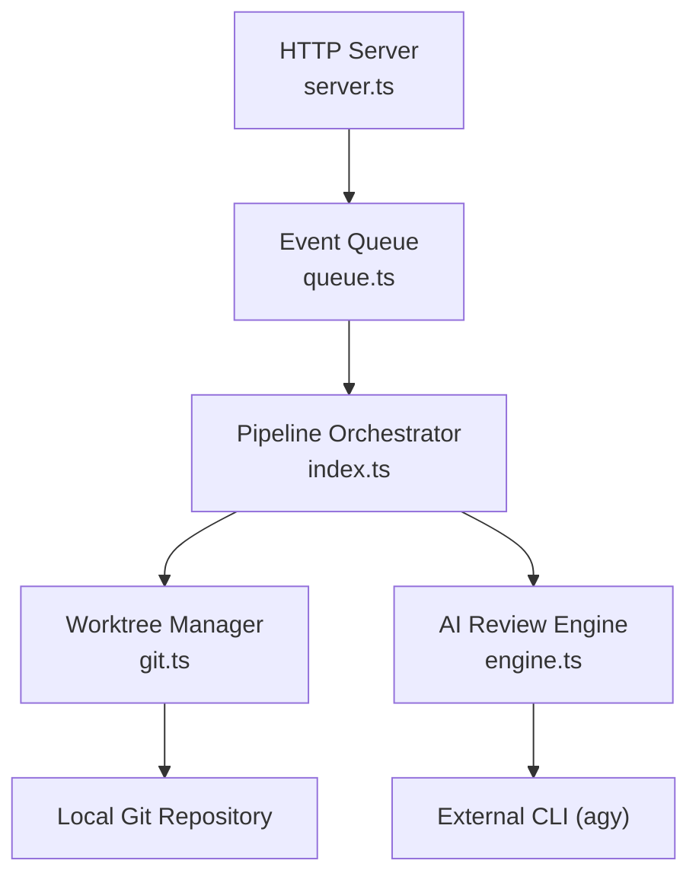
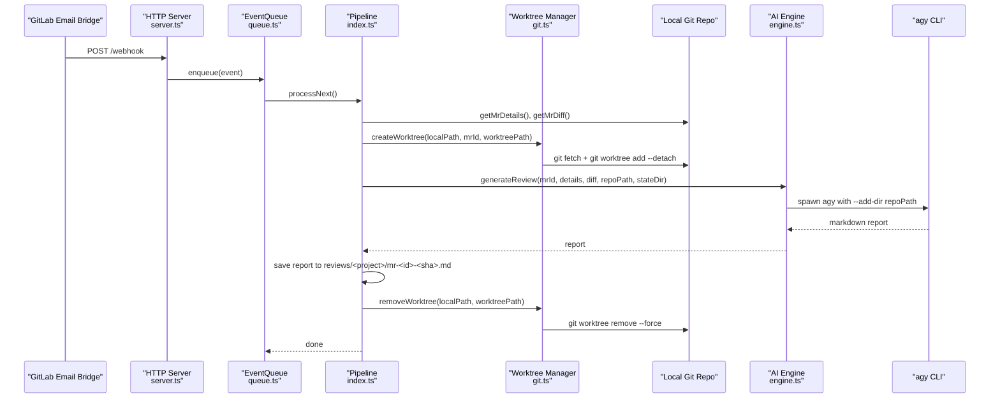
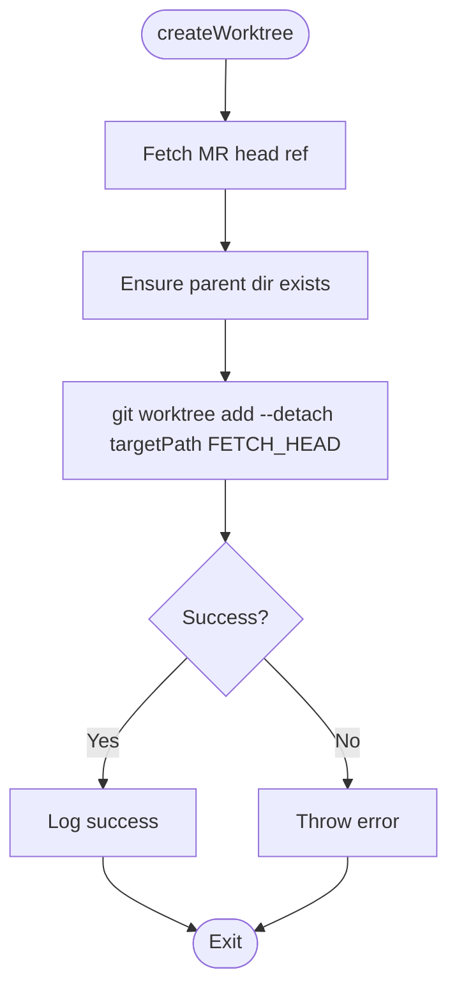
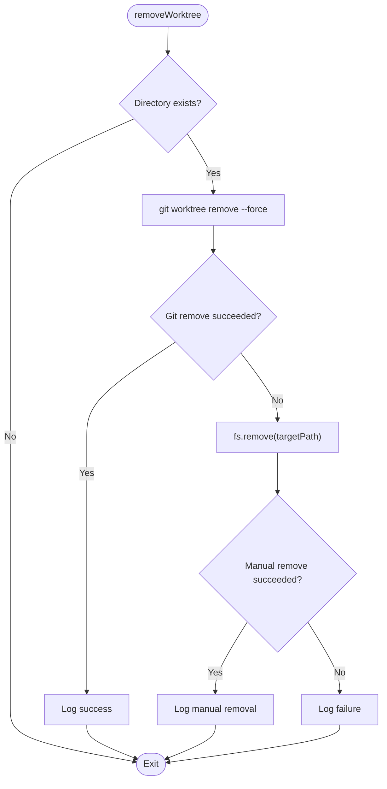
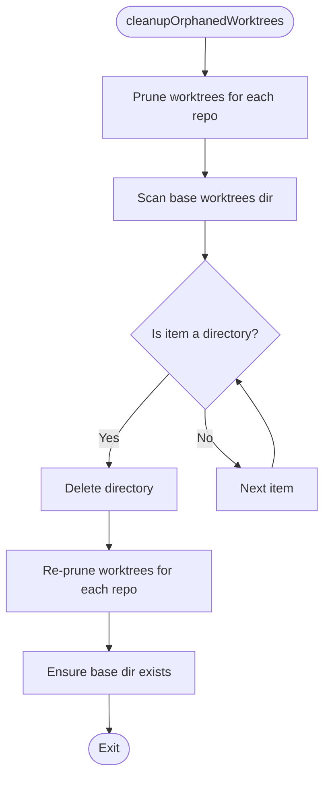
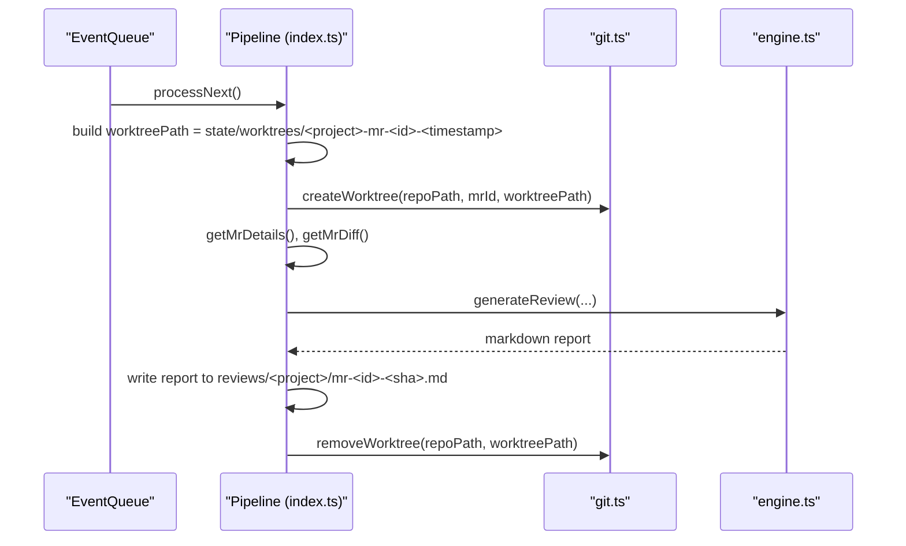
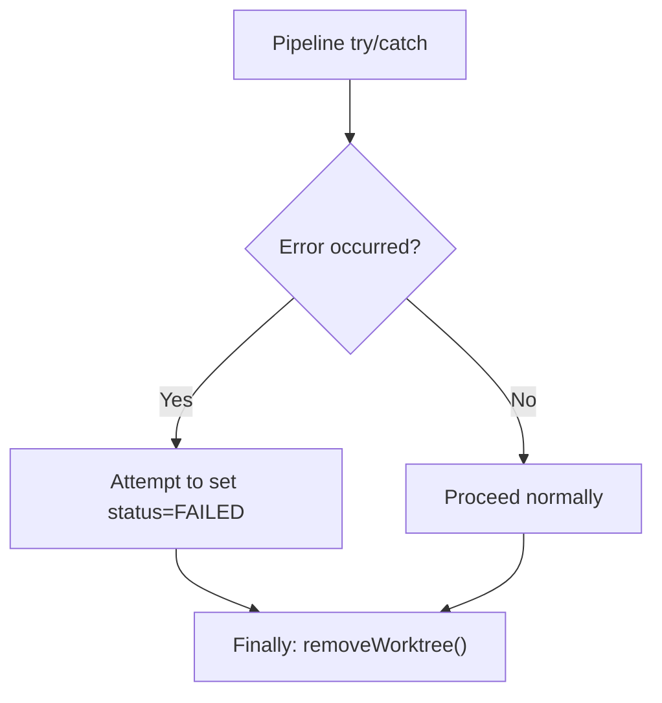
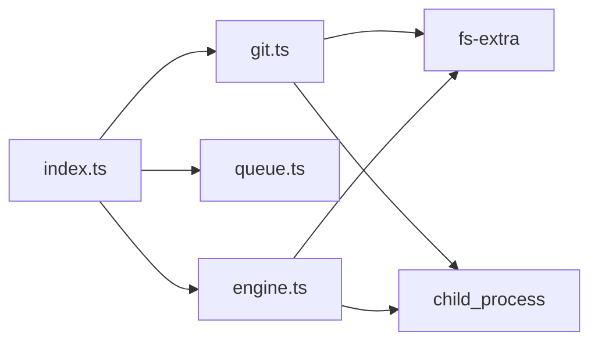

# Worktree Management

<cite>
**Referenced Files in This Document**
- [git.ts](file://src/git.ts)
- [index.ts](file://src/index.ts)
- [queue.ts](file://src/queue.ts)
- [engine.ts](file://src/engine.ts)
- [server.ts](file://src/server.ts)
- [README.md](file://README.md)
</cite>

## Table of Contents
1. [Introduction](#introduction)
2. [Project Structure](#project-structure)
3. [Core Components](#core-components)
4. [Architecture Overview](#architecture-overview)
5. [Detailed Component Analysis](#detailed-component-analysis)
6. [Dependency Analysis](#dependency-analysis)
7. [Performance Considerations](#performance-considerations)
8. [Troubleshooting Guide](#troubleshooting-guide)
9. [Conclusion](#conclusion)

## Introduction
This document explains the worktree management system that creates isolated Git environments for each code review. The system ensures safe code analysis without affecting the main repository by:
- Creating a detached Git worktree per merge request (MR).
- Fetching MR refs and diffs from the configured local repository clone.
- Running AI-driven reviews against the isolated worktree context.
- Cleaning up worktrees after processing, including robust handling of orphaned worktrees.

The design prioritizes safety, isolation, deterministic cleanup, and predictable resource usage during concurrent review processing.

## Project Structure
The worktree lifecycle is orchestrated across several modules:
- Bootstrap and pipeline orchestration: [index.ts](file://src/index.ts)
- Worktree operations and cleanup: [git.ts](file://src/git.ts)
- Sequential event queue to prevent concurrency issues: [queue.ts](file://src/queue.ts)
- AI review engine invocation: [engine.ts](file://src/engine.ts)
- HTTP server and webhooks: [server.ts](file://src/server.ts)
- High-level overview and configuration guidance: [README.md](file://README.md)

**Diagram sources**
- [server.ts:83-109](file://src/server.ts#L83-L109)
- [queue.ts:6-46](file://src/queue.ts#L6-L46)
- [index.ts:47-184](file://src/index.ts#L47-L184)
- [git.ts:9-49](file://src/git.ts#L9-L49)
- [engine.ts:8-212](file://src/engine.ts#L8-L212)

**Section sources**
- [index.ts:20-45](file://src/index.ts#L20-L45)
- [git.ts:51-99](file://src/git.ts#L51-L99)
- [README.md:160-201](file://README.md#L160-L201)

## Core Components
- Worktree creation: fetches MR head via Git and creates a detached worktree under a controlled base directory.
- Worktree removal: removes the worktree with fallback to manual deletion if Git fails.
- Orphaned worktree cleanup: prunes Git’s internal state and deletes leftover directories under the worktrees base path.
- Pipeline integration: orchestrates worktree creation, diff fetching, AI review, report saving, notifications, and cleanup.
- Concurrency control: sequential queue prevents overlapping worktree operations.

Key responsibilities:
- Isolation: Each MR gets its own detached worktree; the main branch remains untouched.
- Deterministic paths: Worktree paths follow a consistent naming convention for traceability.
- Robust cleanup: Cleanup runs on startup and after each review, ensuring no orphans remain.

**Section sources**
- [git.ts:9-49](file://src/git.ts#L9-L49)
- [git.ts:51-99](file://src/git.ts#L51-L99)
- [index.ts:60-183](file://src/index.ts#L60-L183)
- [queue.ts:6-46](file://src/queue.ts#L6-L46)

## Architecture Overview
The end-to-end flow for an MR review includes:
1. Webhook receives an email payload and enqueues it.
2. The queue processes one event at a time.
3. The pipeline resolves the project config, constructs a unique worktree path, and creates the worktree.
4. The pipeline fetches MR details and diff using glab CLI.
5. The AI engine invokes agy CLI with repository access to generate a structured review.
6. The report is saved under reviews/<project-name>/mr-<id>-<sha>.md.
7. Notifications are sent.
8. The worktree is removed in a finally block.

**Diagram sources**
- [server.ts:83-109](file://src/server.ts#L83-L109)
- [queue.ts:15-44](file://src/queue.ts#L15-L44)
- [index.ts:47-183](file://src/index.ts#L47-L183)
- [git.ts:9-49](file://src/git.ts#L9-L49)
- [engine.ts:8-212](file://src/engine.ts#L8-L212)

## Detailed Component Analysis

### Worktree Creation
- Fetches the MR head reference directly from origin using Git.
- Ensures the parent directory exists before creating the worktree.
- Creates a detached worktree pointing to FETCH_HEAD to avoid branch conflicts.
- Logs success/failure and throws errors on failure.

**Diagram sources**
- [git.ts:9-27](file://src/git.ts#L9-L27)

**Section sources**
- [git.ts:9-27](file://src/git.ts#L9-L27)

### Worktree Removal
- Attempts to remove the worktree via Git with force flag.
- Falls back to manually deleting the directory if Git removal fails.
- Logs outcomes and continues even if manual deletion fails.

**Diagram sources**
- [git.ts:29-49](file://src/git.ts#L29-L49)

**Section sources**
- [git.ts:29-49](file://src/git.ts#L29-L49)

### Orphaned Worktree Cleanup
- Prunes Git’s internal worktree metadata for all configured repositories.
- Scans the base worktrees directory for leftover directories and removes them.
- Re-prunes Git state after deletions to ensure consistency.
- Ensures the base worktrees directory exists.

**Diagram sources**
- [git.ts:51-99](file://src/git.ts#L51-L99)

**Section sources**
- [git.ts:51-99](file://src/git.ts#L51-L99)

### Pipeline Integration and Lifecycle
- Constructs a unique worktree path per MR using project name, MR ID, and timestamp.
- Creates the worktree before fetching the diff.
- Invokes the AI engine with repository access.
- Saves the generated Markdown report under reviews/<project-name>/mr-<id>-<sha>.md.
- Always removes the worktree in a finally block to guarantee cleanup.

**Diagram sources**
- [index.ts:60-183](file://src/index.ts#L60-L183)
- [git.ts:9-49](file://src/git.ts#L9-L49)
- [engine.ts:8-212](file://src/engine.ts#L8-L212)

**Section sources**
- [index.ts:60-183](file://src/index.ts#L60-L183)

### Naming Conventions and Path Structures
- Base worktrees directory: state/worktrees
- Worktree path pattern: state/worktrees/<projectName>-mr-<mrId>-<timestamp>
- Report storage: reviews/<projectName>/mr-<mrId>-<sha>.md
- Prompt files (temporary): state/prompts/prompt-<mrId>-<timestamp>.txt

These conventions provide clear traceability between MRs, commits, and generated artifacts.

**Section sources**
- [index.ts:60-64](file://src/index.ts#L60-L64)
- [index.ts:115-121](file://src/index.ts#L115-L121)
- [engine.ts:80-88](file://src/engine.ts#L80-L88)

### Error Handling Patterns
- Worktree creation wraps Git commands and logs detailed errors, throwing a descriptive error message.
- Worktree removal attempts Git-based removal first, then falls back to filesystem deletion, logging both outcomes.
- Orphaned cleanup handles prune failures gracefully and continues scanning/removing directories.
- Pipeline catches errors mid-processing, updates status to FAILED when possible, and still performs cleanup in finally.

**Diagram sources**
- [index.ts:160-183](file://src/index.ts#L160-L183)

**Section sources**
- [git.ts:23-49](file://src/git.ts#L23-L49)
- [git.ts:96-99](file://src/git.ts#L96-L99)
- [index.ts:160-183](file://src/index.ts#L160-L183)

### Resource Management Strategies
- Detached worktrees ensure no branch references are created in the main repository.
- Sequential queue prevents concurrent worktree operations, reducing contention and risk of path collisions.
- Cleanup runs on startup and after each review to reclaim disk space and maintain repository integrity.
- Temporary prompt files are cleaned up in the AI engine’s finally block.

**Section sources**
- [queue.ts:6-46](file://src/queue.ts#L6-L46)
- [index.ts:33-44](file://src/index.ts#L33-L44)
- [index.ts:180-183](file://src/index.ts#L180-L183)
- [engine.ts:203-211](file://src/engine.ts#L203-L211)

## Dependency Analysis
The worktree subsystem depends on:
- Git CLI for worktree operations.
- fs-extra for file system utilities.
- Child process execution for Git commands.
- Logger for observability.

**Diagram sources**
- [index.ts:1-18](file://src/index.ts#L1-L18)
- [git.ts:1-5](file://src/git.ts#L1-L5)
- [engine.ts:1-6](file://src/engine.ts#L1-L6)

**Section sources**
- [index.ts:1-18](file://src/index.ts#L1-L18)
- [git.ts:1-5](file://src/git.ts#L1-L5)
- [engine.ts:1-6](file://src/engine.ts#L1-L6)

## Performance Considerations
- Sequential processing: The EventQueue processes events one at a time, preventing concurrent worktree operations and reducing I/O contention.
- Detached worktrees: Avoids branch lock contention and reduces overhead compared to full clones.
- Diff truncation: Large diffs (>100K chars) are truncated to reduce memory and processing time in the AI engine.
- Timeout controls: The AI engine sets a timeout to prevent long-running processes from blocking the queue.
- Cleanup efficiency: Pruning Git’s internal state minimizes administrative overhead and keeps the repository clean.

Recommendations:
- Keep worktree base directory on fast local storage to minimize I/O latency.
- Monitor disk usage of state/worktrees and reviews directories.
- Tune AI engine timeouts based on workload characteristics.
- Consider periodic background cleanup jobs if startup-only cleanup is insufficient.

[No sources needed since this section provides general guidance]

## Troubleshooting Guide
Common issues and resolutions:
- Worktree creation fails due to network or authentication:
  - Verify Git remote access and credentials.
  - Check logs for fetch errors and ensure the MR ref exists.
- Worktree removal fails:
  - The system falls back to manual deletion; verify permissions on the worktree directory.
- Orphaned worktrees persist:
  - Run cleanupOrphanedWorktrees explicitly or restart the service to trigger startup cleanup.
- Disk space exhaustion:
  - Inspect state/worktrees and reviews directories; ensure cleanup runs successfully.
  - Validate that removeWorktree is invoked in the finally block.

Operational checks:
- Confirm that cleanupOrphanedWorktrees is called during bootstrap.
- Verify that removeWorktree is always executed after review processing.
- Monitor logs for warnings about prune failures or manual removals.

**Section sources**
- [git.ts:23-49](file://src/git.ts#L23-L49)
- [git.ts:51-99](file://src/git.ts#L51-L99)
- [index.ts:33-44](file://src/index.ts#L33-L44)
- [index.ts:180-183](file://src/index.ts#L180-L183)

## Conclusion
The worktree management system provides a safe, isolated environment for each code review by leveraging Git worktrees with strict lifecycle controls. It ensures:
- No interference with the main repository through detached worktrees.
- Predictable path structures and naming conventions for traceability.
- Robust cleanup of worktrees, including orphan detection and pruning.
- Controlled concurrency via a sequential queue to prevent resource contention.
- Comprehensive error handling and logging for operational visibility.

This approach enables reliable, automated AI-driven code reviews while maintaining repository integrity and efficient resource usage.

[No sources needed since this section summarizes without analyzing specific files]