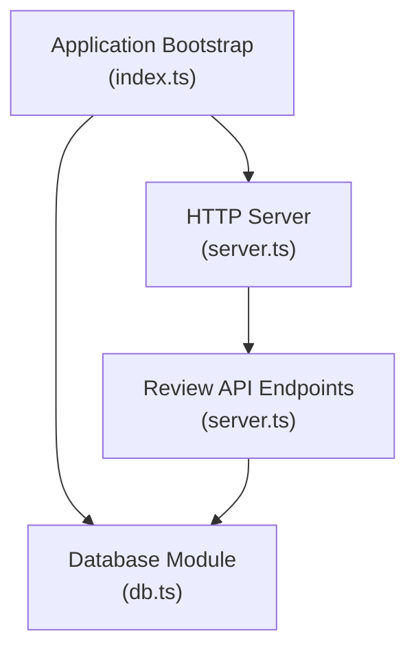
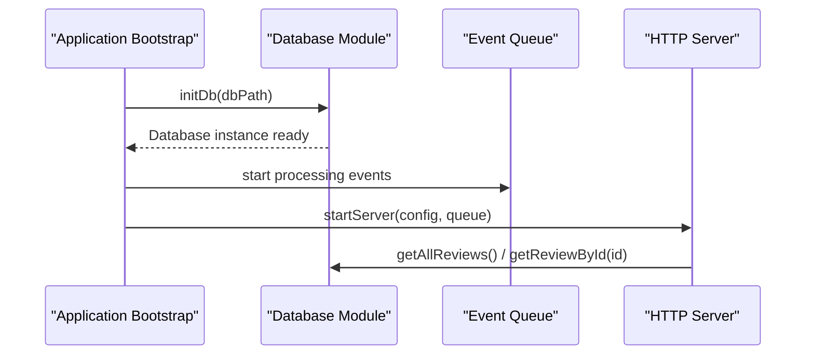
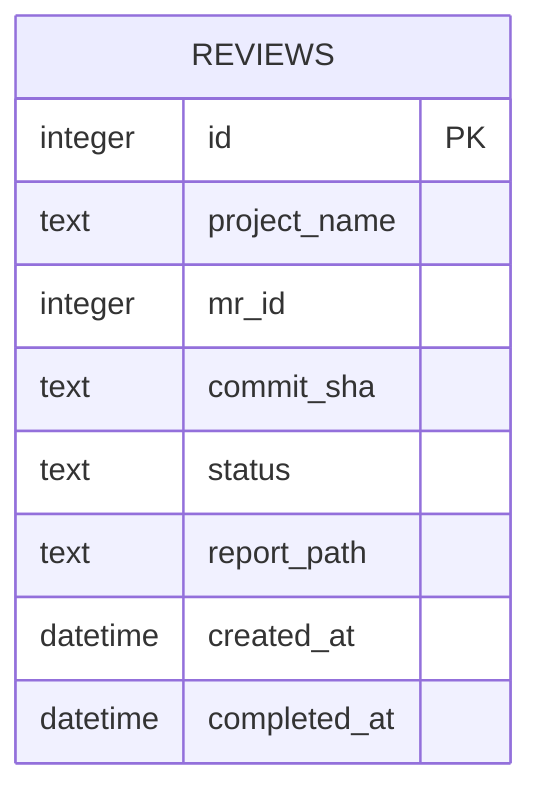
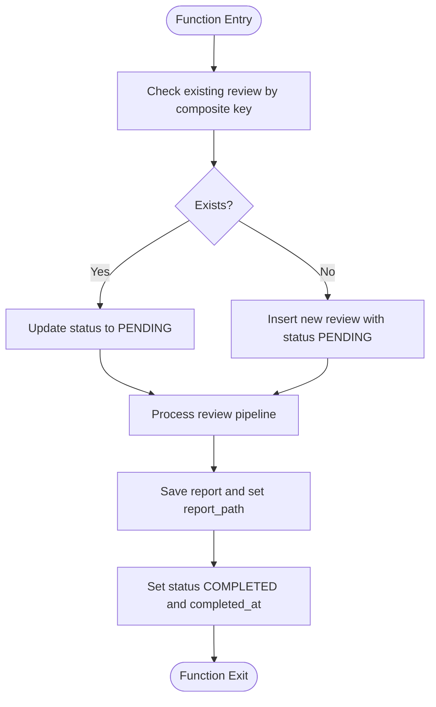
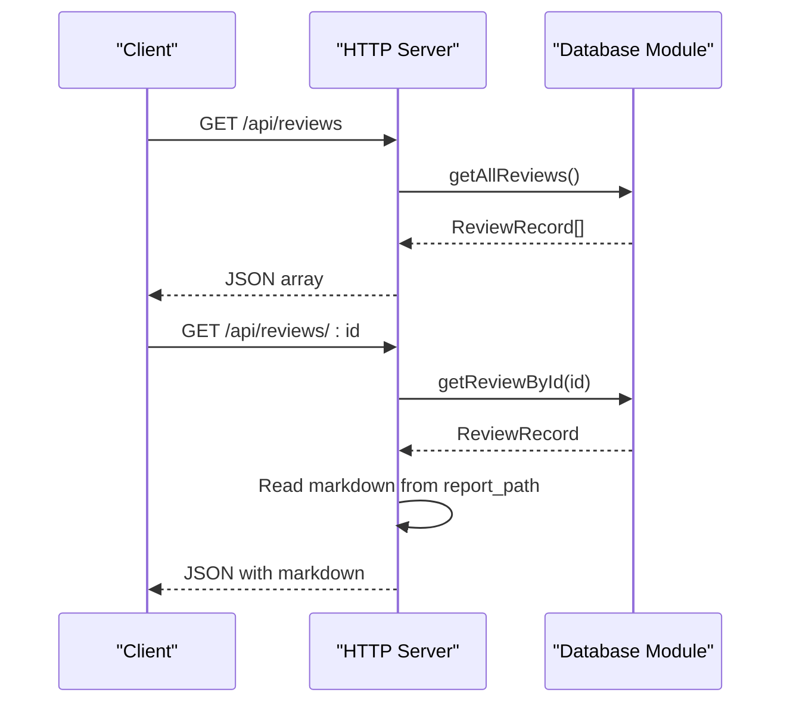
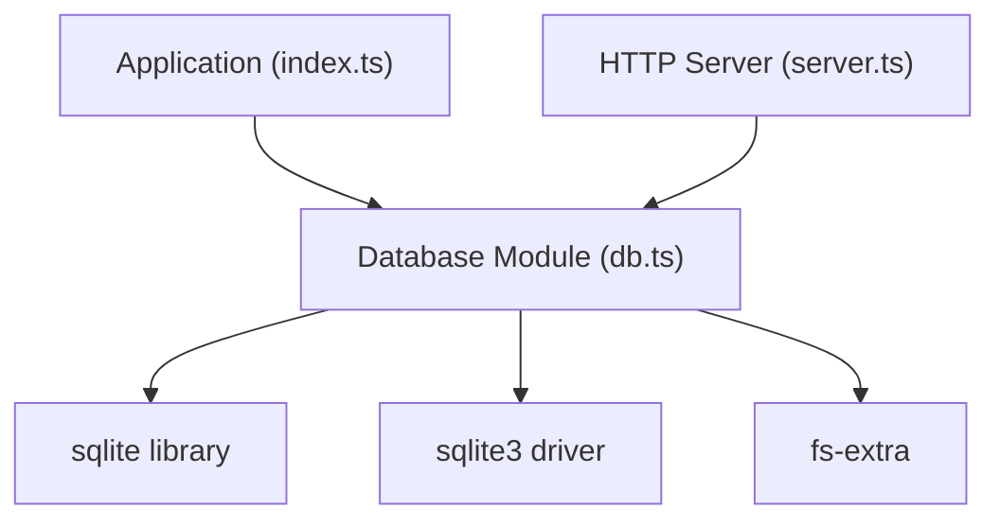

# Database Layer

<cite>
**Referenced Files in This Document**   
- [db.ts](file://src/db.ts)
- [index.ts](file://src/index.ts)
- [server.ts](file://src/server.ts)
- [package.json](file://package.json)
</cite>

## Table of Contents
1. [Introduction](#introduction)
2. [Project Structure](#project-structure)
3. [Core Components](#core-components)
4. [Architecture Overview](#architecture-overview)
5. [Detailed Component Analysis](#detailed-component-analysis)
6. [Dependency Analysis](#dependency-analysis)
7. [Performance Considerations](#performance-considerations)
8. [Troubleshooting Guide](#troubleshooting-guide)
9. [Conclusion](#conclusion)
10. [Appendices](#appendices)

## Introduction
This document provides comprehensive data model documentation for the SQLite database layer used by the application to store review records. It covers schema design, CRUD operations, connection management, transaction handling, indexing strategies, query optimization patterns, migration approaches, backup strategies, integrity constraints, and performance considerations for high-volume review processing. The goal is to make the database layer understandable for both technical and non-technical readers while providing actionable guidance for maintenance and scaling.

## Project Structure
The database layer is implemented as a dedicated module that initializes an in-process SQLite database, defines the schema (including indexes), and exposes typed functions for common operations. The application bootstrap initializes the database early in the startup sequence, and the HTTP server reads from it to serve review metadata and content.

**Diagram sources**
- [index.ts:20-29](file://src/index.ts#L20-L29)
- [db.ts:9-48](file://src/db.ts#L9-L48)
- [server.ts:10-33](file://src/server.ts#L10-L33)

**Section sources**
- [index.ts:20-29](file://src/index.ts#L20-L29)
- [db.ts:9-48](file://src/db.ts#L9-L48)
- [server.ts:10-33](file://src/server.ts#L10-L33)

## Core Components
- Database initialization and schema creation
- Review record type definition
- CRUD operations for reviews
- Indexing strategy for deduplication and lookup performance

Key responsibilities:
- Initialize the SQLite database file and ensure directory existence
- Create the reviews table with appropriate fields and defaults
- Define a unique index to prevent duplicate review entries per project, merge request, and commit
- Provide typed functions to insert, retrieve, update, and list reviews

**Section sources**
- [db.ts:9-48](file://src/db.ts#L9-L48)
- [db.ts:50-59](file://src/db.ts#L50-L59)
- [db.ts:61-95](file://src/db.ts#L61-L95)

## Architecture Overview
The database layer integrates into the application lifecycle and HTTP API:

- Application bootstrap loads configuration, initializes the database, verifies GitLab CLI authentication, cleans up orphaned worktrees, and starts the event queue and HTTP server.
- The database module creates the reviews table and a unique index during initialization.
- The HTTP server exposes endpoints to list reviews and fetch individual review details, including the markdown report path stored in the database.

**Diagram sources**
- [index.ts:20-29](file://src/index.ts#L20-L29)
- [index.ts:46-184](file://src/index.ts#L46-L184)
- [server.ts:10-33](file://src/server.ts#L10-L33)
- [db.ts:9-48](file://src/db.ts#L9-L48)

## Detailed Component Analysis

### Data Model: Reviews Table
The reviews table stores review records with the following fields:

- id: INTEGER PRIMARY KEY AUTOINCREMENT
- project_name: TEXT NOT NULL
- mr_id: INTEGER NOT NULL
- commit_sha: TEXT NOT NULL
- status: TEXT NOT NULL
- report_path: TEXT (nullable)
- created_at: DATETIME DEFAULT CURRENT_TIMESTAMP
- completed_at: DATETIME (nullable)

Indexing:
- Unique index on (project_name, mr_id, commit_sha) to enforce uniqueness and optimize lookups for deduplication.

Data relationships:
- Each row represents one review attempt tied to a specific project, merge request, and commit SHA.
- report_path references a file path on disk where the generated markdown report is stored; this relationship is logical rather than enforced via foreign keys.

Integrity constraints:
- Primary key constraint on id ensures unique identifiers.
- NOT NULL constraints on core fields ensure required metadata is always present.
- Unique index prevents duplicate review attempts for the same project, MR, and commit.

Complexity analysis:
- Insertions are O(1) amortized due to autoincrement and indexed primary key.
- Lookups by (project_name, mr_id, commit_sha) are O(log n) due to the unique index.
- Listing all reviews uses ORDER BY id DESC; with a primary key index, ordering is efficient.

Optimization opportunities:
- Consider adding additional indexes if frequent queries filter by status or date ranges.
- Partitioning is not applicable in SQLite; consider archiving old records to separate files if volume grows significantly.

**Diagram sources**
- [db.ts:23-40](file://src/db.ts#L23-L40)

**Section sources**
- [db.ts:23-40](file://src/db.ts#L23-L40)

### Connection Management
- The database instance is initialized once at application startup using a singleton pattern within the module scope.
- Directory creation is ensured before opening the database to avoid file-not-found errors.
- Errors during initialization are logged and rethrown to fail fast.

Operational notes:
- The database file path is provided by the application bootstrap and stored under the state directory.
- No explicit connection pooling is used; sqlite3 operates in-process with default concurrency behavior.

**Section sources**
- [db.ts:9-48](file://src/db.ts#L9-L48)
- [index.ts:27-29](file://src/index.ts#L27-L29)

### CRUD Operations
- getReview(projectName, mrId, commitSha): Retrieves a single review by composite key.
- insertReview(projectName, mrId, commitSha): Inserts a new review with initial status PENDING and returns the new id.
- updateReviewStatus(id, status, reportPath?): Updates status, optional report path, and sets completed_at when status indicates completion or failure.
- getAllReviews(): Returns all reviews ordered by newest first.
- getReviewById(id): Retrieves a review by primary key.

Error handling:
- Initialization errors are caught and logged.
- API handlers wrap database calls in try/catch blocks and return appropriate HTTP status codes.

Transaction handling:
- Individual operations use single statements; no explicit transactions are defined in the database module.
- For multi-step workflows (e.g., inserting a review and updating its status), consider wrapping related operations in a transaction to ensure atomicity.

**Diagram sources**
- [index.ts:73-96](file://src/index.ts#L73-L96)
- [index.ts:114-123](file://src/index.ts#L114-L123)
- [db.ts:61-82](file://src/db.ts#L61-L82)

**Section sources**
- [db.ts:61-95](file://src/db.ts#L61-L95)
- [index.ts:73-96](file://src/index.ts#L73-L96)
- [index.ts:114-123](file://src/index.ts#L114-L123)

### API Integration with Database
The HTTP server exposes endpoints that read from the database:

- GET /api/reviews: Lists all reviews.
- GET /api/reviews/:id: Fetches a review by id and includes the markdown content if the report file exists.
- POST /api/reviews/:id/retry: Re-enqueues a review for retry by setting forceRetry and updating status to PENDING.

**Diagram sources**
- [server.ts:24-54](file://src/server.ts#L24-L54)
- [db.ts:84-95](file://src/db.ts#L84-L95)

**Section sources**
- [server.ts:24-54](file://src/server.ts#L24-L54)
- [db.ts:84-95](file://src/db.ts#L84-L95)

## Dependency Analysis
External dependencies relevant to the database layer:

- sqlite3: Native driver for SQLite.
- sqlite: Higher-level wrapper providing async methods like open, get, run, all, exec.
- fs-extra: Used to ensure directories exist before opening the database.

Runtime environment:
- Node.js process runs the application and manages the in-process SQLite database file.

**Diagram sources**
- [db.ts:1-5](file://src/db.ts#L1-L5)
- [package.json:27-34](file://package.json#L27-L34)

**Section sources**
- [db.ts:1-5](file://src/db.ts#L1-L5)
- [package.json:27-34](file://package.json#L27-L34)

## Performance Considerations
- Index usage: The unique index on (project_name, mr_id, commit_sha) optimizes deduplication checks and targeted lookups.
- Query patterns: Most queries are simple and leverage primary key or indexed columns; avoid full table scans by filtering on indexed fields.
- Concurrency: SQLite supports concurrent reads but serializes writes; high write throughput may require batching or queuing writes.
- Storage growth: As reviews accumulate, consider archiving older records or partitioning by time if necessary.
- Report file I/O: Reading markdown reports adds disk I/O; caching frequently accessed reports can reduce latency.

[No sources needed since this section provides general guidance]

## Troubleshooting Guide
Common issues and resolutions:

- Database initialization failures:
  - Ensure the directory for the database file exists and is writable.
  - Verify permissions and available disk space.
  - Check logs for detailed error messages.

- Duplicate review attempts:
  - The unique index prevents duplicates; if retries are needed, update status to PENDING instead of inserting a new row.

- Missing report files:
  - When fetching a review by id, verify that report_path points to an existing file; otherwise, the API returns a 404.

- High latency on listing reviews:
  - If the table grows large, consider limiting results or adding pagination.

**Section sources**
- [db.ts:9-48](file://src/db.ts#L9-L48)
- [server.ts:35-54](file://src/server.ts#L35-L54)

## Conclusion
The SQLite database layer provides a straightforward and effective solution for storing review records with clear schema design, robust indexing, and well-defined CRUD operations. The integration with the application bootstrap and HTTP server ensures seamless operation across the review pipeline. For high-volume scenarios, consider enhancements such as transactional workflows, additional indexes for common filters, and archival strategies to manage storage growth.

[No sources needed since this section summarizes without analyzing specific files]

## Appendices

### Migration Approaches
- Schema changes should be applied via db.exec during initialization, guarded by IF NOT EXISTS to ensure idempotency.
- For complex migrations, maintain a migration log table to track applied versions and avoid reapplying changes.

**Section sources**
- [db.ts:23-40](file://src/db.ts#L23-L40)

### Backup Strategies
- Use SQLite’s built-in backup mechanisms or copy the database file while ensuring no active writes occur.
- Schedule periodic backups to a secure location and test restoration procedures regularly.

[No sources needed since this section provides general guidance]