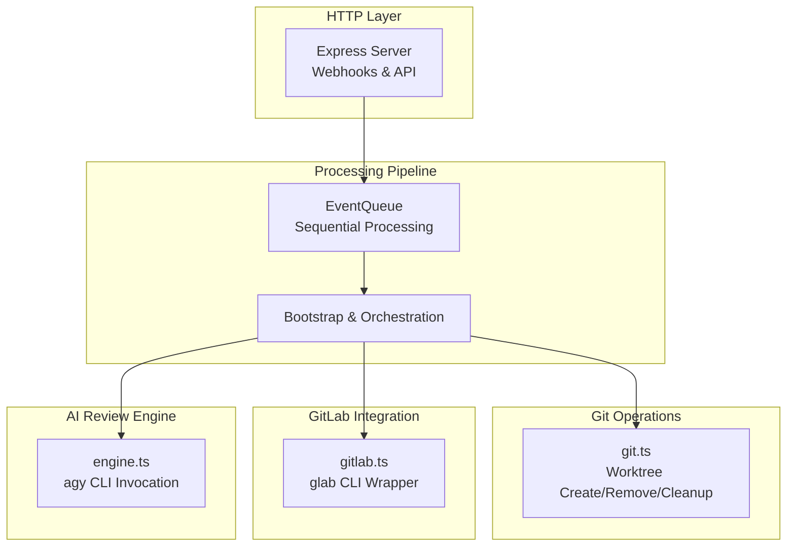
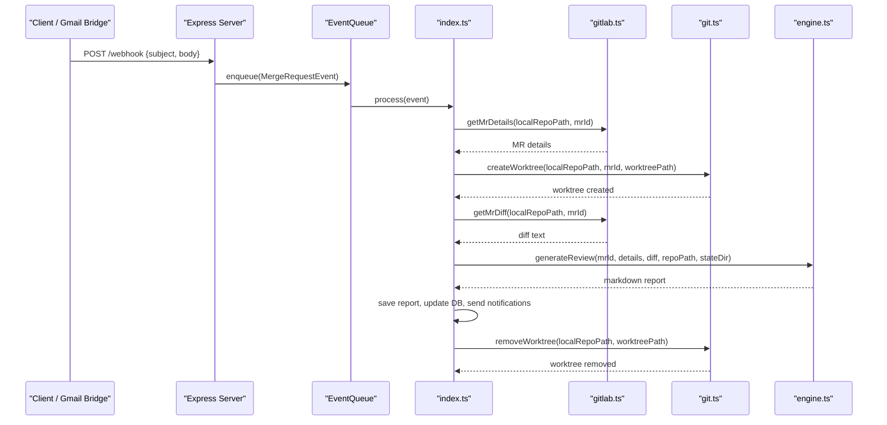
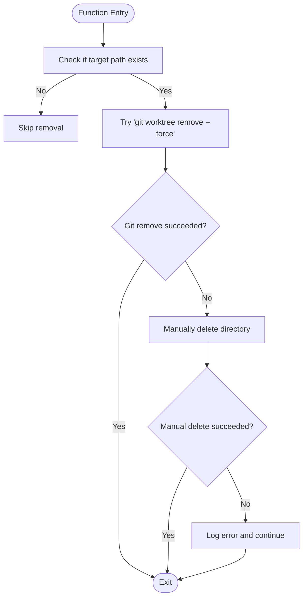
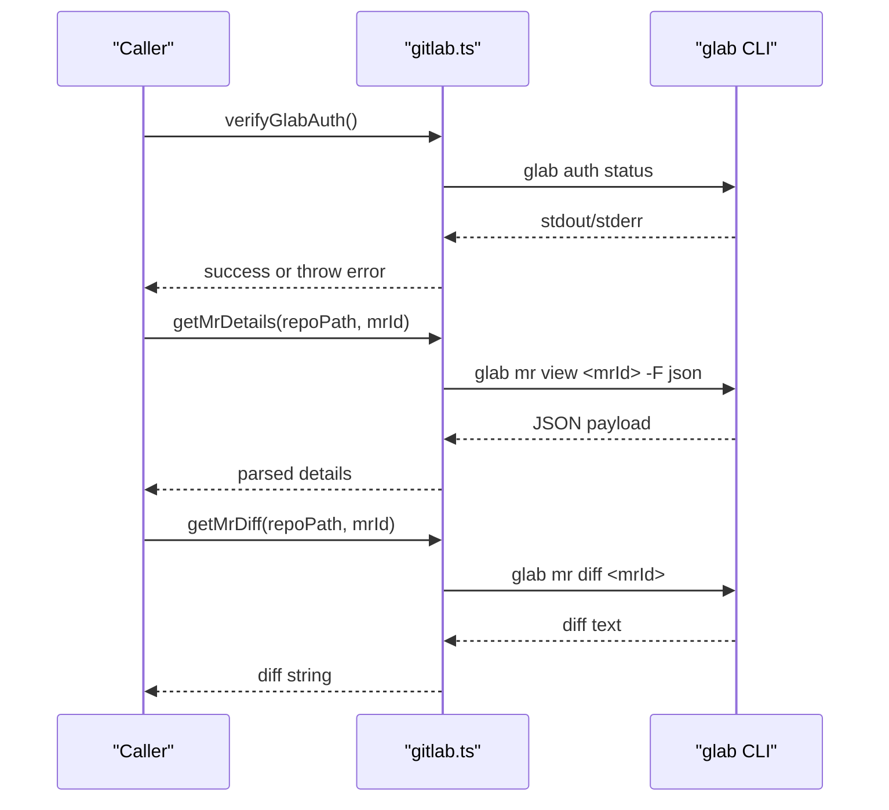
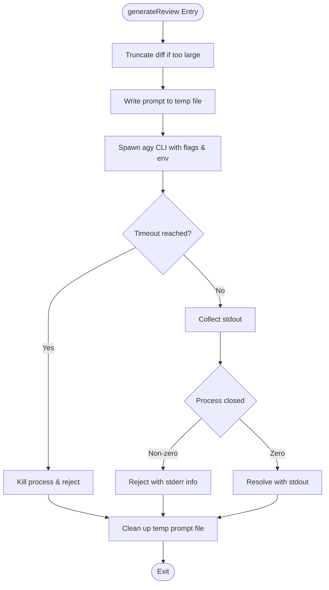
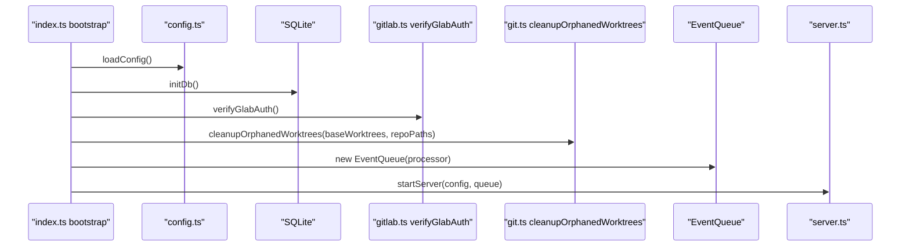
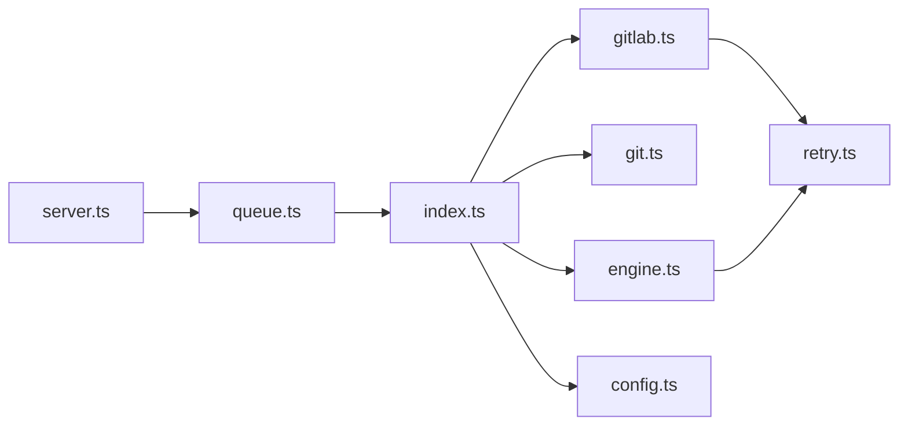

# Git Operations Management

<cite>
**Referenced Files in This Document**
- [git.ts](file://src/git.ts)
- [gitlab.ts](file://src/gitlab.ts)
- [engine.ts](file://src/engine.ts)
- [index.ts](file://src/index.ts)
- [queue.ts](file://src/queue.ts)
- [server.ts](file://src/server.ts)
- [config.ts](file://src/config.ts)
- [retry.ts](file://src/retry.ts)
- [README.md](file://README.md)
- [config.example.json](file://config/config.example.json)
</cite>

## Table of Contents
1. [Introduction](#introduction)
2. [Project Structure](#project-structure)
3. [Core Components](#core-components)
4. [Architecture Overview](#architecture-overview)
5. [Detailed Component Analysis](#detailed-component-analysis)
6. [Dependency Analysis](#dependency-analysis)
7. [Performance Considerations](#performance-considerations)
8. [Troubleshooting Guide](#troubleshooting-guide)
9. [Security Considerations](#security-considerations)
10. [Conclusion](#conclusion)

## Introduction
This document explains how the system manages Git operations and integrates with GitLab to perform safe, isolated code reviews for merge requests (MRs). It focuses on:
- Creating isolated Git worktrees to analyze MR changes without affecting the main repository
- Integrating with GitLab via the glab CLI to fetch MR details and diffs
- Cleaning up orphaned worktrees and managing resources
- Handling network failures and optimizing performance
- Addressing security considerations for repository access and credentials

The system is designed to be read-only with respect to GitLab and the target repositories, ensuring safety during automated analysis.

## Project Structure
At a high level, the application:
- Starts an HTTP server to receive webhook events and serve a dashboard
- Parses incoming GitLab email notifications into structured events
- Uses an in-memory queue to process events sequentially
- For each event:
  - Fetches MR details and diff using glab CLI
  - Creates an isolated Git worktree for the MR
  - Invokes an AI agent to generate a review report
  - Persists the report and sends notifications
  - Cleans up temporary worktrees

**Diagram sources**
- [server.ts:10-115](file://src/server.ts#L10-L115)
- [queue.ts:6-47](file://src/queue.ts#L6-L47)
- [index.ts:20-196](file://src/index.ts#L20-L196)
- [git.ts:9-99](file://src/git.ts#L9-L99)
- [gitlab.ts:21-96](file://src/gitlab.ts#L21-L96)
- [engine.ts:8-213](file://src/engine.ts#L8-L213)

**Section sources**
- [README.md:1-323](file://README.md#L1-L323)

## Core Components
- Worktree Manager (git.ts): Creates, removes, and cleans up Git worktrees for isolated analysis.
- GitLab CLI Wrapper (gitlab.ts): Interfaces with glab to authenticate, fetch MR details, and retrieve diffs.
- AI Review Engine (engine.ts): Builds prompts and invokes agy CLI to generate structured review reports.
- Bootstrap & Orchestration (index.ts): Coordinates configuration loading, DB initialization, authentication checks, cleanup, queue setup, and per-event processing.
- Event Queue (queue.ts): Ensures sequential processing of MR events to avoid concurrency issues.
- HTTP Server (server.ts): Exposes web endpoints and handles webhook payloads.
- Configuration (config.ts): Loads and validates configuration including repository mappings.
- Retry Utility (retry.ts): Provides exponential backoff retry logic for flaky operations.

**Section sources**
- [git.ts:9-99](file://src/git.ts#L9-L99)
- [gitlab.ts:21-96](file://src/gitlab.ts#L21-L96)
- [engine.ts:8-213](file://src/engine.ts#L8-L213)
- [index.ts:20-196](file://src/index.ts#L20-L196)
- [queue.ts:6-47](file://src/queue.ts#L6-L47)
- [server.ts:10-115](file://src/server.ts#L10-L115)
- [config.ts:41-79](file://src/config.ts#L41-L79)
- [retry.ts:12-35](file://src/retry.ts#L12-L35)

## Architecture Overview
The end-to-end flow for handling a GitLab MR notification:

**Diagram sources**
- [server.ts:83-109](file://src/server.ts#L83-L109)
- [queue.ts:15-44](file://src/queue.ts#L15-L44)
- [index.ts:47-183](file://src/index.ts#L47-L183)
- [gitlab.ts:51-95](file://src/gitlab.ts#L51-L95)
- [git.ts:9-49](file://src/git.ts#L9-L49)
- [engine.ts:8-213](file://src/engine.ts#L8-L213)

## Detailed Component Analysis

### Git Worktree Management (git.ts)
Responsibilities:
- Create an isolated worktree for each MR by fetching the MR head ref and checking out a detached HEAD.
- Remove worktrees after processing, with fallback to manual directory deletion if git fails.
- Clean up orphaned worktrees at startup or when needed by pruning Git’s internal state and removing stale directories.

Key behaviors:
- Fetches MR head via `git fetch origin refs/merge-requests/<id>/head`.
- Adds a detached worktree at a computed path under a base directory.
- Removes worktrees using `git worktree remove --force`, with fallback to filesystem removal.
- Prunes worktrees across configured repos and deletes leftover directories under the base worktrees folder.

**Diagram sources**
- [git.ts:29-49](file://src/git.ts#L29-L49)

Cleanup procedure highlights:
- Prune Git worktree administrative pointers for all configured repos.
- Scan the base worktrees directory for orphaned directories and remove them.
- Run prune again to ensure consistency after deletions.

**Section sources**
- [git.ts:9-99](file://src/git.ts#L9-L99)

### GitLab API Integration (gitlab.ts)
Responsibilities:
- Verify glab CLI authentication status.
- Fetch MR details (title, description, branches, author, state, SHA).
- Retrieve MR diff content with buffer limits for large diffs.

Authentication verification:
- Executes `glab auth status` and inspects output for login/token presence.
- Throws an error if no active token is found.

Fetching MR details:
- Uses `glab mr view <id> -F json` wrapped with retry logic.
- Parses JSON into a typed structure.

Fetching MR diff:
- Uses `glab mr diff <id>` with a max buffer size to handle large diffs.
- Wrapped with retry logic.

**Diagram sources**
- [gitlab.ts:21-96](file://src/gitlab.ts#L21-L96)

**Section sources**
- [gitlab.ts:21-96](file://src/gitlab.ts#L21-L96)

### AI Review Engine (engine.ts)
Responsibilities:
- Build a prompt that includes MR metadata and the diff.
- Truncate excessively large diffs to control memory usage.
- Invoke agy CLI with appropriate flags and environment variables.
- Handle timeouts and errors; clean up temporary prompt files.

Key behaviors:
- Writes prompt to a file to bypass command-line length limits.
- Spawns agy with model selection, permission skipping, directory access, and extended timeout.
- Captures stdout and enforces a process-level timeout.
- Retries invocation with exponential backoff.

**Diagram sources**
- [engine.ts:8-213](file://src/engine.ts#L8-L213)

**Section sources**
- [engine.ts:8-213](file://src/engine.ts#L8-L213)

### Bootstrap & Orchestration (index.ts)
Responsibilities:
- Load and validate configuration.
- Initialize SQLite database.
- Verify glab CLI authentication.
- Clean up orphaned worktrees at startup.
- Set up the event queue and define the per-event pipeline.
- Start the HTTP server.

Per-event pipeline steps:
- Fetch MR details and deduplicate based on project name, MR ID, and commit SHA.
- Create an isolated worktree.
- Fetch the MR diff.
- Generate the AI review report.
- Save the report and update database status.
- Send notifications (Telegram, Email, Desktop).
- Always remove the worktree in a finally block.

**Diagram sources**
- [index.ts:20-196](file://src/index.ts#L20-L196)
- [config.ts:41-79](file://src/config.ts#L41-L79)
- [gitlab.ts:21-49](file://src/gitlab.ts#L21-L49)
- [git.ts:51-99](file://src/git.ts#L51-L99)
- [server.ts:10-115](file://src/server.ts#L10-L115)

**Section sources**
- [index.ts:20-196](file://src/index.ts#L20-L196)

### Event Queue (queue.ts)
Responsibilities:
- Maintain a FIFO queue of MergeRequestEvent items.
- Process one event at a time to prevent concurrent interference.
- Use setImmediate to schedule asynchronous processing.

Behavior:
- Enqueue pushes events and triggers processing.
- processNext ensures only one processor runs at a time and continues to the next item.

**Section sources**
- [queue.ts:6-47](file://src/queue.ts#L6-L47)

### HTTP Server (server.ts)
Responsibilities:
- Serve static UI and expose REST endpoints for reviewing reports.
- Accept webhook payloads from Google Apps Script and parse them into MergeRequestEvent objects.
- Validate project configuration before enqueuing events.

Endpoints:
- GET /status: Health check.
- GET /api/reviews: List all reviews.
- GET /api/reviews/:id: Get specific review with markdown content.
- POST /api/reviews/:id/retry: Re-enqueue a failed or pending review.
- POST /webhook: Receive and parse GitLab email payloads.

**Section sources**
- [server.ts:10-115](file://src/server.ts#L10-L115)

### Configuration (config.ts)
Responsibilities:
- Define Zod schemas for configuration validation.
- Load config.json and validate repository local paths exist.

Validation:
- Ensures required fields are present and valid.
- Verifies that each configured repository’s localPath exists on disk.

**Section sources**
- [config.ts:6-79](file://src/config.ts#L6-L79)

### Retry Utility (retry.ts)
Responsibilities:
- Provide exponential backoff retry logic for flaky operations.
- Log attempts and delays for observability.

Usage:
- Wraps glab CLI calls and agy CLI invocations to improve resilience against transient network issues.

**Section sources**
- [retry.ts:12-35](file://src/retry.ts#L12-L35)

## Dependency Analysis
High-level dependencies between modules:

**Diagram sources**
- [server.ts:10-115](file://src/server.ts#L10-L115)
- [queue.ts:6-47](file://src/queue.ts#L6-L47)
- [index.ts:20-196](file://src/index.ts#L20-L196)
- [gitlab.ts:21-96](file://src/gitlab.ts#L21-L96)
- [git.ts:9-99](file://src/git.ts#L9-L99)
- [engine.ts:8-213](file://src/engine.ts#L8-L213)
- [config.ts:41-79](file://src/config.ts#L41-L79)
- [retry.ts:12-35](file://src/retry.ts#L12-L35)

**Section sources**
- [server.ts:10-115](file://src/server.ts#L10-L115)
- [queue.ts:6-47](file://src/queue.ts#L6-L47)
- [index.ts:20-196](file://src/index.ts#L20-L196)
- [gitlab.ts:21-96](file://src/gitlab.ts#L21-L96)
- [git.ts:9-99](file://src/git.ts#L9-L99)
- [engine.ts:8-213](file://src/engine.ts#L8-L213)
- [config.ts:41-79](file://src/config.ts#L41-L79)
- [retry.ts:12-35](file://src/retry.ts#L12-L35)

## Performance Considerations
- Diff truncation: The engine truncates diffs exceeding a threshold to reduce memory consumption and processing time.
- Buffer sizing: glab diff retrieval uses a larger buffer to accommodate big diffs while avoiding overflow.
- Sequential processing: The event queue processes one MR at a time to prevent resource contention and ensure deterministic behavior.
- Timeouts: The AI engine sets a process-level timeout to prevent long-running agents from blocking the pipeline.
- Retry with backoff: Network-bound operations (glab CLI) and external tool invocations (agy CLI) use exponential backoff to mitigate transient failures.

[No sources needed since this section provides general guidance]

## Troubleshooting Guide
Common issues and resolutions:
- glab CLI not authenticated:
  - Symptom: Authentication verification fails.
  - Resolution: Ensure glab is installed and run authentication login; verify token presence.
- Network failures when fetching MR details/diffs:
  - Symptom: Errors from glab CLI calls.
  - Resolution: Rely on built-in retry with exponential backoff; check network connectivity and glab auth status.
- Orphaned worktrees remain after crashes:
  - Symptom: Stale directories under the worktrees base path.
  - Resolution: On startup, the system prunes Git worktree state and removes orphaned directories automatically.
- AI engine timeout:
  - Symptom: agy CLI times out during review generation.
  - Resolution: Adjust timeout settings or investigate repository complexity; ensure sufficient resources.

Operational tips:
- Monitor logs for retry attempts and errors.
- Verify repository local paths exist in configuration.
- Use the dashboard to inspect review statuses and retry failed reviews.

**Section sources**
- [gitlab.ts:21-49](file://src/gitlab.ts#L21-L49)
- [git.ts:51-99](file://src/git.ts#L51-L99)
- [engine.ts:139-187](file://src/engine.ts#L139-L187)
- [index.ts:33-44](file://src/index.ts#L33-L44)

## Security Considerations
- Read-only design: The agent does not post comments, approvals, or modify MRs; it operates in a read-only capacity with respect to GitLab and repositories.
- Credential management:
  - glab CLI authentication is used instead of direct token management; tokens are managed by glab’s auth mechanism.
  - Repository access is limited to configured local paths validated at startup.
- Environment isolation:
  - Reviews run in isolated Git worktrees to prevent interference with the developer’s working tree.
  - Temporary prompt files are cleaned up after processing.
- External tool invocation:
  - The AI engine spawns agy with explicit flags and environment variables to minimize interactive prompts and enforce non-interactive operation.

Best practices:
- Keep configuration files secure and exclude sensitive values from version control.
- Restrict filesystem permissions for repository clones and state directories.
- Monitor and audit external tool invocations and their outputs.

**Section sources**
- [README.md:303-313](file://README.md#L303-L313)
- [engine.ts:114-137](file://src/engine.ts#L114-L137)
- [config.ts:68-75](file://src/config.ts#L68-L75)

## Conclusion
The system provides a robust, safe, and scalable approach to automated code review by leveraging Git worktrees for isolation and the glab CLI for GitLab integration. It emphasizes reliability through retries and timeouts, maintains operational hygiene with cleanup procedures, and adheres to a read-only security posture. The modular architecture separates concerns across Git operations, GitLab integration, AI review generation, orchestration, and HTTP services, enabling maintainable and extensible functionality.

[No sources needed since this section summarizes without analyzing specific files]