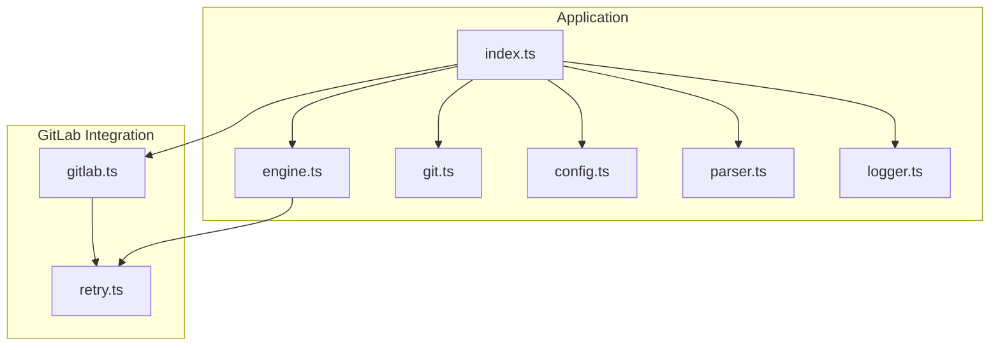
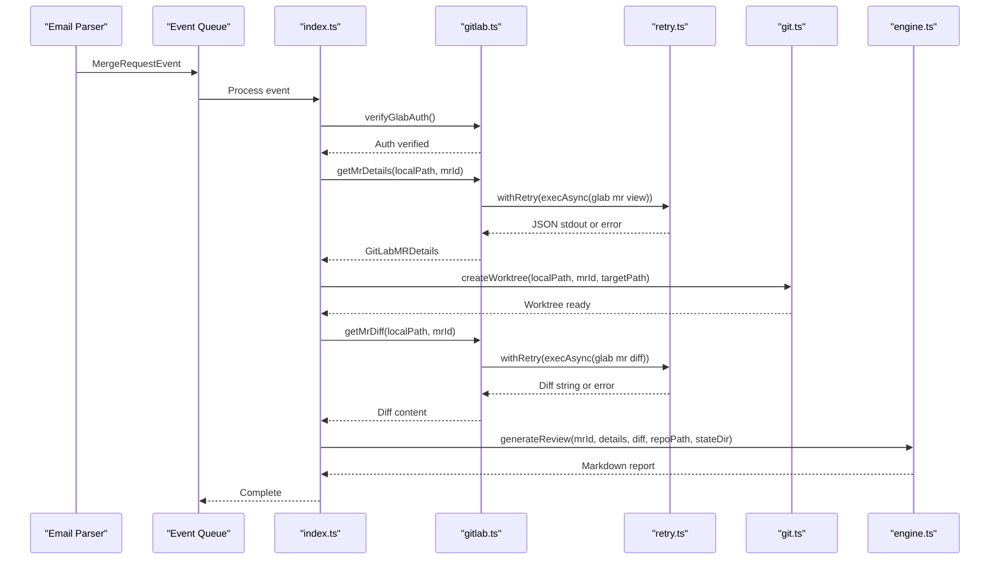
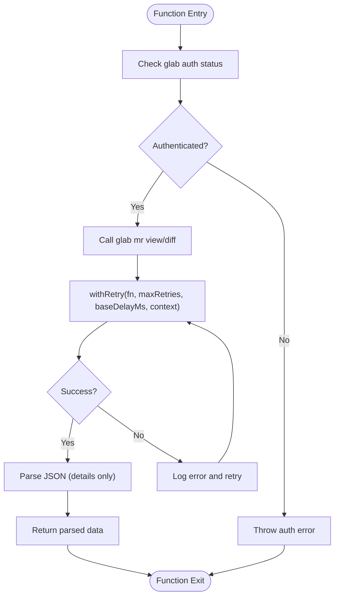
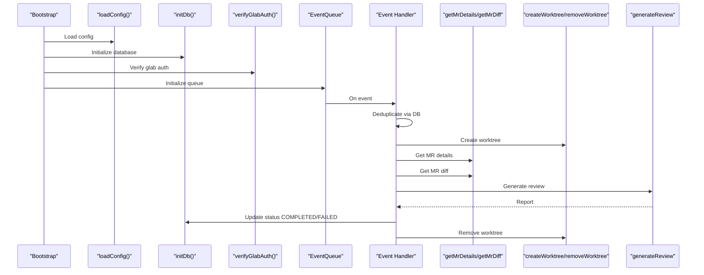
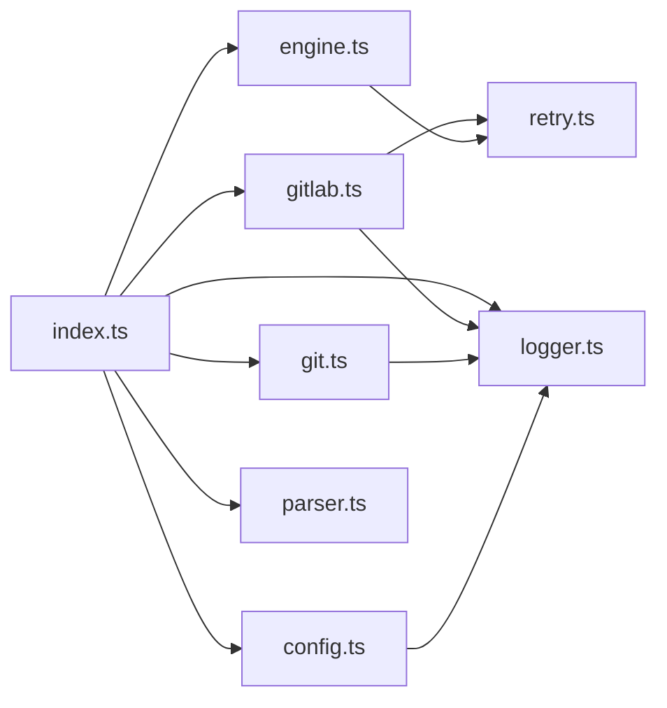

# GitLab API Integration

<cite>
**Referenced Files in This Document**
- [gitlab.ts](file://src/gitlab.ts)
- [retry.ts](file://src/retry.ts)
- [index.ts](file://src/index.ts)
- [engine.ts](file://src/engine.ts)
- [git.ts](file://src/git.ts)
- [config.ts](file://src/config.ts)
- [parser.ts](file://src/parser.ts)
- [logger.ts](file://src/logger.ts)
- [config.example.json](file://config/config.example.json)
- [README.md](file://README.md)
</cite>

## Table of Contents
1. [Introduction](#introduction)
2. [Project Structure](#project-structure)
3. [Core Components](#core-components)
4. [Architecture Overview](#architecture-overview)
5. [Detailed Component Analysis](#detailed-component-analysis)
6. [Dependency Analysis](#dependency-analysis)
7. [Performance Considerations](#performance-considerations)
8. [Troubleshooting Guide](#troubleshooting-guide)
9. [Security Considerations](#security-considerations)
10. [Conclusion](#conclusion)

## Introduction
This document explains how the application integrates with GitLab to retrieve merge request (MR) details, extract diffs, and access related project information for AI-powered code review. The system uses the glab CLI as a secure bridge to GitLab’s REST API, avoiding direct token management in the application. It includes robust error handling, retry logic with exponential backoff, and structured response parsing for MR metadata used by the AI engine.

## Project Structure
The GitLab integration spans several modules:
- Authentication verification via glab CLI
- MR details and diff retrieval through glab commands
- Retry wrapper for transient failures
- Orchestration of the end-to-end pipeline
- Worktree isolation for safe review execution
- Configuration validation and repository mapping

**Diagram sources**
- [index.ts:1-196](file://src/index.ts#L1-L196)
- [gitlab.ts:1-96](file://src/gitlab.ts#L1-L96)
- [retry.ts:1-36](file://src/retry.ts#L1-L36)
- [engine.ts:1-213](file://src/engine.ts#L1-L213)
- [git.ts:1-100](file://src/git.ts#L1-L100)
- [config.ts:1-80](file://src/config.ts#L1-L80)
- [parser.ts:1-92](file://src/parser.ts#L1-L92)
- [logger.ts:1-14](file://src/logger.ts#L1-L14)

**Section sources**
- [index.ts:1-196](file://src/index.ts#L1-L196)
- [gitlab.ts:1-96](file://src/gitlab.ts#L1-L96)
- [retry.ts:1-36](file://src/retry.ts#L1-L36)
- [engine.ts:1-213](file://src/engine.ts#L1-L213)
- [git.ts:1-100](file://src/git.ts#L1-L100)
- [config.ts:1-80](file://src/config.ts#L1-L80)
- [parser.ts:1-92](file://src/parser.ts#L1-L92)
- [logger.ts:1-14](file://src/logger.ts#L1-L14)

## Core Components
- glab CLI wrapper: Verifies authentication, fetches MR details, and retrieves diffs.
- Retry utility: Provides exponential backoff for transient failures.
- Pipeline orchestrator: Coordinates event processing, worktree creation, diff fetching, and AI review generation.
- Worktree manager: Isolates reviews using Git worktrees.
- Configuration loader: Validates repository mappings and required paths.
- Email parser: Extracts MR metadata from GitLab notification emails.

Key responsibilities:
- Authentication: Ensure glab is authenticated before any API calls.
- Data retrieval: Fetch MR metadata and diffs via glab commands.
- Error handling: Wrap external calls with retries and log detailed errors.
- Data transformation: Parse JSON responses into typed structures for downstream use.

**Section sources**
- [gitlab.ts:8-19](file://src/gitlab.ts#L8-L19)
- [gitlab.ts:21-49](file://src/gitlab.ts#L21-L49)
- [gitlab.ts:51-71](file://src/gitlab.ts#L51-L71)
- [gitlab.ts:73-95](file://src/gitlab.ts#L73-L95)
- [retry.ts:3-35](file://src/retry.ts#L3-L35)
- [index.ts:47-184](file://src/index.ts#L47-L184)
- [git.ts:9-27](file://src/git.ts#L9-L27)
- [git.ts:29-49](file://src/git.ts#L29-L49)
- [config.ts:6-38](file://src/config.ts#L6-L38)
- [config.ts:41-79](file://src/config.ts#L41-L79)
- [parser.ts:1-9](file://src/parser.ts#L1-L9)
- [parser.ts:17-91](file://src/parser.ts#L17-L91)

## Architecture Overview
The system processes GitLab MR events triggered by email notifications. For each event:
1. Parse the email to extract MR metadata.
2. Verify glab authentication.
3. Retrieve MR details and diff using glab CLI with retry logic.
4. Create an isolated Git worktree for safe review.
5. Generate an AI review report using the agy CLI.
6. Save the report and send notifications.

**Diagram sources**
- [index.ts:47-184](file://src/index.ts#L47-L184)
- [gitlab.ts:21-95](file://src/gitlab.ts#L21-L95)
- [retry.ts:12-35](file://src/retry.ts#L12-L35)
- [git.ts:9-27](file://src/git.ts#L9-L27)
- [engine.ts:8-213](file://src/engine.ts#L8-L213)

## Detailed Component Analysis

### GitLab CLI Wrapper (glab integration)
Responsibilities:
- Verify glab authentication status.
- Fetch MR details as JSON and parse into a typed structure.
- Fetch MR diff as text with buffer limits for large changes.
- Use retry wrapper for resilience against transient network issues.

Authentication flow:
- Executes `glab auth status`.
- Checks output for login indicators.
- Throws a clear error if no active token is found.

MR details retrieval:
- Executes `glab mr view <id> -F json` within the local repository context.
- Parses JSON into GitLabMRDetails.
- Retries up to 3 times with exponential backoff.

Diff extraction:
- Executes `glab mr diff <id>` with a larger buffer to accommodate big diffs.
- Returns raw diff text for the AI engine.

Error handling:
- Logs detailed errors and wraps them in user-friendly messages.
- Propagates errors to the orchestrator for status updates.

**Diagram sources**
- [gitlab.ts:21-49](file://src/gitlab.ts#L21-L49)
- [gitlab.ts:51-71](file://src/gitlab.ts#L51-L71)
- [gitlab.ts:73-95](file://src/gitlab.ts#L73-L95)
- [retry.ts:12-35](file://src/retry.ts#L12-L35)

**Section sources**
- [gitlab.ts:8-19](file://src/gitlab.ts#L8-L19)
- [gitlab.ts:21-49](file://src/gitlab.ts#L21-L49)
- [gitlab.ts:51-71](file://src/gitlab.ts#L51-L71)
- [gitlab.ts:73-95](file://src/gitlab.ts#L73-L95)

### Retry Utility
Purpose:
- Provide generic exponential backoff for asynchronous operations.
- Log attempts and delays for observability.
- Re-throw final error after exhausting retries.

Behavior:
- Attempts function execution repeatedly until success or max retries reached.
- Delays double on each attempt starting from a base delay.
- Contextual logging helps identify failing operations.

Complexity:
- Time complexity depends on number of retries; worst-case O(maxRetries).
- Space complexity O(1) aside from call stack and timers.

**Section sources**
- [retry.ts:3-35](file://src/retry.ts#L3-L35)

### Pipeline Orchestrator (index.ts)
Responsibilities:
- Bootstrap application components (config, DB, logger).
- Verify glab authentication at startup.
- Clean orphaned worktrees.
- Initialize event queue and process MR events sequentially.
- Coordinate MR details retrieval, worktree creation, diff fetching, and AI review generation.
- Persist reports and send notifications.

Key flows:
- Deduplication check using SQLite to avoid re-reviews.
- Isolated worktree creation per MR.
- Error handling that updates review status to FAILED when necessary.
- Cleanup of worktrees in finally blocks.

**Diagram sources**
- [index.ts:20-196](file://src/index.ts#L20-L196)
- [gitlab.ts:21-95](file://src/gitlab.ts#L21-L95)
- [git.ts:9-49](file://src/git.ts#L9-L49)
- [engine.ts:8-213](file://src/engine.ts#L8-L213)

**Section sources**
- [index.ts:20-196](file://src/index.ts#L20-L196)

### Worktree Manager (git.ts)
Responsibilities:
- Fetch MR head ref directly from origin.
- Create detached worktrees for safe review execution.
- Remove worktrees gracefully with fallback cleanup.
- Prune orphaned worktrees during startup.

Design notes:
- Uses `git worktree add --detach` to avoid branch conflicts.
- Ensures parent directories exist before creating worktrees.
- Implements manual directory removal fallback if git fails.

**Section sources**
- [git.ts:9-27](file://src/git.ts#L9-L27)
- [git.ts:29-49](file://src/git.ts#L29-L49)
- [git.ts:51-99](file://src/git.ts#L51-L99)

### Configuration Loader (config.ts)
Responsibilities:
- Define Zod schemas for configuration validation.
- Load and validate configuration file.
- Validate repository local paths exist.

Validation highlights:
- Enforces non-empty local paths.
- Requires valid email fields when configured.
- Throws descriptive errors for missing or invalid configurations.

**Section sources**
- [config.ts:6-38](file://src/config.ts#L6-L38)
- [config.ts:41-79](file://src/config.ts#L41-L79)

### Email Parser (parser.ts)
Responsibilities:
- Decode percent-encoded strings to handle URL wrapping.
- Extract MR URL, project name, MR ID, title, and action.
- Determine action type based on email body keywords.

Output:
- Structured MergeRequestEvent object used by the queue and orchestrator.

**Section sources**
- [parser.ts:1-9](file://src/parser.ts#L1-L9)
- [parser.ts:17-91](file://src/parser.ts#L17-L91)

### Logger (logger.ts)
Responsibilities:
- Configure Pino logger with pretty printing.
- Support environment-based log levels.

Usage:
- Centralized logging across all modules for consistent observability.

**Section sources**
- [logger.ts:1-14](file://src/logger.ts#L1-L14)

## Dependency Analysis
High-level dependencies:
- index.ts depends on gitlab.ts, git.ts, engine.ts, config.ts, parser.ts, and logger.ts.
- gitlab.ts depends on retry.ts and logger.ts.
- engine.ts depends on retry.ts and logger.ts.
- git.ts depends on logger.ts.
- config.ts depends on logger.ts.
- parser.ts is standalone but consumed by index.ts.

**Diagram sources**
- [index.ts:1-196](file://src/index.ts#L1-L196)
- [gitlab.ts:1-96](file://src/gitlab.ts#L1-L96)
- [engine.ts:1-213](file://src/engine.ts#L1-L213)
- [git.ts:1-100](file://src/git.ts#L1-L100)
- [config.ts:1-80](file://src/config.ts#L1-L80)
- [parser.ts:1-92](file://src/parser.ts#L1-L92)
- [logger.ts:1-14](file://src/logger.ts#L1-L14)

**Section sources**
- [index.ts:1-196](file://src/index.ts#L1-L196)
- [gitlab.ts:1-96](file://src/gitlab.ts#L1-L96)
- [engine.ts:1-213](file://src/engine.ts#L1-L213)
- [git.ts:1-100](file://src/git.ts#L1-L100)
- [config.ts:1-80](file://src/config.ts#L1-L80)
- [parser.ts:1-92](file://src/parser.ts#L1-L92)
- [logger.ts:1-14](file://src/logger.ts#L1-L14)

## Performance Considerations
- Large diff handling:
  - Buffer size increased for diff retrieval to prevent truncation.
  - AI engine truncates excessively large diffs to control prompt size.
- Exponential backoff:
  - Reduces pressure on GitLab API during transient failures.
- Sequential processing:
  - Event queue ensures one MR is processed at a time, preventing resource contention.
- Worktree isolation:
  - Avoids interference with developer’s working tree and reduces I/O contention.

[No sources needed since this section provides general guidance]

## Troubleshooting Guide
Common issues and resolutions:
- glab CLI not authenticated:
  - Ensure `glab auth login` has been executed and tokens are present.
  - The application throws a clear error if no active token is detected.
- Network failures or rate limits:
  - The retry utility automatically retries failed requests with exponential backoff.
  - Check logs for retry attempts and last error messages.
- Missing local repository path:
  - Configuration validation ensures local paths exist; update config accordingly.
- Worktree cleanup failures:
  - Manual fallback removes directories if git commands fail; ensure permissions allow deletion.
- AI engine timeouts:
  - The AI engine enforces a timeout and kills long-running processes; adjust model or prompt size if needed.

Operational tips:
- Inspect logs for detailed error traces and retry contexts.
- Validate configuration files and ensure they match the example schema.
- Use the provided test webhook script to simulate events and verify pipeline behavior.

**Section sources**
- [gitlab.ts:21-49](file://src/gitlab.ts#L21-L49)
- [retry.ts:12-35](file://src/retry.ts#L12-L35)
- [config.ts:41-79](file://src/config.ts#L41-L79)
- [git.ts:29-49](file://src/git.ts#L29-L49)
- [engine.ts:139-187](file://src/engine.ts#L139-L187)

## Security Considerations
Token management:
- The application does not manage GitLab tokens directly; it relies on glab CLI’s pre-authenticated state.
- Tokens are stored by glab in its secure credential store, not in application configuration.

Credential storage:
- Application configuration may include sensitive values (e.g., Telegram bot token, SMTP credentials).
- Keep configuration files out of version control and restrict file permissions.

Best practices:
- Run the application under a dedicated service account with minimal privileges.
- Avoid logging sensitive data; ensure logs do not contain tokens or secrets.
- Regularly rotate tokens and credentials outside the application.

**Section sources**
- [gitlab.ts:21-49](file://src/gitlab.ts#L21-L49)
- [config.example.json:1-28](file://config/config.example.json#L1-L28)
- [README.md:303-312](file://README.md#L303-L312)

## Conclusion
The GitLab integration leverages the glab CLI to securely fetch MR details and diffs while delegating token management to a trusted tool. Robust retry logic and comprehensive error handling improve reliability under network instability and rate limits. The pipeline orchestrates worktree isolation, AI review generation, and notifications, ensuring a safe and efficient review workflow. Configuration validation and structured logging provide operational clarity and security best practices.

[No sources needed since this section summarizes without analyzing specific files]