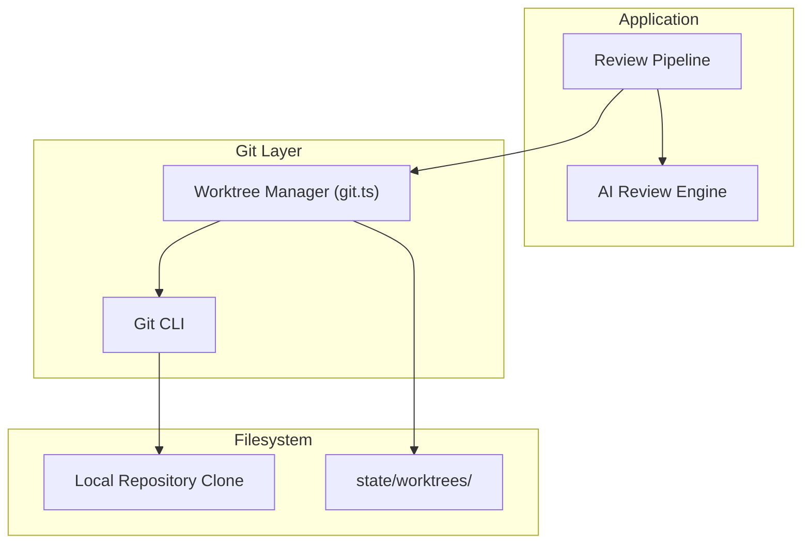
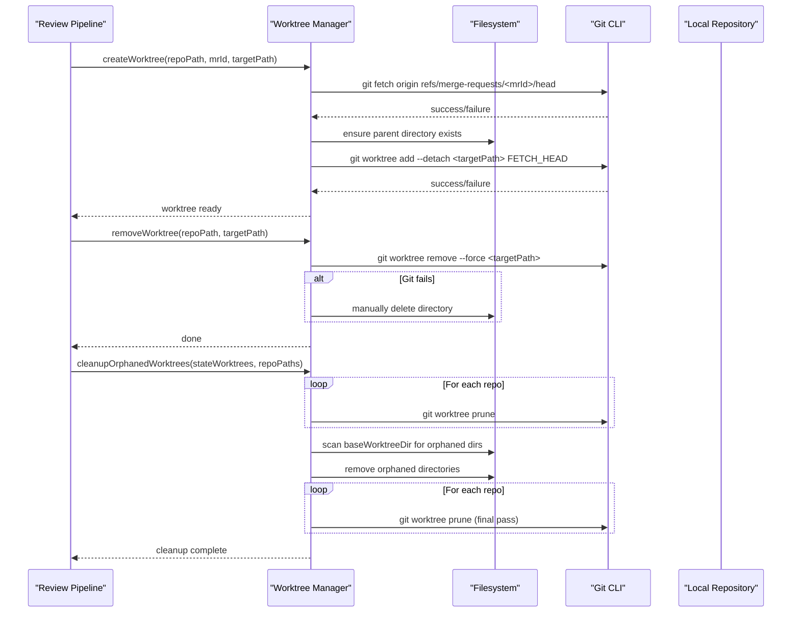
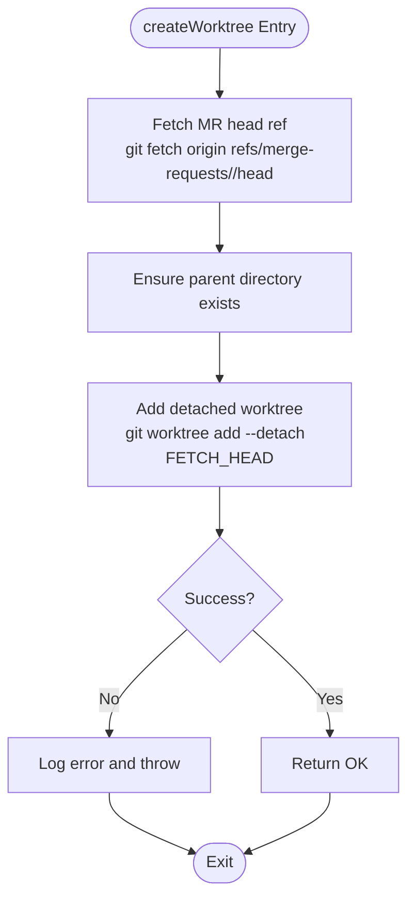
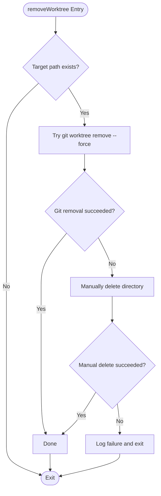
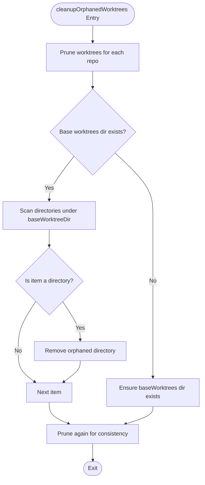
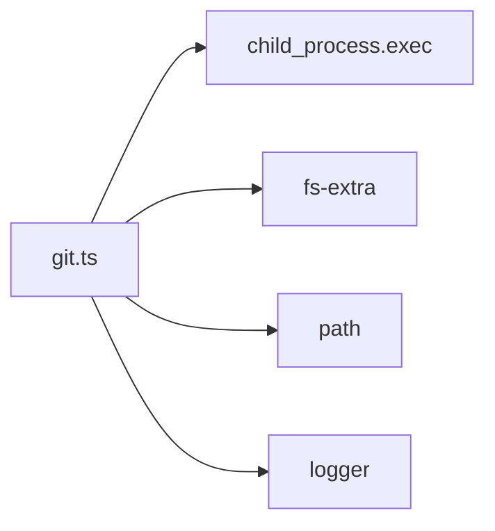

# Worktree Management

<cite>
**Referenced Files in This Document**
- [git.ts](file://src/git.ts)
- [README.md](file://README.md)
</cite>

## Table of Contents
1. [Introduction](#introduction)
2. [Project Structure](#project-structure)
3. [Core Components](#core-components)
4. [Architecture Overview](#architecture-overview)
5. [Detailed Component Analysis](#detailed-component-analysis)
6. [Dependency Analysis](#dependency-analysis)
7. [Performance Considerations](#performance-considerations)
8. [Troubleshooting Guide](#troubleshooting-guide)
9. [Conclusion](#conclusion)

## Introduction
This document explains the Git worktree management functionality used to safely analyze merge requests without affecting the main repository checkout. The system creates isolated Git worktrees for each review, fetches the exact merge request commit, and ensures cleanup even when commands fail or the process is interrupted. It also documents how orphaned worktrees are pruned and removed during startup and after reviews.

Key goals:
- Isolate analysis per merge request using detached Git worktrees.
- Fetch only the required merge request ref from the remote.
- Provide robust error handling and fallback cleanup.
- Maintain disk hygiene by pruning Git administrative state and removing orphaned directories.

## Project Structure
The worktree logic lives in a dedicated module that wraps Git operations. The application’s README describes how this module fits into the overall pipeline: it is invoked during the review workflow to create an isolated working copy of the target repository before running AI-driven analysis.

**Diagram sources**
- [git.ts:9-27](file://src/git.ts#L9-L27)
- [git.ts:29-49](file://src/git.ts#L29-L49)
- [git.ts:51-99](file://src/git.ts#L51-L99)
- [README.md:205-222](file://README.md#L205-L222)

**Section sources**
- [README.md:205-222](file://README.md#L205-L222)
- [README.md:250-252](file://README.md#L250-L252)

## Core Components
The worktree manager exposes three primary functions:

- createWorktree(localRepoPath, mrId, targetPath): Creates an isolated worktree for a given merge request.
- removeWorktree(localRepoPath, targetPath): Removes a worktree with a fallback to manual directory deletion if Git fails.
- cleanupOrphanedWorktrees(baseWorktreeDir, configuredReposPaths): Prunes Git administrative state and removes leftover worktree directories.

These functions coordinate Git CLI calls, filesystem operations, and logging to ensure safe and predictable behavior.

**Section sources**
- [git.ts:9-27](file://src/git.ts#L9-L27)
- [git.ts:29-49](file://src/git.ts#L29-L49)
- [git.ts:51-99](file://src/git.ts#L51-L99)

## Architecture Overview
At runtime, the review pipeline triggers worktree creation for each merge request. The worktree manager fetches the merge request head reference and adds a detached worktree at a controlled path under the application’s state directory. After analysis, the worktree is removed; on startup or after failures, orphaned worktrees are cleaned up.

**Diagram sources**
- [git.ts:9-27](file://src/git.ts#L9-L27)
- [git.ts:29-49](file://src/git.ts#L29-L49)
- [git.ts:51-99](file://src/git.ts#L51-L99)

## Detailed Component Analysis

### createWorktree
Purpose:
- Fetch the merge request head reference from the remote.
- Ensure the target directory exists.
- Create a detached worktree pointing to the fetched commit.

Key behaviors:
- Uses Git to fetch the specific merge request ref: `refs/merge-requests/<id>/head`.
- Ensures the parent directory of the target path exists before creating the worktree.
- Adds a detached worktree using `git worktree add --detach`, which avoids attaching to any branch and isolates the commit.
- Logs progress and errors, and throws a descriptive error on failure.

Example Git commands:
- Fetch MR head: `git fetch origin refs/merge-requests/<mrId>/head`
- Create detached worktree: `git worktree add --detach <targetPath> FETCH_HEAD`

Error handling:
- Catches errors from Git and filesystem operations.
- Logs detailed error messages including the MR ID.
- Throws a new error with context so callers can handle or surface the failure.

**Diagram sources**
- [git.ts:9-27](file://src/git.ts#L9-L27)

**Section sources**
- [git.ts:9-27](file://src/git.ts#L9-L27)

### removeWorktree
Purpose:
- Remove a previously created worktree.
- Provide a fallback mechanism to manually delete the directory if Git removal fails.

Key behaviors:
- Checks whether the target path exists before attempting removal.
- Attempts to remove via Git with force to handle untracked files and detached HEAD states.
- If Git removal fails, falls back to deleting the directory directly using the filesystem API.
- Logs both successful and failed attempts, including fallback outcomes.

Example Git command:
- Remove worktree: `git worktree remove --force <targetPath>`

Fallback strategy:
- On Git failure, deletes the directory manually to ensure cleanup proceeds.
- Logs any additional errors encountered during manual deletion.

**Diagram sources**
- [git.ts:29-49](file://src/git.ts#L29-L49)

**Section sources**
- [git.ts:29-49](file://src/git.ts#L29-L49)

### cleanupOrphanedWorktrees
Purpose:
- Clean up Git administrative state for worktrees that no longer exist on disk.
- Remove orphaned directories under the application’s worktrees state folder.

Key behaviors:
- Iterates over configured repository paths and runs `git worktree prune` to remove stale pointers.
- Scans the base worktrees directory for leftover directories.
- Deletes orphaned directories found during the scan.
- Runs another round of pruning to reconcile Git state after deletions.
- Ensures the base worktrees directory exists; creates it if missing.
- Logs warnings and errors for non-fatal issues like prune failures.

Example Git command:
- Prune administrative state: `git worktree prune`

Cleanup flow:
- First prune across all repositories.
- Scan and remove orphaned directories.
- Final prune pass to clean up any remaining references.

**Diagram sources**
- [git.ts:51-99](file://src/git.ts#L51-L99)

**Section sources**
- [git.ts:51-99](file://src/git.ts#L51-L99)

## Dependency Analysis
The worktree manager depends on:
- Child process execution to run Git commands.
- Filesystem utilities to ensure directories exist and to perform cleanup.
- Logging for observability and diagnostics.

**Diagram sources**
- [git.ts:1-7](file://src/git.ts#L1-L7)

**Section sources**
- [git.ts:1-7](file://src/git.ts#L1-L7)

## Performance Considerations
- Network I/O during fetch: Fetching merge request heads involves network access. Batch or cache where possible to reduce repeated fetches for the same MR.
- Disk usage: Detached worktrees duplicate checked-out content. Limit concurrent worktrees and ensure timely removal to avoid disk pressure.
- Pruning overhead: Running `git worktree prune` across multiple repositories incurs filesystem and Git metadata traversal costs. Schedule cleanup during low-traffic periods or batch operations.
- Directory scanning: Scanning the base worktrees directory can be expensive if many entries exist. Consider incremental scans or maintaining a manifest of active worktrees.
- Error retries: Avoid aggressive retries on Git failures to prevent cascading delays. Use bounded retries with exponential backoff for transient network issues.

[No sources needed since this section provides general guidance]

## Troubleshooting Guide
Common issues and strategies:
- Git fetch failures:
  - Verify remote connectivity and authentication.
  - Confirm the merge request ref exists: `refs/merge-requests/<mrId>/head`.
  - Inspect logs for detailed error messages thrown by createWorktree.
- Git worktree add failures:
  - Ensure the parent directory exists and is writable.
  - Check for existing directories at the target path that may conflict.
- Git worktree remove failures:
  - The fallback will attempt manual deletion; verify filesystem permissions.
  - If manual deletion fails, check for open file handles or locked files.
- Orphaned worktrees:
  - Run cleanupOrphanedWorktrees to prune stale Git state and remove leftover directories.
  - Monitor logs for warnings about prune failures and orphaned directories.

Operational tips:
- Keep the base worktrees directory organized and monitor its size.
- Periodically run cleanup routines to reclaim disk space.
- Validate repository paths and ensure they are accessible before invoking worktree operations.

**Section sources**
- [git.ts:9-27](file://src/git.ts#L9-L27)
- [git.ts:29-49](file://src/git.ts#L29-L49)
- [git.ts:51-99](file://src/git.ts#L51-L99)

## Conclusion
The worktree management layer provides a robust foundation for safe, isolated code analysis. By fetching precise merge request refs and creating detached worktrees, it prevents interference with the main repository. Comprehensive error handling and fallback mechanisms ensure resilience, while cleanup routines maintain disk hygiene by pruning Git administrative state and removing orphaned directories. Following the performance and troubleshooting guidance helps keep the system reliable and efficient in production environments.

[No sources needed since this section summarizes without analyzing specific files]