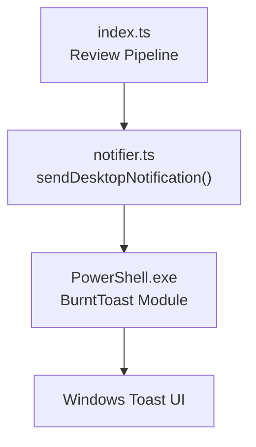
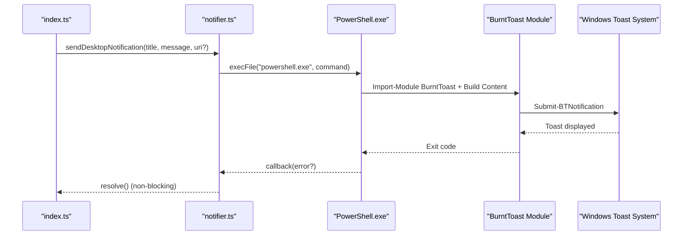
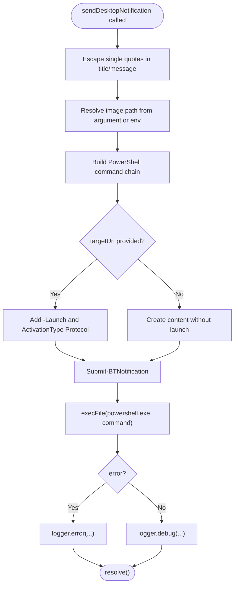
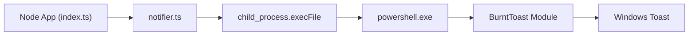

# Desktop Notifications

<cite>
**Referenced Files in This Document**
- [notifier.ts](file://src/notifier.ts)
- [index.ts](file://src/index.ts)
- [README.md](file://README.md)
- [package.json](file://package.json)
</cite>

## Table of Contents
1. [Introduction](#introduction)
2. [Project Structure](#project-structure)
3. [Core Components](#core-components)
4. [Architecture Overview](#architecture-overview)
5. [Detailed Component Analysis](#detailed-component-analysis)
6. [Dependency Analysis](#dependency-analysis)
7. [Performance Considerations](#performance-considerations)
8. [Troubleshooting Guide](#troubleshooting-guide)
9. [Conclusion](#conclusion)

## Introduction
This document explains the desktop notification system used by the application to deliver local alerts on Windows using BurntToast. The implementation is platform-specific: it runs from within WSL and invokes PowerShell to call the BurntToast module, producing clickable toast notifications that open the review dashboard when clicked.

The desktop notification feature is optional. On non-Windows platforms, the notification step is intentionally non-blocking and degrades gracefully without failing the overall pipeline.

## Project Structure
The desktop notification functionality is implemented as a small Node.js module that executes PowerShell commands via `child_process.execFile`. It is integrated into the main pipeline where reviews are completed.

**Diagram sources**
- [index.ts:151-159](file://src/index.ts#L151-L159)
- [notifier.ts:11-59](file://src/notifier.ts#L11-L59)

**Section sources**
- [index.ts:151-159](file://src/index.ts#L151-L159)
- [notifier.ts:1-61](file://src/notifier.ts#L1-L61)

## Core Components
- **Desktop Notification Sender**: A function that builds a PowerShell command sequence to create a BurntToast notification with title, message, optional logo, and an optional deep link.
- **Integration Point**: The main pipeline calls the notification sender after saving the review report and updating its status.

Key responsibilities:
- Escape user-provided strings for safe PowerShell usage.
- Construct BurntToast XML-like objects through PowerShell cmdlets.
- Optionally attach a launch URI so clicking the toast opens the review dashboard.
- Log success or failure without blocking the pipeline.

**Section sources**
- [notifier.ts:11-59](file://src/notifier.ts#L11-L59)
- [index.ts:151-159](file://src/index.ts#L151-L159)

## Architecture Overview
The desktop notification flow is a side effect triggered after successful review generation. It does not block the primary workflow and always resolves even if PowerShell execution fails.

**Diagram sources**
- [index.ts:151-159](file://src/index.ts#L151-L159)
- [notifier.ts:17-59](file://src/notifier.ts#L17-L59)

## Detailed Component Analysis

### Platform-Specific Implementation for Windows
The notifier uses `child_process.execFile` to run `powershell.exe` with a constructed command string. The command imports the BurntToast module and constructs a toast notification with:
- Title text
- Message text
- Optional logo image path
- Optional launch action pointing to the review dashboard URL

Important characteristics:
- Runs from WSL but targets the Windows desktop environment.
- Uses absolute Windows paths for images.
- Avoids shell escaping issues by passing arguments directly to `execFile`.

**Diagram sources**
- [notifier.ts:17-59](file://src/notifier.ts#L17-L59)

**Section sources**
- [notifier.ts:1-61](file://src/notifier.ts#L1-L61)

### Notification Message Formatting and Display Options
The notification supports:
- Title: Short summary identifying the project and MR.
- Message: Human-readable completion message encouraging the user to click.
- Logo: Optional image path configured via environment variable or passed explicitly.
- Deep Link: Optional URI that opens the Web Dashboard at a specific review ID.

Behavior:
- If a target URI is provided, the toast becomes clickable and launches the URI using protocol activation.
- If no URI is provided, the toast displays information only.

Configuration inputs:
- `title`: Derived from project name and MR identifier.
- `message`: Indicates completion and invites the user to view the report.
- `targetUri`: Built from the configured public URL plus the review ID.
- `windowsImagePath`: Optional; falls back to `NOTIF_LOGO_PATH` environment variable.

**Section sources**
- [index.ts:151-159](file://src/index.ts#L151-L159)
- [notifier.ts:4-22](file://src/notifier.ts#L4-L22)
- [notifier.ts:24-40](file://src/notifier.ts#L24-L40)

### Fallback Mechanisms for Non-Windows Platforms
The notifier does not implement a cross-platform fallback. Instead, it relies on the caller to continue regardless of whether the notification succeeds. The promise always resolves, ensuring the pipeline proceeds even if PowerShell is unavailable or the BurntToast module is missing.

Implications:
- On Linux/macOS, the notification will likely fail due to missing PowerShell/BurntToast, but the review process remains unaffected.
- Logging captures errors for diagnostics without interrupting the workflow.

**Section sources**
- [notifier.ts:44-59](file://src/notifier.ts#L44-L59)
- [index.ts:151-159](file://src/index.ts#L151-L159)

### Configuration Examples and Usage Patterns
To enable desktop notifications:
- Install the BurntToast PowerShell module on Windows or WSL.
- Optionally set `NOTIF_LOGO_PATH` to an absolute Windows path for the notification icon.
- Ensure `publicUrl` is configured so deep links resolve correctly.

Usage pattern in the pipeline:
- After saving the review report and updating its status, construct a dashboard URL including the review ID.
- Call the notification sender with the title, message, and dashboard URL.

Example configuration references:
- Public URL and general setup instructions are documented in the README.
- Example configuration file shows repository, Telegram, and email settings; desktop notification settings are environment-based rather than JSON-configured.

**Section sources**
- [README.md:116-122](file://README.md#L116-L122)
- [README.md:78-104](file://README.md#L78-L104)
- [config.example.json:1-28](file://config/config.example.json#L1-L28)
- [index.ts:151-159](file://src/index.ts#L151-L159)

### Notification Lifecycle and User Interaction Handling
Lifecycle:
1. Review completes successfully.
2. Report is saved and database status updated to completed.
3. Desktop notification is sent asynchronously.
4. User sees the toast; clicking it opens the review dashboard via the configured public URL.

User interaction handling:
- Clickable behavior is enabled by attaching a launch URI with protocol activation.
- If no URI is provided, the toast is informational only.

Error handling:
- Errors from PowerShell execution are logged.
- The promise always resolves to avoid blocking the pipeline.

**Section sources**
- [index.ts:120-159](file://src/index.ts#L120-L159)
- [notifier.ts:24-40](file://src/notifier.ts#L24-L40)
- [notifier.ts:44-59](file://src/notifier.ts#L44-L59)

## Dependency Analysis
The desktop notification feature depends on:
- Node.js runtime and `child_process.execFile`.
- PowerShell (`powershell.exe`) available from the execution context.
- BurntToast PowerShell module installed on the Windows side.
- Optional environment variable `NOTIF_LOGO_PATH`.
- Correctly configured `publicUrl` for deep linking.

External dependencies:
- No additional npm packages are required specifically for desktop notifications.
- The BurntToast module is managed by PowerShell, not npm.

**Diagram sources**
- [index.ts:151-159](file://src/index.ts#L151-L159)
- [notifier.ts:1-61](file://src/notifier.ts#L1-L61)

**Section sources**
- [package.json:1-37](file://package.json#L1-L37)
- [README.md:116-122](file://README.md#L116-L122)

## Performance Considerations
- The notification is asynchronous and non-blocking; failures do not delay the review pipeline.
- PowerShell invocation adds minimal overhead compared to AI review generation.
- Large diffs and heavy processing occur before notifications are sent, so notification latency is negligible relative to total pipeline time.

[No sources needed since this section provides general guidance]

## Troubleshooting Guide

Common issues and resolutions:

- BurntToast module not installed
  - Symptom: PowerShell errors when attempting to import BurntToast.
  - Resolution: Install the module using PowerShell: `Install-Module BurntToast -Force`.

- Missing PowerShell or wrong execution policy
  - Symptom: `powershell.exe` not found or blocked by execution policy.
  - Resolution: Ensure PowerShell is available in the environment and that the command is executed with bypassed execution policy as implemented.

- Invalid or inaccessible logo path
  - Symptom: Toast appears without logo or fails to render image.
  - Resolution: Provide an absolute Windows path via `windowsImagePath` or set `NOTIF_LOGO_PATH`. Verify the path exists and is readable by the Windows session.

- Deep link does not open the correct review
  - Symptom: Clicking the toast opens the dashboard but not the intended review.
  - Resolution: Confirm `publicUrl` is correctly configured and includes the review ID parameter.

- Running from WSL
  - Symptom: Notifications do not appear when running inside WSL.
  - Resolution: Ensure PowerShell can reach the Windows desktop session and that BurntToast is installed in the appropriate PowerShell profile.

- Non-Windows platforms
  - Symptom: Notifications silently fail or log errors.
  - Resolution: This is expected; the feature is Windows-only. Use Telegram or email notifications as alternatives.

**Section sources**
- [README.md:116-122](file://README.md#L116-L122)
- [notifier.ts:44-59](file://src/notifier.ts#L44-L59)

## Conclusion
The desktop notification system provides a convenient way to alert users on Windows about completed AI reviews. It integrates cleanly into the existing pipeline, remains non-blocking, and leverages BurntToast for rich, clickable toast notifications. While Windows-only, it complements other notification channels such as Telegram and email, offering a seamless user experience for developers working on Windows.

[No sources needed since this section summarizes without analyzing specific files]