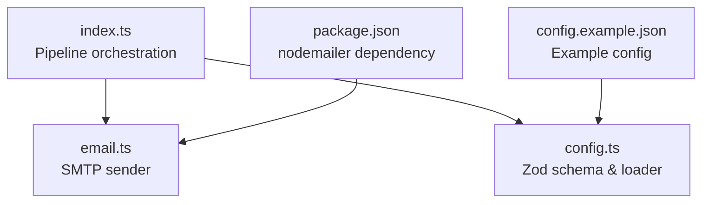
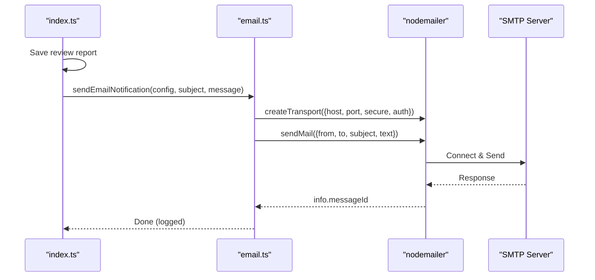
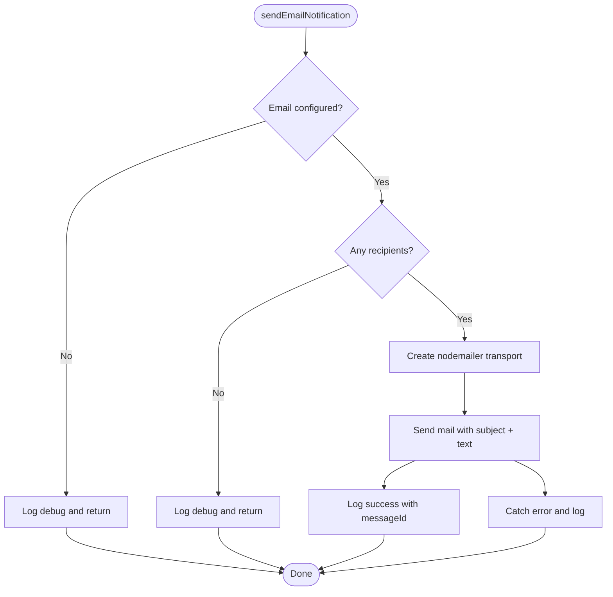
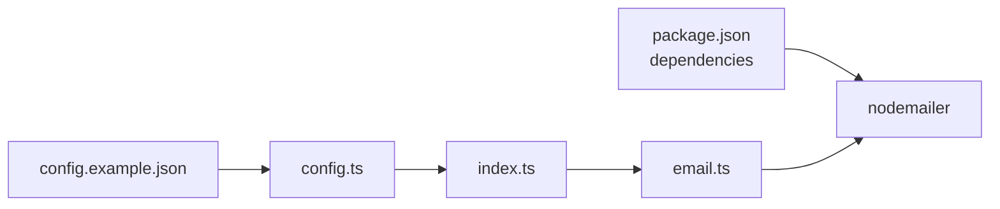

# Email Notifications

<cite>
**Referenced Files in This Document**
- [email.ts](file://src/email.ts)
- [config.ts](file://src/config.ts)
- [index.ts](file://src/index.ts)
- [config.example.json](file://config/config.example.json)
- [README.md](file://README.md)
- [Google_Apps_Script_Setup.md](file://docs/Google_Apps_Script_Setup.md)
- [package.json](file://package.json)
</cite>

## Table of Contents
1. [Introduction](#introduction)
2. [Project Structure](#project-structure)
3. [Core Components](#core-components)
4. [Architecture Overview](#architecture-overview)
5. [Detailed Component Analysis](#detailed-component-analysis)
6. [Dependency Analysis](#dependency-analysis)
7. [Performance Considerations](#performance-considerations)
8. [Troubleshooting Guide](#troubleshooting-guide)
9. [Conclusion](#conclusion)

## Introduction
This document explains the email notification system that sends review results via SMTP. It covers SMTP server configuration (host, port, authentication, and SSL/TLS), the current email message format, attachment handling, example configurations for popular providers, deliverability best practices, error handling, and troubleshooting steps.

The system uses nodemailer to send plain-text emails after an AI review completes. The email content is constructed inline during the pipeline and does not use a separate template engine or include attachments at this time.

## Project Structure
The email feature is implemented as a small module integrated into the main pipeline:
- Configuration schema validates email settings.
- The main pipeline invokes the email sender after saving the review report.
- An example configuration file demonstrates the required fields.

**Diagram sources**
- [index.ts:136-149](file://src/index.ts#L136-L149)
- [email.ts:1-49](file://src/email.ts#L1-L49)
- [config.ts:11-21](file://src/config.ts#L11-L21)
- [config.example.json:16-26](file://config/config.example.json#L16-L26)
- [package.json:27-35](file://package.json#L27-L35)

**Section sources**
- [email.ts:1-49](file://src/email.ts#L1-L49)
- [config.ts:11-21](file://src/config.ts#L11-L21)
- [index.ts:136-149](file://src/index.ts#L136-L149)
- [config.example.json:16-26](file://config/config.example.json#L16-L26)
- [package.json:27-35](file://package.json#L27-L35)

## Core Components
- SMTP sender: Creates a nodemailer transport using host, port, secure flag, and auth credentials; sends a plain-text email with subject and recipients.
- Configuration validation: Zod schema enforces valid SMTP settings, including host, port, secure, auth.user, auth.pass, from, and to array.
- Pipeline integration: After generating and saving the review report, the pipeline constructs a simple text message and calls the email sender.

Key responsibilities:
- Validate configuration before sending.
- Skip sending if email is not configured or no recipients are provided.
- Log success and failure without throwing errors so the review pipeline continues even if email delivery fails.

**Section sources**
- [email.ts:9-48](file://src/email.ts#L9-L48)
- [config.ts:11-21](file://src/config.ts#L11-L21)
- [index.ts:136-149](file://src/index.ts#L136-L149)

## Architecture Overview
The email notification is triggered after the review report is saved. The flow is:
1. Pipeline saves the Markdown report.
2. Pipeline builds a plain-text email body with project, MR, URL, title, and report path.
3. Pipeline calls the email sender with subject and message.
4. Email sender creates a nodemailer transport and sends the email.
5. Success or failure is logged; failures do not interrupt the pipeline.

**Diagram sources**
- [index.ts:136-149](file://src/index.ts#L136-L149)
- [email.ts:22-47](file://src/email.ts#L22-L47)

## Detailed Component Analysis

### SMTP Sender (email.ts)
- Transport creation: Uses host, port, secure, and auth.user/auth.pass from configuration.
- Message composition: Sends a plain-text body with subject and recipients joined by commas.
- Error handling: Catches and logs errors without rethrowing; the pipeline remains unaffected by email failures.
- Early exits: Skips sending when email is not configured or when there are no recipients.

**Diagram sources**
- [email.ts:9-48](file://src/email.ts#L9-L48)

**Section sources**
- [email.ts:9-48](file://src/email.ts#L9-L48)

### Configuration Schema (config.ts)
- Enforces required fields for SMTP:
  - host: string
  - port: positive integer
  - secure: boolean (default false)
  - auth.user: string
  - auth.pass: string
  - from: email address
  - to: non-empty array of email addresses
- Loads and validates the JSON configuration file on startup.

Practical implications:
- If any field is missing or invalid, the application will fail fast during startup.
- The email section is optional; omitting it disables email notifications.

**Section sources**
- [config.ts:11-21](file://src/config.ts#L11-L21)
- [config.ts:41-79](file://src/config.ts#L41-L79)

### Pipeline Integration (index.ts)
- After saving the review report, the pipeline constructs:
  - Subject: includes project name, MR number, and title.
  - Body: plain text with project, MR, URL, title, and report path.
- Calls sendEmailNotification with these values.

Note: The current implementation does not attach files or embed images.

**Section sources**
- [index.ts:136-149](file://src/index.ts#L136-L149)

### Example Configuration (config.example.json)
- Demonstrates the structure for enabling email notifications:
  - host, port, secure, auth.user, auth.pass, from, and to array.
- Use this as a template to configure your own SMTP server.

**Section sources**
- [config.example.json:16-26](file://config/config.example.json#L16-L26)

## Dependency Analysis
- nodemailer is used for SMTP transport and sending messages.
- Zod validates configuration.
- The main pipeline orchestrates the call to the email sender.

**Diagram sources**
- [package.json:27-35](file://package.json#L27-L35)
- [index.ts:136-149](file://src/index.ts#L136-L149)
- [email.ts:1-49](file://src/email.ts#L1-L49)
- [config.ts:11-21](file://src/config.ts#L11-L21)
- [config.example.json:16-26](file://config/config.example.json#L16-L26)

**Section sources**
- [package.json:27-35](file://package.json#L27-L35)
- [email.ts:1-49](file://src/email.ts#L1-L49)
- [config.ts:11-21](file://src/config.ts#L11-L21)
- [index.ts:136-149](file://src/index.ts#L136-L149)

## Performance Considerations
- Email sending is synchronous within the pipeline but wrapped in try/catch to avoid blocking the workflow on failure.
- No connection pooling or queueing is implemented; each email triggers a new transport and send operation.
- For high-volume scenarios, consider batching emails or introducing a background worker to offload SMTP operations.

[No sources needed since this section provides general guidance]

## Troubleshooting Guide

Common issues and resolutions:
- Connection failures:
  - Verify host and port are correct for your provider.
  - Ensure firewall or network policies allow outbound connections to the SMTP server.
  - Confirm TLS/SSL settings match the provider’s requirements.
- Authentication issues:
  - Confirm auth.user and auth.pass are correct.
  - Some providers require app passwords or OAuth tokens instead of account passwords.
  - Double-check domain permissions and SMTP relay access.
- Delivery problems:
  - Ensure from address matches the authenticated user or an allowed sender domain.
  - Avoid spam-triggering content; keep subjects and bodies concise and relevant.
  - Configure SPF/DKIM/DMARC on your sending domain to improve deliverability.
- Missing recipients:
  - If to is empty, the sender skips sending; verify the configuration includes at least one recipient.
- Email not configured:
  - If the email section is omitted, the sender logs and skips sending; add the email configuration to enable notifications.

Provider-specific notes:
- Gmail:
  - Use Gmail’s SMTP settings and an app password if 2FA is enabled.
  - Set secure appropriately based on the port you choose.
- Outlook/Office 365:
  - Use Office 365 SMTP endpoints and appropriate credentials or app passwords.
  - Ensure your organization allows SMTP relay from your environment.
- Custom SMTP servers:
  - Follow your server’s documentation for host, port, and security mode.
  - Test connectivity with a simple SMTP client before integrating.

Deliverability best practices:
- Use a dedicated sender address and consistent domain.
- Keep message content professional and free of spammy language.
- Provide clear subject lines and meaningful plain-text bodies.
- Monitor bounce rates and remove invalid addresses over time.
- Implement feedback loops with your provider to handle bounces and complaints.

Error handling behavior:
- The email sender catches and logs errors without throwing, ensuring the review pipeline continues even if email delivery fails.
- Successful sends log the messageId for traceability.

**Section sources**
- [email.ts:22-47](file://src/email.ts#L22-L47)
- [README.md:42-42](file://README.md#L42-L42)
- [Google_Apps_Script_Setup.md:1-39](file://docs/Google_Apps_Script_Setup.md#L1-L39)

## Conclusion
The email notification system provides a straightforward way to receive review results via SMTP. It validates configuration, sends plain-text emails, and handles errors gracefully without disrupting the review pipeline. To extend functionality, you can enhance the message format to include HTML templates and attachments, integrate advanced deliverability features, and implement retry logic tailored to SMTP errors.

[No sources needed since this section summarizes without analyzing specific files]