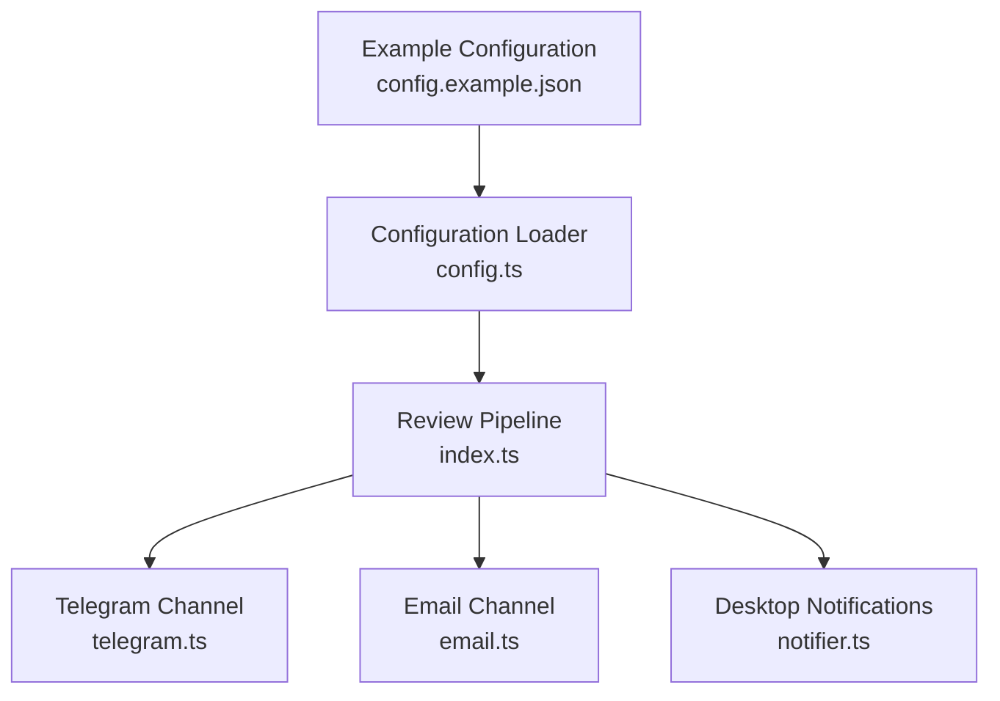
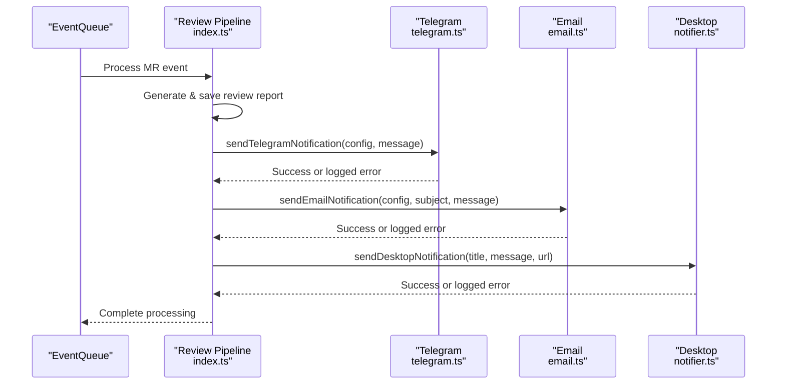
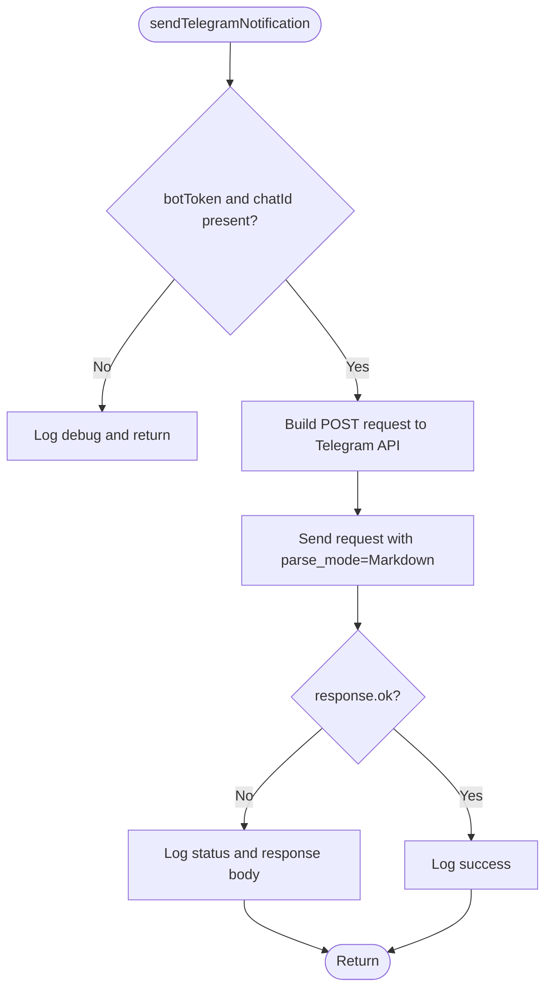
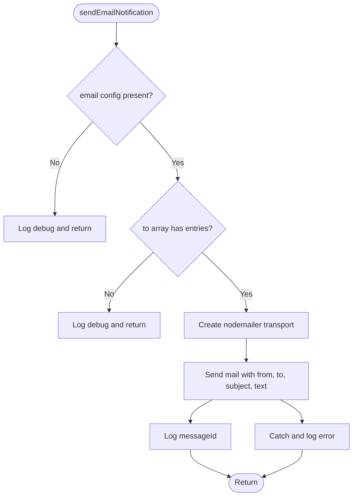
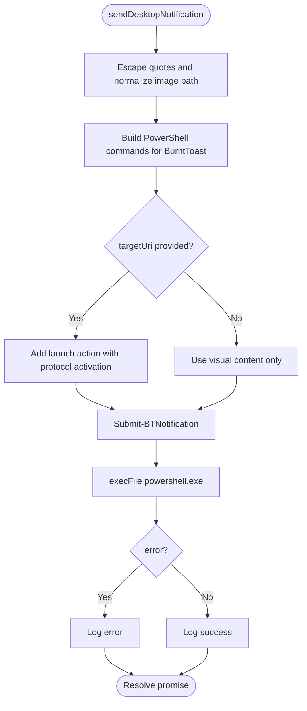
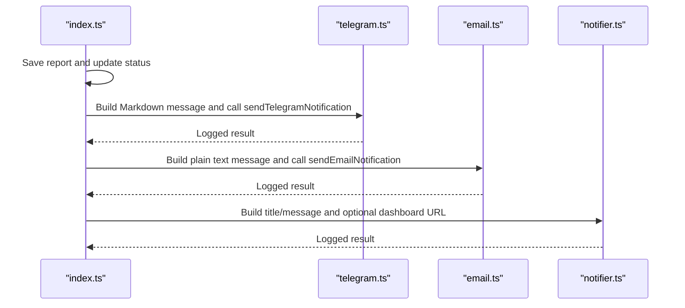
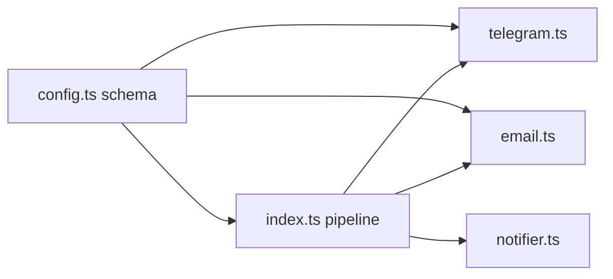

# Notification System

<cite>
**Referenced Files in This Document**
- [index.ts](file://src/index.ts)
- [notifier.ts](file://src/notifier.ts)
- [telegram.ts](file://src/telegram.ts)
- [email.ts](file://src/email.ts)
- [config.ts](file://src/config.ts)
- [config.example.json](file://config/config.example.json)
- [README.md](file://README.md)
</cite>

## Table of Contents
1. [Introduction](#introduction)
2. [Project Structure](#project-structure)
3. [Core Components](#core-components)
4. [Architecture Overview](#architecture-overview)
5. [Detailed Component Analysis](#detailed-component-analysis)
6. [Dependency Analysis](#dependency-analysis)
7. [Performance Considerations](#performance-considerations)
8. [Troubleshooting Guide](#troubleshooting-guide)
9. [Conclusion](#conclusion)

## Introduction
This document explains the multi-channel notification system that delivers AI review results through Telegram, Email, and Windows desktop notifications. It covers the notification abstraction layer, channel-specific integrations, configuration examples, error handling, and troubleshooting guidance. The system is designed so that notification failures do not block or fail the core review pipeline.

## Project Structure
The notification functionality is implemented across three modules:
- Telegram integration for Markdown-formatted messages via the Telegram Bot API
- Email integration using SMTP with nodemailer
- Desktop notifications on Windows using BurntToast via PowerShell from WSL

These channels are invoked by the main pipeline after a review report is generated and persisted.

**Diagram sources**
- [index.ts:125-159](file://src/index.ts#L125-L159)
- [telegram.ts:8-43](file://src/telegram.ts#L8-L43)
- [email.ts:9-48](file://src/email.ts#L9-L48)
- [notifier.ts:11-60](file://src/notifier.ts#L11-L60)
- [config.ts:23-34](file://src/config.ts#L23-L34)
- [config.example.json:12-26](file://config/config.example.json#L12-L26)

**Section sources**
- [index.ts:125-159](file://src/index.ts#L125-L159)
- [config.ts:23-34](file://src/config.ts#L23-L34)
- [config.example.json:12-26](file://config/config.example.json#L12-L26)

## Core Components
- Notification abstraction layer: The main pipeline orchestrates sending notifications after saving the review report. Each channel is independent and fails gracefully without affecting the pipeline.
- Telegram channel: Sends Markdown-formatted messages to a configured chat using the Telegram Bot API. Skips if bot token or chat ID are missing.
- Email channel: Sends plain text emails via SMTP using nodemailer. Skips if email config is missing or recipients list is empty.
- Desktop notifications: Uses BurntToast PowerShell module to show clickable toast notifications on Windows, including optional deep links to the dashboard.

Key responsibilities:
- Validate configuration before sending
- Format messages per channel
- Log outcomes and errors
- Ensure non-blocking behavior for the pipeline

**Section sources**
- [index.ts:125-159](file://src/index.ts#L125-L159)
- [telegram.ts:8-43](file://src/telegram.ts#L8-L43)
- [email.ts:9-48](file://src/email.ts#L9-L48)
- [notifier.ts:11-60](file://src/notifier.ts#L11-L60)

## Architecture Overview
The notification architecture follows a simple fan-out pattern: once the review report is saved and marked completed, the pipeline triggers all enabled channels. Each channel independently validates its configuration and handles errors internally.

**Diagram sources**
- [index.ts:125-159](file://src/index.ts#L125-L159)
- [telegram.ts:8-43](file://src/telegram.ts#L8-L43)
- [email.ts:9-48](file://src/email.ts#L9-L48)
- [notifier.ts:11-60](file://src/notifier.ts#L11-L60)

## Detailed Component Analysis

### Telegram Integration
- Message formatting: Markdown mode is used when sending messages to Telegram.
- Configuration gating: If bot token or chat ID are missing, the function logs a debug message and returns without sending.
- Error handling: Network or API errors are caught and logged; they do not throw exceptions to avoid disrupting the pipeline.
- Rate limiting: There is no built-in rate limiting or retry logic in this implementation.

**Diagram sources**
- [telegram.ts:8-43](file://src/telegram.ts#L8-L43)

**Section sources**
- [telegram.ts:8-43](file://src/telegram.ts#L8-L43)

### Email Integration
- SMTP configuration: Uses nodemailer with host, port, secure flag, and auth credentials from configuration.
- Recipients: Supports multiple recipients via an array; joined into a comma-separated string for delivery.
- Message format: Plain text body is sent; no template rendering engine is used.
- Delivery tracking: The transporter returns a messageId which is logged for traceability.
- Error handling: Errors are caught and logged; they do not propagate to the pipeline.

**Diagram sources**
- [email.ts:9-48](file://src/email.ts#L9-L48)

**Section sources**
- [email.ts:9-48](file://src/email.ts#L9-L48)

### Desktop Notifications (Windows via BurntToast)
- Execution environment: Designed to run from WSL and invoke PowerShell to use the BurntToast module.
- Content: Supports title, message, optional image path, and optional deep link URL to open the dashboard.
- Safety: Escapes single quotes in strings and uses execFile to avoid shell escaping issues.
- Logging: Logs success or error details without blocking the pipeline.

**Diagram sources**
- [notifier.ts:11-60](file://src/notifier.ts#L11-L60)

**Section sources**
- [notifier.ts:11-60](file://src/notifier.ts#L11-L60)

### Notification Abstraction Layer
The main pipeline coordinates the notification flow after generating and saving the review report. It constructs channel-specific messages and invokes each channel independently.

**Diagram sources**
- [index.ts:125-159](file://src/index.ts#L125-L159)
- [telegram.ts:8-43](file://src/telegram.ts#L8-L43)
- [email.ts:9-48](file://src/email.ts#L9-L48)
- [notifier.ts:11-60](file://src/notifier.ts#L11-L60)

**Section sources**
- [index.ts:125-159](file://src/index.ts#L125-L159)

## Dependency Analysis
- Configuration schema defines required fields for repositories, optional Telegram settings, and optional Email settings.
- The pipeline depends on these configurations to gate notifications and build URLs.
- External dependencies:
  - Telegram Bot API over HTTP
  - nodemailer for SMTP
  - PowerShell BurntToast module for Windows desktop notifications

**Diagram sources**
- [config.ts:23-34](file://src/config.ts#L23-L34)
- [index.ts:125-159](file://src/index.ts#L125-L159)
- [telegram.ts:8-43](file://src/telegram.ts#L8-L43)
- [email.ts:9-48](file://src/email.ts#L9-L48)
- [notifier.ts:11-60](file://src/notifier.ts#L11-L60)

**Section sources**
- [config.ts:23-34](file://src/config.ts#L23-L34)
- [index.ts:125-159](file://src/index.ts#L125-L159)

## Performance Considerations
- Non-blocking notifications: All channels catch and log errors instead of throwing, ensuring the review pipeline continues even if a channel fails.
- Sequential processing: The event queue processes one MR at a time, reducing contention and simplifying resource usage.
- No built-in retries or rate limiting: Telegram and Email channels do not implement retry or backoff; consider adding exponential backoff if you encounter transient network issues.
- Desktop notifications: Use execFile to avoid shell overhead and escaping complexity; ensure BurntToast is installed to avoid unnecessary delays.

[No sources needed since this section provides general guidance]

## Troubleshooting Guide

### Telegram
- Symptom: No Telegram messages received
  - Check that botToken and chatId are set in configuration
  - Verify the Telegram Bot API responds successfully and check logs for status codes and error bodies
  - Note: There is no built-in retry or rate limiting; repeated failures may require external throttling

**Section sources**
- [telegram.ts:8-43](file://src/telegram.ts#L8-L43)

### Email
- Symptom: Emails not delivered
  - Confirm SMTP host, port, secure flag, and auth credentials are correct
  - Ensure the recipients list is not empty
  - Check logs for messageId and any SMTP errors
  - Note: Only plain text is supported; templates are not rendered

**Section sources**
- [email.ts:9-48](file://src/email.ts#L9-L48)

### Desktop Notifications (Windows)
- Symptom: No toast notifications appear
  - Ensure BurntToast PowerShell module is installed
  - Verify PowerShell execution policy allows running scripts
  - Check that the image path is absolute and properly escaped
  - Confirm the target URI is valid and opens the dashboard correctly

**Section sources**
- [notifier.ts:11-60](file://src/notifier.ts#L11-L60)

### General
- Pipeline resilience: Notification failures are logged but do not mark reviews as failed; inspect logs to distinguish between pipeline errors and notification errors.
- Configuration validation: Missing or invalid configuration will prevent specific channels from sending; verify your config file structure.

**Section sources**
- [index.ts:160-179](file://src/index.ts#L160-L179)
- [config.ts:41-79](file://src/config.ts#L41-L79)

## Conclusion
The notification system provides a resilient, multi-channel approach to delivering review results. Telegram offers Markdown-formatted alerts, Email provides SMTP-based delivery with messageId logging, and Windows desktop notifications enable quick access to reports via BurntToast. The design ensures that notification failures do not disrupt the core review workflow. For production environments, consider adding retry logic, rate limiting, and richer email templating to improve reliability and user experience.

[No sources needed since this section summarizes without analyzing specific files]