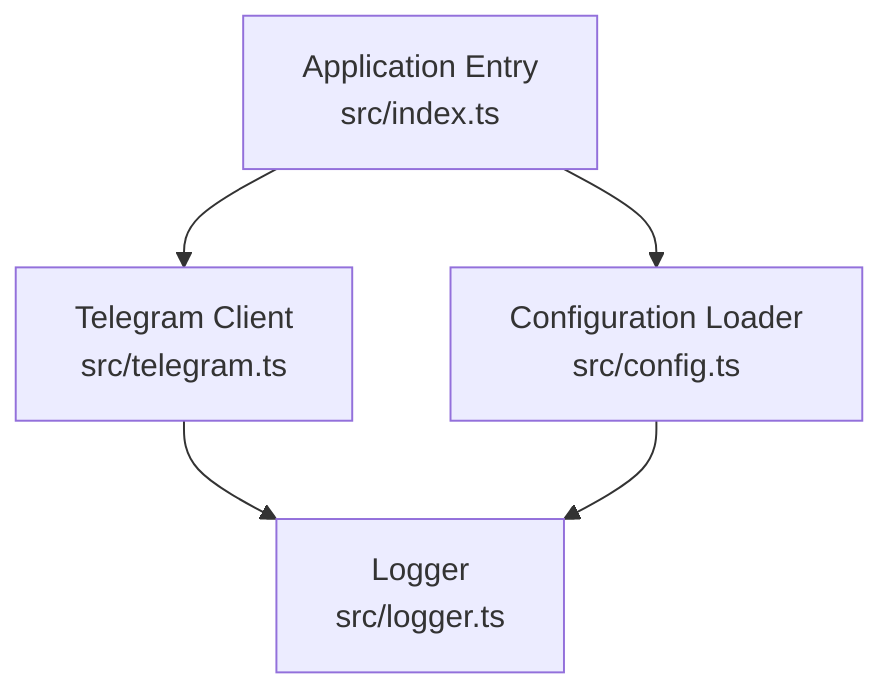
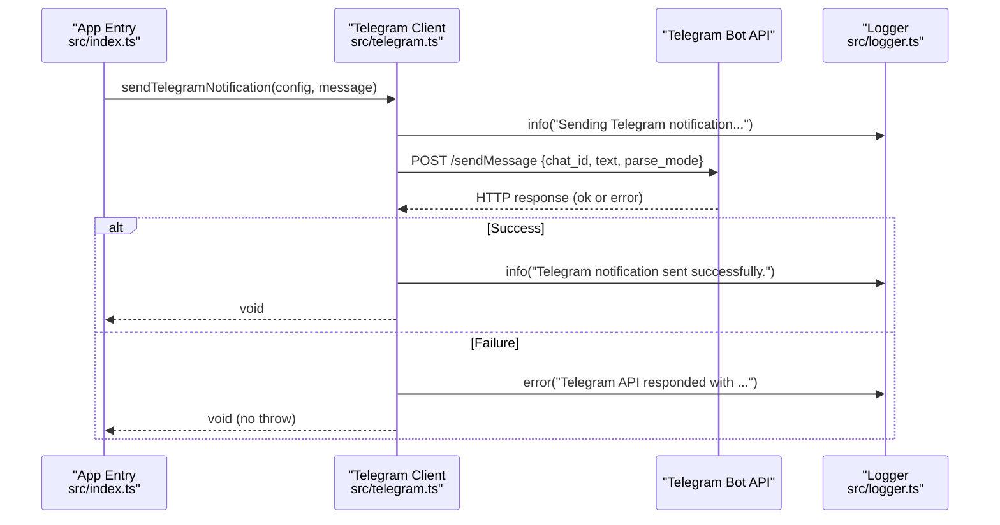
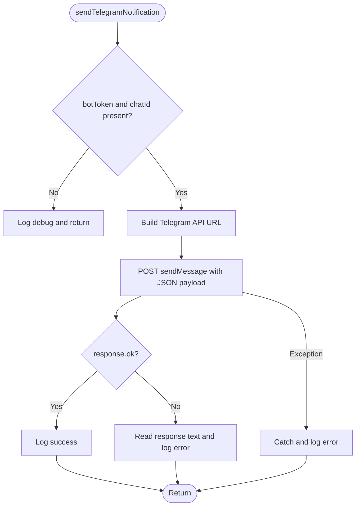
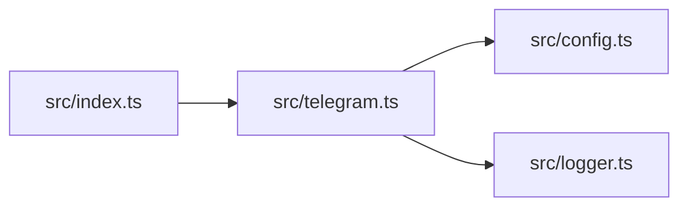

# Telegram Integration

<cite>
**Referenced Files in This Document**
- [telegram.ts](file://src/telegram.ts)
- [index.ts](file://src/index.ts)
- [config.ts](file://src/config.ts)
- [config.example.json](file://config/config.example.json)
- [logger.ts](file://src/logger.ts)
- [retry.ts](file://src/retry.ts)
</cite>

## Table of Contents
1. [Introduction](#introduction)
2. [Project Structure](#project-structure)
3. [Core Components](#core-components)
4. [Architecture Overview](#architecture-overview)
5. [Detailed Component Analysis](#detailed-component-analysis)
6. [Dependency Analysis](#dependency-analysis)
7. [Performance Considerations](#performance-considerations)
8. [Troubleshooting Guide](#troubleshooting-guide)
9. [Conclusion](#conclusion)

## Introduction
This document explains the Telegram bot integration used to deliver AI review notifications. It covers configuration (token and chat ID), message formatting, error handling for network failures and invalid responses, example message structures, and the Telegram API client implementation with connection management. The integration is designed to be non-disruptive: notification failures are logged but do not fail the overall review pipeline.

## Project Structure
The Telegram integration is implemented as a small, focused module that:
- Reads Telegram settings from the application configuration
- Sends Markdown-formatted messages via the Telegram Bot API
- Logs success and failure details without throwing exceptions

**Diagram sources**
- [index.ts:1-196](file://src/index.ts#L1-L196)
- [telegram.ts:1-44](file://src/telegram.ts#L1-L44)
- [config.ts:1-80](file://src/config.ts#L1-L80)
- [logger.ts:1-14](file://src/logger.ts#L1-L14)

**Section sources**
- [index.ts:1-196](file://src/index.ts#L1-L196)
- [telegram.ts:1-44](file://src/telegram.ts#L1-L44)
- [config.ts:1-80](file://src/config.ts#L1-L80)
- [logger.ts:1-14](file://src/logger.ts#L1-L14)

## Core Components
- Telegram client: sends Markdown messages to a configured chat using the Telegram Bot API.
- Configuration loader: validates and loads Telegram token and chat ID.
- Logger: provides structured logging for successes and errors.
- Retry utility: available for exponential backoff retry patterns (not currently used by the Telegram client).

Key responsibilities:
- Validate presence of Telegram credentials before sending.
- Construct the Telegram API request payload.
- Handle HTTP response status and body text on failure.
- Log outcomes and avoid propagating errors to the caller.

**Section sources**
- [telegram.ts:1-44](file://src/telegram.ts#L1-L44)
- [config.ts:23-34](file://src/config.ts#L23-L34)
- [logger.ts:1-14](file://src/logger.ts#L1-L14)
- [retry.ts:1-36](file://src/retry.ts#L1-L36)

## Architecture Overview
The application triggers a review workflow and, upon completion, sends a Telegram notification with a summary of the result.

**Diagram sources**
- [index.ts:125-134](file://src/index.ts#L125-L134)
- [telegram.ts:8-43](file://src/telegram.ts#L8-L43)
- [logger.ts:1-14](file://src/logger.ts#L1-L14)

## Detailed Component Analysis

### Telegram Client Implementation
Responsibilities:
- Skip sending if botToken or chatId are missing.
- Build the Telegram API URL and JSON payload.
- Use native fetch to send the request.
- Handle non-OK responses by logging the status and response body.
- Catch and log exceptions without rethrowing.

**Diagram sources**
- [telegram.ts:8-43](file://src/telegram.ts#L8-L43)

**Section sources**
- [telegram.ts:8-43](file://src/telegram.ts#L8-L43)

### Configuration and Token Setup
- Telegram settings are optional and validated via schema.
- Example configuration includes botToken and chatId placeholders.
- The configuration loader enforces schema validation and logs errors when invalid.

Configuration fields:
- telegram.botToken: string (optional)
- telegram.chatId: string (optional)

Example configuration file structure:
- config/config.example.json demonstrates where to place botToken and chatId.

**Section sources**
- [config.ts:23-34](file://src/config.ts#L23-L34)
- [config.example.json:12-15](file://config/config.example.json#L12-L15)

### Message Formatting System
- Messages are sent with parse_mode set to Markdown.
- The application composes a concise summary including project name, MR link, title, type, and report path.
- Ensure any user-provided content does not break Markdown syntax; escape special characters if needed.

Message composition example (conceptual):
- Title line indicating completion
- Project and MR metadata
- Type label
- Brief description
- Report path in code block

**Section sources**
- [telegram.ts:24-28](file://src/telegram.ts#L24-L28)
- [index.ts:125-134](file://src/index.ts#L125-L134)

### Error Handling Mechanisms
Current behavior:
- Missing configuration: skip sending and log debug message.
- Non-OK HTTP response: read response body and log error; do not throw.
- Network or runtime exceptions: catch and log error; do not throw.

Retry strategy:
- A generic retry utility exists with exponential backoff, but it is not used by the Telegram client. You can integrate it if you need retries for transient network issues.

Rate limiting:
- No explicit rate limit handling is implemented in the Telegram client. If you encounter rate limits, consider integrating the retry utility with appropriate delays and backoff.

**Section sources**
- [telegram.ts:9-12](file://src/telegram.ts#L9-L12)
- [telegram.ts:31-42](file://src/telegram.ts#L31-L42)
- [retry.ts:12-35](file://src/retry.ts#L12-L35)

### Connection Management
- Uses native fetch for HTTP requests.
- No persistent connections or connection pooling are managed by this module.
- Each call opens a new connection to the Telegram Bot API endpoint.

**Section sources**
- [telegram.ts:18-29](file://src/telegram.ts#L18-L29)

### Example Message Types and Structures

- Success notification (review completed):
  - Content: completion notice, project name, MR link, title, type, and report path.
  - Format: Markdown.
  - Triggered after saving the report and updating the review status.

- Failure notification (conceptual):
  - When a review fails, you may compose a message describing the failure and include relevant identifiers.
  - Integrate similar logic to build a Markdown message and call the Telegram client.

- Summary notification (conceptual):
  - Aggregate multiple results into a single message with sections for each item.
  - Ensure Markdown formatting remains valid.

Note: These examples describe message structures conceptually; actual implementation should follow the same pattern as the success message.

[No sources needed since these are conceptual examples]

## Dependency Analysis
The Telegram client depends on configuration and logger modules. The application entry point composes the message and invokes the Telegram client.

**Diagram sources**
- [index.ts:1-196](file://src/index.ts#L1-L196)
- [telegram.ts:1-44](file://src/telegram.ts#L1-L44)
- [config.ts:1-80](file://src/config.ts#L1-L80)
- [logger.ts:1-14](file://src/logger.ts#L1-L14)

**Section sources**
- [index.ts:1-196](file://src/index.ts#L1-L196)
- [telegram.ts:1-44](file://src/telegram.ts#L1-L44)
- [config.ts:1-80](file://src/config.ts#L1-L80)
- [logger.ts:1-14](file://src/logger.ts#L1-L14)

## Performance Considerations
- The Telegram client performs a single HTTP request per notification.
- There is no batching or caching of responses.
- Avoid sending large messages to reduce payload size.
- Consider adding retries with exponential backoff if transient network errors occur frequently.

[No sources needed since this section provides general guidance]

## Troubleshooting Guide

Common issues and resolutions:

- Authentication failures:
  - Symptom: Telegram API returns an error indicating invalid token.
  - Action: Verify botToken in config/config.json matches the token provided by BotFather.
  - Check: Ensure the configuration file is correctly loaded and parsed.

- Chat ID problems:
  - Symptom: Messages are not delivered or API returns an error about chat access.
  - Action: Confirm chatId is correct and the bot has permission to send messages to the target chat.
  - For group chats, ensure the bot is added and has posting rights.

- Message delivery problems:
  - Symptom: No logs indicate success; check logs for error messages.
  - Action: Inspect the HTTP response status and body text logged by the client.
  - Validate that the message content is valid Markdown.

- Rate limit exceeded:
  - Symptom: Repeated failures due to Telegram API rate limits.
  - Action: Implement retries with exponential backoff using the existing retry utility.
  - Reduce message frequency or batch notifications where possible.

- Network failures:
  - Symptom: Exceptions during fetch calls.
  - Action: Add retry logic with backoff; verify network connectivity and DNS resolution.

- Configuration validation errors:
  - Symptom: Application fails to start due to invalid configuration.
  - Action: Review config/config.json against the schema; ensure all required fields are present and valid.

**Section sources**
- [telegram.ts:9-12](file://src/telegram.ts#L9-L12)
- [telegram.ts:31-42](file://src/telegram.ts#L31-L42)
- [config.ts:41-78](file://src/config.ts#L41-L78)
- [retry.ts:12-35](file://src/retry.ts#L12-L35)

## Conclusion
The Telegram integration provides a simple, resilient way to notify users about review outcomes. It uses Markdown formatting, handles errors gracefully, and integrates cleanly with the application’s configuration and logging systems. For enhanced reliability under adverse network conditions, consider integrating the retry utility with exponential backoff and adding explicit rate-limit handling.

[No sources needed since this section summarizes without analyzing specific files]