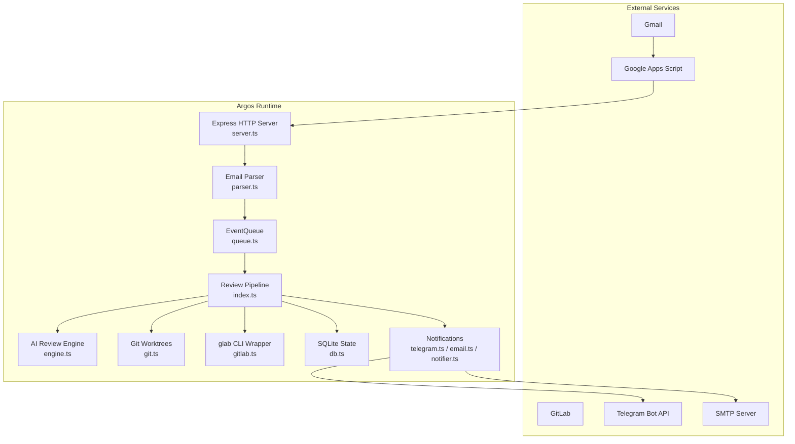
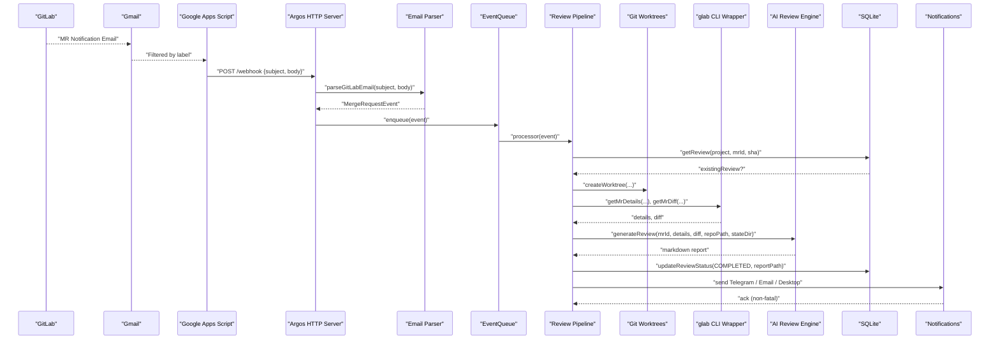
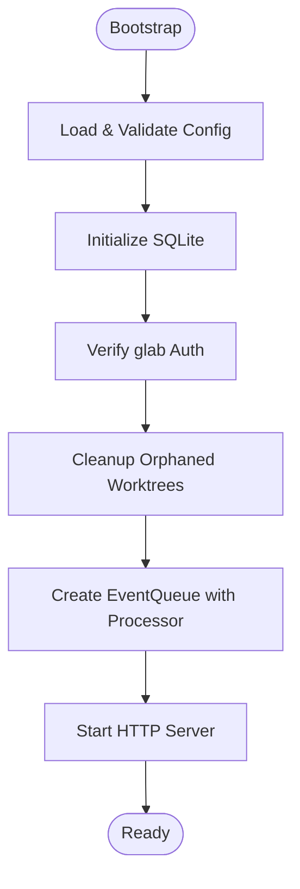
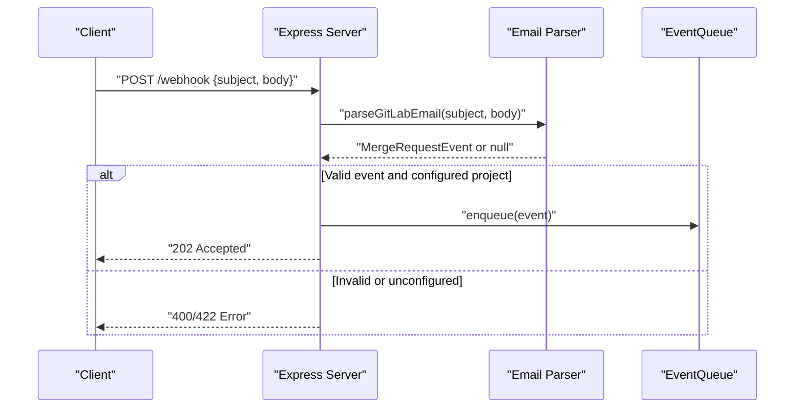
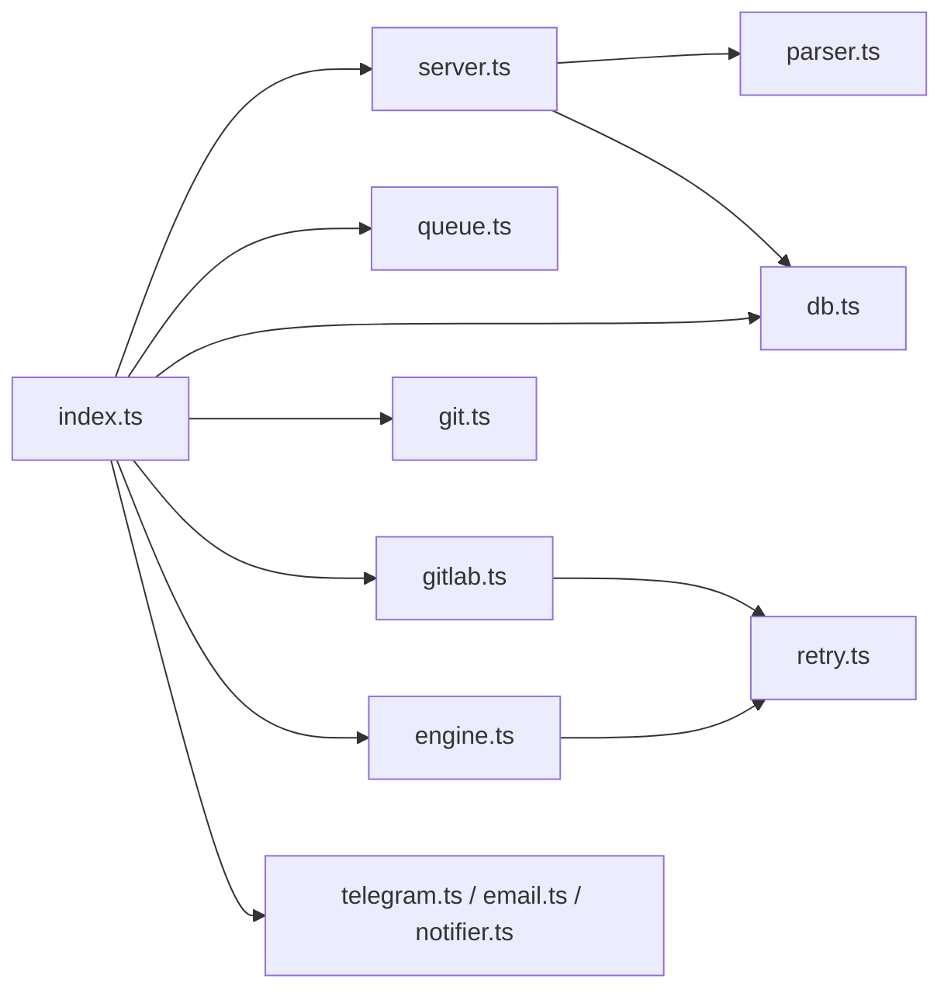

# System Architecture

<cite>
**Referenced Files in This Document**
- [README.md](file://README.md)
- [index.ts](file://src/index.ts)
- [server.ts](file://src/server.ts)
- [parser.ts](file://src/parser.ts)
- [queue.ts](file://src/queue.ts)
- [engine.ts](file://src/engine.ts)
- [git.ts](file://src/git.ts)
- [gitlab.ts](file://src/gitlab.ts)
- [db.ts](file://src/db.ts)
- [config.ts](file://src/config.ts)
- [telegram.ts](file://src/telegram.ts)
- [email.ts](file://src/email.ts)
- [notifier.ts](file://src/notifier.ts)
- [google-apps-script.js](file://scripts/google-apps-script.js)
- [config.example.json](file://config/config.example.json)
</cite>

## Table of Contents
1. Introduction
2. Project Structure
3. Core Components
4. Architecture Overview
5. Detailed Component Analysis
6. Dependency Analysis
7. Performance Considerations
8. Troubleshooting Guide
9. Conclusion

## Introduction
Argos is a self-hosted AI code review assistant that ingests GitLab Merge Request notifications delivered via email, parses them into structured events, and orchestrates an isolated, AI-powered review pipeline. It uses Git worktrees for safe analysis, SQLite for state management, and exposes an Express HTTP server with a web dashboard and API. Notifications are sent to Telegram, SMTP email, and optionally Windows desktop notifications. The system is designed around modular components and sequential processing to ensure safety and predictability.

## Project Structure
The repository follows a feature-based layout under src/, with configuration, scripts, and runtime state directories:
- src/: core modules (HTTP server, parser, queue, engine, git operations, GitLab integration, persistence, config, notifications)
- scripts/: Google Apps Script bridge for Gmail-to-webhook forwarding
- config/: example configuration schema
- state/: runtime artifacts (SQLite DB, prompts, worktrees)
- reviews/: generated Markdown reports per project
- public/: static web dashboard assets

**Diagram sources**
- [server.ts:10-114](file://src/server.ts#L10-L114)
- [parser.ts:17-91](file://src/parser.ts#L17-L91)
- [queue.ts:6-46](file://src/queue.ts#L6-L46)
- [index.ts:20-191](file://src/index.ts#L20-L191)
- [engine.ts:8-212](file://src/engine.ts#L8-L212)
- [git.ts:9-99](file://src/git.ts#L9-L99)
- [gitlab.ts:21-95](file://src/gitlab.ts#L21-L95)
- [db.ts:9-95](file://src/db.ts#L9-L95)
- [telegram.ts:8-43](file://src/telegram.ts#L8-L43)
- [email.ts:9-48](file://src/email.ts#L9-L48)
- [notifier.ts:11-60](file://src/notifier.ts#L11-L60)

**Section sources**
- [README.md:1-323](file://README.md#L1-L323)

## Core Components
- Bootstrap and orchestration: initializes configuration, database, GitLab auth, orphan cleanup, event queue, and starts the HTTP server.
- HTTP server: serves the dashboard, provides REST endpoints, and accepts webhook payloads from Google Apps Script.
- Email parser: extracts MR metadata from GitLab notification emails.
- Event queue: serializes processing to avoid concurrent interference.
- Git operations: creates and removes isolated Git worktrees; cleans up orphans on startup.
- GitLab integration: wraps glab CLI to fetch MR details and diffs with retry logic.
- AI review engine: constructs prompts and invokes agy CLI with timeouts and retries.
- Persistence: SQLite schema and CRUD for review records and status tracking.
- Notifications: optional Telegram, SMTP email, and Windows desktop notifications.

**Section sources**
- [index.ts:20-191](file://src/index.ts#L20-L191)
- [server.ts:10-114](file://src/server.ts#L10-L114)
- [parser.ts:17-91](file://src/parser.ts#L17-L91)
- [queue.ts:6-46](file://src/queue.ts#L6-L46)
- [git.ts:9-99](file://src/git.ts#L9-L99)
- [gitlab.ts:21-95](file://src/gitlab.ts#L21-L95)
- [engine.ts:8-212](file://src/engine.ts#L8-L212)
- [db.ts:9-95](file://src/db.ts#L9-L95)
- [telegram.ts:8-43](file://src/telegram.ts#L8-L43)
- [email.ts:9-48](file://src/email.ts#L9-L48)
- [notifier.ts:11-60](file://src/notifier.ts#L11-L60)

## Architecture Overview
End-to-end flow from GitLab MR notification emails through Gmail filters and Google Apps Script to the Express HTTP server and the internal pipeline:

**Diagram sources**
- [google-apps-script.js:15-77](file://scripts/google-apps-script.js#L15-L77)
- [server.ts:83-109](file://src/server.ts#L83-L109)
- [parser.ts:17-91](file://src/parser.ts#L17-L91)
- [queue.ts:15-46](file://src/queue.ts#L15-L46)
- [index.ts:47-184](file://src/index.ts#L47-L184)
- [git.ts:9-49](file://src/git.ts#L9-L49)
- [gitlab.ts:51-95](file://src/gitlab.ts#L51-L95)
- [engine.ts:8-212](file://src/engine.ts#L8-L212)
- [db.ts:61-82](file://src/db.ts#L61-L82)
- [telegram.ts:8-43](file://src/telegram.ts#L8-L43)
- [email.ts:9-48](file://src/email.ts#L9-L48)
- [notifier.ts:11-60](file://src/notifier.ts#L11-L60)

## Detailed Component Analysis

### Bootstrap and Orchestration (index.ts)
Responsibilities:
- Load and validate configuration.
- Initialize SQLite database.
- Verify GitLab CLI authentication.
- Clean up orphaned worktrees.
- Create an in-memory event queue with the review pipeline processor.
- Start the HTTP server.

Key behaviors:
- Deduplication check using SQLite before starting a review.
- Isolated worktree creation per MR.
- Fetching MR details and diff via glab CLI wrapper.
- Invoking AI review engine and saving Markdown reports.
- Sending notifications and updating review status.
- Ensuring worktree cleanup in finally block.

**Diagram sources**
- [index.ts:20-191](file://src/index.ts#L20-L191)

**Section sources**
- [index.ts:20-191](file://src/index.ts#L20-L191)

### HTTP Server and Web Dashboard (server.ts)
Endpoints:
- GET /status: health check.
- Static files: serves the web dashboard.
- GET /api/reviews: list all reviews.
- GET /api/reviews/:id: retrieve a specific review with markdown content.
- POST /api/reviews/:id/retry: enqueue a retry for a failed/pending review.
- POST /webhook: accept email payloads from Google Apps Script.

Processing:
- Parses JSON bodies.
- Validates webhook payload and project configuration.
- Enqueues parsed events for asynchronous processing.

**Diagram sources**
- [server.ts:10-114](file://src/server.ts#L10-L114)
- [parser.ts:17-91](file://src/parser.ts#L17-L91)
- [queue.ts:15-46](file://src/queue.ts#L15-L46)

**Section sources**
- [server.ts:10-114](file://src/server.ts#L10-L114)

### Email Parser (parser.ts)
Responsibilities:
- Decode percent-encoded strings (e.g., FireEye-wrapped URLs).
- Extract MR URL, project path, MR ID, project name, title, and action type.
- Return a normalized MergeRequestEvent or null if unrecognized.

Edge cases:
- Handles various subject formats and fallback title extraction.
- Maps email body keywords to actions like opened, updated, approved, merged, commented.

**Section sources**
- [parser.ts:17-91](file://src/parser.ts#L17-L91)

### Event Queue (queue.ts)
Design:
- In-memory FIFO queue with single-threaded processing.
- Prevents concurrent reviews to avoid resource contention.
- Uses setImmediate to process next item asynchronously after each completion.

Error handling:
- Logs errors without failing the entire pipeline.

**Section sources**
- [queue.ts:6-46](file://src/queue.ts#L6-L46)

### Git Operations (git.ts)
Capabilities:
- createWorktree: fetches MR head and creates a detached worktree.
- removeWorktree: removes worktree via git command with manual fallback.
- cleanupOrphanedWorktrees: prunes git administrative pointers and deletes leftover directories.

Safety:
- Ensures parent directories exist.
- Prunes git worktrees before and after cleanup.

**Section sources**
- [git.ts:9-99](file://src/git.ts#L9-L99)

### GitLab Integration (gitlab.ts)
Functions:
- verifyGlabAuth: checks glab CLI authentication status.
- getMrDetails: fetches MR metadata via glab mr view with retry.
- getMrDiff: fetches MR diff via glab mr diff with retry and buffer limits.

Resilience:
- Wraps CLI calls with retry utility for transient failures.

**Section sources**
- [gitlab.ts:21-95](file://src/gitlab.ts#L21-L95)

### AI Review Engine (engine.ts)
Workflow:
- Truncates excessively large diffs.
- Builds a prompt instructing the agent to classify MR type and produce a structured Markdown report.
- Writes prompt to file to bypass command-line length limits.
- Invokes agy CLI with flags for non-interactive mode and extended timeout.
- Applies retry with exponential backoff.
- Cleans up temporary prompt files.

Timeouts and resilience:
- Process-level timeout kills long-running agy invocations.
- Non-zero exit codes and stderr captured for diagnostics.

**Section sources**
- [engine.ts:8-212](file://src/engine.ts#L8-L212)

### Database and State Management (db.ts)
Schema:
- reviews table with id, project_name, mr_id, commit_sha, status, report_path, created_at, completed_at.
- Unique index on (project_name, mr_id, commit_sha) to enforce deduplication.

Operations:
- initDb: opens DB and ensures schema exists.
- getReview, insertReview, updateReviewStatus, getAllReviews, getReviewById.

Usage:
- Tracks review lifecycle and supports dashboard queries.

**Section sources**
- [db.ts:9-95](file://src/db.ts#L9-L95)

### Configuration (config.ts)
Validation:
- Zod schemas for repositories, telegram, email, port, and publicUrl.
- Loads config.json and validates presence of local repository paths.

Example:
- See config.example.json for structure.

**Section sources**
- [config.ts:6-79](file://src/config.ts#L6-L79)
- [config.example.json:1-28](file://config/config.example.json#L1-L28)

### Notifications
- Telegram: sendTelegramNotification sends Markdown messages via Telegram Bot API; failures are logged but do not fail the pipeline.
- Email: sendEmailNotification uses nodemailer to send plain text emails; failures are logged and non-fatal.
- Desktop: sendDesktopNotification triggers Windows toast notifications via PowerShell BurntToast module; resolves regardless of success to avoid blocking.

**Section sources**
- [telegram.ts:8-43](file://src/telegram.ts#L8-L43)
- [email.ts:9-48](file://src/email.ts#L9-L48)
- [notifier.ts:11-60](file://src/notifier.ts#L11-L60)

### Google Apps Script Bridge (google-apps-script.js)
Purpose:
- Polls Gmail threads labeled for GitLab MRs and forwards unread messages to Argos webhook endpoint.
- Marks messages as read only when successful or rejected (to prevent loops).

Configuration:
- WEBHOOK_URL points to Argos HTTP server.
- GMAIL_LABEL matches Gmail filter label.

**Section sources**
- [google-apps-script.js:15-77](file://scripts/google-apps-script.js#L15-L77)

## Dependency Analysis
High-level component relationships:

Observations:
- Low coupling between notification modules and core pipeline; they are invoked post-processing and failures are non-fatal.
- Sequential processing via EventQueue reduces concurrency risks.
- External dependencies (glab, agy) are encapsulated in wrappers with retry logic.

**Diagram sources**
- [index.ts:20-191](file://src/index.ts#L20-L191)
- [server.ts:10-114](file://src/server.ts#L10-L114)
- [parser.ts:17-91](file://src/parser.ts#L17-L91)
- [queue.ts:6-46](file://src/queue.ts#L6-L46)
- [engine.ts:8-212](file://src/engine.ts#L8-L212)
- [git.ts:9-99](file://src/git.ts#L9-L99)
- [gitlab.ts:21-95](file://src/gitlab.ts#L21-L95)
- [db.ts:9-95](file://src/db.ts#L9-L95)
- [telegram.ts:8-43](file://src/telegram.ts#L8-L43)
- [email.ts:9-48](file://src/email.ts#L9-L48)
- [notifier.ts:11-60](file://src/notifier.ts#L11-L60)

**Section sources**
- [index.ts:20-191](file://src/index.ts#L20-L191)
- [server.ts:10-114](file://src/server.ts#L10-L114)

## Performance Considerations
- Sequential processing: EventQueue processes one event at a time to avoid contention across Git operations, AI invocations, and I/O.
- Diff truncation: Large diffs are truncated to reduce memory usage and prompt size.
- Timeouts: agy CLI invocation has a process-level timeout to prevent indefinite hangs.
- Retries: glab and agy CLI calls use retry with exponential backoff to handle transient failures.
- Disk I/O: Reports written to disk; consider log rotation and storage capacity planning.
- Worktree cleanup: Ensures no lingering worktrees consume disk space.

[No sources needed since this section provides general guidance]

## Troubleshooting Guide
Common issues and mitigations:
- Missing configuration: Ensure config/config.json exists and passes validation; verify repository local paths exist.
- glab CLI not authenticated: Run glab auth login; verify token presence.
- Unrecognized webhook payload: Check email format and parser regex; confirm project is configured.
- Failed worktree creation: Inspect git logs; ensure origin refs/merge-requests/<id>/head exists.
- AI review failure: Check agy CLI availability and permissions; review stderr output and timeouts.
- Notification failures: Verify Telegram bot token/chatId and SMTP settings; desktop notifications require BurntToast module.

Operational tips:
- Use /status for health checks.
- Use /api/reviews and /api/reviews/:id to inspect state and reports.
- Use /api/reviews/:id/retry to reprocess failed or pending reviews.

**Section sources**
- [config.ts:41-79](file://src/config.ts#L41-L79)
- [gitlab.ts:21-49](file://src/gitlab.ts#L21-L49)
- [server.ts:83-109](file://src/server.ts#L83-L109)
- [git.ts:9-99](file://src/git.ts#L9-L99)
- [engine.ts:139-212](file://src/engine.ts#L139-L212)
- [telegram.ts:8-43](file://src/telegram.ts#L8-L43)
- [email.ts:9-48](file://src/email.ts#L9-L48)
- [notifier.ts:11-60](file://src/notifier.ts#L11-L60)

## Conclusion
Argos implements a robust, modular architecture that safely transforms GitLab MR notification emails into actionable AI-generated review reports. By leveraging Git worktrees for isolation, SQLite for durable state, and an in-memory sequential queue, it balances reliability with simplicity. External integrations (GitLab via glab, Telegram, SMTP, Windows desktop notifications) are cleanly encapsulated, and the design supports future scalability through horizontal scaling of workers and externalized queues if needed. Security considerations include read-only behavior toward GitLab, minimal exposure of credentials via configuration, and non-fatal notification failures to preserve core pipeline integrity.

[No sources needed since this section summarizes without analyzing specific files]