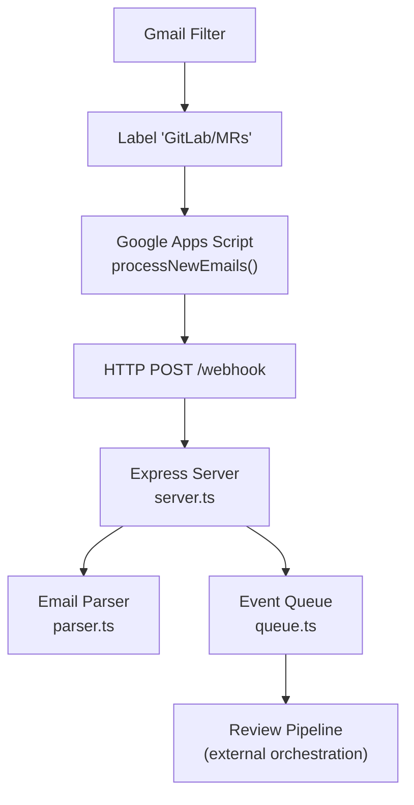
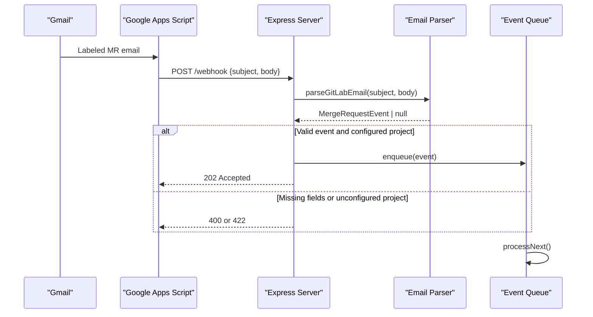
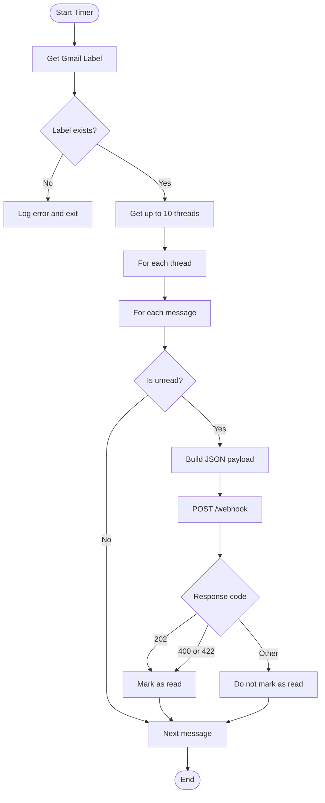
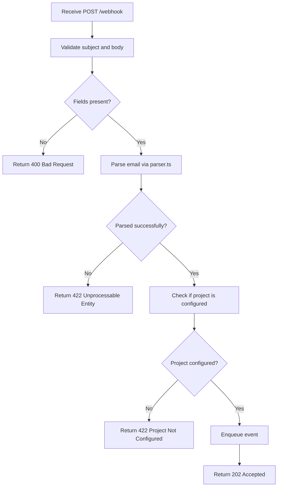
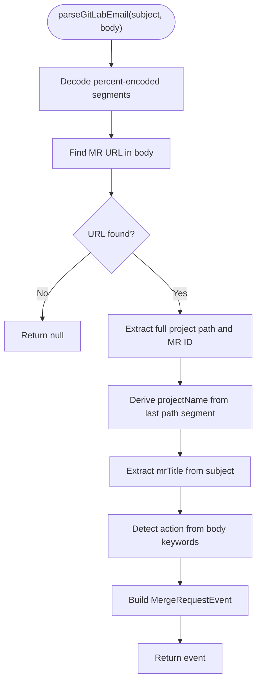
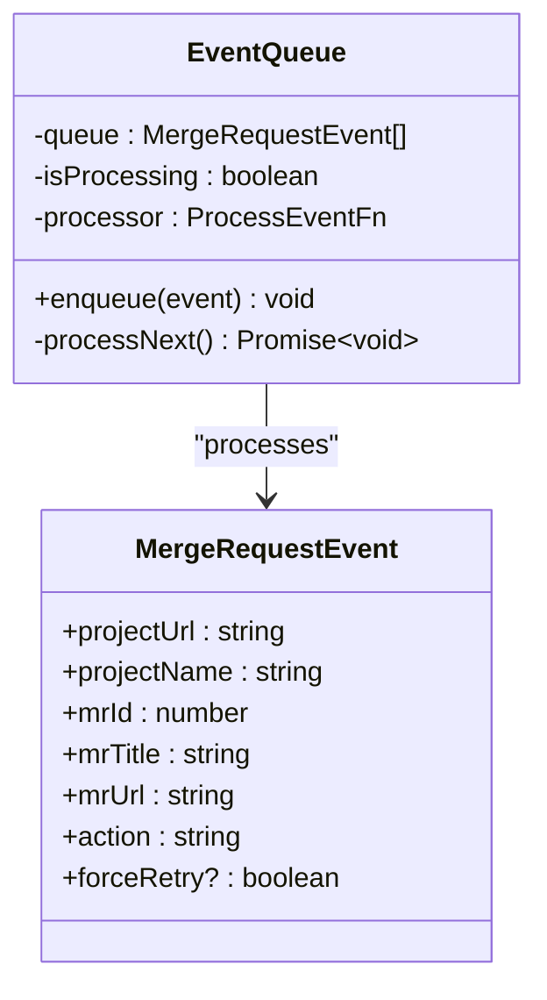
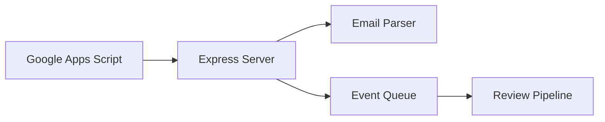

# Webhook Processing Pipeline

<cite>
**Referenced Files in This Document**
- [README.md](file://README.md)
- [server.ts](file://src/server.ts)
- [parser.ts](file://src/parser.ts)
- [queue.ts](file://src/queue.ts)
- [google-apps-script.js](file://scripts/google-apps-script.js)
- [Google_Apps_Script_Setup.md](file://docs/Google_Apps_Script_Setup.md)
</cite>

## Table of Contents
1. [Introduction](#introduction)
2. [Project Structure](#project-structure)
3. [Core Components](#core-components)
4. [Architecture Overview](#architecture-overview)
5. [Detailed Component Analysis](#detailed-component-analysis)
6. [Dependency Analysis](#dependency-analysis)
7. [Performance Considerations](#performance-considerations)
8. [Troubleshooting Guide](#troubleshooting-guide)
9. [Security Considerations](#security-considerations)
10. [Conclusion](#conclusion)

## Introduction
This document explains the webhook processing pipeline that ingests GitLab Merge Request notification emails and turns them into asynchronous review jobs. The flow starts with Gmail filters forwarding matching emails to a Google Apps Script, which then sends HTTP POST requests to the Express server’s `/webhook` endpoint. The server parses the email payload, validates it, enqueues the event for sequential processing, and responds immediately to avoid request blocking.

The pipeline is designed to:
- Accept email payloads from Google Apps Script
- Parse GitLab MR metadata from email subjects and bodies
- Validate project configuration before processing
- Enqueue events for reliable, non-blocking execution
- Provide clear error responses and logging for debugging

## Project Structure
At a high level, the relevant parts of the codebase are:
- `scripts/google-apps-script.js`: Gmail-to-webhook bridge deployed as a Google Apps Script
- `docs/Google_Apps_Script_Setup.md`: Setup instructions for Gmail filters and Apps Script triggers
- `src/server.ts`: Express server exposing `/webhook`, API endpoints, and static dashboard
- `src/parser.ts`: Email parser that extracts merge request details
- `src/queue.ts`: In-memory sequential event queue
- `README.md`: High-level overview including webhook payload format and architecture diagram

**Diagram sources**
- [google-apps-script.js:15-47](file://scripts/google-apps-script.js#L15-L47)
- [server.ts:83-109](file://src/server.ts#L83-L109)
- [parser.ts:17-91](file://src/parser.ts#L17-L91)
- [queue.ts:15-45](file://src/queue.ts#L15-L45)

**Section sources**
- [README.md:5-30](file://README.md#L5-L30)
- [README.md:141-158](file://README.md#L141-L158)

## Core Components
- Google Apps Script forwarder: Polls labeled Gmail threads, builds a JSON payload, and POSTs it to the webhook URL. It marks messages as read only when the server accepts or explicitly rejects malformed input.
- Express server `/webhook`: Validates presence of subject/body, parses the email, checks configured projects, enqueues the event, and returns an immediate 202 Accepted response.
- Email parser: Extracts MR URL, project name, MR ID, title, and action from the email body and subject. Handles percent-encoded URLs and multiple subject formats.
- Event queue: A simple FIFO queue that processes one event at a time using `setImmediate`, preventing concurrent reviews and avoiding request blocking.

**Section sources**
- [google-apps-script.js:15-77](file://scripts/google-apps-script.js#L15-L77)
- [server.ts:83-109](file://src/server.ts#L83-L109)
- [parser.ts:17-91](file://src/parser.ts#L17-L91)
- [queue.ts:15-45](file://src/queue.ts#L15-L45)

## Architecture Overview
The end-to-end flow is:
1. Gmail filter applies a label to GitLab MR notifications.
2. Google Apps Script runs on a timer, reads unread labeled threads, and forwards each message to the webhook.
3. The Express server receives the webhook, parses and validates the payload, and enqueues the event.
4. The queue processes events sequentially, invoking the review pipeline (outside this document).

**Diagram sources**
- [google-apps-script.js:15-77](file://scripts/google-apps-script.js#L15-L77)
- [server.ts:83-109](file://src/server.ts#L83-L109)
- [parser.ts:17-91](file://src/parser.ts#L17-L91)
- [queue.ts:15-45](file://src/queue.ts#L15-L45)

## Detailed Component Analysis

### Google Apps Script Forwarder
Responsibilities:
- Read threads with a specific Gmail label
- Iterate through messages and select unread ones
- Build a JSON payload containing messageId, subject, and body
- POST to the configured webhook URL
- Mark messages as read only when accepted or explicitly rejected by the server

Key behaviors:
- Uses `UrlFetchApp.fetch` with JSON content type
- Treats 202 as success; treats 400/422 as explicit rejection but still marks as read to avoid loops
- On network errors or unexpected status codes, does not mark as read so retries can occur

**Diagram sources**
- [google-apps-script.js:15-77](file://scripts/google-apps-script.js#L15-L77)

**Section sources**
- [google-apps-script.js:1-78](file://scripts/google-apps-script.js#L1-L78)
- [Google_Apps_Script_Setup.md:1-39](file://docs/Google_Apps_Script_Setup.md#L1-L39)

### Express Server Webhook Handler
Responsibilities:
- Parse JSON request bodies
- Validate required fields (`subject`, `body`)
- Parse email into a structured event
- Validate that the project is configured
- Enqueue the event for background processing
- Respond immediately with 202 Accepted

Validation and error handling:
- Missing subject/body → 400 Bad Request
- Unrecognized or malformed event → 422 Unprocessable Entity
- Unconfigured project → 422 Unprocessable Entity
- Successful acceptance → 202 Accepted with event summary

**Diagram sources**
- [server.ts:83-109](file://src/server.ts#L83-L109)

**Section sources**
- [server.ts:1-115](file://src/server.ts#L1-L115)

### Email Parser
Responsibilities:
- Decode percent-encoded strings in the email body to handle security wrappers around URLs
- Extract the MR URL and derive project path, project name, and MR ID
- Extract MR title from the subject with fallback strategies
- Determine the MR action based on keywords in the body

Parsing logic highlights:
- Percent-decoding loop protects against malformed encodings
- MR URL regex expects standard GitLab merge request paths
- Title extraction supports common patterns and falls back to cleaning the subject
- Action detection uses keyword matching with a default of “updated”

**Diagram sources**
- [parser.ts:17-91](file://src/parser.ts#L17-L91)

**Section sources**
- [parser.ts:1-92](file://src/parser.ts#L1-L92)

### Event Queue
Responsibilities:
- Maintain a FIFO queue of `MergeRequestEvent` items
- Process events sequentially to prevent concurrent interference
- Use `setImmediate` to avoid blocking the HTTP request handler
- Log processing lifecycle and errors

Concurrency model:
- Only one event is processed at a time
- After processing completes (success or failure), the next item is scheduled asynchronously
- Errors during processing are logged without crashing the queue

**Diagram sources**
- [queue.ts:1-47](file://src/queue.ts#L1-L47)
- [parser.ts:1-9](file://src/parser.ts#L1-L9)

**Section sources**
- [queue.ts:1-47](file://src/queue.ts#L1-L47)

## Dependency Analysis
High-level dependencies:
- `server.ts` depends on:
  - `parser.ts` for email parsing
  - `queue.ts` for asynchronous processing
  - `config.ts` for repository configuration validation
  - `db.ts` for API endpoints unrelated to the webhook
- `google-apps-script.js` depends on:
  - Gmail API via Apps Script
  - External HTTP endpoint (the Express server)
- `parser.ts` is self-contained and defines the `MergeRequestEvent` interface used by the queue and server

**Diagram sources**
- [server.ts:1-115](file://src/server.ts#L1-L115)
- [parser.ts:1-92](file://src/parser.ts#L1-L92)
- [queue.ts:1-47](file://src/queue.ts#L1-L47)
- [google-apps-script.js:1-78](file://scripts/google-apps-script.js#L1-L78)

**Section sources**
- [server.ts:1-115](file://src/server.ts#L1-L115)
- [parser.ts:1-92](file://src/parser.ts#L1-L92)
- [queue.ts:1-47](file://src/queue.ts#L1-L47)
- [google-apps-script.js:1-78](file://scripts/google-apps-script.js#L1-L78)

## Performance Considerations
- Non-blocking webhook response: The server responds with 202 Accepted immediately after enqueuing, minimizing latency for the sender.
- Sequential processing: The queue ensures only one event is processed at a time, reducing resource contention and simplifying state management.
- Asynchronous scheduling: `setImmediate` defers processing to the next tick, preventing synchronous blocking in the HTTP handler.
- Rate limiting: No built-in rate limiting is implemented in the current webhook handler. If needed, add middleware to throttle requests per IP or globally.
- Payload size: Large email bodies may increase memory usage during parsing; consider truncation policies if necessary.

[No sources needed since this section provides general guidance]

## Troubleshooting Guide
Common issues and resolutions:
- Missing subject or body:
  - Symptom: 400 Bad Request
  - Cause: Incoming payload lacks required fields
  - Resolution: Ensure Google Apps Script includes both `subject` and `body` in the JSON payload
- Unrecognized event format:
  - Symptom: 422 Unprocessable Entity
  - Cause: Email body does not contain a recognizable MR URL or cannot be parsed
  - Resolution: Verify the email contains a valid GitLab MR URL and matches expected patterns
- Unconfigured project:
  - Symptom: 422 Project Not Configured
  - Cause: The extracted project name is not present in the server configuration
  - Resolution: Add the project to the server configuration under repositories
- Gmail script not marking messages as read:
  - Symptom: Emails remain unread and are retried repeatedly
  - Cause: Server returned unexpected status codes or network errors
  - Resolution: Inspect server logs and ensure the webhook URL is reachable; check for transient network failures

Debugging approaches:
- Use the included test script to send sample payloads to the webhook
- Inspect server logs for parsing and queue processing events
- Confirm Gmail label and Apps Script trigger are correctly configured
- Validate the webhook URL is publicly accessible or tunneled via tools like ngrok

**Section sources**
- [server.ts:83-109](file://src/server.ts#L83-L109)
- [google-apps-script.js:49-77](file://scripts/google-apps-script.js#L49-L77)
- [README.md:289-295](file://README.md#L289-L295)

## Security Considerations
Current implementation notes:
- Payload validation: The server validates presence of `subject` and `body`, parses the email, and checks project configuration before enqueuing.
- No authentication or signature verification: The `/webhook` endpoint currently does not enforce secret-based signatures or token-based authentication.
- No rate limiting: There is no built-in throttling mechanism to protect against abuse or accidental floods.

Recommended hardening steps:
- Add request authentication:
  - Require a shared secret header or query parameter
  - Validate HMAC signatures over the payload body
- Add rate limiting:
  - Implement per-IP or global rate limits using Express middleware
- Restrict allowed origins:
  - Use CORS policies to limit which domains can call the webhook
- Sanitize inputs:
  - Validate and normalize email body length
  - Reject excessively large payloads
- Audit and log:
  - Log all incoming webhook requests with sanitized metadata
  - Alert on repeated failures or suspicious patterns

[No sources needed since this section provides general guidance]

## Conclusion
The webhook processing pipeline integrates Gmail, Google Apps Script, and an Express server to reliably ingest GitLab MR notification emails. The server parses and validates email payloads, enqueues events for sequential processing, and responds immediately to avoid blocking. The queue ensures stable, non-concurrent execution of review tasks. To improve robustness and security, consider adding authentication, signature verification, and rate limiting to the webhook endpoint.

[No sources needed since this section summarizes without analyzing specific files]