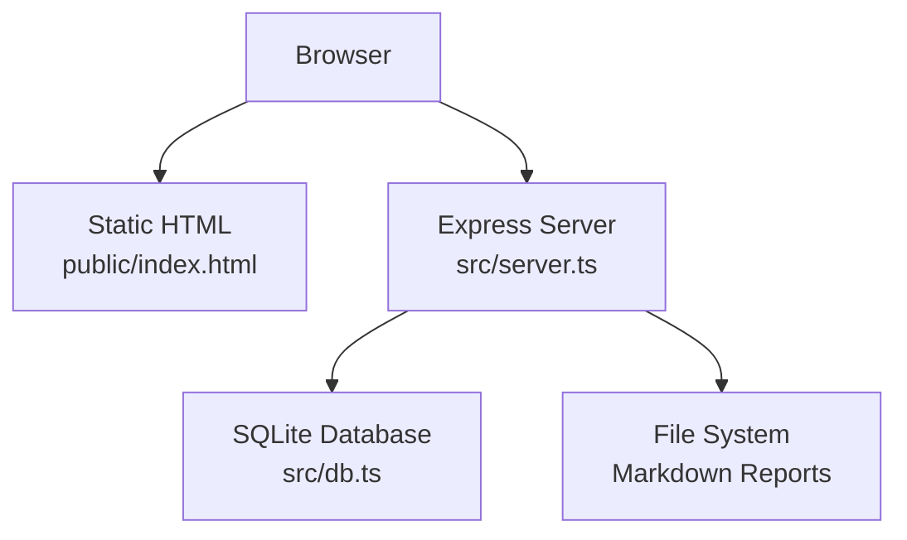
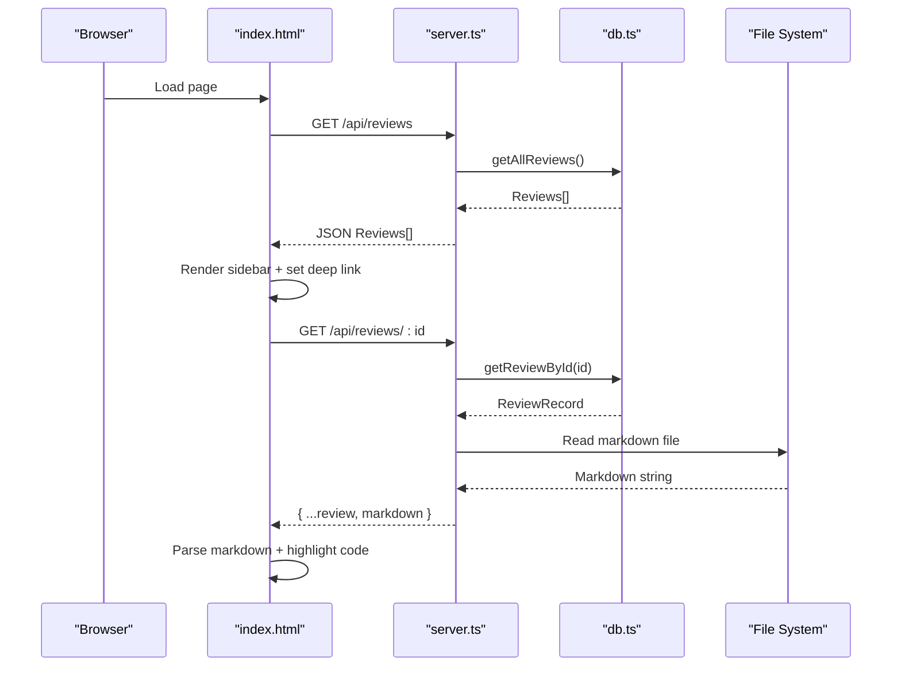
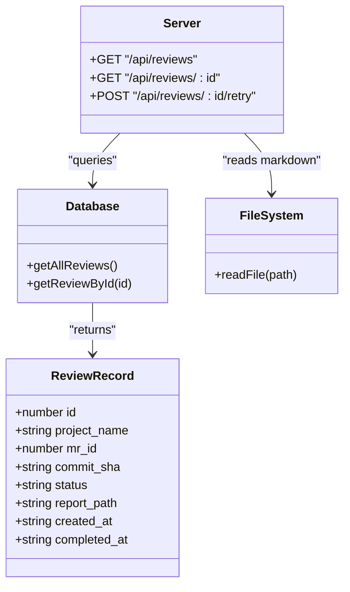

# Web Dashboard

<cite>
**Referenced Files in This Document**
- [index.html](file://public/index.html)
- [server.ts](file://src/server.ts)
- [db.ts](file://src/db.ts)
- [package.json](file://package.json)
</cite>

## Table of Contents
1. [Introduction](#introduction)
2. [Project Structure](#project-structure)
3. [Core Components](#core-components)
4. [Architecture Overview](#architecture-overview)
5. [Detailed Component Analysis](#detailed-component-analysis)
6. [Dependency Analysis](#dependency-analysis)
7. [Performance Considerations](#performance-considerations)
8. [Troubleshooting Guide](#troubleshooting-guide)
9. [Conclusion](#conclusion)

## Introduction
This document describes the built-in web dashboard for reviewing AI-generated reports. The dashboard is a single-page application (SPA) that:
- Displays a sidebar list of reviews with status badges and timestamps
- Renders markdown content with syntax highlighting
- Auto-refreshes the review list periodically
- Supports deep linking via URL query parameters to open a specific review directly
- Integrates with backend REST endpoints to fetch review metadata and full report content, and to queue retries

The SPA is served statically by an Express server, which also exposes the API endpoints used by the client.

## Project Structure
The dashboard consists of:
- A static HTML page under public/ that includes all UI logic inline
- An Express server under src/ that serves the static files and provides API routes
- A SQLite-backed data layer for storing review records and report paths

**Diagram sources**
- [index.html:1-374](file://public/index.html#L1-L374)
- [server.ts:10-114](file://src/server.ts#L10-L114)
- [db.ts:9-47](file://src/db.ts#L9-L47)

**Section sources**
- [index.html:1-374](file://public/index.html#L1-L374)
- [server.ts:10-114](file://src/server.ts#L10-L114)
- [db.ts:9-47](file://src/db.ts#L9-L47)

## Core Components
- Review List Sidebar: Loads reviews from /api/reviews and renders each item with project name, MR ID, timestamp, and status badge. Clicking an item selects it and updates the URL with ?id=...
- Markdown Renderer: Uses marked.js and highlight.js to render markdown content with syntax highlighting for code blocks
- Auto-Refresh: Periodically reloads the review list every 10 seconds to reflect new or updated reviews
- Deep Linking: On initial load, if the URL contains ?id=<reviewId>, the corresponding review is auto-selected and its content loaded
- Retry Action: A “Retry Review” button triggers a POST to /api/reviews/:id/retry to re-queue processing for a failed or pending review

Key implementation references:
- UI structure and styles: [index.html:16-208](file://public/index.html#L16-L208)
- Review list rendering and selection: [index.html:245-305](file://public/index.html#L245-L305)
- Markdown configuration and rendering: [index.html:235-243](file://public/index.html#L235-L243), [index.html:350-363](file://public/index.html#L350-L363)
- Auto-refresh interval: [index.html:369-370](file://public/index.html#L369-L370)
- Deep link handling on first load: [index.html:290-301](file://public/index.html#L290-L301)
- Retry flow: [index.html:309-328](file://public/index.html#L309-L328)

**Section sources**
- [index.html:16-208](file://public/index.html#L16-L208)
- [index.html:235-243](file://public/index.html#L235-L243)
- [index.html:245-305](file://public/index.html#L245-L305)
- [index.html:309-328](file://public/index.html#L309-L328)
- [index.html:350-363](file://public/index.html#L350-L363)
- [index.html:369-370](file://public/index.html#L369-L370)

## Architecture Overview
The dashboard follows a simple SPA architecture:
- The browser loads index.html, which initializes marked/highlight.js and calls the API
- The Express server serves static assets and exposes REST endpoints
- The database layer reads/writes review records; the server reads report markdown from disk when requested

**Diagram sources**
- [index.html:245-305](file://public/index.html#L245-L305)
- [index.html:350-363](file://public/index.html#L350-L363)
- [server.ts:24-54](file://src/server.ts#L24-L54)
- [db.ts:84-95](file://src/db.ts#L84-L95)

## Detailed Component Analysis

### Review List Sidebar
Responsibilities:
- Fetch the list of reviews from /api/reviews
- Render each review with title (project + MR id), date, and status badge
- Handle click events to select a review, update URL with ?id=..., and load the report
- Show loading/error states appropriately

Implementation highlights:
- Fetching and rendering: [index.html:245-305](file://public/index.html#L245-L305)
- Styling and layout: [index.html:45-109](file://public/index.html#L45-L109)

API contract:
- Endpoint: GET /api/reviews
- Response: Array of review objects with fields including id, project_name, mr_id, commit_sha, status, created_at, completed_at, report_path

Error handling:
- If fetching fails, the sidebar shows an error message instead of the list

**Section sources**
- [index.html:45-109](file://public/index.html#L45-L109)
- [index.html:245-305](file://public/index.html#L245-L305)
- [server.ts:24-33](file://src/server.ts#L24-L33)
- [db.ts:84-88](file://src/db.ts#L84-L88)

### Markdown Rendering with Syntax Highlighting
Responsibilities:
- Configure marked.js to use highlight.js for code block syntax highlighting
- Render markdown content into HTML and inject into the main content area

Implementation highlights:
- Library initialization and highlight integration: [index.html:235-243](file://public/index.html#L235-L243)
- Rendering markdown into DOM: [index.html:350-363](file://public/index.html#L350-L363)

Notes:
- Code blocks without a language are auto-detected using highlight.js
- Styles for pre/code blocks are defined in the page’s CSS

**Section sources**
- [index.html:235-243](file://public/index.html#L235-L243)
- [index.html:350-363](file://public/index.html#L350-L363)

### Auto-Refresh Functionality
Responsibilities:
- Periodically refresh the review list to pick up new or updated reviews
- Avoid interfering with user interactions or current view state

Implementation highlights:
- Interval-based refresh: [index.html:369-370](file://public/index.html#L369-L370)

Behavior:
- Every 10 seconds, the client calls GET /api/reviews and re-renders the sidebar
- The currently selected review remains active unless the list changes significantly

**Section sources**
- [index.html:369-370](file://public/index.html#L369-L370)

### Deep Linking Capabilities
Responsibilities:
- Support opening a specific review via URL parameter ?id=...
- Update the URL when selecting a review without reloading the page
- Auto-select and load the target review on initial page load if present

Implementation highlights:
- Updating URL on selection: [index.html:276-281](file://public/index.html#L276-L281)
- Auto-opening on first load: [index.html:290-301](file://public/index.html#L290-L301)

Usage example:
- Navigate to https://your-host/dashboard/?id=123 to open review 123 directly

**Section sources**
- [index.html:276-281](file://public/index.html#L276-L281)
- [index.html:290-301](file://public/index.html#L290-L301)

### Retry Flow
Responsibilities:
- Allow users to re-queue a failed or pending review
- Provide visual feedback during retry attempts

Implementation highlights:
- Button and handler: [index.html:309-328](file://public/index.html#L309-L328)

API contract:
- Endpoint: POST /api/reviews/:id/retry
- Request: No body required
- Response: { status: "Retrying" }
- Side effect: Enqueues a retry event to be processed by the background worker

**Section sources**
- [index.html:309-328](file://public/index.html#L309-L328)
- [server.ts:56-81](file://src/server.ts#L56-L81)

## Architecture Overview

**Diagram sources**
- [db.ts:50-59](file://src/db.ts#L50-L59)
- [server.ts:24-81](file://src/server.ts#L24-L81)

## Dependency Analysis
- Client-side dependencies:
  - marked.js for markdown parsing
  - highlight.js for syntax highlighting
- Server-side dependencies:
  - express for HTTP routing and static serving
  - fs-extra for filesystem operations
  - sqlite/sqlite3 for database access
  - zod for schema validation (available but not used in these modules)

Runtime entry point and scripts:
- Start command uses ts-node to run src/index.ts
- Dependencies include express, fs-extra, sqlite, sqlite3, pino, nodemailer, zod

**Section sources**
- [index.html:10-14](file://public/index.html#L10-L14)
- [server.ts:1-8](file://src/server.ts#L1-L8)
- [db.ts:1-5](file://src/db.ts#L1-L5)
- [package.json:8-35](file://package.json#L8-L35)

## Performance Considerations
- Auto-refresh interval: The default 10-second polling may cause frequent requests. Consider increasing the interval or implementing conditional refresh based on last-known timestamps.
- Large markdown payloads: Rendering very large markdown documents can impact performance. Consider pagination or lazy loading sections.
- Database queries: Ensure indexes exist on frequently queried columns (e.g., project_name, mr_id, commit_sha). The schema already defines a unique index on those columns.
- File I/O: Reading markdown from disk per request adds latency. Caching recent reports in memory could reduce disk reads.

[No sources needed since this section provides general guidance]

## Troubleshooting Guide
Common issues and resolutions:
- Reviews not loading:
  - Check network tab for errors on GET /api/reviews
  - Verify server logs for database connection or query errors
  - Confirm the server is running and listening on the configured port
- Report content not showing:
  - Ensure the review has a valid report_path and the markdown file exists on disk
  - Check GET /api/reviews/:id response for 404 indicating missing file
- Markdown not highlighted:
  - Verify that highlight.js and marked.js are loaded successfully
  - Inspect console for script loading errors
- Retry not working:
  - Confirm POST /api/reviews/:id/retry returns success
  - Check that the background worker processes queued events
  - Re-fetch the review list to see updated status

Relevant implementation references:
- Error handling in server routes: [server.ts:24-81](file://src/server.ts#L24-L81)
- Client-side error states: [index.html:302-304](file://public/index.html#L302-L304), [index.html:361-363](file://public/index.html#L361-L363)

**Section sources**
- [server.ts:24-81](file://src/server.ts#L24-L81)
- [index.html:302-304](file://public/index.html#L302-L304)
- [index.html:361-363](file://public/index.html#L361-L363)

## Conclusion
The web dashboard provides a clean, interactive interface for reviewing AI-generated reports. It integrates seamlessly with the backend through well-defined REST endpoints, supports deep linking for direct navigation, and offers convenient features like auto-refresh and retry. Customization options include styling via CSS variables, adjusting the auto-refresh interval, and extending the UI components within the same HTML file. For production deployments, consider adding authentication, caching, and more robust error reporting.

[No sources needed since this section summarizes without analyzing specific files]